# Reasoning Index System — アーキテクチャドキュメント

> **重要 / 注意**: 本ドキュメントは **legacy** トラックである `code_doc_agent`（ADK ベースの 6 フェーズドキュメント生成パイプライン）と `vais_query_agent`（Vertex AI Search ベースのクエリエージェント）のアーキテクチャを記述しています。これらは現在 `legacy/` 配下にアーカイブされており、新規開発では使用されません。
>
> **現行システム**は graph-RAG 構成です。ドキュメント生成は `graph_generator/`（`python -m graph_generator`）、クエリは Spanner コードグラフに対する `graph_query_agent`（`mcp_server/` および `webapp/` のチャットから利用）が担当します。現行アーキテクチャの詳細は **[`graph_generator/manual.md`](graph_generator/manual.md)** を参照してください。

## はじめに

Reasoning Index Systemは、Google ADK（Agent Development Kit）を使用して構築されたマルチエージェントシステムです。ソースコードを再帰的にスキャンし、階層的な要約ツリーとトピックツリーを構築することで、コードベースの包括的なドキュメントを自動生成します。

生成されたドキュメントはVertex AI Searchにインデックスされ、セマンティック検索によるクエリ応答を実現します。

## システム全体図

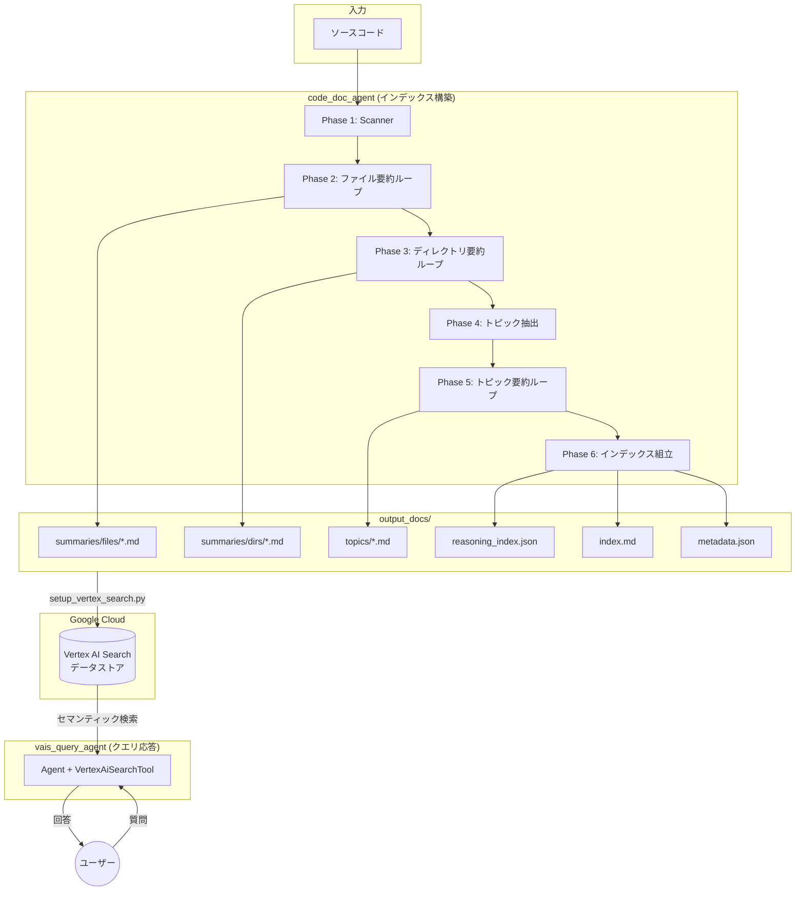

## パイプライン詳細 — `code_doc_agent`

SequentialAgentがルートエージェントとして、6つのフェーズを順番に実行します。各LoopAgentフェーズは、全対象の処理が完了するまでサブエージェントを繰り返し実行します。

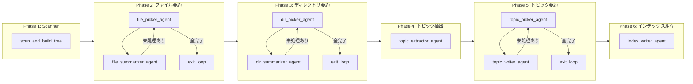

### Phase 1: Scanner — ディレクトリ走査

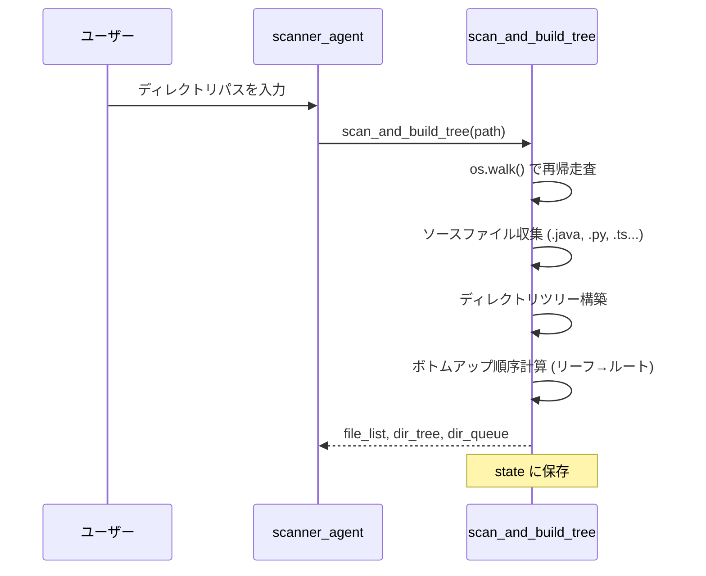

### Phase 2: ファイル要約 — LoopAgent

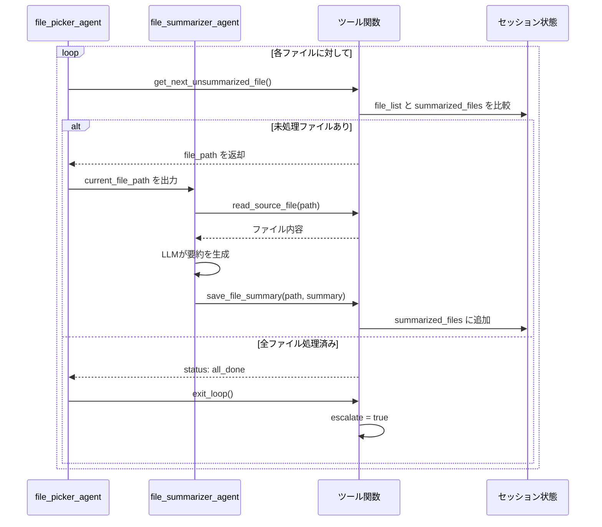

### Phase 3: ディレクトリ要約 — ボトムアップ処理

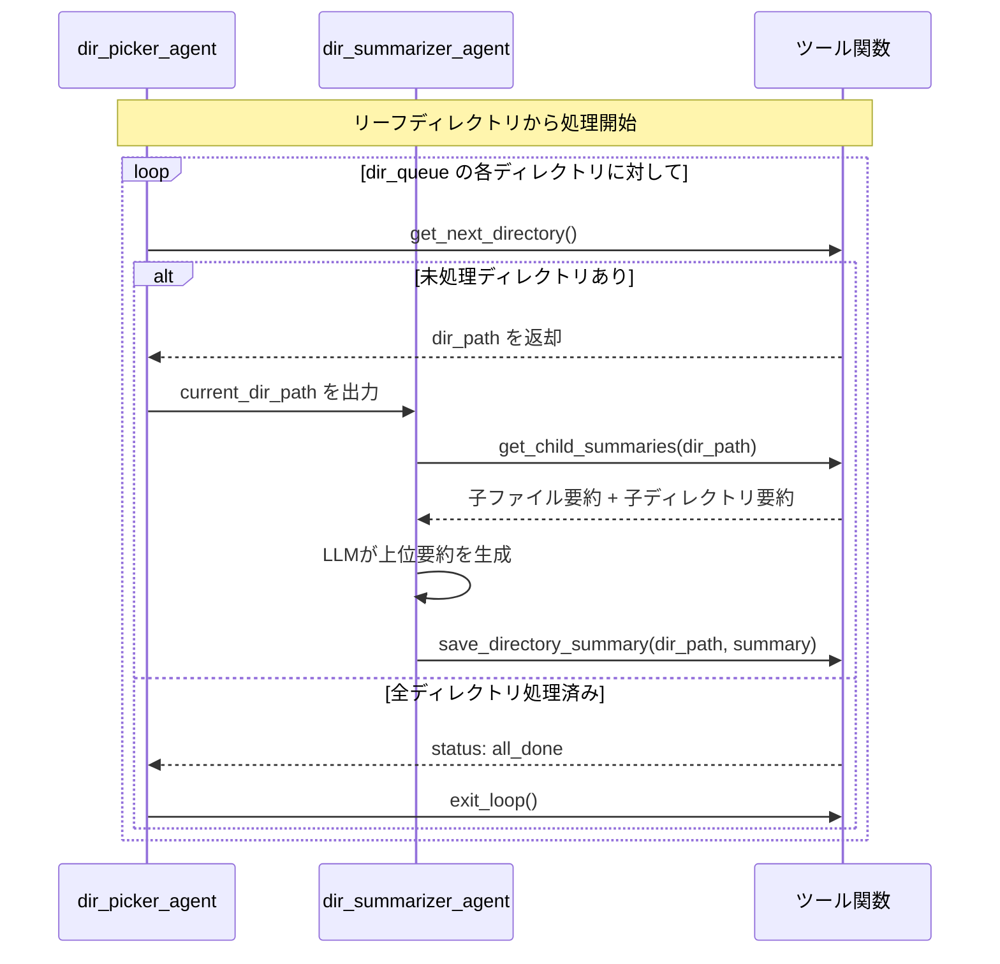

### Phase 4: トピック抽出

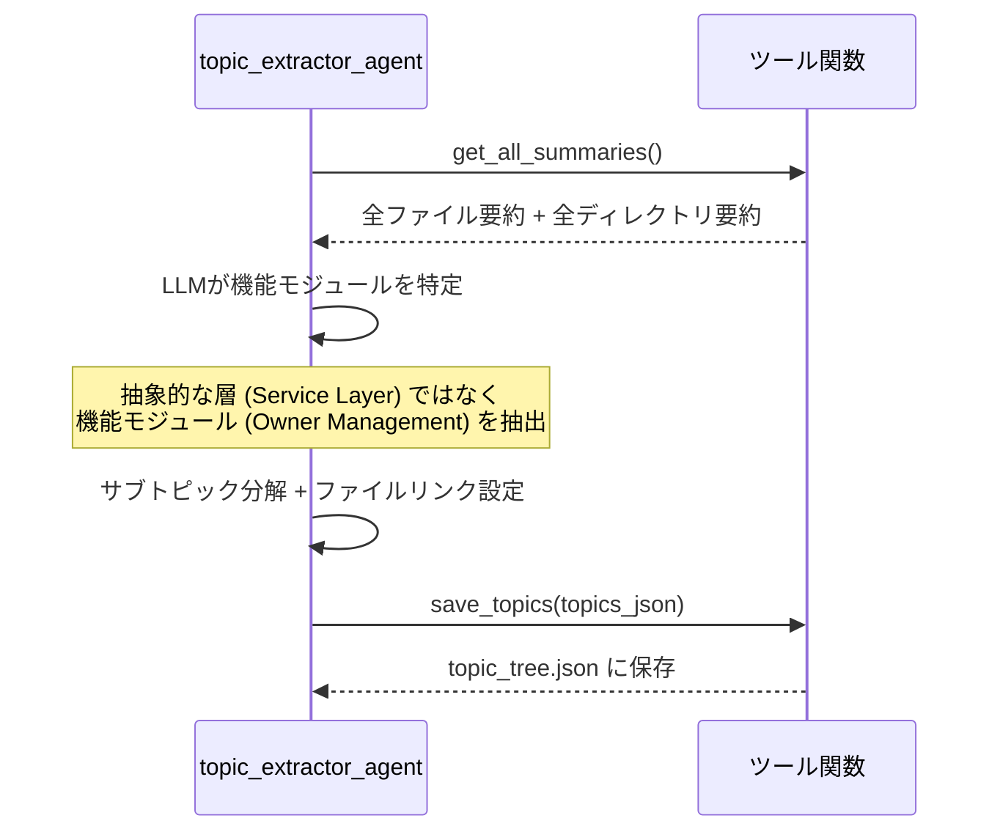

### Phase 5: トピック要約 — ドキュメント生成

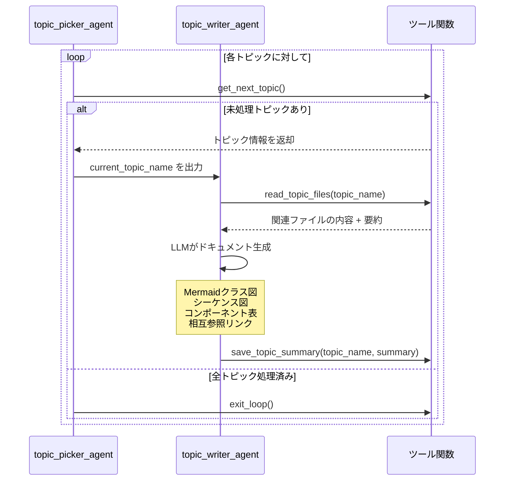

## 状態管理

ADKの`ToolContext.state`を通じて、エージェント間でデータを共有します。

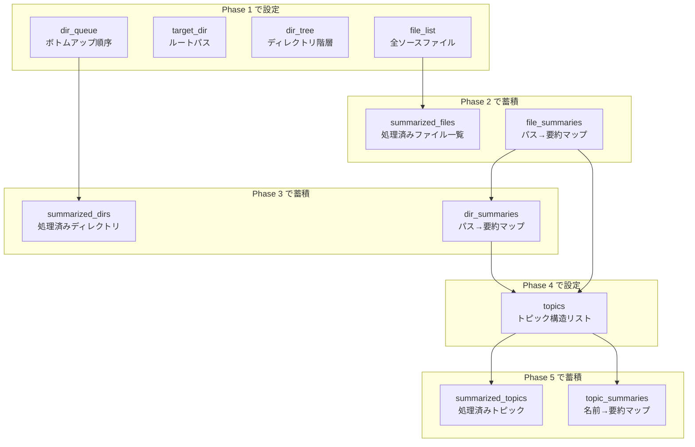

## ループ制御パターン

各LoopAgentは同じパターンで制御されます。

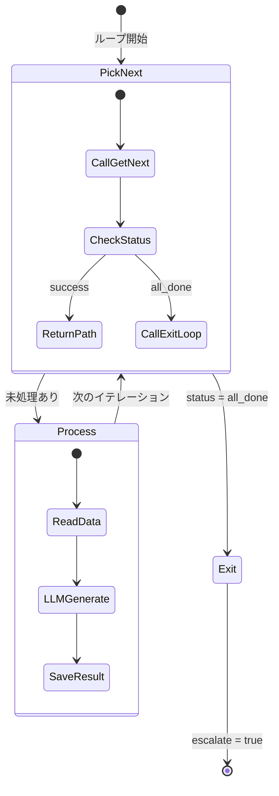

## 出力構造

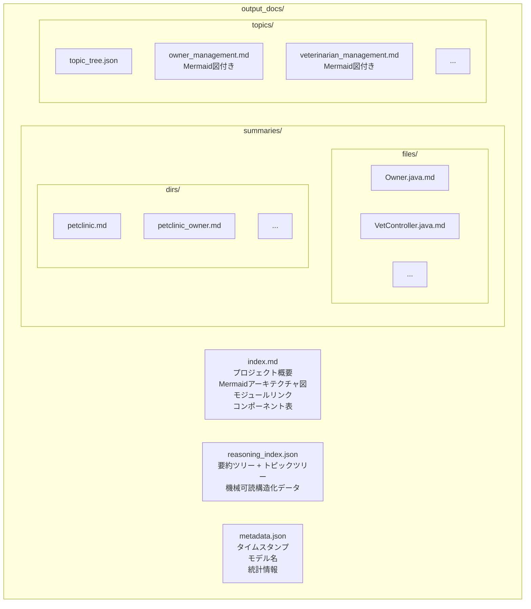

## クエリエージェント

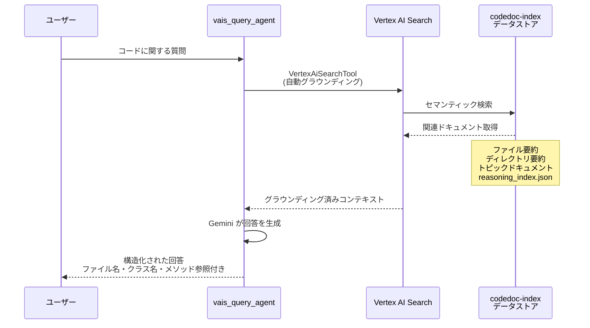

## データストアセットアップフロー

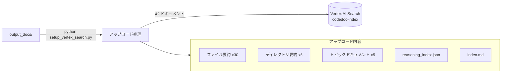

## エージェントクラス図

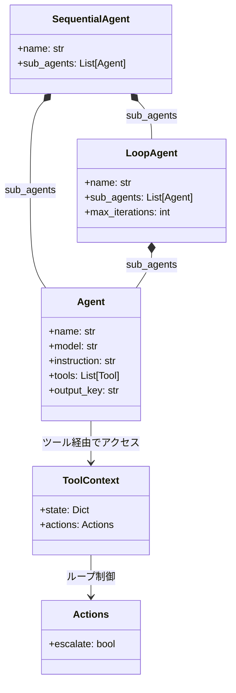

## 使用技術スタック

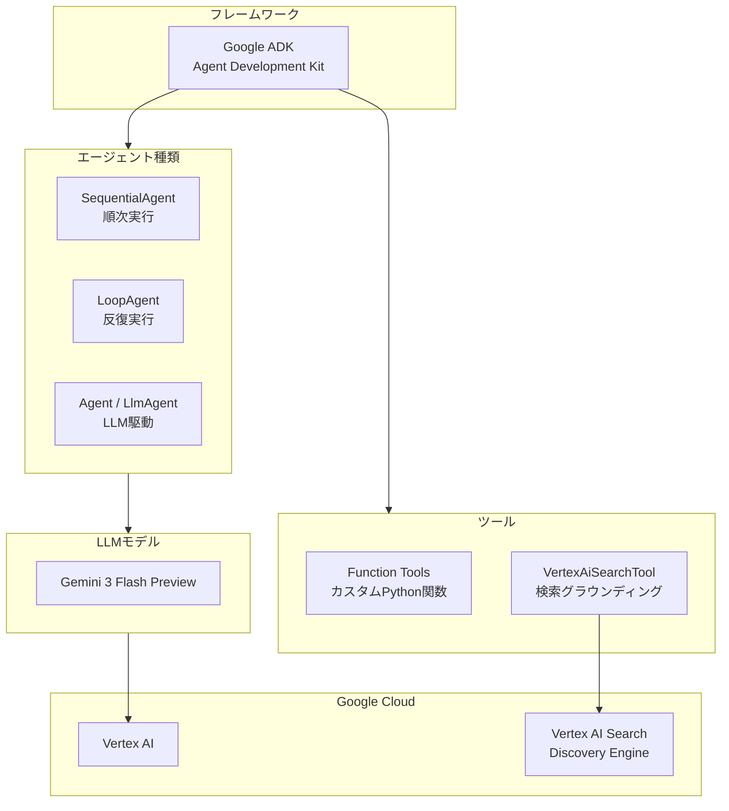

## ファイル構成

| パス | 役割 |
|-----|------|
| `legacy/code_doc_agent/__init__.py` | パッケージ初期化 |
| `legacy/code_doc_agent/agent.py` | 6フェーズパイプライン定義（13エージェント） |
| `legacy/code_doc_agent/tools.py` | 17個のツール関数（スキャン・要約・トピック・インデックス） |
| `legacy/code_doc_agent/.env` | Vertex AI認証情報 |
| `legacy/vais_query_agent/__init__.py` | パッケージ初期化 |
| `legacy/vais_query_agent/agent.py` | VertexAiSearchTool使用のクエリエージェント |
| `legacy/vais_query_agent/.env` | データストアID設定 |
| `legacy/setup_vertex_search.py` | データストア作成 + ドキュメントアップロードスクリプト |
| `requirements.txt` | `google-adk`, `google-cloud-discoveryengine` |

## 実行方法（legacy）

> 以下は **legacy** トラックの実行手順です。アーカイブされたコードを起動する手順は `legacy/README.md` に集約されているため、実行時はそちらを参照してください。

```bash
# 1. インデックス構築（旧 ADK パイプライン）
adk run legacy.code_doc_agent
# → ソースコードのパスを入力

# 2. Vertex AI Searchにアップロード
python legacy/setup_vertex_search.py

# 3. クエリ応答（旧 VAIS クエリエージェント）
adk run legacy.vais_query_agent
# → 質問を入力（日本語可）
```
