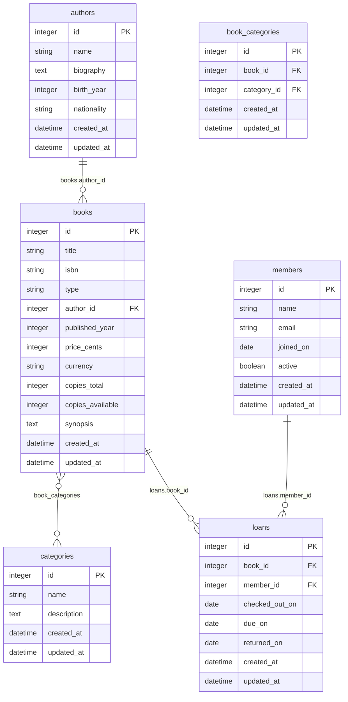

# データベーススキーマ

図書管理システムのためのデータベースです。書籍、著者、カテゴリ、会員、および貸出履歴の情報を管理し、効率的な図書の貸出・返却業務をサポートします。

## ER図

## テーブル一覧

| テーブル | 説明 |
|------|------|
| [authors](authors.md) | 書籍の著者の情報を管理するテーブルです。 |
| [books](books.md) | 管理対象の書籍情報を保持するテーブルです。単一テーブル継承（STI）用のカラムも含みます。 |
| [categories](categories.md) | 書籍のジャンルやカテゴリを管理するテーブルです。 |
| [book_categories](book_categories.md) | 書籍とカテゴリの多対多の関係を結ぶ中間テーブルです。 |
| [members](members.md) | 図書サービスの利用会員情報を管理するテーブルです。 |
| [loans](loans.md) | 会員への書籍の貸出履歴および現在の貸出ステータスを管理するテーブルです。 |
