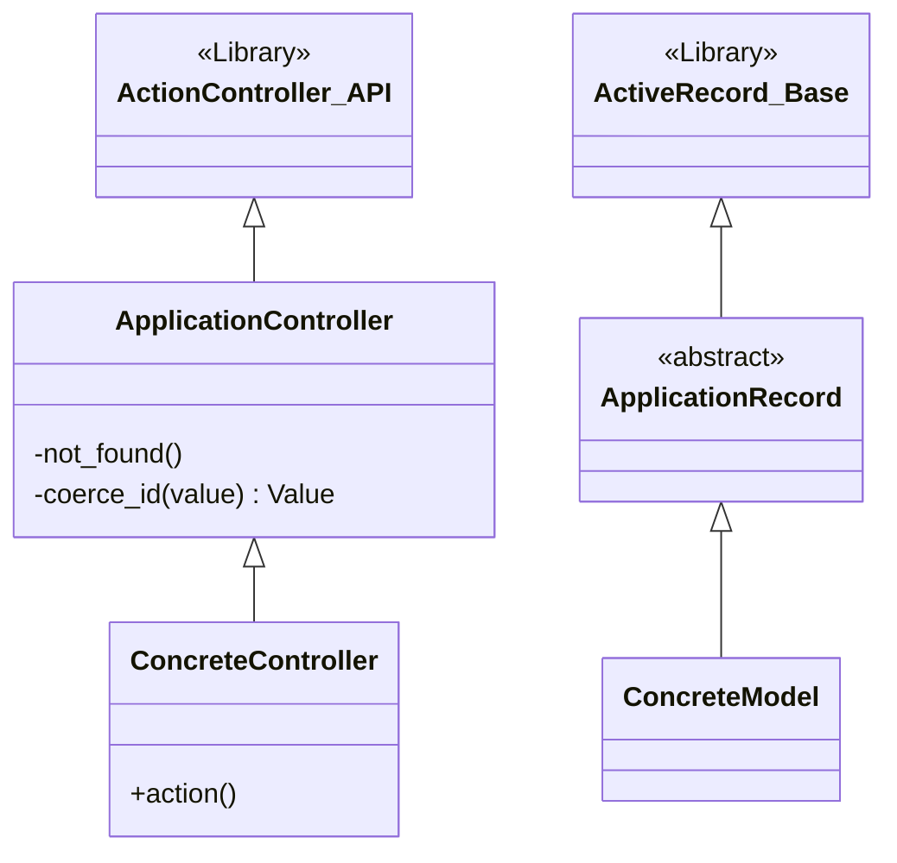
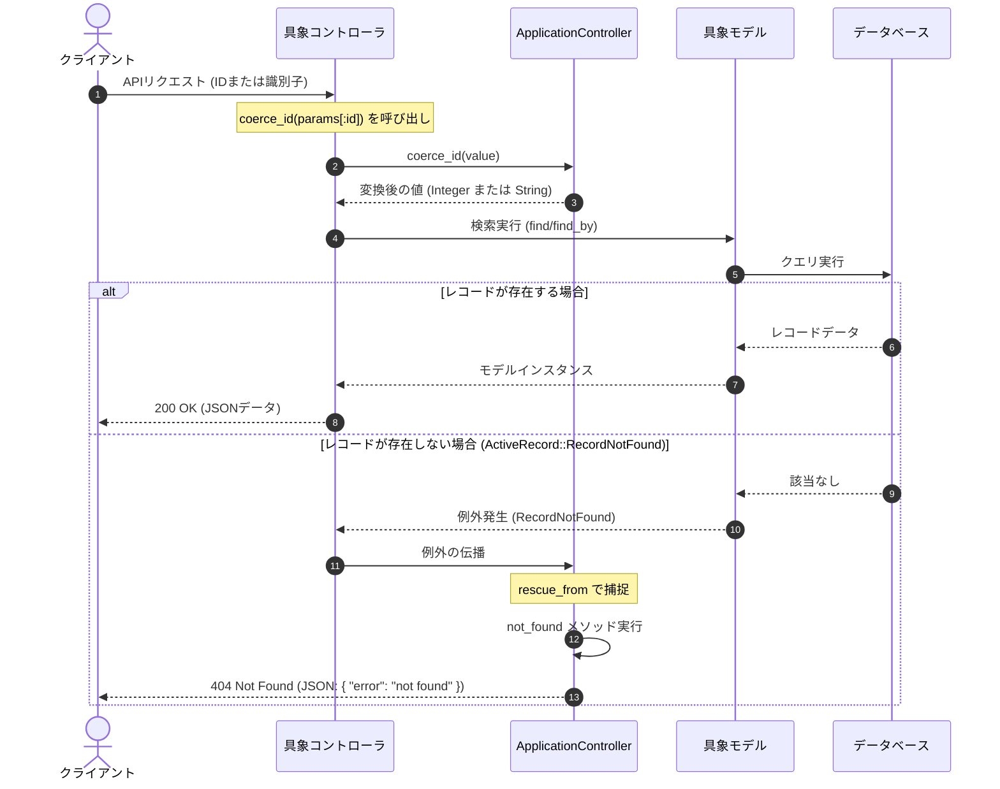

# アプリケーション共通基盤

## はじめに
「アプリケーション共通基盤」モジュールは、本Ruby on Rails API専用アプリケーションにおけるすべてのコントローラおよびデータベースモデルの基底クラスを提供する最下層の共通モジュールです。

本モジュールの主な役割は以下の通りです。
- **共通処理の一元化**: 例外ハンドリングやパラメータの型変換など、アプリケーション全体で横断的に必要となる処理を共通化し、DRY（Don't Repeat Yourself）原則を徹底します。
- **API専用設計の最適化**: 不要なミドルウェアを排除したAPI特化型のコントローラ基盤を提供します。
- **堅牢なデータアクセスの確立**: Active Recordパターンに基づき、データベース操作の共通設定や抽象化の基盤を提供します。

---

## アーキテクチャと設計
本モジュールは、オブジェクト指向設計における「継承」と、Rails標準のデザインパターンを組み合わせて設計されています。

- **Superclass Controller（ベースコントローラ）パターン**:
  `ApplicationController`がすべてのコントローラの親クラスとなり、共通の例外処理やヘルパーメソッドをカプセル化します。
- **Active Record パターン**:
  `ApplicationRecord`がデータベースアクセスとビジネスロジックを内包するモデルの共通基底となり、データソース層の抽象化を担います。
- **Template Method パターンのアプローチ**:
  基底クラスで共通の振る舞い（例：例外ハンドリングや型変換）を定義し、具体的な処理は継承先の具象クラス（各コントローラやモデル）に委ねる設計となっています。

### コンポーネント関係図

### モジュールコンポーネント

| コンポーネント | 責務 |
|-----------|----------------|
| **ApplicationController** | API専用コントローラの基底クラス。共通の例外ハンドリング（404エラーのJSON返却）や、パラメータの型変換ヘルパー（`coerce_id`）を提供します。 |
| **ApplicationRecord** | データベースモデルの基底クラス。`primary_abstract_class`として定義され、Active Recordパターンに基づく共通のデータベース接続設定やカスタムメソッドを子クラスに共有します。 |

---

## データフロー
以下は、クライアントからのリクエストが具象コントローラに到達し、モデルを介してデータベースからデータを取得する際の一連のデータフローです。特に、パラメータの型変換（`coerce_id`）と、レコード未検出時の例外ハンドリング（`not_found`）の流れを示しています。

---

## 主要コンポーネント

### ApplicationController
`ActionController::API`を継承した、API専用アプリケーションの全コントローラの親クラスです。セッション管理やHTMLレンダリングなど、通常のWebアプリケーション（MVC）で必要とされる不要な処理をバイパスし、軽量で高速なAPIレスポンスを実現します。

#### 主要メソッド
- **`not_found` (private)**
  - **概要**: `ActiveRecord::RecordNotFound`例外が発生した際に自動的に呼び出されるエラーハンドラです。
  - **振る舞い**: クライアントに対してステータスコード `404 Not Found` と、一貫したエラーフォーマットのJSON（`{ "error": "not found" }`）を返却します。これにより、各コントローラで個別に例外処理を記述する必要がなくなります。
- **`coerce_id(value)` (private)**
  - **概要**: パラメータとして渡された値のデータ型を動的に判定・変換するヘルパーメソッドです。
  - **振る舞い**: 
    - 引数 `value` が数値として解釈可能な場合は、`Integer` 型に変換して返します。
    - 数値として解釈できない場合（文字列や記号など）は、`ArgumentError` または `TypeError` を捕捉し、元の値（`String`）をそのまま返します。
  - **ユースケース**: モデル側（例：`Book.find_by_identifier`）で、渡された値が「データベースのサロゲートキー（ID）」なのか、「ISBNやタイトルなどの文字列」なのかをランタイム時に判別して検索ロジックを分岐させるために使用されます。

---

### ApplicationRecord
`ActiveRecord::Base`を継承した、アプリケーション内のすべてのデータベースモデルの共通基底クラスです。

#### 主要な設定
- **`primary_abstract_class`**
  - **概要**: このクラス自体がデータベーステーブルを持たない「主要な抽象クラス（Abstract Class）」であることをRailsに宣言します。
  - **効果**: 
    - Railsはこのクラスに対応するデータベーステーブルの探索を行いません。
    - マルチデータベース構成を採用する際、接続先データベースの切り替え設定などをこのクラスに集約し、すべての具象モデルに安全に継承させることができます。

---

## 依存関係

### 外部依存
- **Action Pack (ActionController::API)**: RailsのAPI専用コントローラ機能を提供します。
- **Active Record (ActiveRecord::Base)**: RailsのORM（Object-Relational Mapping）機能を提供します。

### 内部依存
- **具象コントローラ（例: `BooksController` など）**:
  すべて `ApplicationController` を継承して作成されます。これにより、共通の例外ハンドリングや `coerce_id` メソッドが自動的に利用可能になります。
- **具象モデル（例: `Book` など）**:
  すべて `ApplicationRecord` を継承して作成されます。これにより、Active Recordパターンに基づくデータベース操作機能が提供されます。