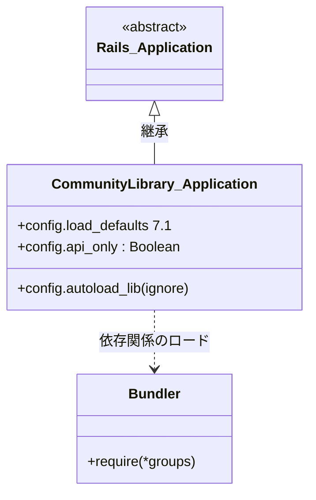
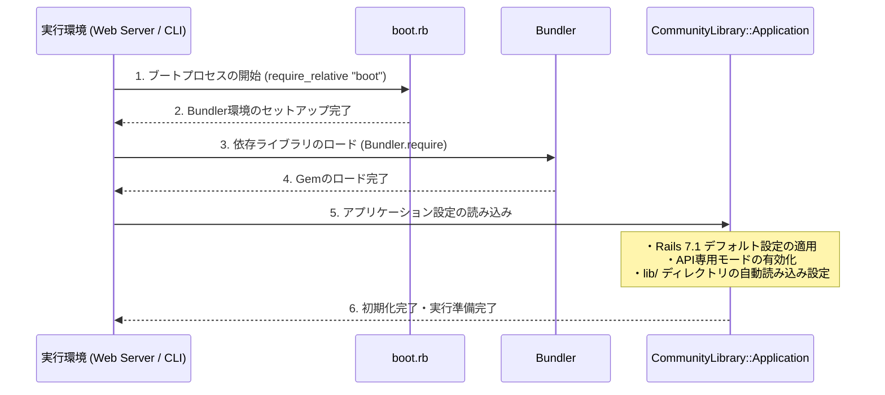

# アプリケーション設定管理

## はじめに
「アプリケーション設定管理」モジュールは、`CommunityLibrary` アプリケーションの起動、初期化、および全体的な動作仕様の定義を担う最重要のモジュールです。

本モジュールは、アプリケーションの起動プロセスにおいて最初に評価され、Railsフレームワークのロード、依存ライブラリ（Gem）の読み込み、およびアプリケーション固有のグローバル設定（API専用モードの有効化や自動読み込みパスの設定など）を適用します。これにより、システム全体が同一の前提条件と一貫した環境設定のもとで動作することを保証します。

---

## アーキテクチャと設計
本モジュールは、Ruby on Rails標準の初期化アーキテクチャに準拠しています。`Rails::Application` クラスを継承した `CommunityLibrary::Application` クラスを定義し、その中で宣言的に設定を記述する設計パターンを採用しています。

### コンポーネント関係図

### モジュールコンポーネント

| コンポーネント | 責務 |
|-----------|----------------|
| **`CommunityLibrary::Application`** | アプリケーション全体の初期化プロセスを制御し、Railsフレームワークおよびカスタムライブラリの動作設定（API専用モード、自動読み込みパスなど）を管理します。 |

---

## データフロー
アプリケーションの起動時（Webサーバーの起動、コンソール起動、タスク実行時など）における初期化のデータフローは以下の通りです。

---

## 主要コンポーネント

### `CommunityLibrary::Application` クラス
アプリケーションの設定と初期化プロセスをカプセル化するメインクラスです。`Rails::Application` を継承しており、以下の主要な設定を保持・実行します。

- **`config.load_defaults 7.1`**
  Rails 7.1で導入されたデフォルトの設定一式を適用します。これにより、フレームワークの最新のベストプラクティスと安全なデフォルト値が有効になります。
- **`config.api_only = true`**
  本アプリケーションをAPI専用として設定します。これにより、ブラウザ向けのビューテンプレートやアセットパイプライン、不要なミドルウェア（クッキーやセッション管理など）がバイパスされ、軽量で高速なJSONレスポンスに特化した動作が実現します。
- **`config.autoload_lib(ignore: %w[assets tasks])`**
  `lib/` ディレクトリ配下のコードをアプリケーションの自動読み込み（Autoload）対象として追加します。ただし、コード実行に直接関与しない `assets` および `tasks` サブディレクトリは自動読み込みの対象から除外（ignore）します。

---

## 依存関係
本モジュールは、以下の外部モジュールおよびライブラリに依存しています。

1. **`boot.rb` (内部ファイル依存)**
   - アプリケーションのGemfileに定義された環境をセットアップするために、事前に読み込まれる必要があります。
2. **`rails/all` (フレームワーク依存)**
   - Active Record、Action Controller、Active Supportなど、Railsを構成するすべての標準コンポーネントをロードします。
3. **`Bundler` (外部ライブラリ依存)**
   - 実行環境（`development`、`test`、`production`など）に応じた適切なGem（依存ライブラリ）を動的にロードするために使用されます。