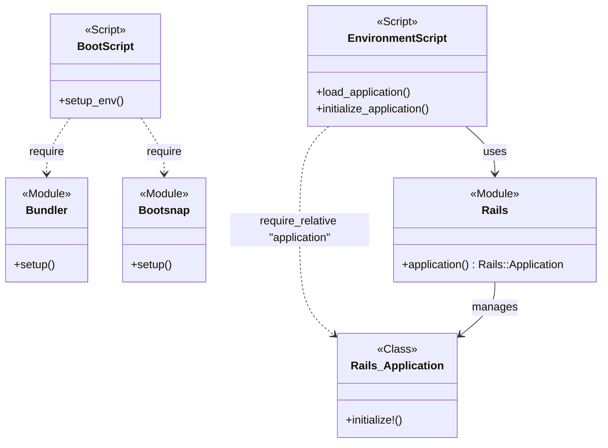
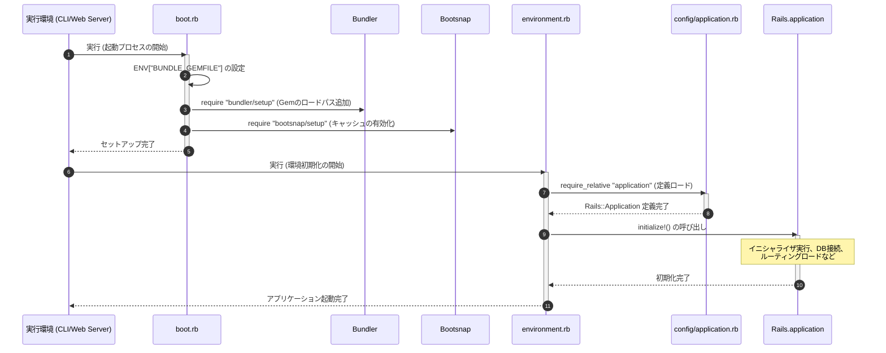

# アプリケーション起動・初期化基盤

## はじめに
「アプリケーション起動・初期化基盤」は、Ruby on Railsアプリケーションが起動する際の最上流に位置し、実行環境のセットアップからアプリケーション全体の初期化までをシームレスに制御するための基盤モジュールです。

本モジュールは、主に `boot.rb` と `environment.rb` の2つのスクリプトファイルで構成されています。これらは、Webサーバー（Pumaなど）やCLIタスク（Rake、Railsコンソールなど）からアプリケーションが呼び出された際に最初に実行され、依存ライブラリのロードパス設定、起動処理の高速化、そしてフレームワークおよび各種コンポーネントの初期化を段階的に実行する役割を担います。

---

## アーキテクチャと設計
本モジュールは、段階的なブートストラッププロセス（段階的初期化）を採用しており、環境の準備とアプリケーションの初期化という2つの明確に分離されたフェーズで設計されています。

1. **環境準備フェーズ (`boot.rb`)**:
   オブジェクト指向的なクラス定義は行わず、手続き的なスクリプトとして実行されます。環境変数の設定や、外部ライブラリ（Bundler, Bootsnap）のセットアップに特化し、高速かつ軽量に動作します。
2. **初期化フェーズ (`environment.rb`)**:
   Railsフレームワークの中核である `Rails.application`（`Rails::Application` のシングルトンインスタンス）を呼び出し、宣言的にアプリケーション全体の初期化プロセスをキックします。

### コンポーネント関係図

### モジュールコンポーネント

| コンポーネント | 責務 |
|-----------|----------------|
| **boot.rb** | 依存ライブラリ（Gem）のロードパス設定、およびBootsnapによる起動処理の高速化。 |
| **environment.rb** | `config/application.rb` の読み込み、および `Rails.application.initialize!` の実行によるアプリケーション全体の初期化。 |
| **Rails.application** | アプリケーションの設定、イニシャライザ、ルーティング、ミドルウェアなどを管理するシングルトンインスタンス。 |

---

## データフロー

アプリケーションが起動されてから、リクエストを受け付け可能になるまでのデータおよび制御のフローは以下の通りです。

---

## 主要コンポーネント

### boot.rb
アプリケーションの起動速度向上と、依存ライブラリのロードパス解決を行うブートストラップスクリプトです。

*   **`ENV["BUNDLE_GEMFILE"]` の設定**:
    プロジェクトのルートディレクトリにある `Gemfile` の絶対パスを環境変数に設定します。これにより、アプリケーションがどのディレクトリから実行されても、正しい依存関係が参照されるようになります。
*   **`bundler/setup` の要求**:
    Gemfileに定義された各種GemをRubyの `$LOAD_PATH` に追加します。これにより、不要なGemの混入を防ぎ、指定されたバージョンのライブラリのみが安全にロードされる状態を作ります。
*   **`bootsnap/setup` の要求**:
    Shopifyが開発した `bootsnap` ライブラリを有効化します。これにより、Rubyバイトコードのコンパイル結果や、`require` 対象ファイルの探索結果（Path Pre-scan）がキャッシュされ、2回目以降のアプリケーション起動プロセスが劇的に高速化されます。

### environment.rb
Railsアプリケーションの具体的な初期化処理を実行するエントリーポイントです。

*   **`require_relative "application"`**:
    同一ディレクトリ（通常は `config/`）に存在する `application.rb` を読み込みます。これにより、`Rails::Application` を継承したアプリケーション固有のクラス定義や、基本設定がメモリ上にロードされます。
*   **`Rails.application.initialize!`**:
    Railsアプリケーションの初期化プロセスをトリガーします。このメソッドの呼び出しにより、以下の処理が順次実行されます。
    1.  `config/initializers/` 配下のスクリプトの実行
    2.  データベース接続（Active Record）の確立
    3.  ルーティング（`config/routes.rb`）のロード
    4.  ロガーの初期化
    5.  各種フレームワークコンポーネント（Action Controller, Action Viewなど）のセットアップ

---

## 依存関係

本モジュールは、アプリケーション全体の起動を司るため、以下の外部ライブラリおよび内部モジュールに依存しています。

### 1. 外部依存関係 (External Dependencies)
*   **Bundler (Gem)**:
    アプリケーションが依存するGemパッケージの管理およびロードパスの制御に使用します。
*   **Bootsnap (Gem)**:
    起動処理におけるI/Oオーバーヘッドおよびコンパイル時間を削減するためのキャッシュ機構として使用します。
*   **Ruby on Rails (Framework)**:
    `Rails` モジュールおよび `Rails::Application` クラスを提供し、初期化ライフサイクルを管理します。

### 2. 内部依存関係 (Internal Dependencies)
*   **`config/application.rb`**:
    `environment.rb` から読み込まれ、アプリケーションのクラス定義と基本設定を提供します。
*   **`Gemfile`**:
    `boot.rb` において、ロードすべきライブラリ群を定義するソースとして依存します。