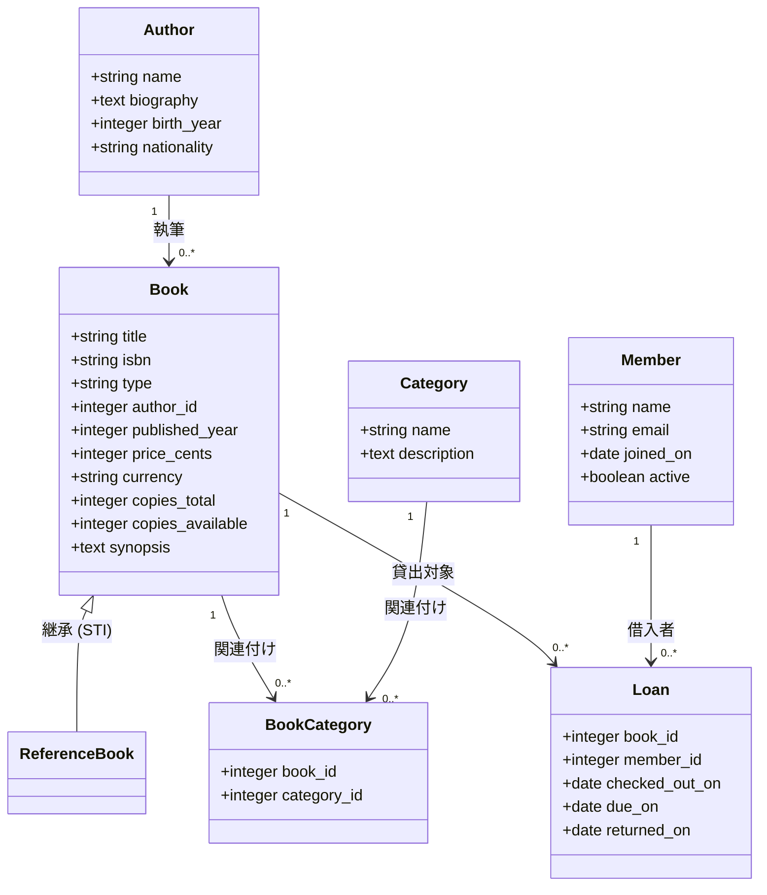
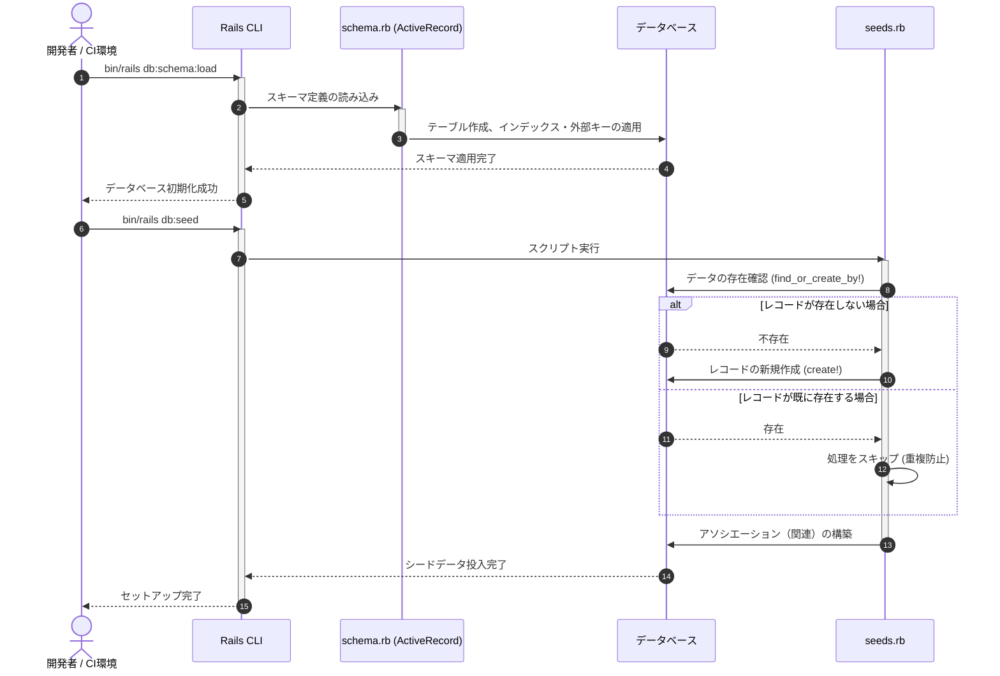
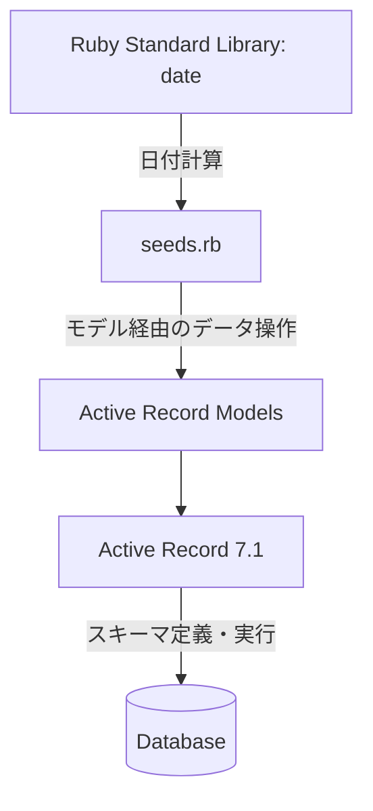

# データベース初期化・シードデータ管理

## はじめに
本モジュールは、アプリケーションにおけるデータベース構造（スキーマ）の定義と、開発・テスト環境の構築に必要な初期データ（シードデータ）の投入を管理する役割を担います。

Ruby on RailsのActive Recordパターンに基づき、以下の2つの主要な役割を果たします。
1. **スキーマ管理 (`schema.rb`)**: データベースの最新状態をコードとして表現し、新規環境への高速かつ正確なデータベース再構築（`bin/rails db:schema:load`）を可能にします。
2. **シードデータ管理 (`seeds.rb`)**: 開発者やCI（継続的インテグレーション）環境向けに、実際のユースケースを模した整合性のある最小限のテストデータを安全に提供します。

---

## アーキテクチャと設計
本モジュールは、Railsの標準的なデータベースマイグレーションおよび初期化プラクティスに準拠して設計されています。

### 設計の特徴
* **スキーマ駆動**: マイグレーション履歴を直接順次実行するのではなく、集約された `schema.rb` から一括でテーブルをロードすることで、環境構築時間を短縮し、マイグレーションファイルの不整合によるエラーを防ぎます。
* **単一テーブル継承 (STI: Single Table Inheritance)**: `books` テーブルに `type` カラムを設け、一般書籍（`Book`）と参考図書（`ReferenceBook`）を同一テーブルで管理する設計を採用しています。
* **冪等性（Idempotency）の担保**: `seeds.rb` 内では `find_or_create_by!` メソッドを多用しています。これにより、スクリプトを複数回実行してもデータが重複登録されず、常に同一のクリーンな状態が維持されます。

### コンポーネント関係図

### モジュールコンポーネント

| コンポーネント | 責務 |
|-----------|----------------|
| **schema.rb** | データベースの物理構造（テーブル、インデックス、外部キー制約、データ型）を定義する。 |
| **seeds.rb** | 開発・テスト環境向けに、リレーションシップが維持された整合性のある初期データを冪等に投入する。 |

---

## データフロー

以下のシーケンス図は、開発者が環境構築を行う際のデータベース初期化およびシードデータ投入のプロセスを示しています。

---

## 主要コンポーネント

### 1. データベーススキーマ (`schema.rb`)
`ActiveRecord::Schema[7.1]` を使用して定義されており、以下のテーブル構造を管理します。

#### 主要なテーブル定義
* **authors**: 著者の基本情報を保持します。`name` カラムにはインデックスが設定されています。
* **books**: 書籍情報を保持します。
  * `type` カラムによるSTI（単一テーブル継承）をサポート。
  * `isbn` は一意制約（Unique Index）を持ちます。
  * `price_cents` と `currency` による簡易的な通貨管理に対応。
* **categories**: 書籍のカテゴリ（ジャンル）を保持します。`name` はユニークです。
* **book_categories**: `books` と `categories` を結びつける中間テーブルです。同一の書籍とカテゴリの組み合わせが重複しないよう、複合ユニークインデックスが設定されています。
* **members**: 図書館の会員情報を保持します。`email` はユニークです。
* **loans**: 書籍の貸出履歴を保持します。
  * `checked_out_on`（貸出日）、`due_on`（返却期限）、`returned_on`（返却日）を管理します。
  * `member_id` と `returned_on` に対する複合インデックスにより、未返却書籍の検索を高速化しています。

---

### 2. シードデータスクリプト (`seeds.rb`)
実際のアプリケーションの動作をシミュレートするための最小限のデータを生成します。

#### 投入されるデータセット
1. **カテゴリ**: `Fiction`（フィクション）および `Reference`（参考図書）の作成。
2. **著者**: `Ursula K. Le Guin` の作成。
3. **一般書籍**: 『*The Left Hand of Darkness*』（SF小説）を作成し、`Fiction` カテゴリに関連付け。
4. **参考図書**: `ReferenceBook` モデル（STI）を使用して『*The Concise Oxford Dictionary*』を作成。
5. **会員**: `Alice Reader` を作成。
6. **貸出履歴**: 会員 `Alice` が書籍『*The Left Hand of Darkness*』を借りている状態（未返却: `returned_on: nil`）を再現。返却期限（`due_on`）は貸出日から21日後として動的に計算。

---

## 依存関係

本モジュールは以下のコンポーネントおよび外部ライブラリに依存しています。

1. **Active Record (Ruby on Rails 7.1)**
   * データベーススキーマのDSL（Domain Specific Language）の提供。
   * データベースへの接続、テーブル作成、インデックス適用の実行。
   * シードデータ投入時におけるORM（Object-Relational Mapping）機能の提供。
2. **データベースアダプタ (SQLite / PostgreSQL / MySQL など)**
   * `schema.rb` の定義を、接続先データベースの固有のSQLDDLに変換して実行します。
3. **Ruby 標準ライブラリ (`date`)**
   * `seeds.rb` における貸出日（`checked_out_on`）および返却期限（`due_on`）の動的な日付計算に使用されます。