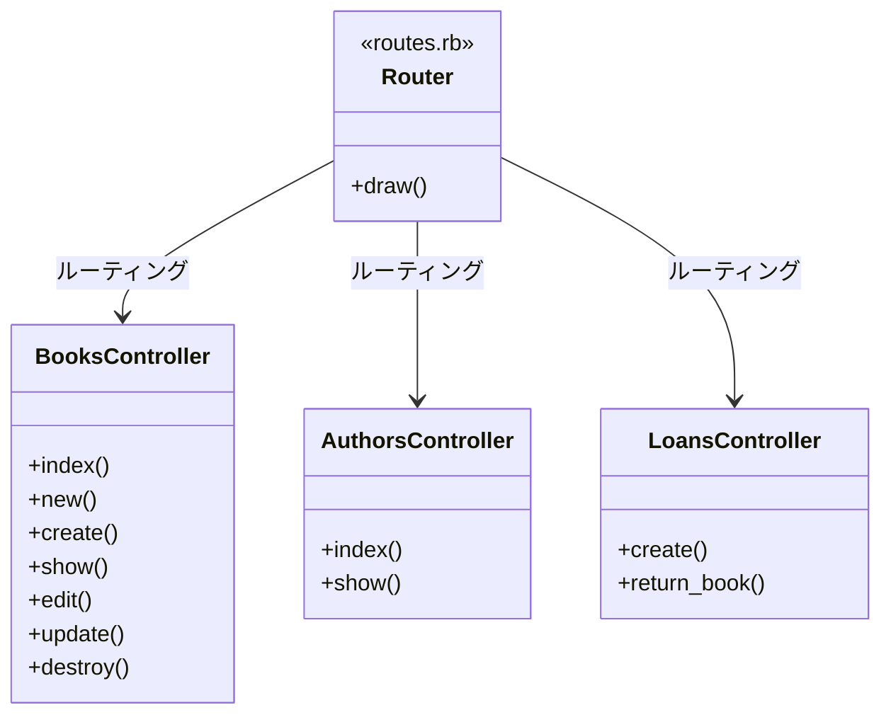
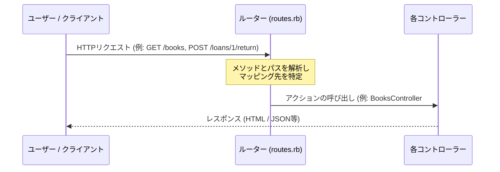

# リクエストルーティング制御

## はじめに
「リクエストルーティング制御」モジュールは、Ruby on RailsアプリケーションにおけるWebリクエストの入り口として機能します。本モジュールの主な役割は、クライアント（ブラウザやAPIクライアント）から送信されたHTTPリクエスト（HTTPメソッドとURLパスの組み合わせ）を解析し、アプリケーション内の適切なコントローラーおよびアクションへとマッピング（ルーティング）することです。

MVC（Model-View-Controller）アーキテクチャにおいて、本モジュールは外部からのリクエストをコントローラー（C）へと橋渡しする重要な制御層として位置づけられています。

## アーキテクチャと設計
本モジュールは、Webアプリケーションの標準的な設計パターンである**REST（Representational State Transfer）**パターンを採用しています。リソース（書籍、著者、貸出）を中心にURLを設計し、HTTPメソッド（GET、POST、PUT/PATCH、DELETE）を用いてリソースに対する操作を表現します。

Railsの「設定より規約（Convention over Configuration）」に基づき、最小限の記述で堅牢かつ直感的なURL設計を実現しています。

### コンポーネント関係図

### モジュールコンポーネント

| コンポーネント | 責務 |
|-----------|----------------|
| **Router (routes.rb)** | HTTPリクエストを解析し、定義されたルールに基づいて適切なコントローラーアクションへディスパッチする。 |
| **BooksController** | 書籍（Books）リソースに対するすべてのCRUD操作（作成、読み取り、更新、削除）を制御する。 |
| **AuthorsController** | 著者（Authors）リソースの一覧表示および詳細表示のみを制御する（作成・更新・削除は制限）。 |
| **LoansController** | 貸出（Loans）リソースの新規作成、および特定の貸出に対する返却処理（`return_book`）を制御する。 |

## データフロー

クライアントからリクエストが送信され、ルーターを介して各コントローラーのアクションが実行されるまでのフローは以下の通りです。

## 主要コンポーネント

### 1. ルーティング定義 (`routes.rb`)
アプリケーション全体のルーティングエントリーポイントです。以下のリソース制御を定義しています。

*   **ルートパス (`root`)**:
    *   アプリケーションのルートURL（`/`）へのアクセスを `BooksController` の `index` アクション（書籍一覧）にマッピングします。
*   **Booksリソース (`books`)**:
    *   フルCRUD（Create, Read, Update, Delete）に対応する7つの標準ルーティングを自動生成します。
*   **Authorsリソース (`authors`)**:
    *   `only: %i[index show]` オプションにより、一覧表示（`index`）と詳細表示（`show`）のみにルーティングを制限し、不要なエンドポイントを排除して安全性を高めています。
*   **Loansリソース (`loans`)**:
    *   新規貸出作成（`create`）のみを許可します。
    *   **メンバーアクション (`member`)**: 特定の貸出リソース（ID指定）に対して、返却処理を行うためのカスタムルート `POST /loans/:id/return` を定義し、`LoansController` の `return_book` アクションにマッピングします。

## 依存関係

本モジュールは以下のコンポーネントおよびフレームワークに依存しています。

1.  **Action Dispatch（Ruby on Railsフレームワーク）**:
    *   Railsが提供するルーティングエンジンであり、`routes.rb` のDSL（ドメイン固有言語）を解釈・実行します。
2.  **コントローラー群 (`BooksController`, `AuthorsController`, `LoansController`)**:
    *   ルーターがリクエストを転送する先となるクラス群です。これらのコントローラーおよび対応するアクションメソッドが正しく定義されている必要があります。存在しないアクションへのマッピングは、実行時に `AbstractController::ActionNotFound` エラーを発生させます。