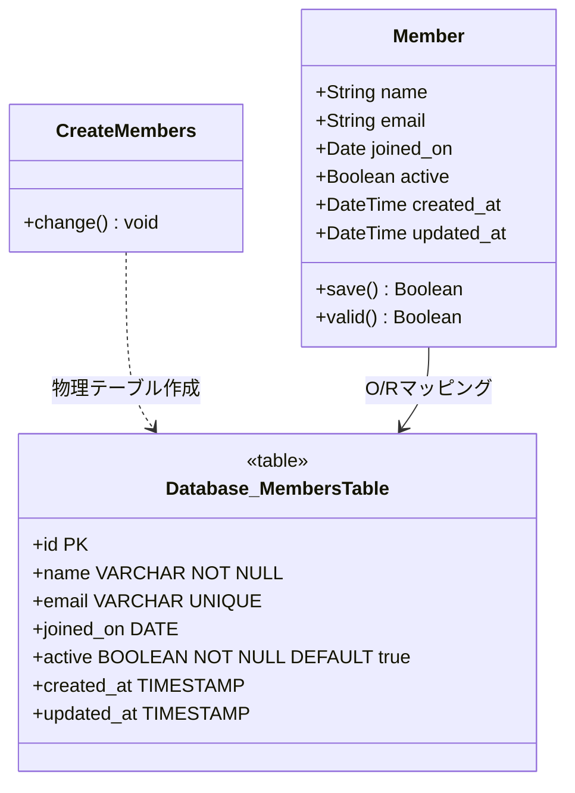

# 会員管理

## はじめに
「会員管理」モジュールは、アプリケーションにおける会員（メンバー）のライフサイクルおよび基本情報を一元管理するための基盤機能です。
本モジュールは、会員の新規登録、プロファイル情報の更新、入会日の記録、およびアカウントの有効/無効状態の管理を担います。システム内の他モジュール（認証、決済、通知など）が会員情報にアクセスする際の共通のデータソースとして位置づけられており、データの整合性と一意性を保証する重要な役割を持っています。

---

## アーキテクチャと設計
本モジュールは、Ruby on Railsが採用している **MVC（Model-View-Controller）パターン** および **ActiveRecordパターン** に基づいて設計されています。

データベースの物理構造を定義するマイグレーションクラスと、ビジネスロジックやバリデーションを内包するモデルクラス（`Member`）が対になって機能します。データベースレベルでの制約（`NOT NULL` や `UNIQUE` インデックス）と、アプリケーションレベルでの制御を組み合わせることで、堅牢なデータ整合性を実現しています。

### コンポーネント関係図


### モジュールコンポーネント
| コンポーネント | 責務 |
|-----------|----------------|
| **CreateMembers** | `members` テーブルのスキーマ定義およびデータベースへの適用（マイグレーション）。インデックスの作成。 |
| **Member** | 会員データを表すActiveRecordモデル。ビジネスロジックの実行、バリデーション（属性の検証）、データベースとのCRUD操作の仲介。 |

---

## データフロー
以下は、管理者またはユーザーが会員情報を登録・更新する際、およびシステムが会員の有効状態を検証する際の基本的なデータフローです。

```mermaid
sequenceDiagram
    participant Client as 利用者 / コントローラ
    participant MemberModel as Member (モデル)
    participant DB as データベース (membersテーブル)

    %% 会員登録フロー
    Note over Client, DB: 会員登録フロー
    Client->>MemberModel: 新規作成要求 (name, email, etc.)
    Active sourceline: 19
    MemberModel->>MemberModel: バリデーション実行 (nameの存在、emailの重複チェック)
    alt バリデーション成功
        MemberModel->>DB: INSERTクエリ実行
        DB-->>MemberModel: 登録成功 (IDとタイムスタンプの払い出し)
        MemberModel-->>Client: 登録完了通知 (Memberオブジェクト)
    else バリデーション失敗
        MemberModel-->>Client: エラー情報返却 (保存失敗)
    end

    %% 状態参照フロー
    Note over Client, DB: 会員状態参照フロー
    Client->>MemberModel: 会員状態確認 (active?)
    MemberModel->>DB: SELECTクエリ実行 (ID指定)
    DB-->>MemberModel: レコード返却
    MemberModel-->>Client: 有効フラグ (true/false) を返却
```

---

## 主要コンポーネント

### 1. CreateMembers (マイグレーションクラス)
データベースに `members` テーブルを構築するためのクラスです。`ActiveRecord::Migration[7.1]` を継承しており、スキーマのバージョン管理を行います。

*   **スキーマ定義詳細**:
    *   `name` (文字列): 必須項目 (`null: false`)。会員の氏名または表示名を格納。
    *   `email` (文字列): 会員のメールアドレス。一意性制約（ユニークインデックス）が付与され、重複登録を防止。
    *   `joined_on` (日付): 会員がシステムに入会した日付。
    *   `active` (真偽値): アカウントの有効/無効状態。デフォルトは `true` (有効)、必須項目 (`null: false`)。
    *   `timestamps`: 作成日時 (`created_at`) と更新日時 (`updated_at`) を自動管理。

### 2. Member (モデルクラス)
※本マイグレーションに対応するActiveRecordモデルクラスです。
データベースの `members` テーブルと1対1でマッピングされ、以下のような役割を持ちます。
*   **バリデーション（推奨定義）**:
    *   `name` の必須チェック (`presence: true`)
    *   `email` のフォーマットチェックおよび一意性チェック (`uniqueness: true`)
*   **スコープ**:
    *   有効な会員のみを抽出するクエリ（例: `scope :active, -> { where(active: true) }`）の提供。

---

## 依存関係

本モジュールは以下の外部ライブラリおよびフレームワークに依存しています。

1.  **ActiveRecord (Ruby on Rails 7.1以上)**:
    *   データベースとの接続、O/Rマッピング、マイグレーション機能を提供します。
2.  **データベース管理システム (RDBMS)**:
    *   PostgreSQL、MySQL、SQLiteなどのリレーショナルデータベース。
    *   メールアドレスの一意性を物理レベルで保証するため、データベース側のユニークインデックス機能に依存しています。