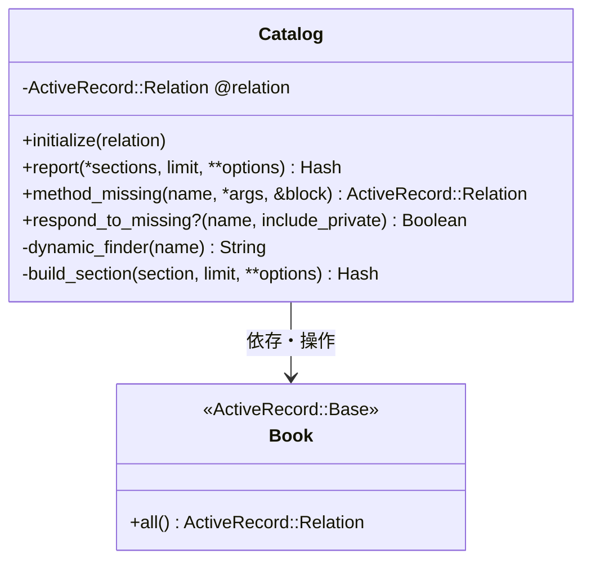
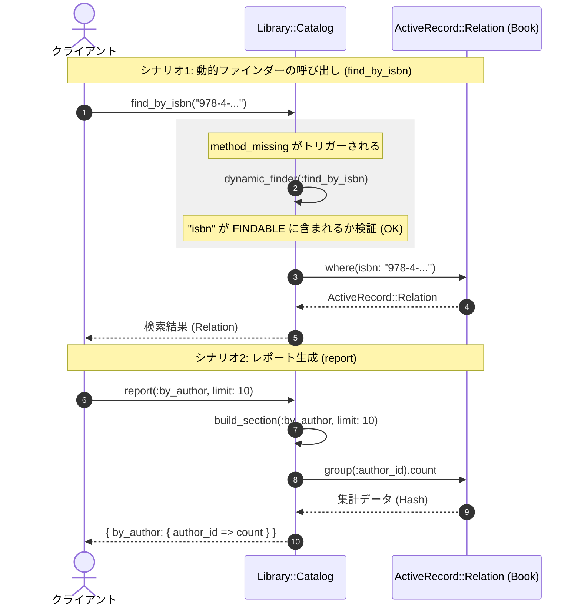

# 動的クエリインターフェース

## はじめに
「動的クエリインターフェース」モジュールは、書籍カタログに対する複雑なデータベースクエリをカプセル化し、簡潔で直感的なAPIを提供する役割を担います。

本モジュールは、アプリケーションにおいてデータベース（ActiveRecordなど）とクライアントコード（コントローラ、サービス、ビューなど）の間に位置する**ファサード（Facade）レイヤー**として機能します。これにより、クライアント側はデータベースの具体的なテーブル構造やクエリの組み立て方を意識することなく、直感的なメソッド呼び出しのみで必要なデータの取得や集計レポートの作成を行うことができます。

---

## アーキテクチャと設計
本モジュールは、コードの柔軟性と保守性を高めるために以下の設計パターンおよび手法を採用しています。

1. **Facade（ファサード）パターン**
   データベースの複雑なリレーション操作（`where`、`group`、`limit`、`count` など）を `Library::Catalog` クラスの背後に隠蔽し、シンプルなインターフェースを提供します。
2. **動的メソッド合成（メタプログラミング）**
   Rubyの `method_missing` および `respond_to_missing?` を利用し、許可された属性（`title`, `isbn`, `author_id`）に対する検索メソッド（`find_by_<属性名>`）を動的に生成します。これにより、ボイラープレートコード（定型的なコード）を大幅に削減しています。
3. **可変長引数とキーワード引数によるオーバーロード**
   `report` メソッドは、引数の数や種類に応じて柔軟に挙動を変える設計（Variadic & Keyword Overload）になっており、単一のメソッドで多様なレポート要求に対応します。

### コンポーネント関係図



### モジュールコンポーネント

| コンポーネント | 責務 |
|-----------|----------------|
| **`Library::Catalog`** | 書籍カタログに対するクエリ操作をカプセル化し、動的ファインダー（検索）や集計レポート生成機能を提供します。 |

---

## データフロー

以下は、クライアントから `Library::Catalog` に対して「動的ファインダーの呼び出し」および「レポート生成」が行われた際のデータフローを示すシーケンス図です。



---

## 主要コンポーネント

### `Library::Catalog` クラス

書籍データの検索および集計処理を管理する主要クラスです。

#### 定数
* **`FINDABLE`** (`Array`): 動的検索が許可されている属性のホワイトリスト。デフォルトは `['title', 'isbn', 'author_id']` です。

#### パブリックメソッド

* **`initialize(relation = Book.all)`**
  * **概要**: クラスの初期化を行います。
  * **引数**:
    * `relation` (`ActiveRecord::Relation`): クエリの対象となるデータソース。デフォルトは `Book.all`。
  * **詳細**: 依存関係の注入（DI）をサポートしており、テスト時などにモックや特定のスコープに絞ったRelationを渡すことが可能です。

* **`report(*sections, limit: 25, **options)`**
  * **概要**: 指定されたセクション（集計軸）に基づいて、書籍データの集計レポートを生成します。
  * **引数**:
    * `*sections` (`Array<Symbol>`): 集計したいセクション（`:by_author`, `:by_year`）。未指定の場合は両方が出力されます。
    * `limit` (`Integer`): 取得するレコード数の上限（デフォルト: `25`）。
    * `**options`: その他の拡張オプション。
  * **戻り値**: `Hash`（セクション名をキー、集計結果を値とするハッシュ）。
  * **使用例**:
    ```ruby
    catalog = Library::Catalog.new
    # 著者別・出版年別の両方をデフォルト制限数で取得
    catalog.report 
    
    # 著者別のみ、制限数10で取得
    catalog.report(:by_author, limit: 10)
    ```

* **`method_missing(name, *args, &block)`**
  * **概要**: 定義されていないメソッドが呼び出された際、それが `find_by_<属性名>` のパターンに合致していれば動的に検索クエリを実行します。
  * **詳細**: 属性名が `FINDABLE` 定数に含まれている場合のみ、`@relation.where(attribute => args.first)` を実行します。合致しない場合は `super` を呼び出し、通常の `NoMethodError` を発生させます。

* **`respond_to_missing?(name, include_private = false)`**
  * **概要**: `method_missing` で動的に処理されるメソッドに対して、`respond_to?` が正しく `true` を返すようにします。
  * **詳細**: ダックタイピングを行う呼び出し元に対して、オブジェクトが正しく振る舞うことを保証します。

#### プライベートメソッド

* **`dynamic_finder(name)`**
  * **概要**: メソッド名が動的ファインダーの命名規則（`find_by_<属性名>`）に適合し、かつ `FINDABLE` に含まれているかを検証します。
  * **戻り値**: 適合した場合は属性名（`String`）、適合しない場合は `nil`。

* **`build_section(section, limit:, **_options)`**
  * **概要**: 指定されたセクションに応じた具体的な集計クエリ（ActiveRecordクエリ）を実行します。
  * **対応セクション**:
    * `:by_author`: 著者ID（`author_id`）ごとの書籍数を集計。
    * `:by_year`: 出版年（`published_year`）ごとの書籍数を集計（`limit` が適用されます）。

---

## 依存関係

本モジュールは以下の外部コンポーネントおよびライブラリに依存しています。

1. **`Book` モデル (ActiveRecord::Base)**
   * デフォルトのデータソースとして `Book.all` を使用します。
   * `Book` モデルは、`title`、`isbn`、`author_id`、`published_year` などのカラム/属性を持っている必要があります。
2. **ActiveRecord (または互換性のあるORM)**
   * `@relation` に対する `where`、`group`、`limit`、`count` などのクエリメソッドチェーンに依存しています。
3. **Ruby メタプログラミング機構**
   * 動的メソッド解決のために、Ruby標準の `method_missing` および `respond_to_missing?` の仕組みに依存しています。