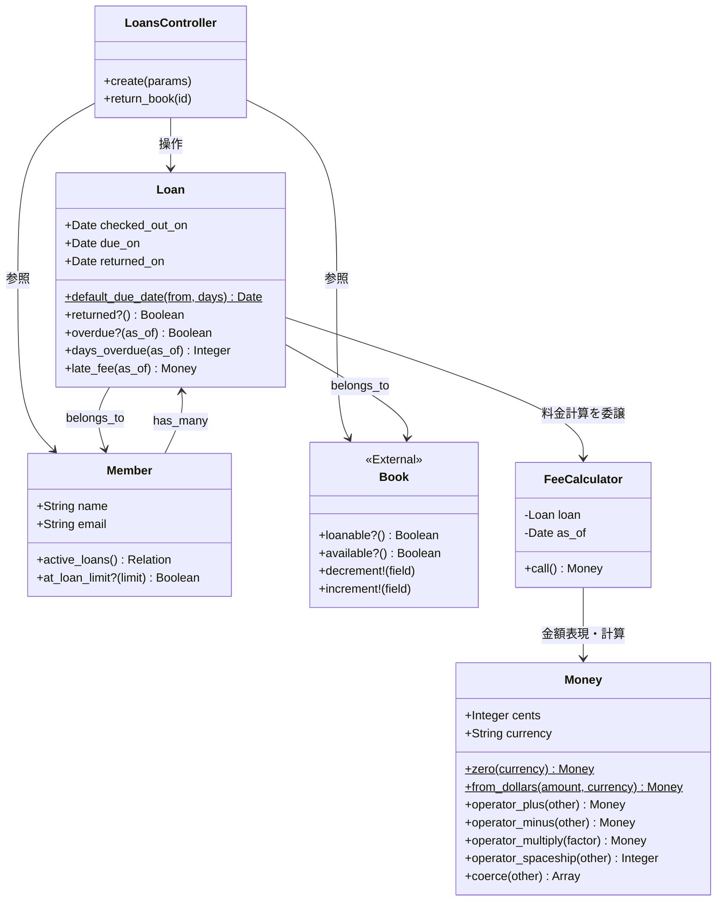
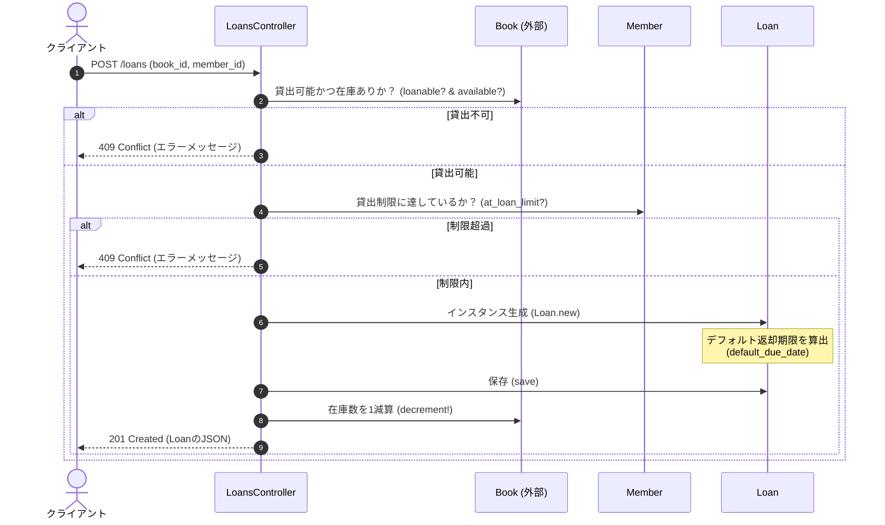
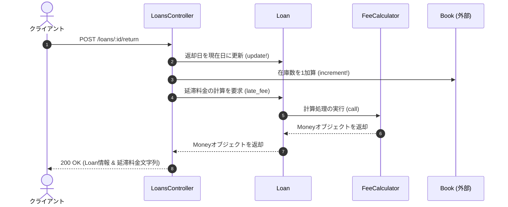

# 図書貸出・返却・料金管理 モジュール仕様書

## はじめに

本モジュールは、図書館管理システム等における**図書の貸出（チェックアウト）**、**返却**、および**延滞料金（遅延損害金）の計算・管理**を統合的に行うためのバックエンドモジュールです。

アプリケーション内では、利用者の貸出制限チェックや書籍の在庫管理といったビジネスルールを厳密に適用し、貸出から返却、そして延滞時の料金徴収までの一連のライフサイクルを安全かつ正確に処理するコア領域として位置づけられています。

---

## アーキテクチャと設計

本モジュールは、Ruby on Railsの標準的な設計パターンをベースにしつつ、ドメイン駆動設計（DDD）の思想を取り入れた堅牢なアーキテクチャを採用しています。

### 採用されている設計パターン

1. **MVC (Model-View-Controller) パターン**
   `LoansController` がリクエストの受付とレスポンスの制御（Controller）を担当し、`Loan` や `Member` がビジネスロジックとデータの永続化（Model）を担います。
2. **Service Object（サービスオブジェクト）パターン**
   延滞料金の計算ロジックを `FeeCalculator` という単一の責務を持つサービスオブジェクトに切り出すことで、モデルの肥大化（Fat Model）を防ぎ、計算ルールの変更やテストを容易にしています。
3. **Value Object（値オブジェクト）パターン**
   金額と通貨の概念を表現するために `Money` クラスを定義しています。このオブジェクトは不変（Immutable）であり、Rubyの**演算子オーバーロード**を駆使して、安全かつ直感的な金額計算を実現しています。

### コンポーネント関係図

### モジュールコンポーネント

| コンポーネント | 責務 |
|:---|:---|
| **`LoansController`** | 貸出および返却処理のAPIエンドポイントを提供し、リクエストのバリデーション、ビジネスロジックの呼び出し、JSONレスポンスの返却を制御する。 |
| **`Loan`** | 貸出イベント（貸出日、返却期限、返却日など）の状態を管理し、期限超過の判定や超過日数の算出を行うActiveRecordモデル。 |
| **`Member`** | 図書館の利用者（メンバー）を管理し、現在の貸出状況や貸出上限数（リミット）の判定を行うActiveRecordモデル。 |
| **`FeeCalculator`** | 貸出データと基準日を基に、1日あたりの延滞料金と最大上限額を考慮して、最終的な延滞料金を算出するサービスオブジェクト。 |
| **`Money`** | 通庫コードとセント単位の金額を保持する不変（イミュータブル）な値オブジェクト。演算子オーバーロードにより、安全な四則演算や比較演算を提供する。 |

---

## データフロー

### 1. 図書貸出フロー（Checkout）
利用者が図書を借りる際の処理フローです。書籍の貸出可否、在庫状況、利用者の貸出制限を検証した上で、貸出を実行します。

### 2. 図書返却フロー（Return）
図書を返却し、延滞が発生している場合は延滞料金を算出して返却結果とともにクライアントに通知します。

---

## 主要コンポーネント

### 1. `Money` (値オブジェクト)
金額を安全に扱うための不変（イミュータブル）なクラスです。浮動小数点数による丸め誤差を防ぐため、内部的にはすべての金額をセント（`Integer`）として保持します。

*   **演算子オーバーロード**:
    *   `+`, `-`: 他の `Money` オブジェクト（同一通貨のみ）または生の整数（セント）との加減算。
    *   `*`: 数値（`Numeric`）との乗算。
    *   `<=>`: `Comparable` モジュールをインクルードし、金額の大小比較（`<`, `<=`, `==`, `>`, `>=`, `between?` 等）を可能にする。
*   **主要メソッド**:
    *   `self.from_dollars(amount, currency)`: 文字列（例: `"$12.34"`）、整数、浮動小数点数から `Money` インスタンスを生成するファクトリメソッド。
    *   `coerce(other)`: `3 * money` のように、数値側が左辺にくる乗算を可能にするための型変換サポート。
    *   `to_s`: 通貨コードと小数点2桁の金額フォーマット（例: `"USD 20.00"`）で文字列化する。

### 2. `FeeCalculator` (サービスオブジェクト)
貸出の延滞料金を計算する専用クラスです。

*   **ビジネスルール**:
    *   1日あたりの延滞料金（`DAILY_FINE`）: 25セント（`Money.new(25)`）
    *   最大延滞料金（`MAX_FINE`）: 20ドル（`Money.new(2_000)`）
*   **主要メソッド**:
    *   `call`: 延滞日数を取得し、`DAILY_FINE * days` を計算。最大上限額 `MAX_FINE` と比較し、低い方の金額を `Money` オブジェクトとして返却する。

### 3. `Loan` (ActiveRecordモデル)
1回の貸出イベントを表現するモデルです。

*   **主要定数**:
    *   `DEFAULT_LOAN_DAYS`: デフォルトの貸出期間（21日間）。
*   **主要メソッド**:
    *   `self.default_due_date(from, days)`: 貸出開始日から返却期限日を算出する。
    *   `returned?`: 図書が返却済みであるかを判定する。
    *   `overdue?(as_of)`: 指定された日付時点で期限超過しているかを判定する。
    *   `days_overdue(as_of)`: 期限超過している日数を算出する（未超過または返却済みの場合は `0`）。
    *   `late_fee(as_of)`: `FeeCalculator` を呼び出し、自身の延滞料金を算出する。

### 4. `Member` (ActiveRecordモデル)
図書館の利用者を表現するモデルです。

*   **主要定数**:
    *   `DEFAULT_LOAN_LIMIT`: デフォルトの最大同時貸出可能数（5冊）。
*   **主要メソッド**:
    *   `active_loans`: 現在返却されていない（未返却の）貸出データを取得する。
    *   `at_loan_limit?(limit)`: 現在のアクティブな貸出数が上限に達しているかを判定する。

### 5. `LoansController` (Railsコントローラ)
外部からの貸出・返却リクエストを処理するAPIコントローラです。

*   **主要アクション**:
    *   `create`: 新規貸出処理。対象の図書が貸出可能か、メンバーが貸出上限に達していないかを検証し、問題がなければ `Loan` レコードを作成して図書の在庫数を減算する。
    *   `return_book`: 返却処理。貸出レコードに返却日を記録し、図書の在庫数を加算し、発生した延滞料金（`late_fee`）を算出してレスポンスとして返却する。

---

## 依存関係

本モジュールは、以下の外部コンポーネントおよびライブラリに依存しています。

### 1. 外部ドメインモデル
*   **`Book` モデル**:
    本モジュールは `Book` モデルが以下のインターフェースおよび属性を持っていることを前提としています。
    *   `loanable?`: 書籍が貸出可能な区分であるか（参照専用などではないか）を返すメソッド。
    *   `available?`: 貸出可能な在庫（コピー）が存在するかを返すメソッド。
    *   `copies_available`: 利用可能な在庫数を示す属性。
    *   `decrement!(:copies_available)`: 在庫数を1減らすメソッド。
    *   `increment!(:copies_available)`: 在庫数を1増やすメソッド。
    *   `title`: 書籍のタイトルを返す属性。
    *   `self.find_by_identifier(id)`: 識別子から書籍を検索するクラスメソッド。

### 2. 外部ライブラリ・フレームワーク
*   **Ruby on Rails (ActiveRecord, ActionController)**:
    *   データベースとのマッピング（`ApplicationRecord` の継承）。
    *   APIエンドポイントの提供（`ApplicationController` の継承）。
    *   日付操作（`Date.current` などの `ActiveSupport` 拡張）。
*   **Ruby標準ライブラリ**:
    *   `Comparable` モジュール: `Money` クラスでの比較演算子自動生成のためにインクルード。