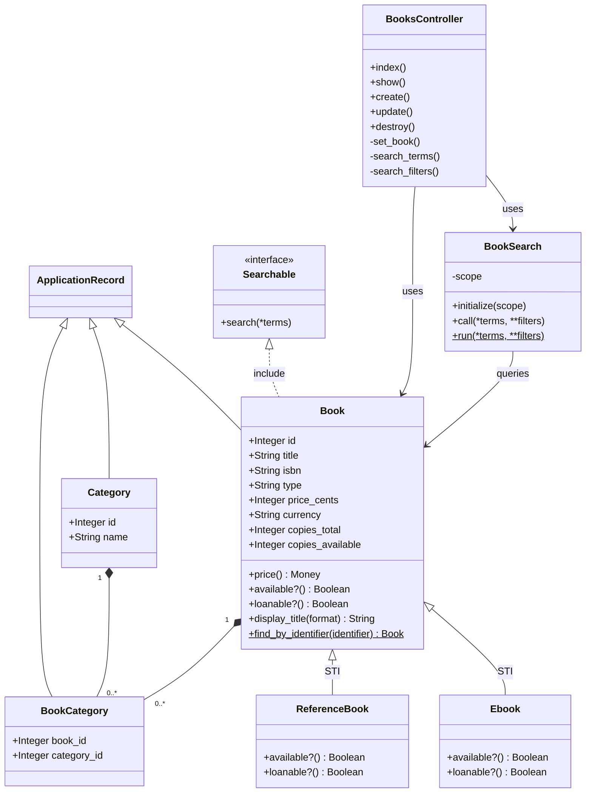
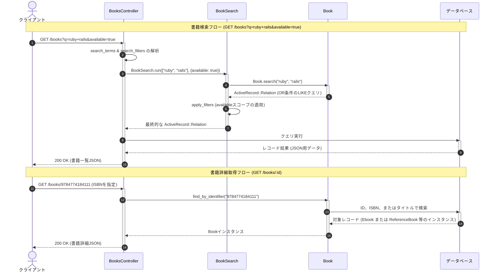

# 書籍カタログ・検索機能

## はじめに
「書籍カタログ・検索機能」モジュールは、システムにおける書籍データのライフサイクル管理（CRUD操作）、カテゴリ分類、および柔軟な検索機能を提供するコアコンポーネントです。

本モジュールは、物理的な書籍だけでなく、電子書籍（Ebook）や館内でのみ閲覧可能な参考図書（ReferenceBook）といった異なる特性を持つ書籍タイプを統一的に扱う設計となっており、貸出可否や在庫状況の判定などのビジネスルールをカプセル化しています。また、ユーザーからの曖昧な検索クエリや、著者・カテゴリ・出版年などの詳細なフィルタリング条件を効率的に処理する検索エンジンとしての役割も担っています。

---

## アーキテクチャと設計
本モジュールでは、保守性と拡張性を高めるために以下の設計パターンを採用しています。

1. **Active Record パターン**
   データベースのテーブルとモデルクラスを1対1でマッピングし、データの永続化とビジネスロジックを同一オブジェクトで管理します（`Book`, `Category`, `BookCategory`）。
2. **単一テーブル継承 (STI: Single Table Inheritance)**
   `books` テーブルを共有し、`type` カラムの値によって `Book`（物理本）、`Ebook`（電子書籍）、`ReferenceBook`（参考図書）の各サブクラスへ動的にインスタンス化します。これにより、書籍タイプごとの振る舞いの違いをポリモーフィズム（多態性）によってシンプルに表現しています。
3. **サービスオブジェクト / クエリオブジェクト パターン**
   複雑になりがちな検索ロジックをコントローラーやモデルから分離し、`BookSearch` クラスにカプセル化しています。
4. **値オブジェクト (Value Object) パターン**
   価格情報を扱うため、`price_cents`（セント単位の整数）と `currency`（通貨コード）の組み合わせを `Money` オブジェクトとして表現します。
5. **ミックスイン (Mixin) パターン**
   `Searchable` モジュール（Concern）を共同利用することで、モデルに対してフリーテキスト検索機能を動的に追加しています。

### コンポーネント関係図

### モジュールコンポーネント

| コンポーネント | 責務 |
|:---|:---|
| **Book** | 書籍カタログの基本情報を管理するActiveRecordモデル。STIの基底クラスであり、価格の取得、貸出可否の判定、識別子による動的検索などの共通ビジネスロジックを保持する。 |
| **Ebook** | 電子書籍を表す `Book` のサブクラス。在庫数は実質無制限であるため、在庫チェックをバイパスして常に利用可能かつ貸出可能とする。 |
| **ReferenceBook** | 参考図書（辞書や百科事典など）を表す `Book` のサブクラス。館外貸出を禁止（常に貸出不可・利用不可）とするビジネスルールを強制する。 |
| **Category** | 書籍の分類（分野）を管理するモデル。 |
| **BookCategory** | `Book` と `Category` の多対多（Many-to-Many）の関連付けを仲介する中間モデル。 |
| **BookSearch** | 検索処理に特化したサービスオブジェクト。フリーワード検索と、属性（著者、カテゴリ、出版年、在庫状況など）によるフィルタリングを組み合わせて実行する。 |
| **Searchable** | `title` カラムを持つモデルに対して、SQLの `LIKE` 句を用いた部分一致検索機能を提供する共通モジュール（Concern）。 |
| **BooksController** | クライアントからのHTTPリクエストを受け取り、書籍のCRUD処理や検索処理を制御してJSON形式でレスポンスを返却するAPIコントローラ。 |

---

## データフロー

以下は、クライアントが書籍を検索するフロー、および特定の識別子（ID、ISBN、タイトル）を用いて書籍詳細を取得するフローのシーケンス図です。

---

## 主要コンポーネント

### 1. Book モデル (`book.rb`)
書籍カタログの基底となるActiveRecordモデルです。

*   **識別子による動的検索 (`self.find_by_identifier`)**
    Rubyの動的型付けを活かし、引数 `identifier` の実行時クラスを判定して適切な検索を行います。
    *   `Book` オブジェクト：そのまま返却
    *   `Integer`：主キー（`id`）で検索
    *   `ISBN_PATTERN`（10桁または13桁の数字）：`isbn` カラムで検索
    *   `String`：`title` カラムで検索
*   **金額のオブジェクト化 (`price`)**
    データベースの `price_cents` と `currency` カラムから `Money` 値オブジェクトを生成して返します。
*   **表示用タイトルの生成 (`display_title`)**
    引数（`:plain`, `:citation`, `:with_year`）に応じて、整形されたタイトル文字列を返します。

### 2. STI サブクラス (`ebook.rb`, `reference_book.rb`)
単一テーブル継承を用いて、書籍タイプごとのビジネスルールをポリモーフィズムで解決しています。

*   **Ebook（電子書籍）**
    物理的な在庫制限がないため、`available?` および `loanable?` は常に `true` を返します。
*   **ReferenceBook（参考図書）**
    館外貸出が禁止されているため、`loanable?` および `available?` は常に `false` を返します。

### 3. BookSearch サービス (`book_search.rb`)
検索処理をカプセル化したクエリオブジェクトです。

*   **可変長引数とキーワード引数の活用**
    `*terms`（可変長引数）でフリーワードを受け取り、`**filters`（ダブルスプラット引数）で明示的なフィルタ条件を受け取ります。
*   **フィルタの動的適用 (`apply_filters`)**
    `reduce` メソッドを用いて、指定されたフィルタ（`author`, `category`, `year`, `available` など）を順次クエリビルダ（`ActiveRecord::Relation`）に適用し、安全にSQLクエリを構築します。

### 4. Searchable コマンド (`searchable.rb`)
モデルにフリーテキスト検索機能を付与するモジュール（Concern）です。

*   **複数キーワードのOR検索 (`search`)**
    複数の検索ワードが渡された場合、それらを `OR` 条件で結合した `LIKE` 検索クエリを動的に生成します。引数がない場合は `all` を返します。

### 5. BooksController (`books_controller.rb`)
外部からのHTTPリクエストを処理するAPIコントローラです。

*   **柔軟なリソース特定**
    `show`, `update`, `destroy` アクションの前に実行される `set_book` では、`Book.find_by_identifier` を呼び出すことで、URLの `:id` パラメータに数値ID、ISBN、タイトルのいずれが指定されても正しく対象書籍を特定できます。

---

## 依存関係

本モジュールは、以下の外部コンポーネントおよびモデルに依存しています。

1. **Author モデル (`belongs_to :author`)**
   書籍の著者を管理するモデル。`BookSearch` での著者名フィルタリング（`joins(:author)`）や、`Book#display_title` での引用形式（`:citation`）出力時に著者のソート用名前（`author.display_name(:sortable)`）を取得するために依存しています。
2. **Loan モデル (`has_many :loans`)**
   書籍の貸出履歴を管理するモデル。書籍が削除された場合、関連する貸出履歴も連動して削除されます（`dependent: :destroy`）。
3. **Member モデル (`has_many :borrowers`)**
   書籍を借りているメンバー（利用者）のモデル。`loans` テーブルを経由して多対多で関連付けられています。
4. **Money 値オブジェクト (`Money`)**
   通貨と金額をカプセル化する値オブジェクト。`Book#price` メソッド内でインスタンス化されます。
5. **ApplicationController**
   `BooksController` の親クラスであり、共通の認証やエラーハンドリングを提供します。