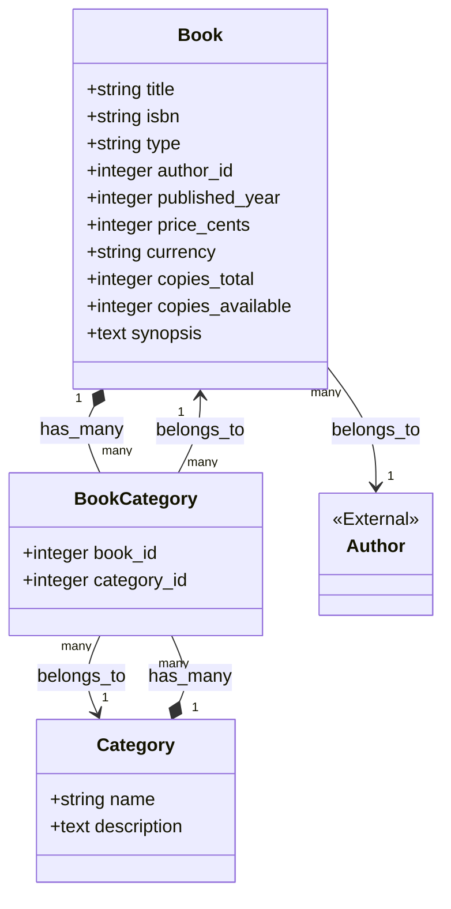
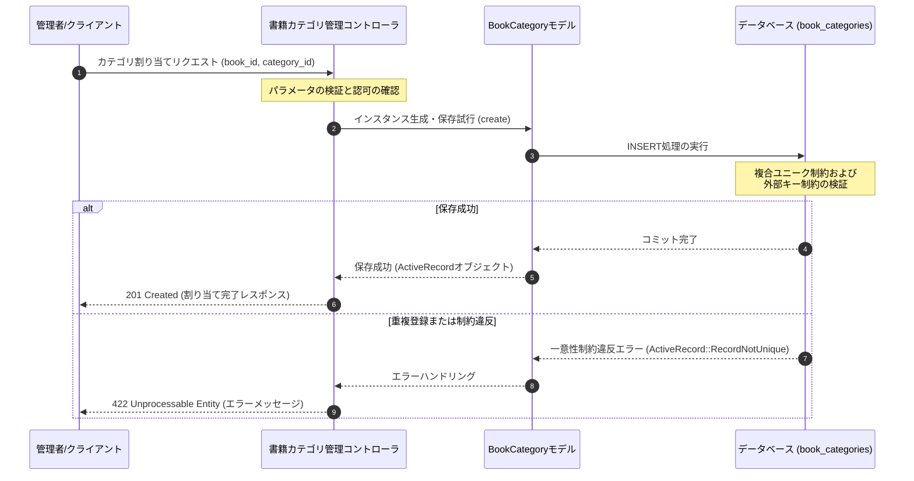

# 書籍・カテゴリ管理

## はじめに
「書籍・カテゴリ管理」モジュールは、アプリケーションにおける書籍データ、カテゴリ情報、およびそれらの関連付けを統合的に管理するためのコアモジュールです。

本モジュールは、書籍の基本情報（タイトル、ISBN、価格、在庫数、要約など）の保持、書籍を分類するためのカテゴリ定義、そして書籍とカテゴリ間の多対多の関連付けを支えるデータベーススキーマおよびデータモデルを提供します。これにより、ユーザーに対する柔軟な書籍検索、カテゴリごとのフィルタリング、および在庫管理の基盤を提供します。

---

## アーキテクチャと設計
本モジュールは、Ruby on RailsのActiveRecordパターンに基づき、以下の設計アプローチを採用しています。

1. **単一テーブル継承 (STI: Single Table Inheritance)**
   `books` テーブルに `type` カラムを定義しています。これにより、例えば「紙の書籍（PhysicalBook）」や「電子書籍（DigitalBook）」といった異なる特性を持つ書籍サブタイプを、同一のテーブルで効率的に管理しつつ、アプリケーションレイヤー（ActiveRecordモデル）では個別のクラスとして振る舞わせることができます。
2. **多対多の関連付け (Many-to-Many Association)**
   書籍（`books`）とカテゴリ（`categories`）は、中間テーブル `book_categories` を介した多対多の関係で結ばれています。1つの書籍に複数のカテゴリを付与でき、同時に1つのカテゴリに複数の書籍を所属させることが可能です。
3. **データの整合性とパフォーマンス最適化**
   * `isbn` や `categories.name` に対するユニークインデックスの付与により、データの重複をデータベースレベルで防止しています。
   * `book_categories` における `[book_id, category_id]` の複合ユニークインデックスにより、同一書籍に対する同一カテゴリの重複登録を防止しています。
   * 外部キー制約（`foreign_key: true`）により、参照整合性を担保しています。

### コンポーネント関係図

### モジュールコンポーネント

| コンポーネント | 責務 |
|-----------|----------------|
| **CreateBooks** | `books` テーブルを作成するマイグレーションクラス。書籍のメタデータ、価格、在庫数、およびSTI用の `type` カラムを定義し、必要なインデックスを配置します。 |
| **CreateCategories** | `categories` テーブルを作成するマイグレーションクラス。カテゴリ名（一意）と説明文を定義します。 |
| **CreateBookCategories** | `book_categories` 中間テーブルを作成するマイグレーションクラス。書籍とカテゴリの多対多の関連を仲介し、重複登録を防ぐ複合ユニークインデックスを定義します。 |

---

## データフロー

以下は、管理者が書籍に対して新しいカテゴリを割り当てる際、およびシステムがそれをデータベースに永続化する際のデータフローです。

---

## 主要コンポーネント

### 1. CreateBooks (マイグレーション)
書籍情報を格納する `books` テーブルを構築します。
* **主要なカラム定義**:
  * `title` (string, null: false): 書籍のタイトル。
  * `isbn` (string): 国際標準図書番号。一意のインデックスが設定され、重複登録を防ぎます。
  * `type` (string): STI（単一テーブル継承）用の識別子カラム。
  * `author_id` (references, null: false): 著者テーブルへの外部キー。
  * `price_cents` (integer, default: 0) & `currency` (string, default: "USD"): 通貨単位を考慮した金額管理（Moneyパターン）のためのカラム。
  * `copies_total` & `copies_available` (integer): 蔵書総数と貸出可能数を管理する在庫カラム。

### 2. CreateCategories (マイグレーション)
書籍を分類するための `categories` テーブルを構築します。
* **主要なカラム定義**:
  * `name` (string, null: false): カテゴリ名。ユニークインデックスが付与されており、システム内で一意であることが保証されます。
  * `description` (text): カテゴリの詳細な説明。

### 3. CreateBookCategories (マイグレーション)
`books` と `categories` の多対多の関係を解決する中間テーブル `book_categories` を構築します。
* **主要なカラム定義**:
  * `book_id` (references, null: false): `books` テーブルへの外部キー。
  * `category_id` (references, null: false): `categories` テーブルへの外部キー。
* **インデックス**:
  * `[:book_id, :category_id]` に対する複合ユニークインデックスが設定されており、同一の書籍に同一のカテゴリが複数回紐付けられるのを防ぎます。

---

## 依存関係

本モジュールは、以下の外部モジュールおよびフレームワーク機能に依存しています。

1. **著者管理モジュール (Authors Module)**
   * `books` テーブルの `author_id` カラムは、`authors` テーブル（別モジュールで定義）をターゲットとする外部キー制約を持っています。そのため、本モジュールを適用する前に `authors` テーブルがデータベース上に存在している必要があります。
2. **ActiveRecord (Ruby on Rails 7.1)**
   * データベーススキーマの定義、マイグレーションの実行、およびモデル間のアソシエーション（`has_many :through` など）の実現において、RailsのActiveRecordフレームワークに全面的に依存しています。