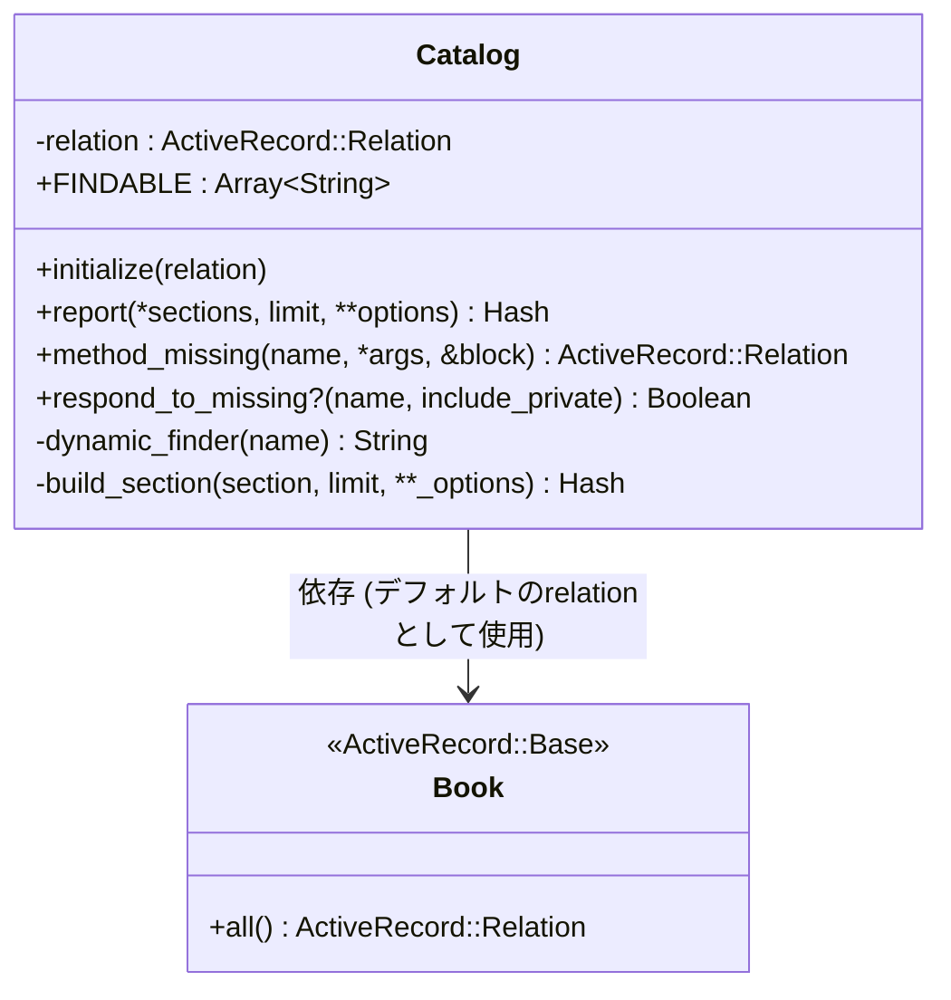
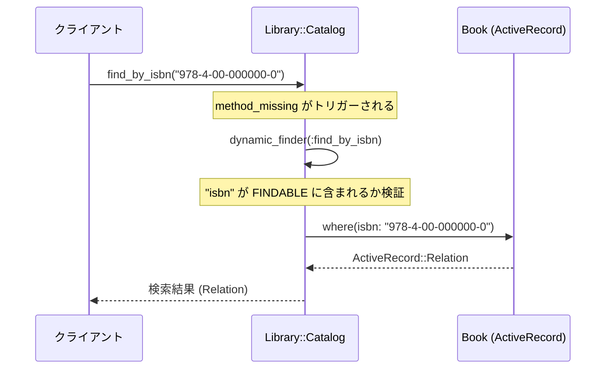
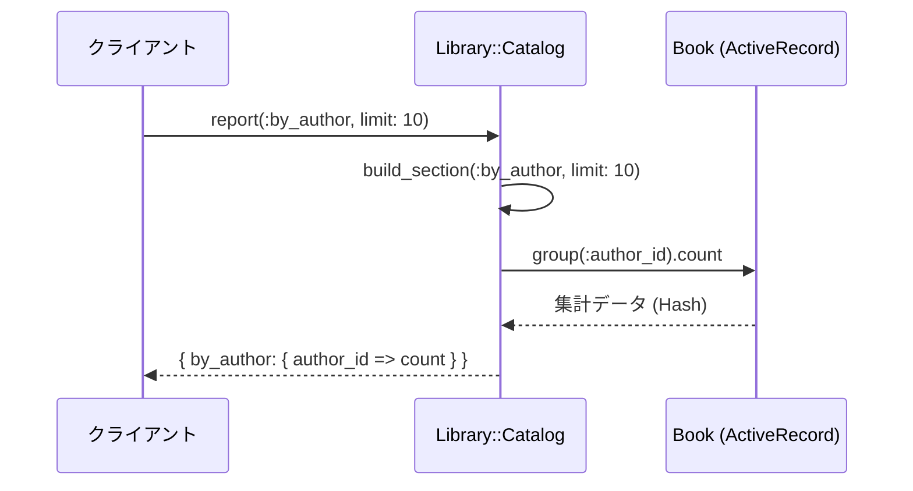

# 書籍検索機能

## はじめに
「書籍検索機能」モジュール（`Library::Catalog`）は、アプリケーション内における書籍データの検索および集計レポートの作成を担うコンポーネントです。

本モジュールは、データベース（ActiveRecord等）とクライアントコード（コントローラーや他のサービスロジック）の間に位置し、複雑なデータベースクエリをカプセル化してシンプルで直感的なインターフェースを提供します。これにより、クライアント側はデータベースの具体的な構造やクエリの組み立て方を意識することなく、簡潔なコードで書籍情報の取得や統計データの生成を行うことができます。

## アーキテクチャと設計
本モジュールでは、設計パターンとして **Facade（ファサード）パターン** を採用しています。

`Library::Catalog` クラスがデータアクセスレイヤー（`Book` モデルなど）に対する唯一の窓口となり、複雑なクエリロジックを隠蔽します。

また、Rubyの強力なメタプログラミング機能（`method_missing` および `respond_to_missing?`）を活用することで、静的に多数の検索メソッドを定義することなく、許可された属性（`title`, `isbn`, `author_id`）に基づく動的な検索メソッド（Dynamic Finder）をオンデマンドで合成・実行する柔軟な設計となっています。

### コンポーネント関係図

### モジュールコンポーネント
| コンポーネント | 責務 |
|-----------|----------------|
| **Library::Catalog** | 書籍カタログに対するクエリ操作（動的検索、レポート生成）をカプセル化し、クライアントにシンプルなAPIを提供するファサードクラス。 |
| **Book** | 書籍データを表すモデル（ActiveRecordモデルを想定）。`Library::Catalog` がクエリを発行する対象。 |

## データフロー

### 1. 動的検索（Dynamic Finder）のフロー
クライアントが `find_by_isbn` などの動的メソッドを呼び出した際、メタプログラミングを介してクエリが実行される流れです。

### 2. レポート生成（report）のフロー
クライアントが著者別や出版年別の集計レポートを要求した際、指定されたセクションのデータを集計して返却する流れです。

## 主要コンポーネント

### Library::Catalog クラス
書籍検索および集計レポート作成の窓口となる主要クラスです。

#### 定数
* **`FINDABLE`** (`Array`): 動的検索が許可されている属性のホワイトリスト（`['title', 'isbn', 'author_id']`）。セキュリティと意図しないメソッド実行を防ぐために定義されています。

#### パブリックメソッド
* **`initialize(relation = Book.all)`**
  * **概要**: カタログオブジェクトを初期化します。
  * **引数**: `relation` (デフォルト: `Book.all`) - クエリの基盤となるActiveRecordなどのリレーションオブジェクト。依存性注入（DI）が可能な設計になっています。
* **`report(*sections, limit: 25, **options)`**
  * **概要**: 指定されたセクション（`:by_author`, `:by_year`）の集計レポートをハッシュ形式で生成します。
  * **引数**:
    * `*sections` (可変長引数): 集計したいセクション。未指定の場合はデフォルトで `:by_author` と `:by_year` の両方が対象となります。
    * `limit:` (キーワード引数, デフォルト: `25`): 取得するレコードの上限数。
    * `**options` (ダブルスプラット引数): 拡張用の任意のオプション。
  * **戻り値**: `Hash` (例: `{ by_author: { 1 => 5 }, by_year: { 2023 => 12 } }`)
* **`method_missing(name, *args, &block)`**
  * **概要**: 定義されていないメソッドが呼び出された際、それが `find_by_<属性名>` のパターンに一致し、かつ属性名が `FINDABLE` に含まれている場合に、動的に検索クエリを実行します。
* **`respond_to_missing?(name, include_private = false)`**
  * **概要**: `method_missing` で動的に処理されるメソッドに対して、`respond_to?` が正しく `true` を返すようにします。これにより、ダックタイピングを行う呼び出し元に対しても安全に動作します。

#### プライベートメソッド
* **`dynamic_finder(name)`**
  * **概要**: 呼び出されたメソッド名が動的検索のパターン（`find_by_<属性名>`）に一致し、かつ `FINDABLE` に含まれているかを検証します。一致した場合は属性名を返し、そうでない場合は `nil` を返します。
* **`build_section(section, limit:, **_options)`**
  * **概要**: 指定されたセクションに応じた集計処理（`group` や `limit` を用いたクエリ）を実行し、結果を返します。

## 依存関係
本モジュールは以下のコンポーネントおよびライブラリに依存しています。

1. **`Book` モデル (ActiveRecord)**
   * `Library::Catalog` はデフォルトのデータソースとして `Book.all` を使用するため、`Book` クラスが定義されている必要があります。
2. **ActiveRecord 互換のインターフェース**
   * 本モジュールは、内部で `@relation.where`、`@relation.group`、`@relation.limit`、`@relation.count` などのメソッドを呼び出しています。そのため、注入される `relation` オブジェクトは、これらのActiveRecordクエリメソッドをサポートしている必要があります。