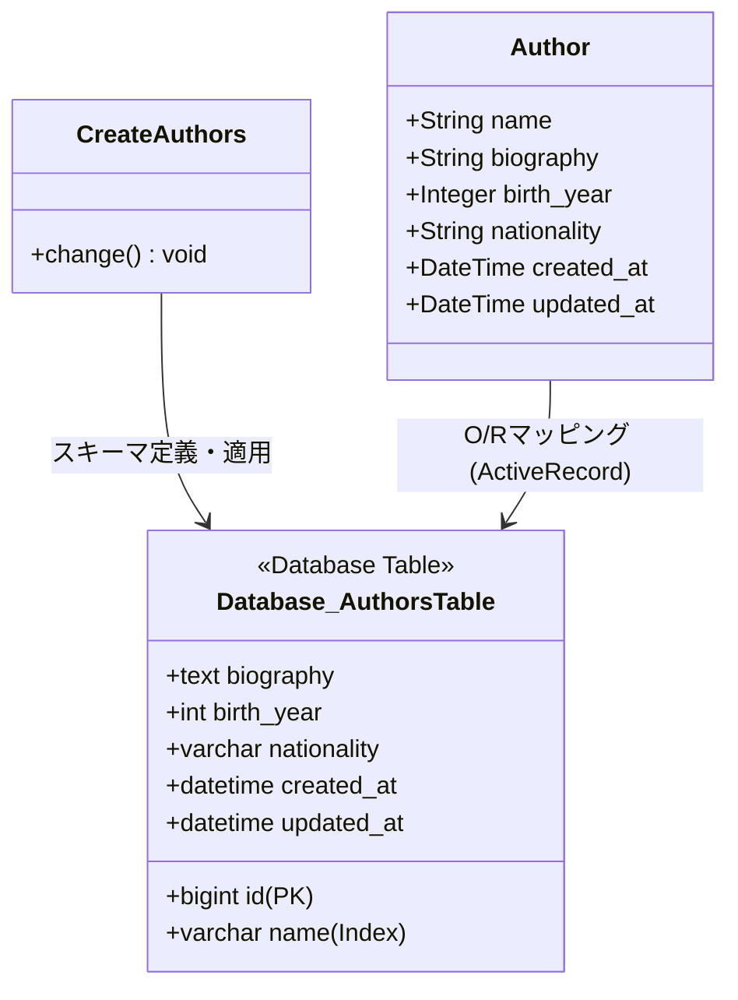
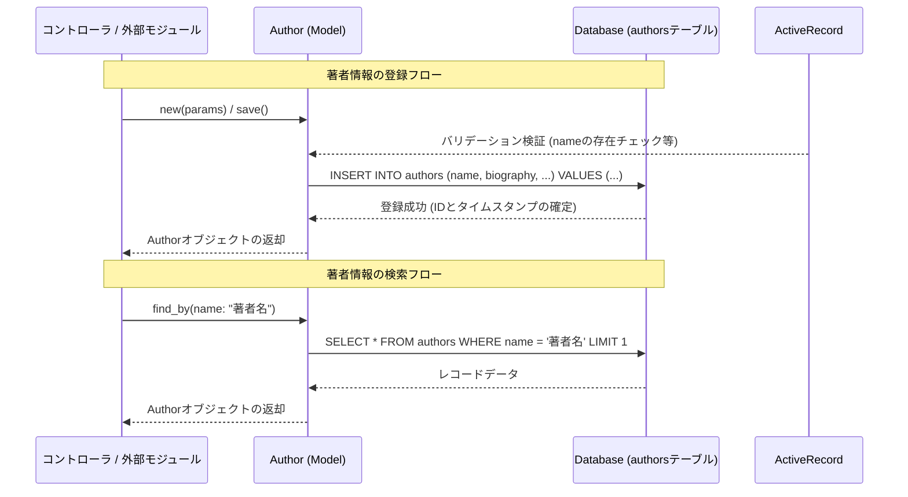

# 著者管理

## はじめに
「著者管理」モジュールは、アプリケーション内におけるコンテンツ作成者（著者）の基本情報を一元的に管理するための基盤モジュールです。

本モジュールは、著者の氏名、経歴、誕生年、国籍などのメタデータをデータベースで永続化し、他のモジュール（例：書籍管理、記事管理など）に対して信頼性の高い著者データを提供する役割を担います。

## アーキテクチャと設計
本モジュールは、Ruby on Railsが採用している **MVC（Model-View-Controller）パターン** および **ActiveRecordパターン** に基づいて設計されています。

データベースのスキーマ管理には、Commandパターンを応用したRailsのマイグレーション機構が使用されており、スキーマのバージョン管理と再現性を担保しています。

### コンポーネント関係図

### モジュールコンポーネント
| コンポーネント | 責務 |
|-----------|----------------|
| **CreateAuthors** | `authors` テーブルをデータベース上に新規作成・削除するためのマイグレーション処理を実行する。 |
| **Author** | `authors` テーブルに対応するActiveRecordモデル。ビジネスロジック、バリデーション、データベースクエリをカプセル化する（アプリケーション層に実装）。 |
| **authors (テーブル)** | 著者データを永続化するためのリレーショナルデータベーステーブル。 |

## データフロー

以下は、アプリケーションが「著者管理」モジュールを介して著者データを登録および取得する際の基本的なデータフローです。

## 主要コンポーネント

### CreateAuthors (ActiveRecord::Migration[7.1])
データベースに `authors` テーブルを構築するためのマイグレーションクラスです。

*   **メソッド**:
    *   `change`: データベースのマイグレーション適用時（アップ）およびロールバック時（ダウン）の挙動を双方向に定義します。
*   **テーブル定義詳細**:
    *   `name` (string, `null: false`): 著者名。必須項目。検索頻度が高いため、データベースインデックスが追加されています。
    *   `biography` (text): 著者の経歴・プロフィール情報（任意）。
    *   `birth_year` (integer): 誕生年（任意）。
    *   `nationality` (string): 国籍（任意）。
    *   `timestamps`: レコードの作成日時（`created_at`）と更新日時（`updated_at`）を自動管理します。

### Author (ActiveRecord::Base)
※本マイグレーションに対応して定義されるActiveRecordモデルクラス（想定）。
*   **役割**: `authors` テーブルと1対1でマッピングされ、データの検証（バリデーション）やデータベースへのクエリ操作を担当します。
*   **推奨されるバリデーション**:
    *   `name`: 必須（`presence: true`）

## 依存関係

*   **Ruby on Rails (ActiveRecord 7.1)**: データベースマイグレーションおよびO/Rマッピングの基盤フレームワーク。
*   **データベース管理システム (RDBMS)**: PostgreSQL, MySQL, SQLite3 などのリレーショナルデータベース。
*   **関連モジュール（拡張予定）**:
    *   **書籍管理モジュール (Book等)**: 1人の著者が複数の書籍を持つアソシエーション（`has_many :books`）を構築する際に、本モジュールの `Author` モデルに依存します。