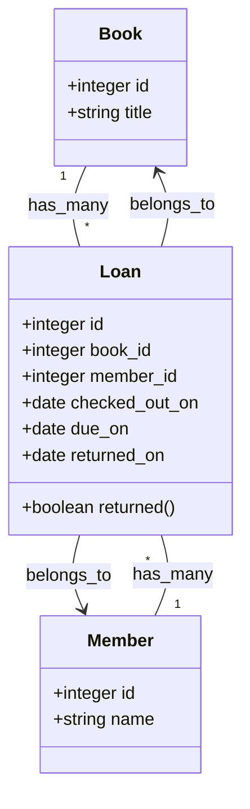
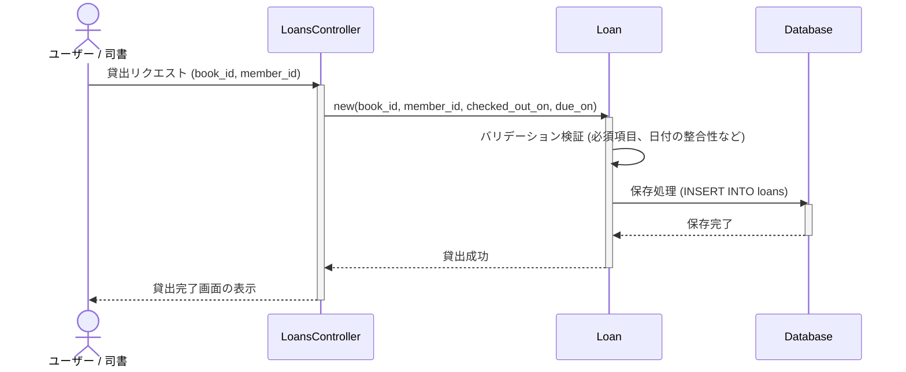

# 貸出管理

## はじめに
「貸出管理」モジュールは、システムにおける図書の貸出・返却、およびその期限管理を担うコアコンポーネントです。
本モジュールは、図書（Book）と会員（Member）の仲介（多対多の関連付け）を行い、「誰が」「何を」「いつから」「いつまで」借りているか、また「実際にいつ返却されたか」という貸出ライフサイクルを一元管理します。

## アーキテクチャと設計
本モジュールは、Ruby on RailsのMVC（Model-View-Controller）パターンに基づき設計されています。

データベース設計においては、`loans` テーブルが `books` テーブルと `members` テーブルを紐付ける交差テーブル（中間テーブル）として機能します。また、特定の会員が現在借りている図書（未返却の貸出）を効率的に検索できるよう、`member_id` と `returned_on` に対する複合インデックスが設定されています。

### コンポーネント関係図

### モジュールコンポーネント
| コンポーネント | 責務 |
|-----------|----------------|
| **CreateLoans** | `loans` テーブルの作成、外部キー制約、および検索最適化のための複合インデックスを定義するマイグレーションクラス。 |
| **Loan (Model)** | 貸出データのバリデーション（貸出日や返却期限日の整合性チェックなど）や、貸出・返却に関するビジネスロジックをカプセル化する。 |
| **LoansController** | 貸出（チェックアウト）および返却（チェックイン）のリクエストを処理し、適切なレスポンスを制御する。 |

## データフロー
以下は、ユーザー（または司書）が図書の貸出処理（チェックアウト）を行う際のデータフローです。

## 主要コンポーネント

### 1. CreateLoans (Migration)
データベースに `loans` テーブルを新規作成するためのマイグレーションクラスです。
- **外部キー制約**: `book_id` および `member_id` に対し、存在しないレコードの参照を防ぐ外部キー制約（`foreign_key: true`）を付与しています。
- **インデックス**: `[:member_id, :returned_on]` の複合インデックスを追加することで、「特定の会員が現在借りている図書（`returned_on` が `NULL` のレコード）」の検索クエリを高速化しています。

### 2. Loan (Model)
貸出のビジネスルールを管理するActiveRecordモデルです（※マイグレーションから想定される実装）。
- **アソシエーション**:
  - `belongs_to :book`
  - `belongs_to :member`
- **バリデーション**:
  - `book_id`, `member_id`, `checked_out_on`, `due_on` の必須チェック。
  - `due_on`（返却期限日）が `checked_out_on`（貸出日）と同日か、それより未来の日付であることの検証。

## 依存関係
本モジュールは以下の外部モジュールに依存しています。

1. **図書管理モジュール (Book)**
   - 貸出対象となる図書データが存在している必要があります。
   - 貸出時に、図書のステータス（「貸出可能」から「貸出中」への変更）を制御する際に連携します。
2. **会員管理モジュール (Member)**
   - 借用者となる会員データが存在している必要があります。
   - 貸出時に、会員の貸出上限数制限や、延滞による貸出停止ステータスの判定を行う際に連携します。