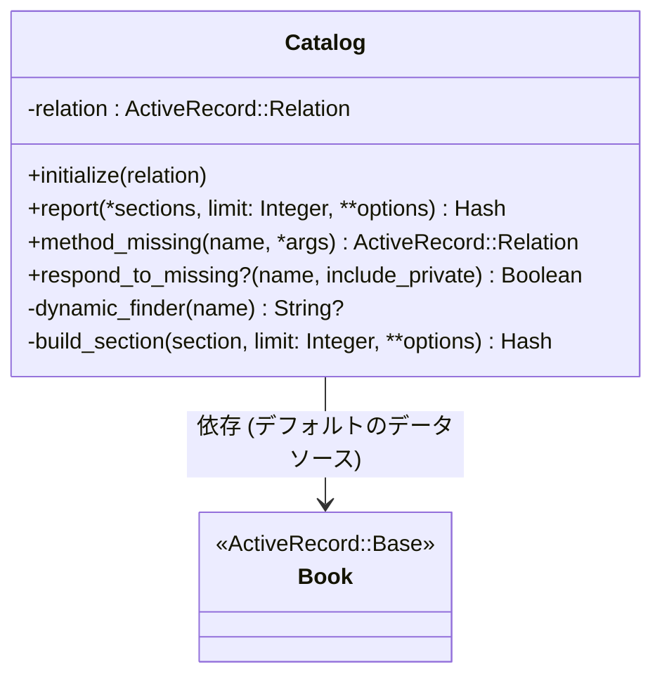
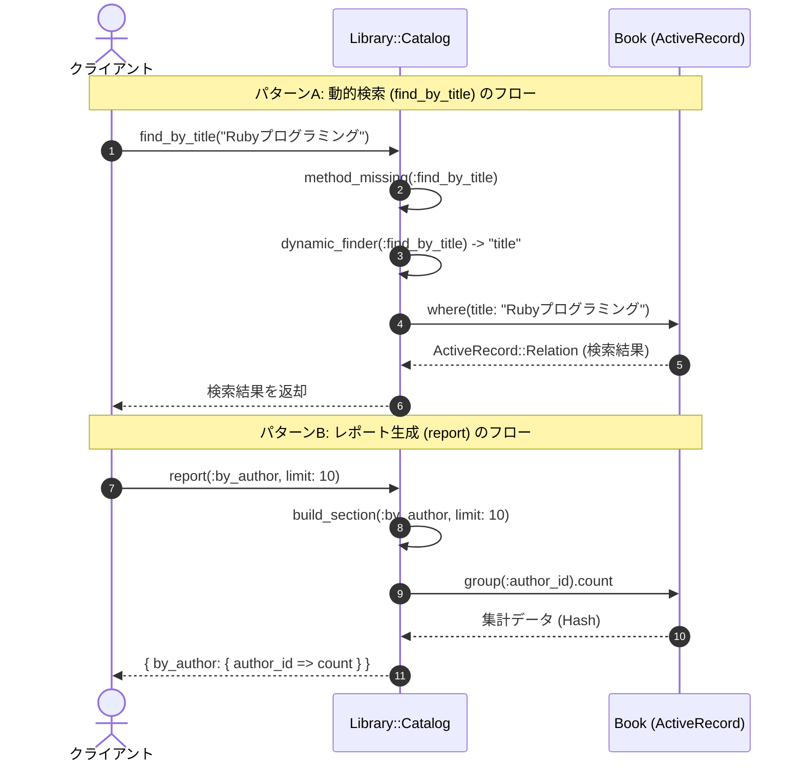

# 集計・レポート作成機能

## はじめに
「集計・レポート作成機能」モジュール（`Library::Catalog`）は、書籍カタログに対する複雑なクエリ操作や集計処理をカプセル化し、シンプルで統一されたインターフェースを提供する役割を担います。

本モジュールは、アプリケーション内においてデータベース（ActiveRecordモデルである `Book`）とクライアントコード（コントローラ、ビュー、または他のサービスオブジェクト）の中間に位置する**ファサード（Facade）**として機能します。これにより、クライアント側はデータベースの具体的なクエリ構造を意識することなく、直感的なメソッド呼び出しのみで書籍の動的検索や統計レポートの取得が可能になります。

---

## アーキテクチャと設計
本モジュールでは、設計の簡素化と柔軟性の向上を目的として、以下のパターンおよび手法が採用されています。

1. **Facade（ファサード）パターン**
   データベースクエリの複雑さを `Library::Catalog` クラスの背後に隠蔽し、クライアントに対して簡潔なAPIを提供します。
2. **メタプログラミング（動的ファインダー）**
   Rubyの `method_missing` および `respond_to_missing?` を活用し、許可された属性（`title`, `isbn`, `author_id`）に基づく検索メソッド（例: `find_by_title`）を動的に合成します。これにより、冗長なボイラープレートコードを排除しています。
3. **依存性注入（Dependency Injection）**
   初期化時に `relation`（デフォルトは `Book.all`）を受け取る設計となっており、テストの容易性（モックの利用など）や、特定のスコープに絞り込んだデータソースの利用を可能にしています。

### コンポーネント関係図

### モジュールコンポーネント
| コンポーネント | 責務 |
|-----------|----------------|
| **Library::Catalog** | 書籍カタログに対するクエリ操作（動的検索、集計レポート作成）をカプセル化し、クライアントにシンプルなインターフェースを提供する。 |
| **Book** | カタログデータのデータソースとなるActiveRecordモデル（デフォルトのデータソース）。 |

---

## データフロー

本モジュールにおける主要なデータ処理フローは以下の通りです。

---

## 主要コンポーネント

### Library::Catalog クラス
書籍データの検索および集計処理を抽象化するメインクラスです。

#### 主要メソッド

*   **`initialize(relation = Book.all)`**
    *   **概要**: カタログオブジェクトを初期化します。
    *   **引数**:
        *   `relation` (ActiveRecord::Relation): クエリの対象となるデータソース。デフォルトは `Book.all`。
*   **`report(*sections, limit: 25, **options)`**
    *   **概要**: 指定されたセクション（著者別、出版年別など）の集計レポートを生成します。
    *   **引数**:
        *   `*sections` (Symbol): レポートに含めるセクション（`:by_author`, `:by_year`）。未指定の場合は両方が出力されます。
        *   `limit` (Integer): 取得するレコード数の上限（デフォルト: 25）。
        *   `**options`: 追加のオプション引数。
    *   **戻り値**: `Hash`（セクション名をキー、集計結果を値とするハッシュ）。
*   **`method_missing(name, *args, &block)`**
    *   **概要**: 定義されていないメソッドが呼ばれた際、それが `find_by_<属性名>` のパターンに合致し、かつ許可された属性（`title`, `isbn`, `author_id`）であれば、動的に検索クエリを実行します。
*   **`respond_to_missing?(name, include_private = false)`**
    *   **概要**: `method_missing` で動的に解決可能なメソッドに対し、`respond_to?` が正しく `true` を返すようにします。

---

## 依存関係

本モジュールは以下のコンポーネントおよび機能に依存しています。

1. **ActiveRecord（または同様のインターフェースを持つORM）**
   *   `Library::Catalog` は、データソース（`relation`）が `where`、`group`、`limit`、`count` などのクエリメソッドを実装していることを前提としています。
2. **Book モデル**
   *   デフォルトのデータソースとして `Book.all` を参照しているため、`Book` クラス（ActiveRecordモデル）の存在に依存します。
3. **Ruby メタプログラミング機能**
   *   動的ファインダーを実現するために、Ruby標準の `method_missing` および `respond_to_missing?` の仕組みに依存しています。