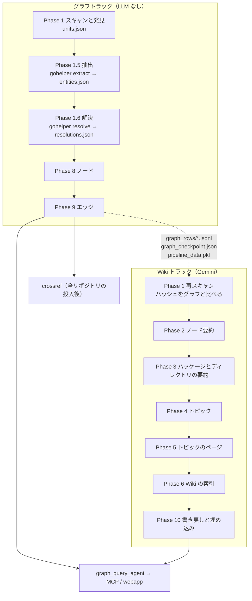

# アーキテクチャ

CodeDoc（Go 版）が何でできていて、Go のソースがどの順に何を通ってグラフと Wiki になるかを説明します。
使い方と設定は [../README.md](../README.md)、Phase 1.6 の解決の中身は [LSP_RESOLUTION.md](LSP_RESOLUTION.md)、Spanner の表と ID 規則は [GRAPH_SCHEMA.md](GRAPH_SCHEMA.md)、モジュールとリポジトリをまたぐ扱いは [CROSS_PROJECT.md](CROSS_PROJECT.md) に譲ります。

## 1. 全体像

大きな Go のコードベースを読むとき、LLM の要約と grep だけでは「この関数を誰が呼ぶか」に正確に答えられません。

- LLM の要約は、呼び出し関係をもっともらしい推測で埋めます。
- grep は Go の名前解決に負けます。多くの型が同じ名前のメソッドを持ち、埋め込みでメソッドが昇格し、インターフェースは宣言なしに満たされます。import パスとパッケージ名は一致するとは限りません。どのファイルがコンパイルされるかはビルド制約が、どのモジュールのソースが使われるかは `go.work` と `replace` が決めます。

そこで成果物を 2 つに分けています。

| 成果物 | 作り方 | 置き場所 |
|---|---|---|
| グラフ | 決定的な解析だけで作り、確定したエッジだけを張る | Cloud Spanner のプロパティグラフ。`--no-spanner` ならローカルの行ファイルだけ |
| Wiki | Gemini が日本語で書く。宣言・ファイル・パッケージ・ディレクトリの要約、機能トピックのページ、埋め込み | `OUTPUT_DIR/repos/<repo>/` と、グラフのノードの `summary` / `embedding` カラム |

質問応答エージェントはグラフに GQL を投げ、要約もグラフのノードから読みます。

呼び出し先を確定するのは、同梱の Go プログラム gohelper です。抽出（`gohelper extract`）は go/parser を、解決（`gohelper resolve`）は go/packages と go/types を使います。言語サーバーは使いません。Python 側は、モジュールの発見、答えの分類とゲート、グラフの行、Wiki、Spanner を受け持ちます。

どの部分も次の 3 つを守ります。

1. 解析対象のコードを実行せず、解析対象のリポジトリに書きません。発見はファイルを読むだけです。go コマンドと gohelper は、一から組み立てた環境と、`OUTPUT_DIR` の下の制御ディレクトリで動きます。
2. 誤ったエッジを作りません。確定できない呼び出しは数えるだけで、エッジにしません。
3. 古い抽出の位置と新しい解決の答えを組み合わせません（[6. チェックポイント・鮮度・キャッシュ](#6-チェックポイント鮮度キャッシュ)）。

## 2. フェーズとトラック

パイプラインはグラフトラックと Wiki トラックに分かれます。`analyze` には `--graph`、`--wiki`、`--all` のどれか 1 つを必ず付けます。

| モード | 走るフェーズ | LLM | Spanner に書くもの |
|---|---|---|---|
| `--graph` | 1 → 1.5 → 1.6 → 8 → 9 | 呼ばない | ノードとエッジ |
| `--wiki` | 1（再スキャンだけ）→ 2 → 3 → 4 → 5 → 6 → 10 | Gemini と埋め込み | 要約の列、トピック、埋め込み |
| `--all` | `--graph` のあと、同じプロセスで `--wiki` | 両方 | 両方 |

| Phase | 関数（`pipeline.py`） | 内容 | 外部依存 |
|---|---|---|---|
| 1 | `phase1_scan` | go コマンドと同じ規則でスキャンし、全ファイルの SHA-256 を取る。モジュールとグループをファイルだけから見つけ、設定のビルド構成とあわせて記録する | なし |
| 1.5 | `phase1b_extract` | `gohelper extract` で、宣言、呼び出し位置、import をファイルごとに取る | gohelper |
| 1.6 | `phase1c_resolve` | グループとビルド構成の組ごとに `gohelper resolve` を 1 回走らせ、各呼び出し位置の答えを分類してゲートに通す | gohelper、go コマンド。ダウンロードモードではモジュールプロキシ |
| 8 | `phase8_write_nodes` | `build_node_rows` でノードの行を作る。`summary` カラムは Go のドキュメントコメントで始まる。Spanner には、要約キャッシュにある `--wiki` の要約を書き戻す | Spanner（`--no-spanner` なら不要） |
| 9 | `phase9_write_edges` | `derive_edge_rows` でエッジの行を作り、前回書いて今回書かなかった行を消す | Spanner（`--no-spanner` なら不要） |
| 1（Wiki） | `phase1_rescan` | スキャンだけを行い、ハッシュをグラフと比べる | なし |
| 2 | `phase2_node_summaries` | 宣言とファイルの要約。ファイルごとに 1 回まとめて頼み、大きなファイルは宣言ごとに頼む | Gemini |
| 3 | `phase3_package_dir_summaries` | パッケージの要約と、下から上へのディレクトリの要約 | Gemini |
| 4 | `phase4_topics` | 機能トピックを決め、ファイルを相対パスで結ぶ（[Phase 4 のトピック](#phase-4-のトピック)） | Gemini |
| 5 | `phase5_topic_pages` | トピックごとのページ | Gemini |
| 6 | `phase6_index` | `index.md`、`reasoning_index.json`、`metadata.json` | なし |
| 10 | `phase10_write_back` | 要約の列を書き戻し、トピックの表を置き換え、埋め込みを書く | Spanner、Vertex AI の埋め込み |
| 投入後 | `crossref`（`crossref.run_crossref`） | 投入済みの全リポジトリからリポジトリ間エッジを導く | Spanner（`--dry-run` なら不要） |

Phase 7 は欠番です。ほかの版と番号をそろえています。

### グラフが先で、Wiki はその上に載る

ほかの版の CodeDoc は Wiki 側を先に走らせ、Phase 8 がその要約をノードに入れます。Go 版は順番を逆にしました。グラフが決定的な土台で、Wiki トラックは終わったグラフを読む層です。理由は 4 つです。

- **費用**: `--graph` は LLM を呼びません。グラフだけを作り直す運用で Gemini の費用がかかりません。
- **要約の質**: Phase 2 は宣言ごとにグラフの文脈を添えて要約を頼みます。関数とメソッドには呼び出し先、呼び出し元、インターフェースの実装候補を、型には埋め込み、実装するインターフェース、メソッドを添えます。グラフが先にないと、この文脈は作れません。
- **検証**: グラフは同じコードから同じノード ID と同じエッジを作ります。Wiki は LLM の出力なので実行ごとに揺れます。揺れる層を上に置いたので、下の層を `evaluate` が GCP なしで採点できます。
- **増分**: 要約はファイルの内容とグラフの文脈のハッシュでキャッシュします。小さな編集のあとの `--graph` と `--wiki` は、変わったファイルとその上のディレクトリ、トピックの分だけ Gemini を呼びます。

### Phase 4 のトピック

ディレクトリごとにトピックを抽出し、1 回の統合で全体のトピックにまとめます。codedoc_go_leiden が比べる相手なので、この形は変えません。どの段も、プロンプトと答えの大きさはリポジトリのファイル数で増えません。

| 段 | 内容 |
|---|---|
| チャンク | 最上位のディレクトリごとに 1 つ、ルート直下のファイルで 1 つ作る。60 ファイルを超えるディレクトリはサブディレクトリで分け、小さい隣どうしを 60 ファイルまでまとめる。ディレクトリ直下のファイルが 60 を超えるときは 60 ずつに切る。名前はチャンクごとに違う（`dir (1/3)` など） |
| 抽出 | チャンクごとに 1 回。トピック名、1 文の要約、ファイルの相対パス、サブトピックを返させる |
| 統合 | チャンクのトピックが 15 を超えたときだけ 1 回。番号、名前、ファイル数、要約だけを渡し、各トピックに入るチャンクのトピックを番号（`members`）で答えさせる。ファイルは Python が番号から合わせる |
| 仕上げ | 同じ名前のトピックは 1 つに合わせる。統合に入らなかったチャンクのトピックは、同じ名前のトピックへ入れる。まだどのトピックも結んでいないファイルを持つものは「その他」へ入れる。トピックは最大 15 で、超えたときは小さいものから「その他」へ移す |

統合の答えが使えないとき（JSON の配列でない、上限で切れたなど）は、チャンクごとに 1 トピックを作り、そのチャンクのトピックをサブトピックにします。チャンクが 15 を超えれば隣を合わせます。どの道でもファイルを落としません。

### Gemini の thinking

gemini-3.5-flash の thinking のトークンは、答えと同じ出力の上限（`MAX_OUTPUT_TOKENS`）を使い、出力として課金されます。呼び出しの種類ごとに水準を決めています。

| 呼び出し | thinking | 理由 |
|---|---|---|
| Phase 2 の一括要約、Phase 4 の抽出と統合、JSON の修復 | `thinking_level` LOW | 答えは JSON で、thinking が上限を使うと切れる |
| Phase 3 のパッケージとディレクトリの要約 | LOW | 子の要約をまとめる呼び出し。F1 の 127 回で、thinking のトークンは MEDIUM が 105,353、LOW が 63,304 だった（2026-10-14） |
| Phase 2 の宣言ごとの要約と宣言からのファイルの要約、Phase 5 のページ | モデルの既定（gemini-3.5-flash は MEDIUM） | Phase 5 のページは Wiki の主な成果物 |

Gemini 3 以降では数値の `thinking_budget` が非推奨なので、`thinking_level` を使います。Gemini 2.5 は `thinking_level` を受け付けないので、LOW の代わりに `thinking_budget` 1024 を渡します。上限で切れた答えの扱いは [README の設定リファレンス](../README.md#設定リファレンス) の `MAX_OUTPUT_TOKENS` にあります。

## 3. 構成要素

| パス | 役割 |
|---|---|
| `gohelper/` | Go のヘルパー（モジュール `codedoc.local/gohelper`）。`main.go` がサブコマンドを振り分け、`internal/extract/` が抽出を、`internal/resolve/` が解決を受け持つ。`golang.org/x/tools` v0.52.0 を `vendor/` に同梱する（[7. gohelper](#7-gohelper)） |
| `graph_generator/__main__.py` | CLI。事前確認、リポジトリごとの出力先 `OUTPUT_DIR/repos/<repo>/` への切り替え、ピアの収集、モードの実行、所要時間の報告、`validate` |
| `graph_generator/config.py` | `.env` の設定を定数にする |
| `graph_generator/pipeline.py` | `PipelineData` と各フェーズの関数。事前確認（`preflight`）、鮮度の検査、グラフのチェックポイント、`--wiki` の前提（`load_graph_state`、`prepare_wiki`）、Spanner への書き込み、ノード ID（`_make_id`）、埋め込みのキャッシュ |
| `graph_generator/go_model.py` | 発見の結果を表すデータクラス（`GoUnit`、`Group`、`BuildConfig`、`Peer`、`Discovery`、`Toolchain`）と、status や理由の語彙 |
| `graph_generator/go_units.py` | `go.mod`・`go.work`・`vendor/modules.txt` とビルド制約の解析、go コマンドと同じスキップ規則のスキャン、モジュール・グループ・ピアの発見、制御ディレクトリの生成、`units.json` |
| `graph_generator/go_toolchain.py` | ツールチェーンの探索と版の比較、`setup go`、go コマンドと gohelper に渡す環境の組み立て、gohelper のビルドとキャッシュ |
| `graph_generator/go_modcache.py` | オフラインでのモジュールの入手先（`vendor/`、ユーザーのモジュールキャッシュ）、ダウンロードモードの取得 |
| `graph_generator/go_extract.py` | Phase 1.5。`gohelper extract` の実行、`entities.json` の再利用の判定と保存、Phase 1.6 の始めの取り直し、Gemini 用の宣言の範囲 |
| `graph_generator/resolution.py` | Phase 1.6 の取りまとめ。グループとビルド構成の組ごとの `gohelper resolve`、抽出の呼び出し位置との突き合わせ、import・埋め込み・実装の記録、統計、`resolutions.json` の原子的な書き込み |
| `graph_generator/go_classify.py` | 呼び出し先の位置の分類（標準ライブラリ、ピア、モジュールキャッシュ、`vendor/`、リポジトリ内など）と、宣言の索引 `DeclIndex` によるノードへの対応付け |
| `graph_generator/go_gates.py` | ゲート。確定できない答えを `unresolved` か `ambiguous` に落とす |
| `graph_generator/graph_rows.py` | 純関数の `build_node_rows`、`node_index`、`derive_edge_rows`。GCP に触れない |
| `graph_generator/setup_spanner_graph.py` | `NODE_SPEC` / `EDGE_SPEC`（スキーマの唯一の定義）、DDL、プロパティグラフ、差分マイグレーション、`--verify` / `--destroy`、書き込みカラムの順 `write_columns()` |
| `graph_generator/node_summaries.py` | Phase 2。ファイルごとのまとめた呼び出し、宣言ごとの呼び出しへの切り替え、グラフの文脈、要約のキャッシュ |
| `graph_generator/prompts.py` | Phase 2〜5 の日本語プロンプトと、キャッシュのキーに入る `PROMPT_VERSION` |
| `graph_generator/crossref.py` | 投入済みリポジトリの解決結果からリポジトリ間エッジを導く |
| `graph_generator/evaluate.py` | フィクスチャに Phase 1〜1.6 と行の導出を回し、正解と比べる回帰ゲート |
| `graph_generator/trial.py` | 実リポジトリでの試験。オフラインとダウンロードの比較と、実行時オラクルによる精度確認 |
| `graph_query_agent/` | ADK の 2 エージェント。`root_agent` が `graph_agent`（ツール `run_gql_query`）に委譲する（[8. 問い合わせの経路](#8-問い合わせの経路)） |
| `mcp_server/` | FastMCP のサーバー（`ask_codebase` とセッション操作）と、Cloud Run へのデプロイ道具（`deploy.sh`、`Dockerfile`） |
| `webapp/` | FastAPI（Wiki の配信、チャット、`graph_rows/` を読むグラフエクスプローラー `graph_api.py`）と Vite/React の UI。ルートの `Dockerfile` が webapp のイメージを作る |
| `scripts/gql_lint.py` | エージェントの指示文、スキル、ドキュメントの GQL 例をスキーマに照らして検査する |
| `scripts/doccheck.py` | README と docs をコードと照合する（リンクとアンカー、CLI、設定キー、表とカラム、GQL、禁止語と記号、検証表） |
| `scripts/verification_table.py` | `evaluate` と `trial` の結果から、[LSP_RESOLUTION.md の検証の数値](LSP_RESOLUTION.md#114-検証の数値)の表の行を出す |
| `tests/` | pytest。Gemini・Spanner・埋め込みのフェイク（`conftest.py`）と、記録した gohelper の出力（`fixtures/helper/`）で動く |
| `test_codes/` | フィクスチャ 3 つ（`iryo-kanri-system`、`go_layouts`、`multi_repo`）、正解の道具と実行時オラクル goracle（`_gt/`）、合成モジュールプロキシ（`_proxy/`） |

境界は次のとおりです。

- `go_model.py` はほかのモジュールに依存しません。
- Go の構文を解析するのは gohelper だけです。Python が解析するのは、ファイル先頭のビルド制約、package 句、import だけです。Wiki トラックはソースをそのまま Gemini に渡します。
- `pipeline.py` は書き込みカラムを `setup_spanner_graph.write_columns()` から取ります。`graph_rows.py` の行も同じ順に並びます。
- `crossref.py` はノード ID を `pipeline._make_id` で計算し直します。名前では探しません。
- MCP サーバーと webapp はエージェントを包むだけで、GQL を自分では持ちません。webapp のグラフエクスプローラーは `graph_rows/*.jsonl` を直接読み、表と端点のカラムを `NODE_SPEC` / `EDGE_SPEC` から取ります。`graph_generator` の無い webapp のイメージでは、行の先頭の列（主キー、始点、終点）から読み取ります。

## 4. データの流れ

1 回の実行の状態は `pipeline.PipelineData` が持ちます。各フェーズが読むものと書くものは次のとおりです。ファイルはどれも `OUTPUT_DIR/repos/<repo>/` の下にあります（一覧は [README の出力](../README.md#出力)）。

| Phase | 読むもの | 書くファイル | `PipelineData` に入れるもの |
|---|---|---|---|
| 1 | 対象ディレクトリ、`go.mod`・`go.work`・`vendor/modules.txt`、各ファイルの先頭 | `units.json` | ファイル一覧、ファイルごとの SHA-256、ディレクトリツリー、`Discovery` |
| 1.5 | スキャンしたファイル、前回の `entities.json` | `entities.json` | ファイルごとの宣言、呼び出し位置、import |
| 1.6 | エンティティ、`Discovery`、ピア | 制御ディレクトリ `go/<group>/`、gohelper の出力 `go/<group>/resolve-<build>.jsonl`、`resolutions.json` | 呼び出し・import・埋め込み・実装の解決結果 |
| 8 | ファイルごとの SHA-256、エンティティ、前回の `graph_rows/*.jsonl` | `graph_prune.json`（前回の行の主キー）、`graph_rows/<Table>.jsonl`（ノード）、`graph_meta.json`、`graph_checkpoint.json` | 書いた行数 |
| 9 | 解決結果、エンティティ、ノードの索引、`graph_prune.json` | `graph_rows/<Table>.jsonl`（エッジ）、`graph_checkpoint.json`。今回書かなかった行を消したら `graph_prune.json` を消す | 書いた行数 |
| グラフトラックの終わり | `PipelineData` | `pipeline_data.pkl` | なし |
| 1（Wiki） | 対象ディレクトリ | なし | ファイルごとの SHA-256（グラフと比べる） |
| 2 | `graph_rows/*.jsonl`、ソース、要約のキャッシュ | `summaries/nodes/<relpath>.json` | 宣言とファイルの要約 |
| 3 | ファイルの要約 | `summaries/packages.json`、`summaries/dirs.json` | パッケージとディレクトリの要約 |
| 4 | ファイルの要約 | `topics/topic_tree.json`、`topics/inputs.json` | トピック |
| 5 | トピックと関連ファイル | `topics/<topic>.md`、`topics/stats.json` | トピックのページ |
| 6 | すべての要約とトピック | `index.md`、`reasoning_index.json`、`metadata.json` | なし |
| 10 | `graph_rows/*.jsonl`、すべての要約、トピック | `graph_rows/Topics.jsonl`、`graph_rows/FileBelongsToTopic.jsonl`、`embeddings/cache.sqlite` | なし |

フェーズの間の受け渡しで大事な点は次のとおりです。

- **抽出と解決の継ぎ目**は、（リポジトリ相対パス、呼び出し先トークンのバイトオフセット）の組です。`gohelper extract` と `gohelper resolve` は同じ規則でオフセットを出すので、Python は位置を変換せずに突き合わせます。
- **解決の答え**はファイルごとの記録です。呼び出しの記録は status（`resolved`、`external`、`builtin`、`ambiguous`、`dynamic`、`unresolved`）と、呼び出し先、候補、理由を持ちます。status の意味は [LSP_RESOLUTION.md の 9 節](LSP_RESOLUTION.md#9-statusvia理由)、記録の形は [同 10 節](LSP_RESOLUTION.md#10-resolutionsjson) にあります。
- **行**はどれも「表名 → カラムの辞書のリスト」で、カラムは `write_columns(table)` の順です。Spanner に書く行と `graph_rows/*.jsonl` の行は同じ値です。
- **エッジを作るのは `derive_edge_rows` だけ**です。`MethodCalls` は、呼び出し先がこのリポジトリの `Methods` ノードである `resolved` の記録からだけ作ります。`external`、`builtin`、`dynamic`、`unresolved` は数えるだけです。ピアを指す記録は `crossref` に回します。どの記録がどの表になるかは [GRAPH_SCHEMA.md のエッジ表](GRAPH_SCHEMA.md#3-エッジ表) にあります。
- Phase 8 と 9 は、ハッシュがこの実行のスキャンと違うエンティティと解決の記録を使いません。

## 5. 実行モードと前提

`analyze` は次の順に動きます（`__main__.py` の `cmd_analyze`）。

1. **事前確認**: `pipeline.preflight` が、そのモードに要る確認をすべて行い、1 つの表にして出します。
   - `--graph` と `--all`: ビルド構成、ツールチェーン、gohelper のビルド、空きメモリ、各リポジトリの発見（`go_units.discover` と `go_units.stops`）。
   - Spanner に書くとき: Spanner のスキーマ。表、カラム、カラムの型が `NODE_SPEC` / `EDGE_SPEC` と違えば止まる。
   - `--wiki` と `--all`: Gemini の認証情報と、課金されない `count_tokens` の試し呼び出し。ADC の quota project が使えなければ、その直し方を出す。

   止める問題が 1 つでもあれば、何も始めずに終了コード 3 で止まります。`doctor` は同じ表を出します。どう実行するかは `doctor` には分からないので、Spanner と Gemini の問題は警告にとどめます。
2. **`--wiki` の前提**: `--wiki` では、最初の Gemini 呼び出しより前に、全リポジトリの前提を確かめます。
   - `load_graph_state` は、完了した `graph_checkpoint.json`、同じリポジトリの `graph_meta.json`、同じ `ID_SCHEME`、`graph_rows/`、チェックポイントと同じハッシュの `pipeline_data.pkl` を求めます。
   - `prepare_wiki` はスキャンし直してハッシュを比べ、Spanner の書き込み先とその GCP プロジェクトが同じか、`--no-spanner` の使い方が合っているかを見ます。`ID_PREFIX` と `GRAPH_NAME` は `--no-spanner` でも同じでなければなりません。

   満たさなければ終了コード 4 で止まり、変わったファイルの一覧と実行するコマンドを出します。
3. **リポジトリごとの実行**: 実行の間、`config.OUTPUT_DIR` を `OUTPUT_DIR/repos/<repo>/` に差し替えます。チェックポイントと成果物がリポジトリごとに分かれるのはこのためです。リポジトリをまたいで共有する状態（`OUTPUT_DIR/go/`）は、差し替える前の `OUTPUT_DIR` に置きます。`--repos` のリポジトリは 1 つずつ順に処理します。
4. **トラック**: `--graph` は `run_graph_track` だけを呼びます。`--all` はその後に `prepare_wiki` を通してから `run_wiki_track` を呼びます。`--wiki` は手順 2 で前提を通したデータに `run_wiki_track` を呼びます。
5. **報告**: 最後にフェーズ別の所要時間と件数を出し、`timing_report.json` に書きます。

止める条件と警告の一覧、メッセージ、直し方は [README の doctor と事前確認](../README.md#doctor-と事前確認) と [README の鮮度とレジューム](../README.md#鮮度とレジューム) にあります。

## 6. チェックポイント・鮮度・キャッシュ

原則は 3 つです。

- 終わった単位はすぐディスクに書きます。JSON は一時ファイルに書いてから名前を変えるので、中断しても半端なファイルは残りません。
- 古い抽出の位置と新しい解決の答えを決して組み合わせません。
- キャッシュのキーには、結果を変えうる入力をすべて入れます。

| 状態 | 場所 | 再利用する条件 | 変わったとき |
|---|---|---|---|
| エンティティ | `entities.json` | スキャンした全ファイルについて、SHA-256 と再利用スタンプが記録と一致する。スタンプは抽出器の版 `EXTRACTOR_REVISION`、gohelper のソースのハッシュ、主ビルド構成、ファイルを持つ go.mod とモジュールパスから作る | 1 つでも違えば、gohelper を 1 回呼んで全ファイルを抽出し直す |
| 解決結果 | `resolutions.json` | 再利用しない | 毎回作り直す |
| グラフのチェックポイント | `graph_checkpoint.json` | `ID_SCHEME`、全ファイルのハッシュ、`resolutions.json` のハッシュ（`stats` を除く）、Spanner の書き込み先、`ID_PREFIX`、`GRAPH_NAME`、Spanner の GCP プロジェクトが一致する | どれかが違えば Phase 8 から書き直す |
| グラフの状態 | `pipeline_data.pkl`、`graph_rows/*.jsonl`、`graph_meta.json` | `--wiki` が読む。`pipeline_data.pkl` のハッシュはチェックポイントと一致しなければならない | `--graph` が書き直す |
| ノード要約 | `summaries/nodes/<relpath>.json` | ファイルの SHA-256、グラフの文脈のハッシュ、`PROMPT_VERSION`、モデルが一致する | そのファイルだけ要約し直す |
| パッケージとディレクトリの要約 | `summaries/packages.json`、`summaries/dirs.json` | 子の要約のハッシュ（`PROMPT_VERSION` とモデルを含む）が一致する | 子の要約が変わったものだけ作り直す |
| トピックとページ | `topics/inputs.json`、`topics/topic_tree.json`、`topics/<topic>.md` | 全ファイルの要約とハッシュ、`PROMPT_VERSION`、モデルから作るハッシュが一致する。Phase 4 の呼び出しが 1 つでも失敗した実行は `inputs.json` を残さない | トピックとページをすべて作り直す |
| 埋め込み | `embeddings/cache.sqlite` | 埋め込む文字列の SHA-256、`EMBED_MODEL`、`EMBED_DIMENSION` が一致する | 文字列が変わった行だけ埋め込み API を呼ぶ |
| 前回の行の記録 | `graph_prune.json`、`OUTPUT_DIR/crossref_rows.json` | 同じ書き込み先への次の実行が、前回書いて今回書かなかった行を消すのに使う | 消し終えると `graph_prune.json` は消え、`crossref_rows.json` は今回の主キーだけになる |
| gohelper のバイナリ | `OUTPUT_DIR/go/bin/gohelper-<Go の版>-<ソースのハッシュ>` | ツールチェーンの版と gohelper のソースのハッシュが一致する | ビルドし直す |
| モジュールとビルドのキャッシュ | `OUTPUT_DIR/go/modcache/`、`OUTPUT_DIR/go/gocache/` | go コマンドの規則に従う。リポジトリと実行をまたいで再利用する | go コマンドが足す |

エンティティを全ファイルまとめて抽出し直すのは、あるファイルの記録がほかのファイルに左右されるからです。メソッドの持ち主の型は同じパッケージの別ファイルにあることがあり、ビルド制約で入れ替わる同名の宣言（ビルドの双子）からどれを選ぶかも兄弟のファイルで決まります。

要約のキャッシュは `WIKI_SUMMARY_CACHE` を設定すると `WIKI_SUMMARY_CACHE/<repo>/` に置き、codedoc_go_leiden と共有できます。リポジトリごとの `summaries/` にも毎回書きます。

鮮度は次の順に守ります。

1. Phase 1 が全ファイルの SHA-256 を取ります。
2. Phase 1.5 が上の表の条件でエンティティを再利用するか、抽出し直します。gohelper が読んだバイトのハッシュがスキャンと違えば（スキャンの後に変わったファイル）、記録は今のバイトに合わせます。
3. Phase 1.6 の始めに `go_extract.refresh_entities` が全ファイルをハッシュし直し、変わったファイルと消えたファイルがあれば抽出し直します。前は記録があったのに抽出し直して記録が無くなったファイルがあれば、`StaleEntitiesError` で止まります。
4. 最初の読み込みの前に、`resolution.run_resolution` が各エンティティのハッシュをディスクと照合します。合わなければ 1 回だけ抽出し直してやり直します。
5. gohelper は読み込んだファイルごとに SHA-256 を報告します。読み込みのとき、またはすべての読み込みの後に、バイトがエンティティと違ったファイルがあれば、そのファイルの呼び出しと、そのファイルを指す記録を `unresolved`（理由 `stale`）にします。
6. `resolutions.json` は毎回作り直し、原子的に書きます。gohelper は十分に速く、あるファイルの編集が別のファイルの答えを変えることがあるので、ファイル単位では再利用しません。
7. Phase 8 は始めに前回の `graph_rows/*.jsonl` を消します。チェックポイントは Phase 8 の前に「未完了」で書き、Phase 9 の後に「完了」で書きます。途中で止まった実行のグラフは `--wiki` の前提を通りません。
8. `--wiki` はスキャンし直して、チェックポイントのハッシュと比べます（[5. 実行モードと前提](#5-実行モードと前提)）。
9. `evaluate` は作業ディレクトリを毎回作り直します。
10. `crossref` は、`resolutions.json` と `entities.json` のハッシュが違うファイル（解決の途中で変わったファイル）の記録からエッジを作らず、そういうピアのファイルに着くエッジも作りません（落とした理由 `stale`）。

Spanner への書き込みは、ノードとエッジが upsert、要約と埋め込みが update です。再投入では、前回書いた行のうち今回書かなかった行を Phase 9 の後に消します。消すのは Phase 8 が `graph_prune.json` に記録した主キーだけです。`crossref` も、自分が前回書いたエッジを同じように消します（[CROSS_PROJECT.md の前回のエッジの削除](CROSS_PROJECT.md#前回のエッジの削除)）。`--wiki` のあとに `--graph` をやり直すと、Phase 8 は行を書いた直後に、要約キャッシュにある要約を Spanner に書き戻します（Gemini は呼びません）。Phase 8 は `embedding` カラムを書かないので、埋め込みも残ります。トピックの表（Topics と FileBelongsToTopic）は、そのリポジトリと現在の `ID_PREFIX` の行を 1 つのトランザクションで消してから入れます。どのファイルを消せば何がやり直されるか、どの行をいつ消し、どの行が残るかは [README の鮮度とレジューム](../README.md#鮮度とレジューム) にあります。

## 7. gohelper

gohelper は 1 つのバイナリで、プロトコルの版は 1 です。

| サブコマンド | 使う道具 | 入力 | 出力 |
|---|---|---|---|
| `version` | なし | なし | プロトコルの版、Go の版、x/tools の版、ソースのハッシュ（`revision`） |
| `extract` | go/parser（標準ライブラリだけ） | リポジトリのルートと、相対パスを 1 行ずつ並べたファイル一覧。主ビルド構成 | ファイルごとの記録（宣言、呼び出し位置、import、構文エラーの行）と、最後に集計 |
| `resolve` | go/packages と go/types | 1 つのグループの読み込み条件（作業ディレクトリ、パターン、生成した `go.work` か `-modfile` のコピー、ビルド構成、グループのモジュール、ピアのモジュールのディレクトリ） | 読み込んだファイルとそのハッシュ、呼び出し位置ごとの答え、変換と呼び出しでない `range` の目印、import、埋め込み、インターフェースの実装、読み込みエラー、集計 |

- 出力は JSON Lines です。`extract` は標準出力に書きます。`resolve` は標準出力か `--out` のファイルに書き、Python は制御ディレクトリの `resolve-<build>.jsonl` を `--out` に指定します。診断は標準エラーに出ます。
- 終了コードは、呼び出し方が誤っているとき 2、出力を書けなかったとき 1、それ以外は 0 です。パッケージの読み込みエラーは終了コードではなく記録になります。
- `extract` は全ファイルを 1 回の呼び出しで読みます。ディレクトリと package 句でファイルをまとめ、別ファイルにあるレシーバーの型を見つけます。
- `resolve` はグループとビルド構成の組ごとに `packages.Load` を 1 回呼びます。テストのパッケージも読み込みます。読み込みの条件は [LSP_RESOLUTION.md の 3 節](LSP_RESOLUTION.md#3-読み込み)、位置の分類とインターフェース呼び出しの扱いは同じ文書の 5 節と 6 節にあります。
- 位置は、行が 1 始まり、列が 1 始まりのバイト数、オフセットが 0 始まりのバイト数です。`//line` 指令では調整しません。UTF-16 への変換はどこにもありません。
- 実行のたびに Python が環境を一から組み立てます（`go_toolchain.env_for`。中身は [LSP_RESOLUTION.md の環境と制御ディレクトリ](LSP_RESOLUTION.md#33-環境と制御ディレクトリ)）。1 回の実行は `GO_HELPER_TIMEOUT` 秒で打ち切ります。

ビルドとキャッシュは `go_toolchain.ensure_helper` が受け持ちます。

- 事前確認の中でビルドするので、ビルドの失敗は解析を始める前に分かります（終了コード 3）。
- `gohelper/go.mod` の `go` 行（go1.26.0）より古いツールチェーンでは、ビルドせずに直し方を示して止まります。
- ビルドは `go build -mod=vendor -trimpath -buildvcs=false` です。依存は `gohelper/vendor/` にあるので、ネットワークを使いません。
- バイナリは `OUTPUT_DIR/go/bin/gohelper-<Go の版>-<ソースのハッシュの先頭 16 桁>` に置き、ツールチェーンとソースが変わらない限り使い回します。
- gohelper のソースのハッシュはエンティティの再利用スタンプにも入ります。gohelper を変えれば、次の実行で全ファイルを抽出し直します。`resolutions.json` の `engine.helper` には `version` の `revision` が入ります。

## 8. 問い合わせの経路

質問は次の順に流れます。

1. 利用者が、MCP の `ask_codebase`、webapp の `/api/chat`（ストリーミングは `/api/chat/stream`）、または `adk run graph_query_agent` に自然言語で質問します。
2. `root_agent`（オーケストレーター、ツールなし）が `graph_agent` に委譲します。
3. `graph_agent` は、指示文にある表とカラム、Go の表し方、GQL の例を頼りにクエリを組み立て、`run_gql_query` を呼びます。指示文は、型が `Classes` 表にあること、ファイルごとの `<package>` 擬似型、qualname の文法、インターフェース呼び出しと `PossiblyCalls` の読み方、status と理由の意味を説明します。
4. `run_gql_query` は Spanner の読み取り専用のスナップショットでクエリを実行し、最大 50 行、各値 500 文字までを返します。
5. `graph_agent` が日本語で答え、`root_agent` が返します。

- エージェントの設定（モデル、インスタンス、DB、グラフ名、プロジェクト）は、`graph_query_agent/config.py` がルートの `.env` から読みます。パイプラインと同じキーなので、両者は同じグラフを見ます。
- 指示文は文字列ではなく関数（ADK の InstructionProvider）で渡します。文字列で渡すと ADK が `{名前}` をセッション状態の変数として置き換えようとし、GQL の波括弧や、`init#1`、`<init>.func1` のような qualname を壊すからです。
- `scripts/gql_lint.py` が、指示文のクエリ例をスキーマ（`NODE_SPEC` / `EDGE_SPEC`）に照らして検査します。存在しない表やカラム、向きが逆のエッジ、RETURN でノードそのものを返す誤りを見つけます。スキルとドキュメントの GQL 例も同じ道具で検査します。
- MCP サーバー（FastMCP、ストリーマブル HTTP）は `ask_codebase` と、セッション操作 4 つを公開します。セッションはプロセスのメモリにだけあります。
- webapp は `/api/docs/*` で `OUTPUT_DIR/repos/<repo>/` の Wiki を配信し、`/api/chat` でエージェントを呼びます。どのリポジトリを出すかは、URL の `?repo=`、`WEBAPP_REPO`、ただ 1 つあるリポジトリの順で決まります。
- 自然文の要約はノードの `summary` カラムに、ベクトルは `embedding` カラムにあります。別の全文検索の層はありません。

## 9. 設計判断

| 判断 | 理由 | 採らなかった案 |
|---|---|---|
| 呼び出し先は gohelper（go/packages と go/types）で確定する | gopls と同じ答えを、ずっと短い時間で出す。オフラインで誤答を見分ける型の事実を持つのは gohelper だけ。計測は [LSP_RESOLUTION.md の 2 節](LSP_RESOLUTION.md#2-なぜ-gotypes-か) | 呼び出し位置ごとに言語サーバー（gopls）へ問い合わせる |
| 抽出は go/parser で行う | tree-sitter-go 0.25.0 は Go 1.26 の構文で etcd の 32 ファイルを読めなかった（2026-10-13）。go/parser はツールチェーンと同じ版の構文を読む | tree-sitter-go |
| グループは go コマンド自身のビルド規則に従う | 呼び出しがどのソースに着くか（ワークスペースのソースか公開版か）は go コマンドの規則で決まる。規則は [CROSS_PROJECT.md の 2 節](CROSS_PROJECT.md#2-1-つのリポジトリの中のモジュール) | 常に 1 つのワークスペースとして読む |
| go コマンドはグループごとの制御ディレクトリで動かし、リポジトリには書かない | ワークスペースモードの go コマンドがリポジトリに `go.work.sum` を書き、`go list` が `.git/index` を書き換えるのを確かめた（2026-10-13） | リポジトリの中でそのまま動かす |
| オフラインでは、ユーザーのモジュールキャッシュを `file://` のプロキシとして読む | ユーザーのキャッシュに何も書かない。`GOMODCACHE` を直接向けると、欠けたモジュールのために空のディレクトリを作る | `GOMODCACHE` をユーザーのキャッシュに向ける |
| インターフェース呼び出しは、インターフェースのメソッドへのエッジと、リポジトリ内の実装への `PossiblyCalls` にする。実装が 1 つでも確定させない | Go のインターフェースは宣言なしに満たされ、リポジトリの外の型（標準ライブラリを含む）も満たしうる。例と扱いは [LSP_RESOLUTION.md の 6 節](LSP_RESOLUTION.md#6-インタフェースの呼び出しと-open-world) | 実装が 1 つなら確定させる（ほかの版のやり方） |
| ほかの版の `Modules` 表を `Topics` と呼ぶ | Go で「モジュール」は go.mod のモジュールを指し、それは `module` カラムにある。エージェントが取り違えないようにする | 名前をそろえる |
| `Packages` 表と、`PackageImports`、`ClassEmbeds`、`ClassImplements` を持つ | Go の import はパッケージを指す。埋め込みとインターフェースの実装が Go の型の関係である | ファイル単位の import と `ClassInherits` |
| 名前の推測による `PossiblyCalls` を作らない | Go で `unresolved` になる箇所は型の事実が欠けている箇所で、名前の推測は雑音になる | ほかの版の名前ヒューリスティック |
| Phase 1.6 の文書名を `docs/LSP_RESOLUTION.md` のままにする | 全版で同じ文書の組をそろえる。言語サーバーを使わないことは、その文書の最初の段落に書く | `RESOLUTION.md` に改名する |
| グラフを先に作り、Wiki をその上に載せる。要約は内容のハッシュでキャッシュする | 3 つの実行モードと、Wiki の増分実行（[2. フェーズとトラック](#2-フェーズとトラック)） | Wiki を先に作る（ほかの版の順） |
| フィクスチャ用の合成モジュールプロキシ `test_codes/_proxy` を同梱する | `evaluate --env` をネットワークなしで動かし、第三者のモジュールのライセンスの問題を避ける | 本物の第三者モジュールをネットワークから取る |
| 既定は `CGO_ENABLED=0` | cgo を有効にすると、読み込みのたびに go コマンドがリポジトリの引数で gcc と pkg-config を実行する | cgo を有効にする |
| Phase 10 で `Methods` も埋め込む | 宣言ごとに本当の要約を持つようになった | Files、Classes、Modules だけを埋め込む（ほかの版） |
| 読み込みに失敗したグループは status `error` にし、その呼び出しを `unresolved`（理由 `toolchain` か `load-error`）にして、ほかのグループは続ける | 1 つのグループの失敗で全体を止めない。答えの無い呼び出しを推測で埋めない。扱いは [LSP_RESOLUTION.md の 8 節](LSP_RESOLUTION.md#8-ゲート) | 実行全体を止める |
| 止めるのは、続けても意味のある結果が出ないときだけ。欠けるモジュールなどは警告にとどめる | 使えるツールチェーンが無い、全グループが新しすぎる、Spanner のスキーマや Gemini の設定が無い、のときは結果が出ない。欠けるモジュールがあっても残りは解決できる | 問題があれば常に止める |
| `graph_rows/*.jsonl` は Spanner に書くときも書く | `--wiki` がグラフの文脈をここから読むので、Spanner を読み返さずに済む | `--no-spanner` のときだけ書く |
| エンティティの再利用スタンプに、ファイルを持つ go.mod とモジュールパスを入れる | モジュールの境界が変わると、同じバイトのファイルでもパッケージのパスとモジュールが変わる | 抽出器の版とビルド構成だけにする |
| ノード要約のキャッシュのキーにグラフの文脈を入れる | 呼び出し関係が変われば、要約も変わるべきである | ファイルのハッシュだけにする |
| 要約のキャッシュを codedoc_go_leiden と共有できるようにし、生成コードには既定で Gemini を呼ばない。`--wiki` は呼び出し回数の見積もりを先に出す | Gemini の呼び出しは課金される。etcd では、生成ファイルが宣言ごとの呼び出しのおよそ 46 % を占めた（2026-10-13） | 毎回すべてを要約する |
| `-modfile` は go コマンドの引数でだけ渡し、`GOFLAGS` に入れない | `GOFLAGS` に入れると go/packages が正しく動かない | `GOFLAGS` で渡す |
| ダウンロードモードの単一モジュールのグループは、制御ディレクトリの go.mod のコピーで `-mod=mod` の取得をし、コピーを元に戻してから readonly で読む | 足りないモジュールと go.sum の行だけを補い、require と replace は開発者のビルドと同じに保つ。補った require を残すと、開発者のビルドでは失敗する import が解決してしまう。use 1 つの生成 `go.work` を使う案では、1 つのモジュールが取れないだけで外部のパッケージがすべて読めなくなった | 補った require を残す。use 1 つの生成 `go.work` |
| ダウンロードモードでも、ユーザーのモジュールキャッシュを先に読む | 手元にあるモジュールを取り直さない。チェックサムは照合する | プロキシからだけ取る |
| ユーザーのキャッシュの場所（`go env GOMODCACHE`）は、中立の作業ディレクトリと `GOTOOLCHAIN=local` で尋ねる | 別の版のツールチェーンの自動ダウンロードを起こさない | 対象のリポジトリで尋ねる |
| 整合しない `vendor/` を持つグループは status `error` にする | go コマンドの答えと違う読み込みを黙って行わない | `vendor/` を無視して読む |
| 再投入では、前回書いた行のうち今回書かなかった行を消す。`crossref` も自分の前回のエッジを消す。トピックの表は、リポジトリと `ID_PREFIX` ごとに消してから入れる | upsert だけでは、消えたコードやトピックの行が残り、コードに無いエッジをグラフが返す。消す行は前回の `graph_rows/` の主キーから決め、今の `ID_PREFIX` の ID に限るので、ほかのリポジトリや、別の `ID_PREFIX` のグラフの行には触れない | upsert だけ。Spanner からリポジトリの全キーを毎回読んで差分を取る |
| `--graph` の Phase 8 は、要約キャッシュにある `--wiki` の要約を Spanner に書き戻す | `--graph` のたびに Spanner の要約がドキュメントコメントに戻ると、`--wiki` をやり直すまで要約と埋め込みが合わなくなる。`graph_rows/` はドキュメントコメントのままにする。Phase 2 のプロンプトがそれをドキュメントコメントとして読むためである | ドキュメントコメントで上書きする |
| `crossref` は、解決の途中で変わったファイルの記録からエッジを作らない（`stale`） | 1 つのリポジトリの中と同じく、古い位置と新しい答えを組み合わせない | 記録をそのまま使う |
| 事前確認で、Spanner のスキーマが定義と違えば止める | 長いフェーズを終えたあとの Phase 8 で失敗しないようにする。足りないだけなら `--migrate` で足せるが、型の違いは作り直すしかない | Phase 8 で失敗させる |

呼び出し位置ごとの規則とゲートに関わる判断は [LSP_RESOLUTION.md](LSP_RESOLUTION.md) に、ピアの置き換えの判断は [CROSS_PROJECT.md](CROSS_PROJECT.md) にあります。判断の経緯と根拠の計測は、英語の設計仕様 [docs/superpowers/specs/2026-10-13-codedoc-go-design.md](superpowers/specs/2026-10-13-codedoc-go-design.md) にあります。
