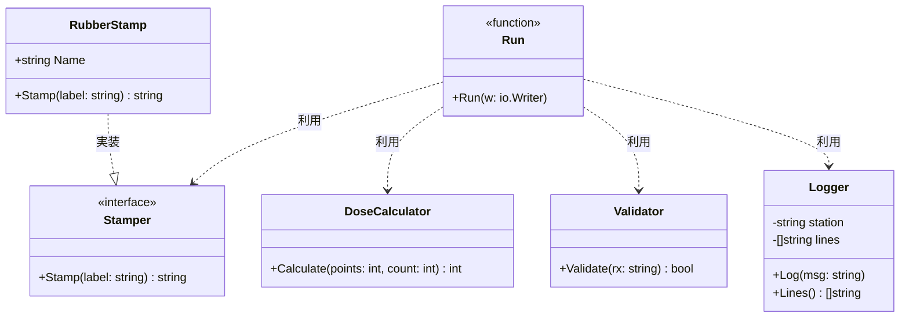
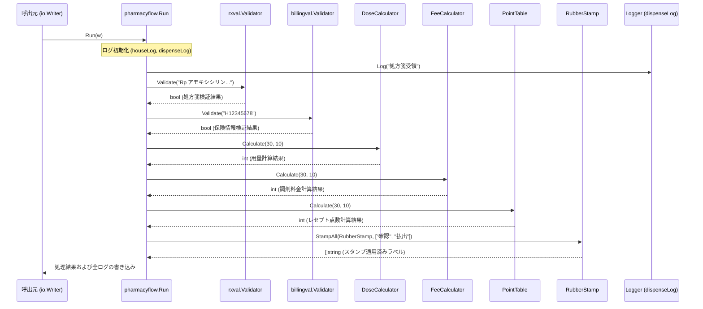

# 調剤・薬局業務管理

## はじめに
「調剤・薬局業務管理」トピックは、医療システムにおける薬局窓口および調剤室での一連の業務プロセスを管理・実行するためのコンポーネント群です。

本トピックは、処方箋の受付から、記載内容のバリデーション、用量計算、薬袋やラベルへのスタンプ（検印）処理、会計・レセプト請求システムとの連携、および業務ログの記録にいたるまで、薬局窓口における一連のワークフローを統合する役割を担っています。

---

## アーキテクチャと設計
本トピックは、ドメインロジックの関心事ごとにパッケージが分割されており、それらを上位のアプリケーションフロー層が統合する**レイヤードアーキテクチャ**および**パイプライン/トランザクションスクリプトパターン**を採用しています。

- **ドメイン層 (`pharmacy`)**: 用量計算やスタンプ処理などの純粋なビジネスルールを定義します。インターフェース（`Stamper`）を活用することで、具体的なスタンプの実装に依存しない設計となっています。
- **バリデーション層 (`pharmacy/validation`)**: 処方箋データの整合性を検証する単一の責務を持ちます。
- **ロギング層 (`pharmacy/logging`)**: 調剤業務に特化したコンテキスト（ステーション名など）を持つログ記録を提供します。
- **アプリケーションフロー層 (`pharmacyflow`)**: 窓口業務のシナリオ（ユースケース）を表現し、各コンポーネントおよび外部ドメイン（会計、レセプト、カーネル）をオーケストレートします。

### コンポーネント関係図

### トピックコンポーネント

| コンポーネント | 責務 |
|-----------|----------------|
| `DoseCalculator` | 調剤における用量や点数の計算ロジックを提供します。 |
| `Stamper` | 薬袋や確認書類へのスタンプ押印処理を抽象化するインターフェースです。 |
| `RubberStamp` | `Stamper` インターフェースの具体的な実装であり、特定の部署名や担当者名でのスタンプ押印を行います。 |
| `Validator` (`pharmacy/validation`) | 入力された処方箋（Rp）のフォーマットが正しいかを検証します。 |
| `Logger` (`pharmacy/logging`) | 調剤室などの特定の業務ステーションに紐づくログをメモリ内に蓄積・管理します。 |
| `pharmacyflow` | 薬局窓口における受付から調剤、計算、確認、ログ出力までの一連の業務フローをシミュレート・実行します。 |

---

## データフロー

以下は、薬局窓口フロー（`pharmacyflow.Run`）が実行された際の一連の処理の流れを示すシーケンス図です。

---

## 主要コンポーネント

### 1. 調剤計算・スタンプ処理 (`pharmacy` パッケージ)

#### `DoseCalculator` 構造体
調剤における用量計算を行います。
*   **`Calculate(points, count int) int`**
    *   与えられた点数（`points`）と回数（`count`）を掛け合わせて総量を計算します。
    *   `guard.EnsurePositive` を使用して、入力された点数が正の数であることを保証します。

#### `Stamper` インターフェース
スタンプ処理を抽象化します。
*   **`Stamp(label string) string`**
    *   対象のラベル文字列に対してスタンプを適用した文字列を返します。

#### `RubberStamp` 構造体
`Stamper` インターフェースの具体的な実装です。
*   **`Name`** (string): スタンプの名称（例: "薬剤部"）。
*   **`Stamp(label string) string`**
    *   `[{Name}] {label}` の形式でフォーマットされた文字列を返します。

#### `StampAll` 関数
*   **`StampAll(s Stamper, labels []string) []string`**
    *   引数で受け取った `Stamper` を用いて、スライス内のすべてのラベルに順次スタンプ処理を適用し、新しいスライスとして返します。

---

### 2. 処方箋バリデーション (`pharmacy/validation` パッケージ)

#### `Validator` 構造体
処方箋データの妥当性検証を行います。
*   **`Validate(rx string) bool`**
    *   処方箋を意味する文字列 `rx` が、正しい接頭辞（`"Rp"`）で開始されているかを検証します。

---

### 3. 調剤ロギング (`pharmacy/logging` パッケージ)

#### `Logger` 構造体
調剤業務に特化したログをメモリ内に保持します。
*   **`New(station string) *Logger`**
    *   特定のステーション名（例: "調剤室"）を指定して、新しい `Logger` インスタンスを生成します。
*   **`Log(msg string)`**
    *   `[調剤] {station}: {msg}` の形式でログメッセージをフォーマットし、内部スライスに蓄積します。
*   **`Lines() []string`**
    *   これまでに記録されたすべてのログ行を返します。

---

### 4. 薬局業務フロー (`reception-desk/internal/flows/pharmacyflow` パッケージ)

#### `pharmacyflow` パッケージ
*   **`Run(w io.Writer)`**
    *   薬局窓口における一連の業務シナリオをシミュレートします。
    *   処方箋の受領ログ記録、処方箋および保険情報のバリデーション、用量・調剤料・レセプト点数の計算、薬袋へのスタンプ押印、および最終的なログの統合出力を一括して実行します。

---

## 依存関係

本トピックは、システム内の以下の外部パッケージおよび共通基盤（Kernel）に依存しています。

1.  **`example.com/iryo/kernel/guard`**
    *   `DoseCalculator` における入力値の正数保証（`EnsurePositive`）のために依存しています。
2.  **`example.com/iryo/kernel/logging`**
    *   薬局窓口全体のシステムログ記録（`klog.New`）のために依存しています。
3.  **`example.com/iryo/billing`**
    *   窓口での調剤料金計算（`FeeCalculator`）のために依存しています。
4.  **`example.com/iryo/billing/validation`**
    *   患者の保険情報の有効性検証（`billingval.Validator`）のために依存しています。
5.  **`example.com/iryo/legacy-claims`**
    *   レセプト請求用の点数計算（`rezept.PointTable`）のために依存しています。