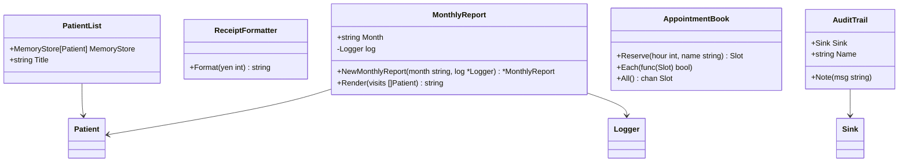
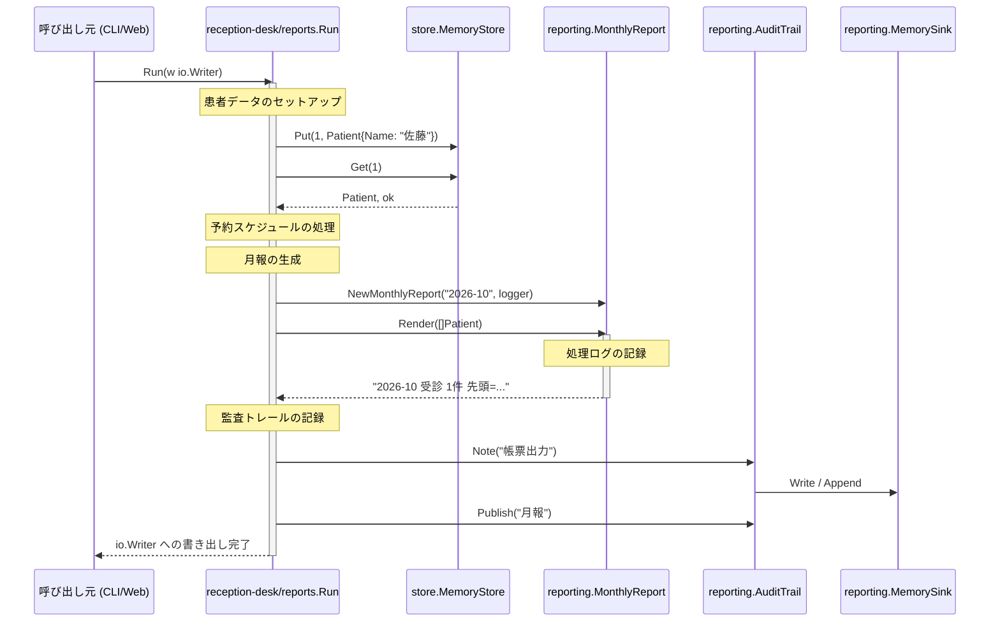

# 業務バッチ・レポート・帳票出力

## はじめに

本ドキュメントは、医療事務システムにおける「業務バッチ」「レポート（月報など）」「帳票出力」および「会計領収書フォーマット」に関する仕様と設計をまとめたテクニカルドキュメントです。

これらのコンポーネントは、日次の締め処理や点検バッチ、患者の受診状況をまとめる月報、受付業務における各種帳票の出力など、システムのバックオフィスおよびフロントオフィス業務を支える重要な機能を担っています。

---

## アーキテクチャと設計

本トピックのコンポーネント群は、ドメイン層、データアクセス層、およびプレゼンテーション層（テキスト出力）を横断的に統合し、エンドユーザーや管理者向けの出力を生成する役割を持っています。

### 設計の特徴
1. **出力の抽象化 (`io.Writer` の活用)**
   日次バッチや帳票出力の実行関数（`Run`）は、具体的な出力先（標準出力、ファイル、ネットワーク等）に依存しないよう、`io.Writer` インターフェースを受け取る設計になっています。これにより、テスト容易性と再利用性が高められています。
2. **共通フォーマッタの利用**
   サードパーティ製のテキスト整形ライブラリ（`example.com/thirdparty/textfmt`）をラップした `textreport` パッケージを各コンソール（管理・受付）に配置し、一貫したレイアウト（見出し、テーブル、右寄せ等）を提供しています。
3. **ジェネリクスによるデータ操作**
   `store.MemoryStore` や `cache.New` などのジェネリックなデータ構造を活用し、型安全なデータ集計やフィルタリングを実現しています。

### コンポーネント関係図



### トピックコンポーネント

| コンポーネント | 責務 |
|-----------|----------------|
| `batch.Run` (admin-console) | 管理コンソールにおける日次点検バッチ処理を実行する。ログ記録、バリデーション、金額換算を行う。 |
| `textreport` (admin-console / reception-desk) | サードパーティ製ライブラリを用いて、テキストベースの帳票（見出し、テーブル、金額行）を整形する。 |
| `ReceiptFormatter` (billing/text) | 会計処理における領収書のテキスト表現（金額フォーマット）を生成する。 |
| `closing.Run` (reception-desk) | 受付業務における日次締め処理を実行する。ログ記録、バリデーション、金額換算を行う。 |
| `reports.Run` (reception-desk) | 患者データ、予約スケジュール、監査ログ、病棟情報などを統合し、デモンストレーション用の帳票出力を実行する。 |
| `MonthlyReport` (reporting) | 指定された月の患者受診状況をまとめ、フォーマットされた月報テキストを生成する。 |
| `LabelAll` (reporting) | `Label()` メソッドを持つ任意のオブジェクトスライスから、ラベル文字列のスライスを抽出するジェネリック関数。 |

---

## データフロー

以下は、受付業務における帳票出力（`reports.Run`）および月報生成（`MonthlyReport.Render`）が実行される際のデータフローです。



---

## 主要コンポーネント

### 1. 日次バッチ・日次締め処理

#### `admin-console/internal/batch.Run(w io.Writer)`
管理コンソール側の日次バッチ処理のエントリポイントです。
- `logging.New("日次点検")` を用いてログを生成します。
- `validation.Validator` によるID検証（例: `"H12345678"`）を行います。
- `pointmath.ToYen(15)` を用いて、医療点数から日本円への換算を行います。

#### `reception-desk/internal/flows/closing.Run(w io.Writer)`
受付業務側の日次締め処理のエントリポイントです。処理内容は管理コンソールの日次バッチと類似していますが、受付ドメインのコンテキスト（`example.com/iryo/billing` や `example.com/iryo/kernel`）に依存して動作します。

---

### 2. テキストレポート整形 (`textreport` パッケージ)

管理コンソールおよび受付業務の双方で提供されている、テキスト帳票整形のユーティリティです。

- **`Heading(title string) string`**
  タイトルを大文字に変換し、隅付き括弧（`【`、`】`）で装飾します。
- **`Render(title string, rows [][2]string) string`**
  2次元配列のデータをテーブル形式に整形し、タイトル付きのテキストとして出力します。
- **`Line(label string, yen int) string`**
  ラベルを右詰めでパディングし、金額（円）と結合した1行のテキストを生成します。

---

### 3. 会計領収書フォーマッタ (`billing/text`)

#### `ReceiptFormatter`
会計処理における領収書出力を担当する構造体です。
- **`Format(yen int) string`**
  整数値の金額を受け取り、`"[会計] 150円"` のような定型テキストを返します。

---

### 4. 帳票出力フロー (`reception-desk/internal/flows/reports`)

#### `reports.Run(w io.Writer)`
受付業務における総合的な帳票出力デモンストレーションを実行します。以下の多岐にわたる処理を統合しています。
- インメモリデータストア（`store.MemoryStore`）を用いた患者情報の登録・取得・集計。
- キャッシュ（`cache.New`）を用いたバイタルデータ（血圧等）の管理。
- 予約システム（`scheduling.AppointmentBook`）からの予約枠の抽出と、ジェネリクス/インターフェースを用いたラベルの抽出。
- 北病棟（`north.Ward`）および南病棟（`south.Ward`）のベッド数情報の出力。
- 監査トレール（`reporting.AuditTrail`）へのログ出力。

---

### 5. レポーティングドメイン (`reporting` パッケージ)

#### `MonthlyReport`
月次の受診レポートを管理する構造体です。
- **`NewMonthlyReport(month string, log *logging.Logger) *MonthlyReport`**
  対象月とロガーを指定してインスタンスを生成します。
- **`Render(visits []patient.Patient) string`**
  受診患者リストを受け取り、受診件数および先頭患者の情報を記載した月報テキストをレンダリングします。

#### `LabelAll[X interface{ Label() string }](items []X) []string`
Goのジェネリクスを利用したヘルパー関数です。`Label() string` メソッドを実装している任意の型のスライスを受け取り、それぞれのラベル文字列を抽出したスライスを返します。

---

## 依存関係

本トピックのコンポーネントは、以下の外部パッケージおよび内部共通パッケージに依存しています。

```
[admin-console / reception-desk]
   │
   ├─► [example.com/thirdparty/textfmt] (サードパーティ製テキスト整形)
   │
   ├─► [example.com/iryo/kernel/logging] (共通ロギング)
   │
   ├─► [example.com/iryo/domain/patient] (患者ドメインモデル)
   │
   ├─► [example.com/iryo/scheduling] (予約スケジュール管理)
   │
   └─► [example.com/iryo/reporting] (レポート共通ドメイン)
```

### 主な依存先パッケージ
- **`example.com/thirdparty/textfmt`**: テキストのテーブル表示やパディング、装飾を行うための外部ライブラリ。
- **`example.com/iryo/kernel/logging`**: システム全体の標準ログフォーマットを提供する共通基盤。
- **`example.com/iryo/domain/patient` / `wards`**: 患者情報や病棟情報などのコアビジネスドメイン。
- **`example.com/iryo/data/store` / `cache`**: インメモリでのデータ永続化およびキャッシュ機構を提供するデータアクセスレイヤー。