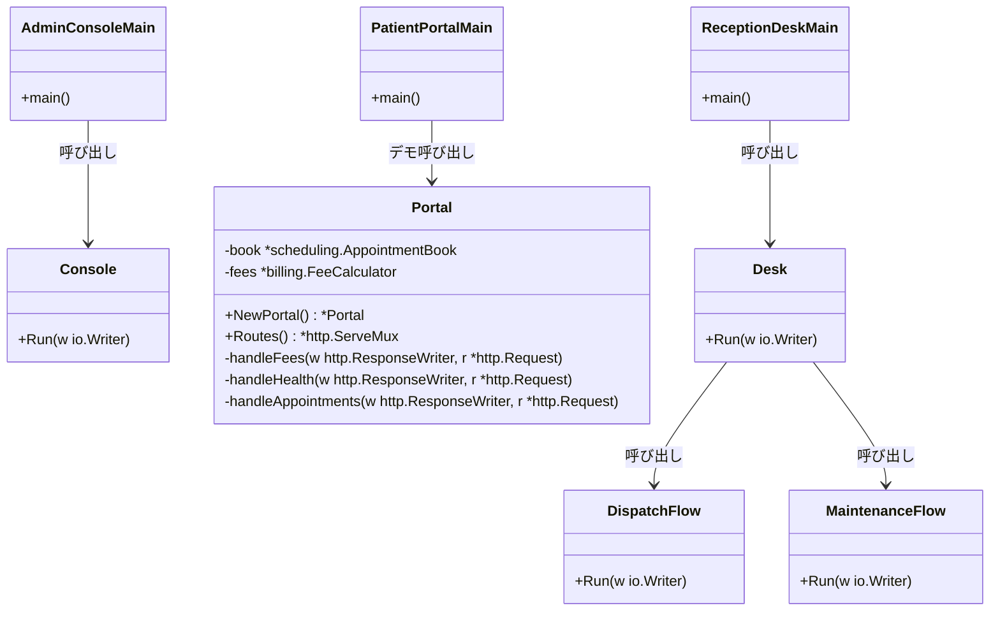
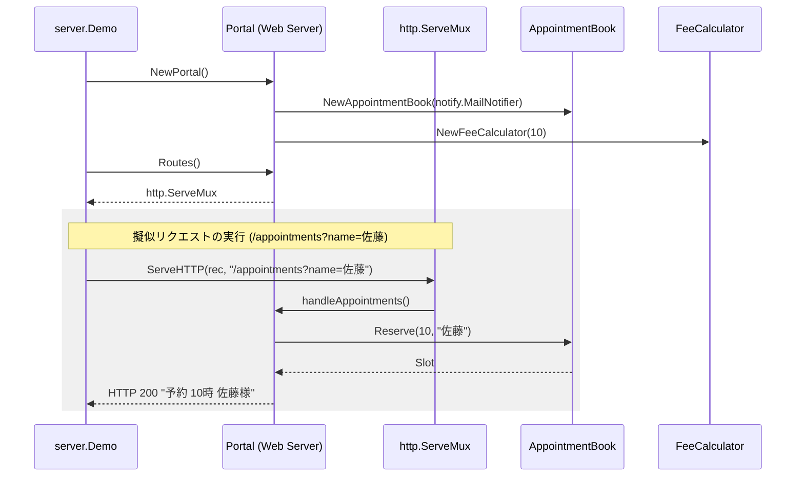

# アプリケーション実行制御・デモ

## はじめに
本トピックは、医療システム（`iryo`）を構成する3つの主要アプリケーション（**管理コンソール**、**患者ポータル**、**受付デスク**）の起動エントリーポイント、およびそれぞれの実行制御フローとデモンストレーション機能を管理します。

システム全体の各ドメイン（会計、予約、患者、レポート、通知、監査など）を統合し、実際の業務シナリオに沿った動作検証やシミュレーションを行うためのハブとして機能します。

---

## アーキテクチャと設計

本トピックでは、システムの保守性とテスト容易性を高めるために以下の設計パターンが採用されています。

1. **CLI/Webエントリーポイントパターン**
   各アプリケーションの `main` パッケージ（`cmd/...`）は極めて薄く実装されており、実際の実行制御ロジックは `internal` パッケージ（`console`, `server`, `desk`）に委譲されています。これにより、標準入出力（`io.Writer`）を差し替えたテストやデモの実行が容易になります。
2. **ファサード / パイプラインパターン**
   `console.Run` や `desk.Run` は、複数のサブシステム（バッチ、会計、チェックイン、薬局、レポートなど）を順次実行するパイプライン（ファサード）として機能し、複雑な業務フローを一本化します。
3. **HTTPハンドラーパターン（患者ポータル）**
   `patient-portal` は `http.ServeMux` を使用したWebサーバーアーキテクチャを採用しています。ドメインサービス（`AppointmentBook`, `FeeCalculator`）を構造体に注入し、各エンドポイントをハンドラーメソッドとして公開しています。
4. **関数型プログラミングと動的制御（振り分けフロー）**
   `dispatch` パッケージでは、Go言語の第一級関数、クロージャ、遅延評価、ゴルーチン、パニックハンドリング（`recover`）などの機能を駆使し、動的な処理の振り分けやエラーハンドリングを実証・検証しています。

### コンポーネント関係図



### トピックコンポーネント

| コンポーネント | 責務 |
|-----------|----------------|
| **admin-console (main)** | 管理コンソールアプリケーションの起動エントリーポイント。標準出力を引数として `console.Run` を呼び出す。 |
| **console** | 管理コンソールのメインシナリオ制御。バッチ処理、診療報酬計算、月次レポート出力、通知送信、監査ログ記録を順次実行する。 |
| **patient-portal (main)** | 患者ポータルアプリケーションの起動エントリーポイント。`server.Demo` を呼び出してデモを実行する。 |
| **Portal** | 患者ポータルのWebサーバー。予約管理（`AppointmentBook`）と診療費計算（`FeeCalculator`）を保持し、HTTPエンドポイントを提供する。 |
| **reception-desk (main)** | 受付デスクアプリケーションの起動エントリーポイント。`desk.Run` を呼び出す。 |
| **desk** | 受付業務全体のデモシナリオ制御。チェックインから会計、薬局、締め、振り分け、レポート、メンテナンスまでの一連のフローを順次実行する。 |
| **dispatch** | 受付業務における「振り分け」フロー。Goの関数型プログラミング機能（高階関数、クロージャ、ゴルーチン、リカバリなど）を用いた動的制御のデモと検証を行う。 |
| **maintenance** | 受付業務における「保守」フロー。システム全体のモジュール（ID管理、マスタロード、エクスポート、リフレクション、メモリサイズ検証など）の動作確認とシミュレーションを実行する。 |

---

## データフロー

以下は、**患者ポータル（patient-portal）**におけるデモ実行時のデータフローです。
`httptest.ResponseRecorder` を用いて、実際のネットワークソケットを介さずにインメモリでHTTPリクエストをシミュレーションし、各ハンドラーの動作を検証します。



---

## 主要コンポーネント

### 1. 管理コンソール（admin-console）

#### `console.Run(w io.Writer)`
管理コンソールのメインシナリオを実行します。
- `guard.Require` によるアクセス制御の検証
- `billing.FeeCalculator` による診療報酬計算
- `reporting.MonthlyReport` による月次レポート生成
- `notify.Notifier` によるメール通知送信
- `audit.ConsoleLogger` による監査ログ出力
- `textreport` パッケージによる整形テキストレポートの出力

### 2. 患者ポータル（patient-portal）

#### `server.Portal`
患者ポータルのWebサーバーを表す構造体です。
```go
type Portal struct {
	book *scheduling.AppointmentBook
	fees *billing.FeeCalculator
}
```

- **`NewPortal() *Portal`**: `Portal` 構造体を初期化します。内部で `MailNotifier` を生成し、`AppointmentBook` に注入します。
- **`Routes() *http.ServeMux`**: ルーティングを定義します。
  - `/fees`: 診療費計算ハンドラー（`handleFees`）
  - `/health`: ヘルスチェックハンドラー（`handleHealth`）
  - `/appointments`: 予約ハンドラー（`handleAppointments`）
- **`Demo(out io.Writer)`**: `httptest.NewRecorder` を使用して、定義されたエンドポイントに対して疑似的なHTTP GETリクエストを送信し、レスポンスを検証・出力します。

### 3. 受付デスク（reception-desk）

#### `desk.Run(w io.Writer)`
受付業務デモのマスターシナリオです。以下のサブフローを順番に実行し、最後に日次サマリーレポートを出力します。
1. `checkin.Run` (チェックイン)
2. `accounting.Run` (会計)
3. `pharmacyflow.Run` (薬局)
4. `closing.Run` (締め)
5. `dispatch.Run` (振り分け)
6. `reports.Run` (レポート)
7. `maintenance.Run` (保守)

#### `dispatch.Run(w io.Writer)`
「振り分け」業務のシミュレーション。Go言語の高度な言語機能の動作検証を兼ねています。
- **関数値とエイリアス**: `billing.Round` や `logging.Log` を変数やマップ（`Hooks`）に代入して動的に呼び出します。
- **クロージャ**: `makeAdder` による状態を持った関数の生成。
- **並行処理**: `sync.WaitGroup` とゴルーチンを用いた並行処理の実行。
- **パニックリカバリ**: `recover` を使用して、不正な診療報酬計算（負の値）によるパニックから安全に回復する機構のデモ。

#### `maintenance.Run(w io.Writer)`
システム保守業務のシミュレーション。低レイヤーの操作やシステム情報の取得を行います。
- **プラットフォーム情報とメトリクス**: `platform.Describe()` や `metrics.Elapsed()` によるシステム情報の出力。
- **マスタデータロード**: `tariff.Load()` による診療報酬点数表の読み込み。
- **データエクスポート**: `exporters.ExportAll` によるCSV/XML形式への一括出力。
- **リフレクションとメモリ操作**: `unsafe.Sizeof` による構造体サイズの取得、および `reflect` パッケージを用いた動的なメソッド（`Describe`）の呼び出し。

---

## 依存関係

本トピックは、システムのほぼすべてのドメインパッケージおよびカーネルパッケージに依存し、それらを統合しています。

```
[admin-console / patient-portal / reception-desk]
  │
  ├─► [domain]
  │     └─ patient (患者ドメインモデル)
  │
  ├─► [billing] (診療報酬計算、端数処理、税計算、点数表マスタ)
  │
  ├─► [scheduling] (予約管理)
  │
  ├─► [reporting] (月次・監査レポート、監査トレイル)
  │
  ├─► [pharmacy] (調剤・スタンプ)
  │
  ├─► [interop] (外部連携)
  │     ├─ records (データ連携レコード)
  │     ├─ exporters (CSV/XMLエクスポート)
  │     ├─ idkit (患者ID管理・トラッカー)
  │     └─ lookup (外部参照解決)
  │
  ├─► [kernel] (基盤機能)
  │     ├─ guard (アクセス制御)
  │     ├─ logging (ロギング)
  │     ├─ notify (通知サービス)
  │     ├─ audit (監査ログ)
  │     ├─ registry (サービスレジストリ)
  │     ├─ metrics (システムメトリクス)
  │     ├─ platform (プラットフォーム情報)
  │     ├─ fastmath (高速計算ユーティリティ)
  │     └─ escalation (エスカレーションポリシー)
  │
  └─► [legacy-claims] (レガシーレセプト請求 - rezept)
```