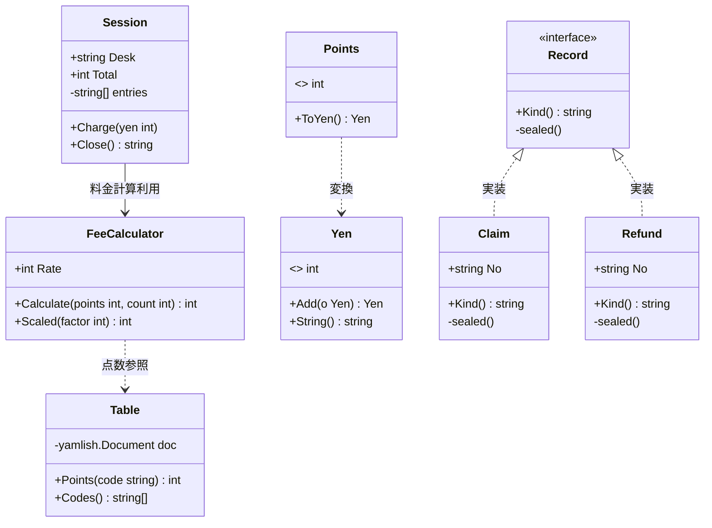
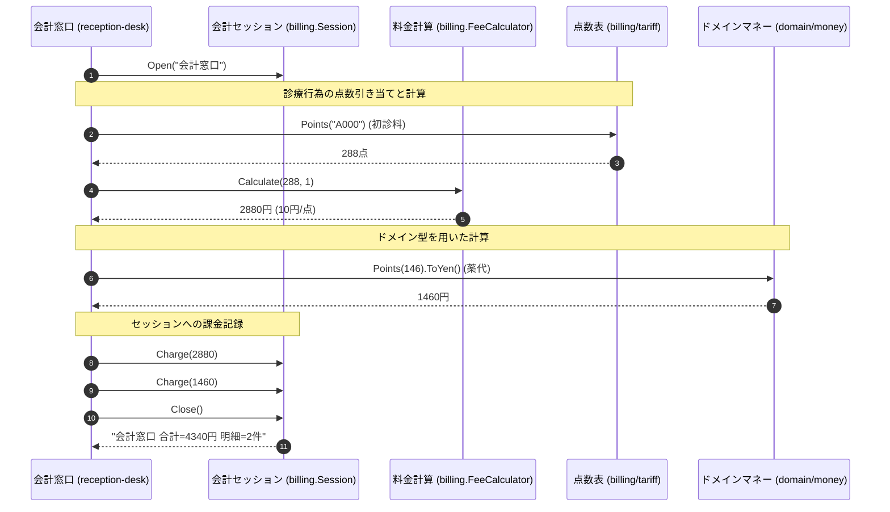

# 医療会計・診療報酬管理

## はじめに
「医療会計・診療報酬管理」トピックは、医療機関における患者の診療費計算、窓口会計、診療報酬点数（タリフ）の管理、およびレセプト（診療報酬明細書）請求データの作成を担うコアモジュールです。

本システムにおいて、このトピックは受付窓口（`reception-desk`）、管理コンソール（`admin-console`）、および患者ポータル（`patient-portal`）の交差点に位置づけられています。日本の医療保険制度における「点数から円への換算（1点＝10円）」を基本としつつ、時間帯や状況に応じた支払ポリシーの適用、窓口での会計セッション管理、新旧システム（レガシーレセプト）間でのデータ相互運用、調剤報酬計算などの多様な会計要件を統一的にサポートします。

---

## アーキテクチャと設計
本トピックは、**ドメイン駆動設計（DDD）**のパターンを取り入れ、ビジネスルールを明確にカプセル化しています。

1. **ドメインモデルの分離 (`domain/money`)**:
   金額を表す `Yen` と、診療報酬点数を表す `Points` を独自の型（Value Object）として定義し、型安全な計算を保証しています。これにより、点数と円の混同によるバグを未然に防ぎます。
2. **ポリシーパターンによる柔軟な料金計算 (`kernel/policy`)**:
   標準料金（`StandardPolicy`）や夜間・緊急料金（`UrgentPolicy`）など、状況に応じた料金計算ルールをポリモーフィズムを用いて切り替え可能にしています。
3. **シールドインターフェースによる型安全な相互運用 (`interop/records`)**:
   Go言語における非公開メソッド（`sealed()`）を利用したインターフェース設計を採用し、パッケージ外での独自の `Record` 実装を制限することで、請求（`Claim`）と返金（`Refund`）の整合性を担保しています。
4. **データ駆動型の点数管理 (`billing/tariff`)**:
   診療報酬点数表（タリフ）をコードから分離し、YAML形式のマスターデータから動的にロードする設計となっています。

### コンポーネント関係図

### トピックコンポーネント

| コンポーネント | 責務 |
|-----------|----------------|
| **`billing.FeeCalculator`** | 点数と回数、および設定されたレート（単価）を基に、医療費の計算を行う。端数処理や税計算のユーティリティも提供。 |
| **`billing.Session`** | 会計窓口における1回分の会計セッションを管理し、課金の累積と明細の記録、最終集計を行う。 |
| **`billing.tariff.Table`** | 診療報酬点数表（タリフ）を管理し、診療コード（例: `A000`）から点数を検索する。 |
| **`billing.validation.Validator`** | 請求処理におけるID（レセプトID等）の妥当性を検証する。 |
| **`domain/money.Yen`** | 日本円の金額を表す値オブジェクト。金額の加算やフォーマット出力を担当。 |
| **`domain/money.Points`** | 診療報酬点数を表す値オブジェクト。1点＝10円の規則に基づき `Yen` へ変換する。 |
| **`interop/records.Record`** | 請求（`Claim`）や返金（`Refund`）などの会計記録を統一的に扱うシールドインターフェース。 |
| **`legacy-claims.PointTable`** | レガシーなレセプト請求システムにおける、独自の加算ロジックを含む点数計算を行う。 |
| **`pharmacy.pointmath`** | 調剤報酬向けに、独自の倍率（10.8倍）を適用した点数から円への変換を行う。 |

---

## データフロー
会計窓口（`reception-desk`）における一般的な会計処理および請求書出力のデータフローを以下に示します。

---

## 主要コンポーネント

### 1. 料金計算 (`billing` パッケージ)
医療費の計算を担う中心的なパッケージです。

*   **`FeeCalculator` (構造体)**:
    *   `Rate`: 1点あたりの単価（通常は10円）。
    *   `Calculate(points, count int) int`: 点数と回数を掛け合わせ、レートを適用して円換算します。内部で `guard.EnsurePositive` を使用し、計算結果が正数であることを保証します。
    *   `Scaled(factor int) int`: 内部的に `Calculate(factor, 10)` を呼び出し、スケールされた値を計算します。
*   **`Round(yen int) int`**:
    10円未満を切り捨てる端数処理を行います（例: `1234` -> `1230`）。
*   **`AddTax(yen int) int`**:
    10%の消費税を加算します。

### 2. 会計セッション (`billing/session.go`)
窓口での一連の会計処理をステートフルに管理します。

*   **`Session` (構造体)**:
    *   `Desk`: 会計を行う窓口名（例: "会計窓口"）。
    *   `Total`: 累積された合計金額（円）。
    *   `entries`: 課金明細の履歴。
*   **`Open(desk string) *Session`**:
    指定された窓口名でセッションを開始します。
*   **`Charge(yen int)`**:
    金額をセッションの合計に累積し、明細に記録します。
*   **`Close() string`**:
    セッションを終了し、合計金額と明細件数をフォーマットしたサマリー文字列を返します。

### 3. 診療報酬点数表 (`billing/tariff` パッケージ)
診療報酬点数（タリフ）のマスターデータを保持します。

*   **`Table` (構造体)**:
    *   埋め込まれたYAMLデータ（`A000: 288` (初診料), `A001: 73` (再診料) など）を解析し、点数表を保持します。
*   **`Load() (*Table, error)`**:
    YAMLデータを解析して `Table` インスタンスを生成します。
*   **`Points(code string) int`**:
    診療コードに対応する点数を取得します。存在しない場合や解析エラー時は `0` を返します。

### 4. ドメインマネー (`domain/money` パッケージ)
会計処理における金額と点数を表す値オブジェクトです。

*   **`Yen` (型)**:
    日本円を表す `int` のエイリアス。`Add(o Yen) Yen` による加算や、`String() string` による「〇〇円」形式の出力を提供します。
*   **`Points` (型)**:
    診療点数を表す `int` のエイリアス。`ToYen() Yen` メソッドにより、1点＝10円の標準規則に基づき `Yen` 型に変換できます。

### 5. 相互運用レコード (`interop/records` パッケージ)
新旧システム間や外部システムとのデータ連携を安全に行うためのパッケージです。

*   **`Record` (インターフェース)**:
    *   `Kind() string` と非公開メソッド `sealed()` を持ちます。パッケージ外での勝手な実装を防ぐシールドインターフェースパターンを採用しています。
*   **`Claim` / `Refund` (構造体)**:
    *   `Record` インターフェースを実装する構造体で、それぞれ「請求」「返金」の区分を表します。

---

## 依存関係
本トピックは、システム内の以下のトピックおよび外部パッケージに依存しています。

1.  **`kernel/guard`**:
    料金計算時の事前条件検証（`EnsurePositive`）や、権限チェック（`Require`）に依存。
2.  **`kernel/policy`**:
    会計窓口（`reception-desk`）において、支払ポリシー（`StandardPolicy`, `UrgentPolicy`）を適用するために依存。
3.  **`kernel/logging` / `kernel/notify`**:
    管理コンソールや患者ポータルでのログ出力、および処理完了通知（メール送信など）に依存。
4.  **`example.com/thirdparty/yamlish`**:
    タリフ（点数表）のYAML解析に依存。
5.  **`scheduling` / `domain/patient`**:
    患者ポータル（`patient-portal`）において、患者情報や予約枠と診療費計算を紐付けるために依存。