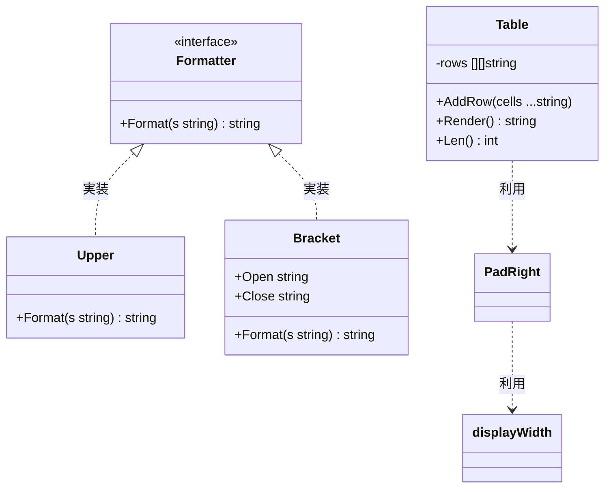
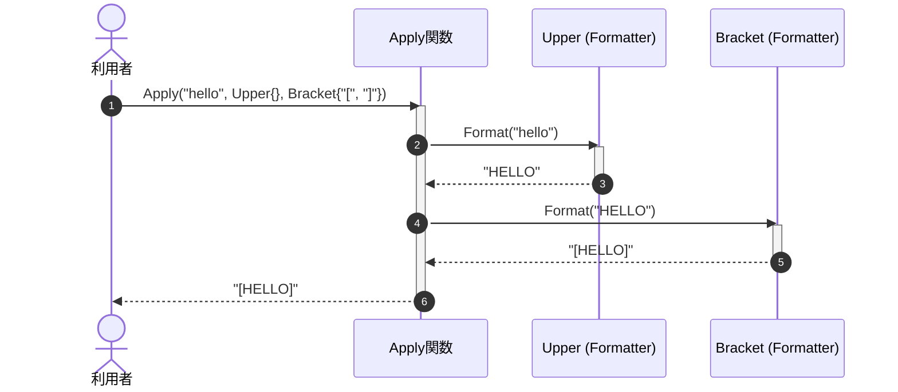
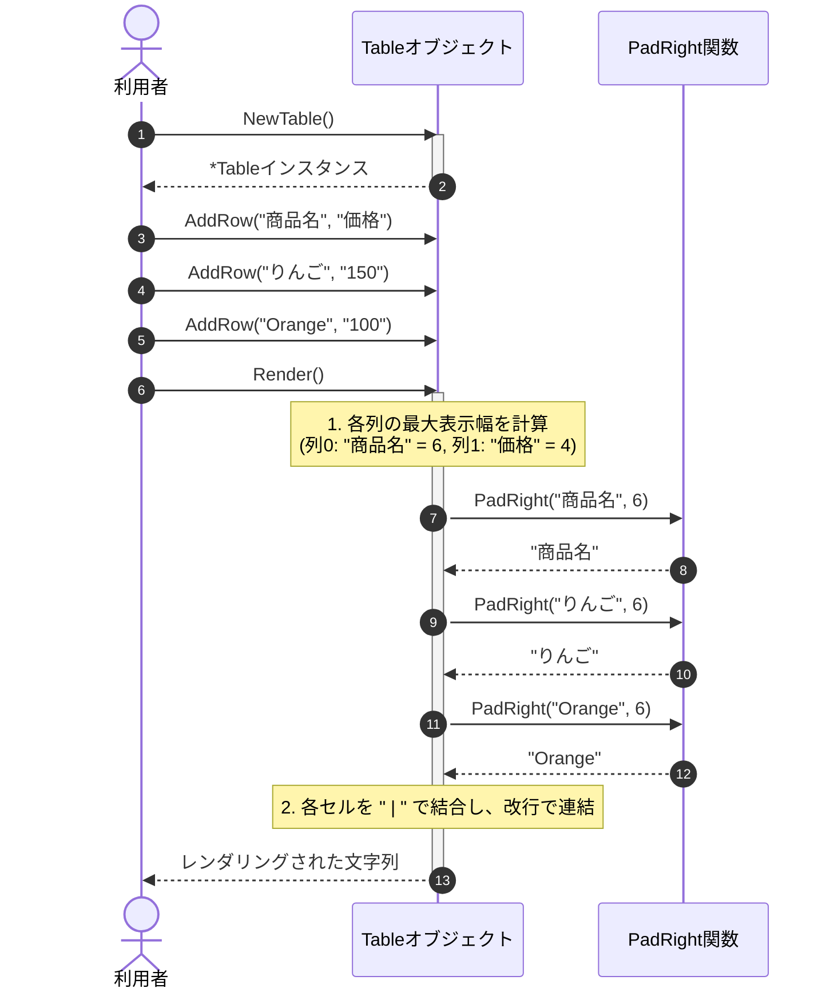

# テキスト処理・フォーマットユーティリティ

## はじめに
`textfmt` パッケージは、アプリケーション内におけるテキストの装飾、フォーマット変換、および等幅フォント環境での配置制御を支援する軽量なユーティリティライブラリです。

特に、日本語の「全角文字（漢字・ひらがな・カタカナ・全角記号）」と「半角文字」が混在する環境において、文字数ではなく**視覚的な表示幅（カラム幅）**を正しく計算して位置揃え（パディング）を行う機能を提供します。これにより、CLI（コマンドラインインターフェース）ツールでの表形式出力や、テキストベースのレポート生成において、美しく整列されたレイアウトを容易に実現できます。

---

## アーキテクチャと設計

本パッケージは、シンプルさと拡張性を両立するために以下の設計パターンを採用しています。

1. **Decorator / Pipeline パターン (`Formatter`)**
   `Formatter` インターフェースを定義し、大文字変換（`Upper`）や括弧囲み（`Bracket`）などの個別の変換処理をカプセル化しています。これらは `Apply` 関数を介してパイプラインのように連続して適用できます。
2. **Builder パターン (`Table`)**
   テキストベースのテーブルを構築する際、行データを順次追加（`AddRow`）し、最終的に一括してレンダリング（`Render`）するビルダースタイルを採用しています。
3. **マルチバイト文字を考慮した表示幅計算**
   Goの標準 `len()` 関数や `utf8.RuneCountInString()` では、全角文字も半角文字も「文字数」としてカウントされるため、等幅フォントでの表示位置がズレてしまいます。本パッケージでは、文字のUnicode範囲を判定して適切な表示幅（全角=2、半角=1）を計算する仕組みを備えています。

### コンポーネント関係図



### トピックコンポーネント

| コンポーネント | 責務 |
|-----------|----------------|
| `Formatter` | テキスト変換処理の共通インターフェース。 |
| `Upper` | 文字列をすべて大文字に変換する `Formatter` 実装。 |
| `Bracket` | 文字列を指定した開始・終了記号で囲む `Formatter` 実装。 |
| `Table` | 複数行・複数列のテキストデータを等幅で整列した表形式の文字列にレンダリングする構造体。 |
| `Apply` | 複数の `Formatter` を順次適用するユーティリティ関数。 |
| `PadRight` | 東アジアの全角文字を考慮し、指定された表示幅になるよう右側に半角スペースを埋める関数。 |
| `Title` | 文字列内の各単語の先頭文字を大文字に変換する関数（マルチバイト文字の先頭にも対応）。 |
| `displayWidth` | 文字列の視覚的な表示幅（全角=2、半角=1）を計算する内部関数。 |

---

## データフロー

### 1. フォーマッタの適用パイプライン (`Apply`)
複数のフォーマッタを順次適用し、最終的な装飾テキストを得るフローです。



### 2. テーブルの構築とレンダリング (`Table`)
行データを追加し、各列の最大表示幅を自動計算して整列されたテーブルを出力するフローです。



---

## 主要コンポーネント

### 1. Formatter インターフェースと実装

テキストを変換するための統一インターフェースと、その標準実装です。

```go
type Formatter interface {
    Format(s string) string
}
```

#### `Upper`
文字列をすべて大文字に変換します。
* **メソッド**: `Format(s string) string`

#### `Bracket`
文字列を指定した `Open`（開始記号）と `Close`（終了記号）で囲みます。
* **フィールド**:
  * `Open string`: 開始記号（例: `[`）
  * `Close string`: 終了記号（例: `]`）
* **メソッド**: `Format(s string) string`

#### `Apply` 関数
可変長引数で受け取った複数の `Formatter` を、指定された文字列に対して左から順に適用します。

```go
func Apply(s string, fs ...Formatter) string
```

* **使用例**:
  ```go
  result := textfmt.Apply("golang", textfmt.Upper{}, textfmt.Bracket{Open: "<<", Close: ">>"})
  // 出力: "<<GOLANG>>"
  ```

---

### 2. 表示幅計算とパディング

日本語などの全角文字が混在するテキストを正しく整列させるための機能です。

#### `displayWidth` 関数（内部関数）
文字列の視覚的な表示幅を計算します。
* **判定ロジック**:
  * Unicodeの `Han`（漢字）、`Hiragana`（ひらがな）、`Katakana`（カタカナ）の範囲に属する文字、および `0xFF01` から `0xFF60`（全角の英数・記号）の範囲の文字は **幅 2** と判定します。
  * それ以外の文字（半角英数、半角カナなど）は **幅 1** と判定します。

#### `PadRight` 関数
文字列 `s` の表示幅が指定された `width` に満たない場合、右側に半角スペースを埋めて位置を揃えます。すでに `width` 以上の表示幅がある場合は、文字列をそのまま返します。

```go
func PadRight(s string, width int) string
```

* **使用例**:
  ```go
  // "Go" (幅2) を幅6にパディング -> 右にスペース4つ
  fmt.Printf("'%s'\n", textfmt.PadRight("Go", 6)) // 'Go    '
  
  // "言語" (幅4) を幅6にパディング -> 右にスペース2つ
  fmt.Printf("'%s'\n", textfmt.PadRight("言語", 6)) // '言語  '
  ```

---

### 3. テキスト変換ユーティリティ

#### `Title` 関数
文字列に含まれる各単語の先頭文字を大文字に変換します。Go標準の `strings.Title`（非推奨）の代替として、UTF-8マルチバイト文字の先頭文字のデコードに対応しています。

```go
func Title(s string) string
```

* **使用例**:
  ```go
  fmt.Println(textfmt.Title("hello world")) // "Hello World"
  fmt.Println(textfmt.Title("日本語 hello")) // "日本語 Hello"
  ```

---

### 4. Table 構造体

等幅のテキストテーブルを生成するためのコンポーネントです。

#### メソッド仕様
* `NewTable() *Table`: 新しい `Table` インスタンスを生成します。
* `AddRow(cells ...string)`: テーブルに行を追加します。
* `Len() int`: 現在追加されている行数を返します。
* `Render() string`: 各列の最大表示幅を自動計算し、各セルを ` | ` で区切って整列したテーブル文字列を生成します。

#### 使用例
```go
table := textfmt.NewTable()
table.AddRow("ID", "商品名", "価格")
table.AddRow("001", "りんご", "150円")
table.AddRow("002", "パイナップル", "400円")
table.AddRow("003", "Banana", "100円")

fmt.Print(table.Render())
```

**出力結果**:
```text
ID  | 商品名       | 価格
001 | りんご       | 150円
002 | パイナップル | 400円
003 | Banana       | 100円
```
*※「パイナップル」（全角6文字＝表示幅12）と「Banana」（半角6文字＝表示幅6）が、表示幅を考慮して美しく右パディングされ、縦のライン（`|`）が揃っていることが確認できます。*

---

## 依存関係

本パッケージは、Goの標準ライブラリのみに依存しており、外部のサードパーティパッケージへの依存はありません。

* **`strings`**: 文字列の結合、大文字変換、リピート処理、単語分割に使用。
* **`unicode`**: 文字が漢字・ひらがな・カタカナであるかの判定に使用。
* **`unicode/utf8`**: マルチバイト文字列から先頭のルーン（Rune）を安全にデコードするために使用。