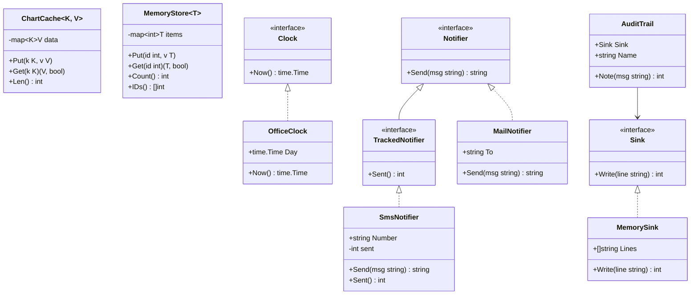
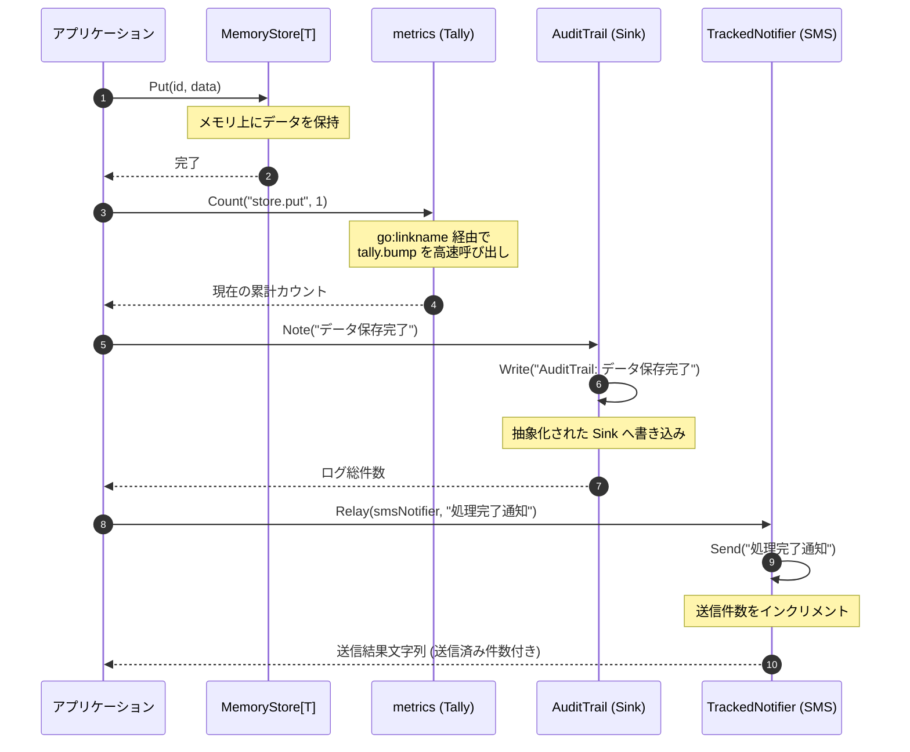

# システム共通基盤・インフラストラクチャ

## はじめに
「システム共通基盤・インフラストラクチャ」は、アプリケーション全体で共有される低レイヤの技術要素、データ管理、ユーティリティ、および外部システムとの相互運用（インターオペラビリティ）を支える共通基盤パッケージ群です。

本トピックは、ビジネスロジック（ドメイン層）から具体的なインフラストラクチャ（メモリ、OS、ハードウェア、時刻、通知、ログ出力など）への依存を抽象化し、システムのテスタビリティ、ポータビリティ、および保守性を最大化する役割を担います。

---

## アーキテクチャと設計

本基盤は、Go言語の強力な言語機能（ジェネリクス、インターフェース、ビルドタグ、アセンブリ、およびコンパイラディレクティブ）を駆使して設計されています。

### 設計の基本原則
1. **インターフェースによる抽象化**: 時刻（`Clock`）、通知（`Notifier`）、データ出力（`Exporter`）、ログ（`Logger`, `Sink`）などをインターフェース化し、具象実装（メール、SMS、CSV、XMLなど）から分離しています。これにより、テスト時のモック差し替えが容易になります。
2. **ジェネリクスによる型安全な共通データ構造**: キャッシュ（`ChartCache`）やデータストア（`MemoryStore`）をジェネリクスで実装し、任意の型に対して型安全（Type-safe）な操作を提供します。
3. **マルチプラットフォーム対応と最適化**: ビルドタグ（`//go:build`）を利用して、OS（Linux/Windows/その他）、Cgoの有無、デバッグモードに応じたコードをコンパイル時に切り替えます。また、AMD64環境向けにはアセンブリによる高速演算（`fastmath`）をサポートします。
4. **カプセル化とバックドア（`go:linkname`）**: 内部パッケージ（`tally`）の機能を `go:linkname` を用いて `metrics` パッケージに結合し、パッケージ境界を維持しつつ、ランタイムレベルの高速なメトリクス収集を実現しています。

### コンポーネント関係図



### トピックコンポーネント

| コンポーネント | 責務 |
|:---|:---|
| **`data/cache`** | ジェネリクスを用いた汎用インメモリキャッシュ（`ChartCache`）の提供。 |
| **`data/store`** | ジェネリクスを用いたインメモリデータストア（`MemoryStore`）およびスライス操作ユーティリティの提供。 |
| **`kernel/clock`** | システム時刻の抽象化（`Clock`）と、テスト容易なモック化、日付スタンプ・ラベルの生成。 |
| **`kernel/platform`** | 実行プラットフォーム（OS、Cgo、デバッグビルド）の自動判別と環境情報の提供。 |
| **`kernel/fastmath`** | アーキテクチャ最適化（AMD64アセンブリ）を考慮した高速数値計算。 |
| **`kernel/metrics`** | `go:linkname` を利用した、低オーバーヘッドのシステムメトリクス（カウンタ、ナノ秒時間）の収集。 |
| **`kernel/notify`** | 通知送信処理の抽象化（`Notifier`）と、一括送信（`Broadcast`）や追跡送信（`Relay`）の制御。 |
| **`kernel/guard`** | 必須チェックや正数チェックなどの事前条件検証（ガード条件）の提供。 |
| **`kernel/registry`** | 文字列処理ハンドラの動的登録（レジストリパターン）と一括管理。 |
| **`kernel/policy`** | 会計手数料計算などのビジネスルール（ポリシー）の定義と拡張。 |
| **`kernel/escalation`** | 病棟や重要度に応じたエスカレーションルールの評価。 |
| **`interop/exporters`** | データのマルチフォーマット（CSV/XML）エクスポートおよびアーカイブ処理の抽象化。 |
| **`interop/lookup`** | 外部コード体系の解決と文字列マッピング。 |
| **`reporting`** | 監査トレイル（`AuditTrail`）や公開ジャーナル（`Journal`）へのログ出力抽象化。 |
| **`scheduling`** | スケジューリング通知用の具体的なSMS送信実装（`SmsNotifier`）。 |

---

## データフロー

以下は、アプリケーションがデータを保存し、メトリクスを更新し、その結果を監査トレイルおよび通知システムへ連携する際の典型的なデータフローです。



---

## 主要コンポーネント

### 1. データ管理とキャッシュ (`data/cache`, `data/store`)
ジェネリクス（Go 1.18以降）をフルに活用し、任意のデータ型に対して再利用可能で型安全なデータアクセスを提供します。

*   **`ChartCache[K comparable, V any]`**:
    任意の比較可能なキー `K` と、任意の型 `V` を保持するインメモリキャッシュ。
*   **`MemoryStore[T any]`**:
    `int` 型のIDをキーとして、任意の構造体 `T` を保存するデータストア。
*   **スライスユーティリティ**:
    *   `FirstOf[T any](xs []T) T`: スライスの先頭要素を安全に取得（空の場合はゼロ値を返す）。
    *   `Sum[N Number](xs []N) N`: 制約 `Number` (`~int | ~int64 | ~float64`) を満たす数値スライスの総和を計算。
    *   `Map[T, U any](xs []T, f func(T) U) []U`: スライスの各要素に関数 `f` を適用して新しいスライスを生成。

### 2. プラットフォーム抽象化と最適化 (`kernel/platform`, `kernel/fastmath`)
実行環境の差異を吸収し、パフォーマンスを最適化します。

*   **マルチプラットフォーム対応 (`kernel/platform`)**:
    ビルドタグにより、コンパイル時に適切なファイルが選択されます。
    *   `platform_linux.go`: Linux環境用のパス（`/home/iryo`）とプラットフォーム名（`linux`）を定義。
    *   `platform_windows.go`: Windows環境用のパス（`C:\iryo`）とプラットフォーム名（`windows`）を定義。
    *   `platform_other.go`: その他のOS用のフォールバック。
    *   `accel_cgo.go` / `accel_nocgo.go`: Cgoの有効化状態に応じてアクセラレーションモード（`cgo` / `pure`）を切り替え。
    *   `platform_debug.go`: `iryodebug` ビルドタグ指定時のみデバッグ用情報を追加。
*   **高速演算 (`kernel/fastmath`)**:
    *   `add_amd64.go`: AMD64環境下では、アセンブリ実装された高速な `AddPoints` を宣言。
    *   `add_generic.go`: 非AMD64環境下での純粋なGo言語によるフォールバック実装。

### 3. メトリクスと内部リンク (`kernel/metrics`, `kernel/internal/tally`)
パフォーマンスに敏感なメトリクス収集において、パッケージのカプセル化を維持しつつ、高速なアクセスを実現するために `go:linkname` を使用しています。

*   **`go:linkname` の適用**:
    `kernel/metrics/metrics.go` 内で、非公開パッケージ `kernel/internal/tally` のプライベート関数 `bump`、および Go ランタイムの `runtime.nanotime` に直接リンクしています。
    ```go
    //go:linkname bump example.com/iryo/kernel/internal/tally.bump
    func bump(counter string, n int) int

    //go:linkname nanotime runtime.nanotime
    func nanotime() int64
    ```
    これにより、通常のパッケージエクスポートの制限を回避し、オーバーヘッドを極限まで抑えて高精度な時間計測（`Started`, `Elapsed`）とカウンタ更新（`Count`）を行います。

### 4. 時刻の抽象化とテスト (`kernel/clock`)
システム時刻への依存を排除し、テスト時に任意の時刻を注入（Dependency Injection）できるように設計されています。

*   **`Clock` インターフェース**:
    `Now() time.Time` を定義。
*   **`OfficeClock`**:
    本番または特定の業務日付を保持する具象構造体。
*   **テスト用モックとエクスポートパターン (`export_test.go`)**:
    非公開関数 `normalize` を外部テストパッケージ（`clock_test`）から検証するため、`export_test.go` で `Normalize = normalize` としてエイリアスを公開するGoのイディオムを採用しています。

### 5. 通知システム (`kernel/notify`, `scheduling`)
通知送信の仕組みを抽象化し、複数の送信チャネルや送信ステータスの追跡をサポートします。

*   **`Notifier`**: 送信を行う基本インターフェース。
*   **`TrackedNotifier`**: `Notifier` を拡張し、送信成功件数（`Sent()`）を追跡可能にするインターフェース。
*   **`SmsNotifier` (`scheduling/sms.go`)**:
    `TrackedNotifier` を実装し、送信件数を内部でカウントする実体。
*   **`Broadcast(ns []Notifier, msg string)`**:
    複数の通知先（メール、SMS等）に対して一括でメッセージを送信するユーティリティ。

### 6. ガード条件とバリデーション (`kernel/guard`)
システムの堅牢性を高めるため、不正なデータ入力を早期に検知して処理を中断（Fail-fast）させます。

*   **`Require(v any, name string) error`**:
    値が `nil` である場合に `RequiredError` を返します。
*   **`EnsurePositive(n int) int`**:
    値が負数の場合に即座に `panic` を発生させ、不正な状態での処理続行を防ぎます。

### 7. 動的レジストリ (`kernel/registry`)
文字列処理などのハンドラを動的に登録・呼び出し可能にする仕組みです。

*   **`Register(name string, h func(string) string)`**:
    パッケージの `init()` 関数などを利用して、`echo`、`upper`、`trim` などのハンドラを動的に登録します。
*   **`Call(name, arg string) string`**:
    登録されたハンドラを名前指定で動的に実行します。

---

## 依存関係

本トピック内のパッケージ群は、以下のような依存関係の階層構造を持っています。

```
[ 相互運用・レポーティング層 ]
      │  └─ interop/exporters, interop/lookup, reporting
      ▼
[ アプリケーション共通データ層 ]
      │  └─ data/cache, data/store, scheduling
      ▼
[ システム共通基盤（カーネル）層 ]
         └─ kernel/notify, kernel/audit, kernel/logging, kernel/clock,
            kernel/guard, kernel/registry, kernel/policy, kernel/escalation,
            kernel/platform, kernel/fastmath, kernel/metrics
```

### 外部依存
*   **Go 標準ライブラリ**: `time`, `strings`, `sort`, `unsafe`, `fmt` などの標準パッケージのみに依存しており、外部のサードパーティ製ライブラリへの依存はありません。これにより、軽量でポータブルな基盤が維持されています。

### 内部パッケージ間の結合度に関する注意点
*   **`kernel/metrics` と `kernel/internal/tally`**:
    `go:linkname` を用いた密結合な関係にあります。`tally` パッケージの配置や関数シグネチャを変更する際は、コンパイルエラーにならずにリンクエラー、あるいは実行時エラーになる可能性があるため、変更時には細心の注意が必要です。
*   **`scheduling` から `kernel/notify` への依存**:
    `scheduling/sms.go` の `SmsNotifier` は、`kernel/notify` の `TrackedNotifier` インターフェースを満たすように実装されています。これにより、スケジューリングドメインからカーネルの通知基盤への依存が成立しています。