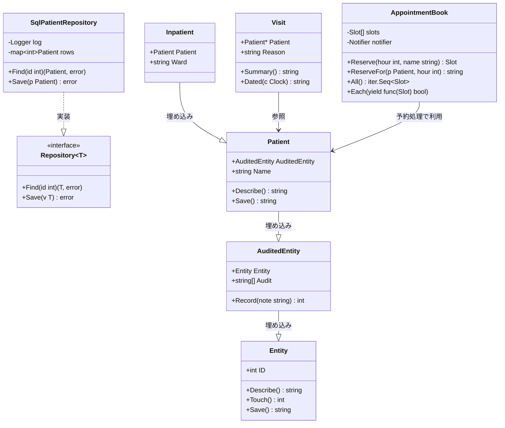
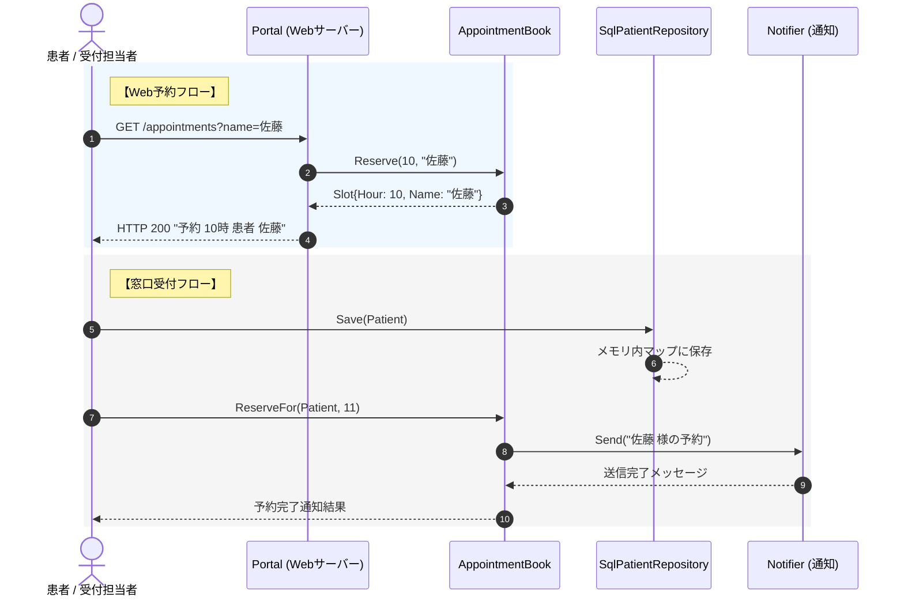

# 患者情報・受付・予約・病棟管理

## はじめに
本ドキュメントは、医療情報システムにおける「患者情報管理」「受付（チェックイン）」「診療予約」「病棟管理」を担うコアモジュールの仕様と設計について解説します。

このトピックは、来院した患者の受付から、予約の管理、入院患者の病棟割り当て、さらには患者向けポータルを通じたWeb予約や診療費の簡易計算まで、医療機関の窓口業務および病棟業務を支える中心的な役割を担っています。

---

## アーキテクチャと設計
本システムは、**ドメイン駆動設計（DDD）**の思想を取り入れたレイヤードアーキテクチャを採用しています。

1. **ドメイン層 (`domain/`)**
   - ビジネスルールとエンティティを定義します。
   - Goの「構造体の埋め込み（コンポジション）」を駆使し、基本エンティティ（`Entity`）から監査ログ付きエンティティ（`AuditedEntity`）、患者（`Patient`）、入院患者（`Inpatient`）へと、段階的に機能を拡張・再利用する設計となっています。
2. **データアクセス層 (`data/`)**
   - リポジトリパターン（`Repository[T]`）を適用し、ドメインモデルの永続化と取得を抽象化しています。
3. **アプリケーション・フロー層 (`reception-desk/`, `patient-portal/`)**
   - 窓口での受付フロー（`checkin`）や、患者ポータル（`server`）といった具体的なユースケースや外部インターフェースを実装します。
4. **相互運用・ユーティリティ層 (`interop/`, `scheduling/`)**
   - 外部ライブラリ（`uuidlite`）を用いた一意な患者IDの発行や、予約枠の管理、通知処理との連携を行います。

### コンポーネント関係図



### トピックコンポーネント

| コンポーネント | 責務 |
| :--- | :--- |
| **`patient.Entity`** | すべてのドメインオブジェクトの基底となる一意の識別子（ID）管理と基本操作を定義。 |
| **`patient.AuditedEntity`** | `Entity` を拡張し、操作履歴（監査ログ）を記録する機能を付与。 |
| **`patient.Patient`** | 患者の基本情報（氏名など）を保持し、患者固有の振る舞いを定義。 |
| **`patient.Inpatient`** | `Patient` を拡張し、入院している病棟（Ward）の情報を保持。 |
| **`visit.Visit`** | 患者の来院情報（受診理由など）を管理し、受付時のサマリーや日時スタンプを生成。 |
| **`north.Ward` / `south.Ward`** | 各病棟（北病棟・南病棟）の名前やベッド数を管理。 |
| **`repository.SqlPatientRepository`** | `Repository` インターフェースを実装し、メモリ内マップを用いて患者データの永続化と検索を行う。 |
| **`idkit.PatientIDs`** | サードパーティのUUIDライブラリを利用して、一意の患者ID（"P-"接頭辞付き）を発行。 |
| **`scheduling.AppointmentBook`** | 診療予約（スロット）の登録、患者ごとの予約、通知処理との連携、予約一覧のイテレーションを管理。 |
| **`server.Portal`** | 患者向けポータルのWebサーバー。予約、診療費計算、ヘルスチェックのHTTPエンドポイントを提供。 |
| **`checkin` (Flow)** | 窓口での受付業務フローを一連のシナリオとして実行・検証する。 |

---

## データフロー

以下は、患者ポータルを介した「Web予約」および窓口での「受付（チェックイン）処理」のデータフローを示すシーケンス図です。



---

## 主要コンポーネント

### 1. 患者ドメインモデル (`domain/patient/`)

Goの構造体埋め込みを利用して、オブジェクトの振る舞いを段階的に拡張しています。

*   **`Entity` 構造体**
    *   システム全体の最小識別単位。`Touch()` メソッドを呼び出すことで、IDをインクリメント（疑似的なバージョンアップや更新処理）します。
*   **`AuditedEntity` 構造体**
    *   `Entity` を埋め込み、さらに `Audit []string` スライスを保持します。`Record(note string)` メソッドにより、エンティティに対する操作履歴を追跡できます。
*   **`Patient` 構造体**
    *   `AuditedEntity` を埋め込み、患者の氏名（`Name`）を保持します。`Describe()` メソッドをオーバーライドし、`"患者 [氏名]"` という形式の文字列表現を提供します。
*   **`Inpatient` 構造体**
    *   `Patient` を埋め込み、入院先の病棟名（`Ward`）を保持します。

### 2. 来院ドメインモデル (`domain/visit/`)

*   **`Visit` 構造体**
    *   患者へのポインタ（`*patient.Patient`）と受診理由（`Reason`）を保持します。
    *   `Summary()` メソッドで患者情報と受診理由を結合したサマリーを返し、`Dated(c clock.Clock)` メソッドで指定されたクロックに基づく日時スタンプ付きの来院情報を生成します。

### 3. 予約管理システム (`scheduling/`)

*   **`Slot` 構造体**
    *   予約時間（`Hour`）と患者名（`Name`）を保持する最小の予約枠単位です。
*   **`AppointmentBook` 構造体**
    *   予約枠のリスト（`slots`）と、予約完了時に通知を行うための `notify.Notifier` インターフェースを保持します。
    *   `ReserveFor(p patient.Patient, hour int)` メソッドを呼び出すことで、予約枠を確保すると同時に、登録された通知先（メールやSMSなど）へ自動的に通知を送信します。
    *   Go 1.23 の新機能であるイテレータ（`iter.Seq[Slot]`）に対応した `All()` メソッドを提供し、予約枠の安全なループ処理を可能にしています。

### 4. 患者ポータルサーバー (`patient-portal/internal/server/`)

*   **`Portal` 構造体**
    *   患者向けのWebインターフェースを提供します。内部に `AppointmentBook` と `FeeCalculator` を保持しています。
    *   **提供エンドポイント**:
        *   `GET /fees`: 診療点数に応じた自己負担額（診療費）を計算して返します。
        *   `GET /health`: サーバーの生存確認用（`"ok"` を返却）。
        *   `GET /appointments`: クエリパラメータ `name` を受け取り、新規の診療予約枠を確保します。

---

## 依存関係

本トピックは、システム内の共通基盤パッケージ（`kernel`）および外部パッケージに依存しています。

```
[patient-portal] / [reception-desk]
       │
       ├─► [scheduling] ──► [kernel/notify] (通知インターフェース)
       │
       ├─► [domain/visit] ──► [kernel/clock] (日時スタンプ)
       │
       ├─► [data/repository] ──► [kernel/logging] (ロギング)
       │
       └─► [interop/idkit] ──► [example.com/thirdparty/uuidlite] (外部ID生成)
```

### 依存する主なパッケージ
*   **`example.com/iryo/kernel/logging`**: リポジトリ操作時のアクセスログ記録に使用。
*   **`example.com/iryo/kernel/clock`**: 来院情報の受付日時スタンプ生成に使用。
*   **`example.com/iryo/kernel/notify`**: 予約完了時や受付時のメール・SMS通知の送信に使用。
*   **`example.com/iryo/billing`**: 患者ポータルでの診療費計算に使用。
*   **`example.com/thirdparty/uuidlite`**: 患者ID（`PatientIDs`）の一意な識別子生成に使用。