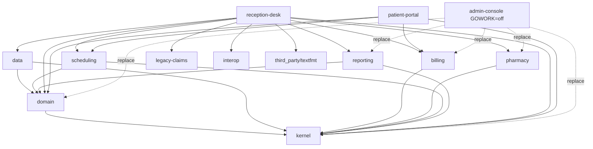

# 医療管理システム (iryo-kanri-system): Go 呼び出し解決コーパス F1

C#、Java、Python の同名コーパスを Go に移したフィクスチャ。13 個のモジュールで構成し、そのうち 12 個をルートの `go.work` がまとめる。
製品コードにはコメントもタグも置かない。例外は Go が意味を持たせるコメントだけで、`//go:build` 行、`//go:linkname` 行、生成ファイルの見出し (`// Code generated ... DO NOT EDIT.`) がそれに当たる。正解データは `ground_truth/` にだけある。

`codedoc_go` の `evaluate` がこのフィクスチャを採点する。正解データの検証はパイプラインを通さず、`test_codes/_gt/` の道具だけで行う。

## モジュール

すべての `go` 行は `go 1.26`。ビルド構成は `GOOS=linux GOARCH=amd64 CGO_ENABLED=0`、タグなし。

| ディレクトリ | モジュールパス | グループ | リポジトリ内の依存 | 第三者モジュール |
|---|---|---|---|---|
| `kernel` | `example.com/iryo/kernel` | ワークスペース | なし | なし |
| `domain` | `example.com/iryo/domain` | ワークスペース | kernel | なし |
| `data` | `example.com/iryo/data` | ワークスペース | kernel, domain | なし |
| `billing` | `example.com/iryo/billing` | ワークスペース | kernel | yamlish v1.1.0 |
| `pharmacy` | `example.com/iryo/pharmacy` | ワークスペース | kernel | なし |
| `scheduling` | `example.com/iryo/scheduling` | ワークスペース | kernel, domain | なし |
| `reporting` | `example.com/iryo/reporting` | ワークスペース | kernel, domain | なし |
| `legacy-claims` | `example.com/iryo/legacy-claims` (パッケージ句は `rezept`) | ワークスペース | なし | なし |
| `interop` | `example.com/iryo/interop` | ワークスペース | なし | uuidlite v1.1.0 |
| `third_party/textfmt` | `example.com/thirdparty/textfmt` (リポジトリ内フォーク) | ワークスペース | なし | なし |
| `reception-desk` | `example.com/iryo/reception-desk` | ワークスペース | 上の 10 モジュールすべて | textfmt v1.1.0 (require のみ。フォークが勝つ) |
| `patient-portal` | `example.com/iryo/patient-portal` | ワークスペース | kernel, domain, billing, scheduling | なし |
| `admin-console` | `example.com/iryo/admin-console` | 単一モジュール (`GOWORK=off`) | kernel, domain, billing, pharmacy, reporting (go.mod の replace) | textfmt v1.1.0 (公開版) |

- **ワークスペースのモジュールは互いを require しない。** 依存は `go.work` の `use` だけで届く。`go.work.sum` は要らない。
- **第三者モジュール**は `test_codes/_proxy` の合成モジュール (`example.com/thirdparty/...`) から取る。
- **`admin-console` は `go.work` にない。** go コマンドは単一モジュールとしてビルドする。go.mod の replace がある 5 モジュールはリポジトリ内のソースになる。置き換えのない `example.com/thirdparty/textfmt` は公開版 v1.1.0 になる (spec §3.2)。
- **`third_party/textfmt` のモジュールパスは公開版と同じ。** 全角文字を幅 2 と数えるためのフォークで、`go.work` の `use` が受付の go.mod の `require ... v1.1.0` に勝つ。
- **同じ import が二つの答えを持つ。** `reception-desk/internal/textreport/textreport.go` と `admin-console/internal/textreport/textreport.go` はバイト単位で同じファイルで、`textfmt.PadRight` は受付ではフォーク、管理コンソールでは公開版に着く。デモの出力でも桁が違う。



アプリは三つ。どれも `cmd/<アプリ>/main.go` を持ち、引数なしで決まった出力のデモを動かす。

| アプリ | 中身 | 最後の行 |
|---|---|---|
| `reception-desk` | 受付、会計、薬局窓口、日次締め、振り分け、帳票、保守の各フロー | `=== 受付業務デモ完了 ===` |
| `admin-console` | 日次バッチ、月報、監査 | `=== 管理タスク完了 ===` |
| `patient-portal` | `net/http` のハンドラ。ポートは開かず `httptest` で 3 件のリクエストを処理する | `=== 患者ポータルデモ完了 ===` |

## シナリオ

ケースは 157 件、宣言アンカー (`DECL_PINS`) は 95 件、クラスの辺 (`CLASS_EDGES`) は 36 本 (2026-10-14)。

| 接頭辞 | 内容 | 件数 | 主な場所 |
|---|---|---|---|
| XPR | 手続き行が 1 文字違わないのに import だけで束縛先が変わる対 (受付の日次締めと管理の日次バッチ) | 10 | `reception-desk/.../closing/daily_close.go`, `admin-console/.../batch/daily_batch.go` |
| TWIN | モジュールをまたぐ同名の宣言 (`Logger.Log`, `Validator.Validate`, `ReceiptFormatter.Format` 3 種, `Calculate` 3 種, `Ward.Beds`, `New`) | 14 | `reception-desk/.../pharmacyflow`, `accounting` |
| EMB | 昇格の深さ 1/2/3、隠蔽、ポインタ埋め込み、明示的な埋め込みパス、構造体に埋め込んだインタフェース (二段目のディスパッチ)、ジェネリック型の埋め込み、標準ライブラリ型の埋め込み | 16 | `domain/patient`, `kernel/policy`, `reporting/trail.go` |
| IFC | インタフェース呼び出し: 実装 0/1/n、標準ライブラリが満たす open world (`*log.Logger`, `time.Time`)、テストだけの偽実装、封印インタフェース、埋め込みインタフェースのメソッド、メソッド式、ジェネリックなインタフェース、型アサーション後の静的呼び出し、関数の中で宣言したインタフェース、グループごとに違う候補 (管理コンソール)、オフラインで不正になる型を埋め込み、同名でシグネチャの違うメソッドを持つ型 (満たさない、spec R52) | 18 | `kernel/notify`, `kernel/audit`, `kernel/clock`, `interop` |
| GEN | ジェネリック関数 (推論、明示的な具体化、型引数二つ)、ジェネリック型のメソッド、ジェネリックな型エイリアス、制約のメソッド呼び出し、インラインの制約、型集合の制約 | 11 | `data/store`, `data/cache`, `domain/patient/describe.go` |
| FV | func-alias (関数、メソッド値、関数リテラル) と負例 (再代入、アドレス取得、クロージャ内の代入)、引数・フィールド・map・パッケージ変数の関数値、IIFE、`go` と `defer`、インタフェースのメソッド値 (埋め込みインタフェース経由を含む)、メソッド式とその別名 (具体型とインタフェース)、range-over-func | 24 | `reception-desk/.../dispatch/dispatch.go` |
| BLT / CNV | 組み込み (`unsafe.Sizeof`, `min`, `clear`, Go 1.26 の式を取る `new`, `panic`, 宣言済みの `error` の `Error`)、名前付き型・基本型・関数型への変換 | 12 | `reception-desk/.../maintenance`, `accounting` |
| BLD | `_linux.go` / `_windows.go` / `!linux && !windows` のツイン、`cgo` と `!cgo` のツイン、独自タグ `iryodebug` で外れるファイル | 6 | `kernel/platform` |
| TST | パッケージ内テスト、外部テスト、`export_test.go`、テスト変種が束縛を変える ambiguous (variant) | 8 | `kernel/clock`, `kernel/escalation`, `billing/fee_test.go` |
| GNC | 生成ファイルの中から、また生成ファイルへの呼び出し | 4 | `legacy-claims/codes_gen.go` |
| INI | パッケージ変数の初期化式 (`<init>`)、その中の関数リテラル (`<init>.func1`)、ファイルごとに番号を振る `init#k` | 6 | `kernel/registry` |
| EXT | 標準ライブラリと `_proxy` の第三者モジュール (v1.1.0 だけにあるメソッドを含む) | 11 | `billing/tariff`, `interop/idkit`, `patient-portal` |
| LNK | `//go:linkname` でリポジトリ内と標準ライブラリから引き込む宣言、アセンブリで実装する本体のない宣言 | 3 | `kernel/metrics`, `kernel/fastmath` |
| MOD | ワークスペースのモジュール間、replace 経由、公開版 (external) の呼び出し。インポートパスとパッケージ句が違うモジュール | 10 | `*/internal/textreport`, `admin-console/.../console`, `patient-portal` |
| UNR | 辺にしてはいけないもの (無名インタフェース、メソッドと同名の関数型フィールド、リフレクション) | 4 | `checkin.go`, `dispatch.go`, `maintenance.go` |

## 期待値の決め方

- **基準。** go1.27.2、`GOOS=linux GOARCH=amd64 CGO_ENABLED=0`、タグなしでの Go の意味論と、spec §5 の規則に従う。リゾルバの出力からは作らない。
- **静的な呼び出し**は宣言そのもの。ジェネリックな宣言は原型。昇格したメソッドは宣言した型のメソッド。
- **インタフェース呼び出し** (`iface`、`typeparam`、インタフェースを受け手とするメソッド値):
  - `targets` はインタフェースのメソッド。埋め込まれたインタフェースのメソッドは、宣言したインタフェースのもの。
  - `candidates` は受け手の静的型を満たす、リポジトリ内のパッケージレベルの具体型のメソッド。そのグループの読み込みにある型だけを数える (管理コンソールのプログラムには予約モジュールがない)。テストファイルの型を含み、ジェネリック型とインタフェース型は含まない。構造体が埋め込みインタフェースで満たすときは、その埋め込みインタフェースのメソッドが候補になる。
  - `runtime_targets` は、その site で実際に走るリポジトリ内の実装。goracle は `entries.json` のすべての入口の観測を合わせて判定するので、すべての入口を合わせた集合を書く。
  - `open_world` は、リポジトリ外の型 (標準ライブラリ、依存モジュール、未公開の型を含む) も満たすかどうか。candidates と open_world は go/types の `types.Implements` で全パッケージを調べて確かめた (2026-10-14)。
- **ノードのないインタフェース** (無名インタフェース `v.(interface{ Describe() string }).Describe()`、関数の中で宣言した名前付きインタフェース、インラインの制約) のメソッドは、リポジトリ内の実装を候補にした `ambiguous` にする。実装がなければ `dynamic` (master plan C5、spec 付録 B R2)。どちらも `MethodCalls` にせず、囲む関数を名指ししない。
- **宣言済みの `error`** の `Error` は `builtin` で、候補を持たない。
- **func 値**は `dynamic`。func-alias の条件 (spec §5.5) をすべて満たすローカル変数だけを `resolved` にする。実行時に走るリポジトリ内の関数は `runtime_targets` に書く。
- **ビルドから外れるファイル**の site は `unresolved` (`excluded-by-build`)。名前で推測しない。
- **変換**は `conversion`。call の記録を作らない。
- **distractors** はもっともらしい誤答で、どの記録もこれを名指ししてはいけない。
- **クラスの辺** (`CLASS_EDGES`、spec 付録 B R50) は、`ClassImplements` 26 本と `ClassEmbeds` 10 本の正確な集合。Go のメソッド集合と埋め込みの規則から手で書き、go/types の一覧と突き合わせた (2026-10-14。オフラインと `--env` で同じ集合)。
  - `ClassImplements` は、パッケージレベルの非ジェネリックな具体型 (テストファイルの型を含む) と、メソッドを持つリポジトリ内のパッケージレベルの非ジェネリックなインタフェースの組。`pointer_receiver` は `*T` だけが満たすとき true。ジェネリックなインタフェース (`Repository[T]`)、型集合の制約 (`store.Number`)、インタフェースどうし、関数の中で宣言したインタフェース、宣言済みの `error` は含めない。`idkit.Tracker` は、オフラインで不正になる `uuidlite.Sequence` を埋め込むが、自分のポインタのメソッド `Get() float64` が昇格したメソッドを隠し、`lookup.Source` の `Get() (Code, error)` と違うので、どちらのモードでも `Source` を満たさない (spec R52)。
  - `ClassEmbeds` は、構造体の埋め込みフィールドと、インタフェースが埋め込むインタフェースのうち、型がリポジトリ内にあるもの。`pointer` は `*T` で埋め込んだとき true。具体化した型はジェネリックな原型を指す (`PatientList` → `store.MemoryStore`)。
  - 端点は F3 と同じ `<repo>:<relpath>:<qualname>`。`modes` (`offline` / `env`) を書いた辺はそのモードだけで数える。F1 には無い。
  - IFC-018 と `Tracker` は spec R52 の回帰ケースです。go/types はオフラインの `Tracker` を、埋め込みの型が不正なためにどのインタフェースも満たすと答えますが、gohelper はメソッドごとに確かめて実装にせず、組も候補も作りません。以前の gohelper はこの組に `incomplete` を付け、修正前の Phase 1.6 はこの印を無視して辺にしていました（Prometheus の試験で見つかった誤り）。印を無視した解決で `evaluate` をオフラインで動かすと、クラスの辺のゲートが `ClassImplements …tracker.go:Tracker -> …lookup.go:Source` を余分な辺として落とすことを確かめました (2026-10-14)。
- **入口** (`entry`) は site を実行する `entries.json` の入口。`null` は、どの入口も実行しない site か、実行されてもオラクルが観測できない site を表す。後者は INI-001 だけで、パッケージ変数の初期化式から標準ライブラリだけを呼ぶので、goracle は計数器も呼び先のフックも置けない。

## 道具とファイル

| ファイル | 内容 |
|---|---|
| `ground_truth/cases.py` | 正解の記述元。ファイル、ファイル内で一意なスニペット、トークンで site を指す。行番号は持たない。宣言アンカー (`DECL_PINS`)、XPR の対、クラスの辺 (`CLASS_EDGES`) も持つ |
| `ground_truth/manifest.json` | 生成物。行、1 始まりのバイト列、0 始まりのバイトオフセットと、ターゲットの宣言位置を足したもの |
| `ground_truth/qa_questions.json` | 日本語の質問 29 件。グラフの行から答える |
| `ground_truth/features.json` | 機能ごとのファイル一覧 (10 機能、77 ファイル)。コーパスの設計から書いたもので、トピックの出力は見ていない。Leiden トピックの比較 (`compare-topics --features`) が使う。受付端末のフローはそれぞれの業務の機能に入れる。振り分けフロー (`dispatch.go`) は関数値とハンドラ登録 (`kernel/registry`) の見本なので共通基盤に入れる |
| `entries.json` | 実行時オラクルが動かす入口 5 件 (3 つのデモと、kernel と billing のテスト)。`admin-console` は `GOWORK=off` で動かす |
| `../_gt/generate_manifest.py` | `cases.py` から `manifest.json` を作る |
| `../_gt/check_ground_truth.py` | 往復、一意性、site の種類、宣言の位置、モジュールの整合、XPR の同一性、クラスの辺 (`manifest.json` の `class_edges`)、QA と機能と入口の形を調べる |
| `../_gt/run_oracle.py` | 入口を goracle の計装の下で動かし、実行されたケースが期待どおりの関数に着くか調べる |

コードを編集したら、`codedoc_go/` で次を順に実行する。

```bash
python3 test_codes/_gt/generate_manifest.py test_codes/iryo-kanri-system
python3 test_codes/_gt/check_ground_truth.py test_codes/iryo-kanri-system
python3 test_codes/_gt/run_oracle.py test_codes/iryo-kanri-system
```

ビルドとデモを手で動かす例。go コマンドは go1.27.2 を使い、モジュールは `_proxy` から取る。

```bash
export GOTOOLCHAIN=local GOFLAGS="-modcacherw -buildvcs=false" GOSUMDB=off GOPROXY=file://$PWD/test_codes/_proxy
cd test_codes/iryo-kanri-system
go build work && go vet work
(cd admin-console && GOWORK=off go vet ./... && GOWORK=off go run ./cmd/admin-console)
(cd reception-desk && go run ./cmd/reception-desk)
(cd patient-portal && go run ./cmd/patient-portal)
go test ./kernel/... ./billing/...
```

## 守ること

- 同名の衝突とバイト単位で同一の行・ファイルが検証の本体。名前をそろえたり重複を消したりしない。
- 製品コードにコメントを書かない。意図はこの README とケースの `why` に書く。
- スニペットは行番号の代わり。編集でスニペットが一意でなくなったら `cases.py` を直す。
- インタフェースを満たす型を足すと、そのインタフェースのケースの candidates と open_world が変わる。テストファイルの型も数える。
- 検証はこのフィクスチャ自身で行う。`graph_generator` の振る舞いに合わせて期待値を変えない。
