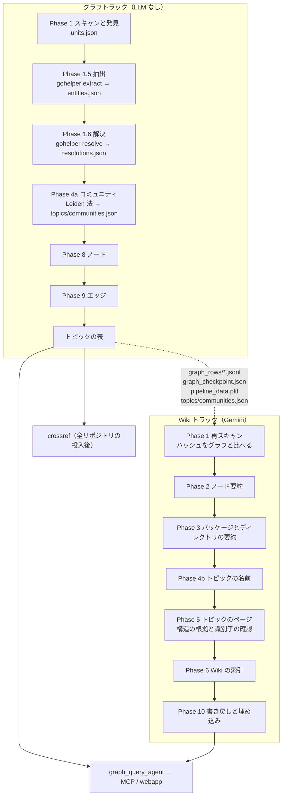

# アーキテクチャ

CodeDoc（Go 版、Leiden トピック）が何でできていて、Go のソースがどの順に何を通ってグラフと Wiki になるかを説明します。
使い方と設定は [../README.md](../README.md)、Phase 1.6 の解決の中身は [LSP_RESOLUTION.md](LSP_RESOLUTION.md)、Spanner の表と ID 規則は [GRAPH_SCHEMA.md](GRAPH_SCHEMA.md)、モジュールとリポジトリをまたぐ扱いは [CROSS_PROJECT.md](CROSS_PROJECT.md) に譲ります。
この版（codedoc_go_leiden）は codedoc_go の写しで、トピックの作り方だけが違います。トピックは確定した呼び出し・埋め込み・実装から Leiden 法で決め（[10. Leiden トピック](#10-leiden-トピック)）、`compare-topics` で codedoc_go の LLM のトピックと比べます（[11. LLM トピックとの比較](#11-llm-トピックとの比較)）。

## 1. 全体像

大きな Go のコードベースを読むとき、LLM の要約と grep だけでは「この関数を誰が呼ぶか」に正確に答えられません。

- LLM の要約は、呼び出し関係をもっともらしい推測で埋めます。
- grep は Go の名前解決に負けます。多くの型が同じ名前のメソッドを持ち、埋め込みでメソッドが昇格し、インターフェースは宣言なしに満たされます。import パスとパッケージ名は一致するとは限りません。どのファイルがコンパイルされるかはビルド制約が、どのモジュールのソースが使われるかは `go.work` と `replace` が決めます。

そこで成果物を 2 つに分けています。

| 成果物 | 作り方 | 置き場所 |
|---|---|---|
| グラフ | 決定的な解析だけで作り、確定したエッジだけを張る | Cloud Spanner のプロパティグラフ。`--no-spanner` ならローカルの行ファイルだけ |
| Wiki | Gemini が日本語で書く。宣言・ファイル・パッケージ・ディレクトリの要約、構造のトピックの名前とページ、埋め込み | `OUTPUT_DIR/repos/<repo>/` と、グラフのノードの `summary` / `embedding` カラム |

質問応答エージェントはグラフに GQL を投げ、要約もグラフのノードから読みます。

トピックのメンバーはグラフと同じく決定的な解析で決めます。Gemini はトピックに名前を付け、構造の根拠からページを書くだけです。

呼び出し先を確定するのは、同梱の Go プログラム gohelper です。抽出（`gohelper extract`）は go/parser を、解決（`gohelper resolve`）は go/packages と go/types を使います。言語サーバーは使いません。Python 側は、モジュールの発見、答えの分類とゲート、グラフの行、Wiki、Spanner を受け持ちます。

どの部分も次の 3 つを守ります。

1. 解析対象のコードを実行せず、解析対象のリポジトリに書きません。発見はファイルを読むだけです。go コマンドと gohelper は、一から組み立てた環境と、`OUTPUT_DIR` の下の制御ディレクトリで動きます。
2. 誤ったエッジを作りません。確定できない呼び出しは数えるだけで、エッジにしません。
3. 古い抽出の位置と新しい解決の答えを組み合わせません（[6. チェックポイント・鮮度・キャッシュ](#6-チェックポイント鮮度キャッシュ)）。

## 2. フェーズとトラック

パイプラインはグラフトラックと Wiki トラックに分かれます。`analyze` には `--graph`、`--wiki`、`--all` のどれか 1 つを必ず付けます。

| モード | 走るフェーズ | LLM | Spanner に書くもの |
|---|---|---|---|
| `--graph` | 1 → 1.5 → 1.6 → 4a → 8 → 9（の後にトピックの表） | 呼ばない | ノードとエッジ、トピックの表（名前はハブの名前。ID の変わらないトピックは前回の `--wiki` の名前） |
| `--wiki` | 1（再スキャンだけ）→ 2 → 3 → 4b → 5 → 6 → 10 | Gemini と埋め込み | 要約の列、トピックの表（名前と要約）、埋め込み |
| `--all` | `--graph` のあと、同じプロセスで `--wiki` | 両方 | 両方 |

| Phase | 関数（`pipeline.py`。`topics_phase.` で始まるものは `topics_phase.py`） | 内容 | 外部依存 |
|---|---|---|---|
| 1 | `phase1_scan` | go コマンドと同じ規則でスキャンし、全ファイルの SHA-256 を取る。モジュールとグループをファイルだけから見つけ、設定のビルド構成とあわせて記録する | なし |
| 1.5 | `phase1b_extract` | `gohelper extract` で、宣言、呼び出し位置、import をファイルごとに取る | gohelper |
| 1.6 | `phase1c_resolve` | グループとビルド構成の組ごとに `gohelper resolve` を 1 回走らせ、各呼び出し位置の答えを分類してゲートに通す | gohelper、go コマンド。ダウンロードモードではモジュールプロキシ |
| 4a | `topics_phase.phase4a_communities` | ノードとエッジの行（`build_node_rows`、`derive_edge_rows`）を原子のグラフに射影し、Leiden 法でトピックとサブトピックを決める（[10](#10-leiden-トピック)） | graspologic-native、networkx |
| 8 | `phase8_write_nodes` | `build_node_rows` でノードの行を作る。`summary` カラムは Go のドキュメントコメントで始まる。Spanner には、要約キャッシュにある `--wiki` の要約を書き戻す | Spanner（`--no-spanner` なら不要） |
| 9 | `phase9_write_edges` | `derive_edge_rows` でエッジの行を作り、前回書いて今回書かなかった行を消す | Spanner（`--no-spanner` なら不要） |
| 9 の後 | `topics_phase.write_graph_topics` | トピックの 5 つの表を書く（[10.8](#108-トピックの表の書き込み)） | Spanner（`--no-spanner` なら不要） |
| 1（Wiki） | `phase1_rescan` | スキャンだけを行い、ハッシュをグラフと比べる | なし |
| 2 | `phase2_node_summaries` | 宣言とファイルの要約。ファイルごとに 1 回まとめて頼み、大きなファイルは宣言ごとに頼む | Gemini |
| 3 | `phase3_package_dir_summaries` | パッケージの要約と、下から上へのディレクトリの要約 | Gemini |
| 4b | `topics_phase.phase4b_naming` | Phase 4a のトピックに名前を付ける（[10.6](#106-phase-4b-名前)） | Gemini |
| 5 | `topics_phase.phase5_reports` | 構造の根拠からトピックごとのページを書き、識別子を確かめる（[10.7](#107-phase-5-ページと識別子の確認)） | Gemini |
| 6 | `phase6_index` | `index.md`、`reasoning_index.json`、`metadata.json`、`topics/topic_tree.json`。消えたトピックのページを消す | なし |
| 10 | `phase10_write_back` | 要約の列を書き戻し、トピックの表を置き換え、埋め込みを書く | Spanner、Vertex AI の埋め込み |
| 投入後 | `crossref`（`crossref.run_crossref`） | 投入済みの全リポジトリからリポジトリ間エッジを導く | Spanner（`--dry-run` なら不要） |

Phase 7 は欠番です。ほかの版と番号をそろえています。codedoc_go の Phase 4（LLM によるトピックの発見）は走らず、Phase 4a と 4b に置き換わります。`topics_phase.py` の関数は、共有のモジュールの LEIDEN-HOOK の行から呼ばれます。

### グラフが先で、Wiki はその上に載る

ほかの版の CodeDoc は Wiki 側を先に走らせ、Phase 8 がその要約をノードに入れます。Go 版は順番を逆にしました。グラフが決定的な土台で、Wiki トラックは終わったグラフを読む層です。理由は 4 つです。

- **費用**: `--graph` は LLM を呼びません。グラフだけを作り直す運用で Gemini の費用がかかりません。
- **要約の質**: Phase 2 は宣言ごとにグラフの文脈を添えて要約を頼みます。関数とメソッドには呼び出し先、呼び出し元、インターフェースの実装候補を、型には埋め込み、実装するインターフェース、メソッドを添えます。グラフが先にないと、この文脈は作れません。
- **検証**: グラフは同じコードから同じノード ID と同じエッジを作ります。Wiki は LLM の出力なので実行ごとに揺れます。揺れる層を上に置いたので、下の層を `evaluate` が GCP なしで採点できます。
- **増分**: 要約はファイルの内容とグラフの文脈のハッシュでキャッシュします。小さな編集のあとの `--graph` と `--wiki` は、変わったファイルとその上のディレクトリ、トピックの分だけ Gemini を呼びます。

この版ではトピックのメンバーもグラフトラックで決めます（Phase 4a）。Wiki トラックは名前とページを書くだけです。

## 3. 構成要素

| パス | 役割 |
|---|---|
| `gohelper/` | Go のヘルパー（モジュール `codedoc.local/gohelper`）。`main.go` がサブコマンドを振り分け、`internal/extract/` が抽出を、`internal/resolve/` が解決を受け持つ。`golang.org/x/tools` v0.52.0 を `vendor/` に同梱する（[7. gohelper](#7-gohelper)） |
| `graph_generator/__main__.py` | CLI。事前確認、リポジトリごとの出力先 `OUTPUT_DIR/repos/<repo>/` への切り替え、ピアの収集、モードの実行、所要時間の報告、`validate` |
| `graph_generator/config.py` | `.env` の設定を定数にする |
| `graph_generator/pipeline.py` | `PipelineData` と各フェーズの関数。事前確認（`preflight`）、鮮度の検査、グラフのチェックポイント、`--wiki` の前提（`load_graph_state`、`prepare_wiki`）、Spanner への書き込み、ノード ID（`_make_id`）、埋め込みのキャッシュ |
| `graph_generator/go_model.py` | 発見の結果を表すデータクラス（`GoUnit`、`Group`、`BuildConfig`、`Peer`、`Discovery`、`Toolchain`）と、status や理由の語彙 |
| `graph_generator/go_units.py` | `go.mod`・`go.work`・`vendor/modules.txt` とビルド制約の解析、go コマンドと同じスキップ規則のスキャン、モジュール・グループ・ピアの発見、制御ディレクトリの生成、`units.json` |
| `graph_generator/go_toolchain.py` | ツールチェーンの探索と版の比較、`setup go`、go コマンドと gohelper に渡す環境の組み立て、gohelper のビルドとキャッシュ |
| `graph_generator/go_modcache.py` | オフラインでのモジュールの入手先（`vendor/`、ユーザーのモジュールキャッシュ）、ダウンロードモードの取得 |
| `graph_generator/go_extract.py` | Phase 1.5。`gohelper extract` の実行、`entities.json` の再利用の判定と保存、Phase 1.6 の始めの取り直し、Gemini 用の宣言の範囲 |
| `graph_generator/resolution.py` | Phase 1.6 の取りまとめ。グループとビルド構成の組ごとの `gohelper resolve`、抽出の呼び出し位置との突き合わせ、import・埋め込み・実装の記録、統計、`resolutions.json` の原子的な書き込み |
| `graph_generator/go_classify.py` | 呼び出し先の位置の分類（標準ライブラリ、ピア、モジュールキャッシュ、`vendor/`、リポジトリ内など）と、宣言の索引 `DeclIndex` によるノードへの対応付け |
| `graph_generator/go_gates.py` | ゲート。確定できない答えを `unresolved` か `ambiguous` に落とす |
| `graph_generator/graph_rows.py` | 純関数の `build_node_rows`、`node_index`、`derive_edge_rows`。GCP に触れない |
| `graph_generator/setup_spanner_graph.py` | `NODE_SPEC` / `EDGE_SPEC`（スキーマの唯一の定義）、DDL、プロパティグラフ、差分マイグレーション、`--verify` / `--destroy`、書き込みカラムの順 `write_columns()` |
| `graph_generator/node_summaries.py` | Phase 2。ファイルごとのまとめた呼び出し、宣言ごとの呼び出しへの切り替え、グラフの文脈、要約のキャッシュ |
| `graph_generator/prompts.py` | Phase 2 と 3 の日本語プロンプトと、キャッシュのキーに入る `PROMPT_VERSION`。Phase 4b と 5 のプロンプトは `topics/naming.py` と `topics/reports.py` にある |
| `graph_generator/crossref.py` | 投入済みリポジトリの解決結果からリポジトリ間エッジを導く |
| `graph_generator/evaluate.py` | フィクスチャに Phase 1〜1.6 と行の導出を回し、正解と比べる回帰ゲート |
| `graph_generator/trial.py` | 実リポジトリでの試験。オフラインとダウンロードの比較と、実行時オラクルによる精度確認 |
| `graph_generator/topics/` | トピックの計算。`graph_builder.py`（原子への射影と台帳）、`community.py`（Leiden 法、階層、メンバー、ID、引き継ぎ、整合性の検査、トピックの表の行）、`metrics.py`（ARI、AMI、NMI、モジュラリティ、コンダクタンス、凝集度）、`naming.py`（Phase 4b のプロンプトと名前の検査）、`reports.py`（根拠の束、Mermaid の雛形、識別子の確認）、`compare.py`（`compare-topics` の指標と報告）、`synthetic.py`（テストと計測用の合成の行） |
| `graph_generator/topics_phase.py` | パイプラインとのつなぎ。事前確認の行、Phase 4a、トピックの表の書き込み、`--wiki` の前提、Phase 4b と 5、Phase 10 のトピックの行、`compare-topics` の CLI |
| `graph_generator/topics_schema.py` | `Topics` の列と 3 つのエッジ表を `NODE_SPEC` / `EDGE_SPEC` に足す |
| `graph_query_agent/` | ADK の 2 エージェント。`root_agent` が `graph_agent`（ツール `run_gql_query`）に委譲する。指示文のトピックの層は `TOPIC_SOURCE = "leiden"` で選ぶ（[8. 問い合わせの経路](#8-問い合わせの経路)） |
| `mcp_server/` | FastMCP のサーバー（`ask_codebase` とセッション操作）と、Cloud Run へのデプロイ道具（`deploy.sh`、`Dockerfile`） |
| `webapp/` | FastAPI（Wiki の配信、チャット、`graph_rows/` を読むグラフエクスプローラー `graph_api.py`）と Vite/React の UI。ルートの `Dockerfile` が webapp のイメージを作る |
| `scripts/gql_lint.py` | エージェントの指示文、スキル、ドキュメントの GQL 例をスキーマに照らして検査する |
| `scripts/doccheck.py` | README と docs をコードと照合する（リンクとアンカー、CLI、設定キー、表とカラム、GQL、禁止語と記号、検証表） |
| `scripts/verification_table.py` | `evaluate` と `trial` の結果から、[LSP_RESOLUTION.md の検証の数値](LSP_RESOLUTION.md#114-検証の数値)の表の行を出す |
| `scripts/sync_from_codedoc_go.sh`、`scripts/leiden_owned.txt`、`scripts/leiden_hooks.py` | codedoc_go からの同期。`leiden_owned.txt` に挙げたこの版だけのパスは上書きしない。同期の後、共有のファイルに LEIDEN-HOOK の編集を当て直して確かめる |
| `tests/` | pytest。Gemini・Spanner・埋め込みのフェイク（`conftest.py`）と、記録した gohelper の出力（`fixtures/helper/`）で動く。codedoc_go のテストに、この版のテスト（`test_topics_*.py`、`test_leiden_*.py`）を足し、期待値が codedoc_go だけのものは `leiden_plugin.py` が理由を付けて飛ばす |
| `test_codes/` | フィクスチャ 3 つ（`iryo-kanri-system`、`go_layouts`、`multi_repo`）、正解の道具と実行時オラクル goracle（`_gt/`）、合成モジュールプロキシ（`_proxy/`） |

境界は次のとおりです。

- `go_model.py` はほかのモジュールに依存しません。
- Go の構文を解析するのは gohelper だけです。Python が解析するのは、ファイル先頭のビルド制約、package 句、import だけです。Wiki トラックはソースをそのまま Gemini に渡します。
- `pipeline.py` は書き込みカラムを `setup_spanner_graph.write_columns()` から取ります。`graph_rows.py` の行も同じ順に並びます。
- `crossref.py` はノード ID を `pipeline._make_id` で計算し直します。名前では探しません。
- MCP サーバーと webapp はエージェントを包むだけで、GQL を自分では持ちません。webapp のグラフエクスプローラーは `graph_rows/*.jsonl` を直接読み、表と端点のカラムを `NODE_SPEC` / `EDGE_SPEC`（`topics_schema` の表を含む）から取ります。`graph_generator` の無い webapp のイメージでは、行の先頭の列（主キー、始点、終点）から読み取ります。
- `graph_generator/topics/` は `pipeline.py` も `config.py` も import しません。行（表名 → カラムの辞書のリスト）を受け取り、GCP に触れません。
- codedoc_go と共有するファイルは、この版では LEIDEN-HOOK の行だけを変えます。それ以外の変更は codedoc_go で行い、同期します。

## 4. データの流れ

1 回の実行の状態は `pipeline.PipelineData` が持ちます。各フェーズが読むものと書くものは次のとおりです。ファイルはどれも `OUTPUT_DIR/repos/<repo>/` の下にあります（一覧は [README の出力](../README.md#出力)）。

| Phase | 読むもの | 書くファイル | `PipelineData` に入れるもの |
|---|---|---|---|
| 1 | 対象ディレクトリ、`go.mod`・`go.work`・`vendor/modules.txt`、各ファイルの先頭 | `units.json` | ファイル一覧、ファイルごとの SHA-256、ディレクトリツリー、`Discovery` |
| 1.5 | スキャンしたファイル、前回の `entities.json` | `entities.json` | ファイルごとの宣言、呼び出し位置、import |
| 1.6 | エンティティ、`Discovery`、ピア | 制御ディレクトリ `go/<group>/`、gohelper の出力 `go/<group>/resolve-<build>.jsonl`、`resolutions.json` | 呼び出し・import・埋め込み・実装の解決結果 |
| 4a | Phase 1.6 までの状態から作ったノードとエッジの行、前回の `topics/communities.json` | `topics/communities.json`、`topics/projection.jsonl` | コミュニティと射影（この実行の中だけ） |
| 8 | ファイルごとの SHA-256、エンティティ、前回の `graph_rows/*.jsonl` | `graph_prune.json`（前回の行の主キー）、`graph_rows/<Table>.jsonl`（ノード）、`graph_meta.json`、`graph_checkpoint.json` | 書いた行数 |
| 9 | 解決結果、エンティティ、ノードの索引、`graph_prune.json` | `graph_rows/<Table>.jsonl`（エッジ）、`graph_checkpoint.json`。今回書かなかった行を消したら `graph_prune.json` を消す | 書いた行数 |
| 9 の後 | コミュニティ、ID の変わらないトピックの `topics/names.json` と `topics/<id>.md` | `graph_rows/` のトピックの 5 つの表 | 書いた行数 |
| グラフトラックの終わり | `PipelineData` | `pipeline_data.pkl` | なし |
| 1（Wiki） | 対象ディレクトリ | なし | ファイルごとの SHA-256（グラフと比べる） |
| 2 | `graph_rows/*.jsonl`、ソース、要約のキャッシュ | `summaries/nodes/<relpath>.json` | 宣言とファイルの要約 |
| 3 | ファイルの要約 | `summaries/packages.json`、`summaries/dirs.json` | パッケージとディレクトリの要約 |
| 4b | `topics/communities.json`、`graph_rows/*.jsonl` から作り直した射影、宣言の要約、前回の `topics/names.json` | `topics/names.json` | なし |
| 5 | コミュニティ、射影、名前、宣言の要約、`topics/pages.json` | `topics/<id>.md`、`topics/pages.json`、`topics/metrics.json`、`topics/stats.json` | トピックの木とページ |
| 6 | すべての要約とトピック | `index.md`、`reasoning_index.json`、`metadata.json`、`topics/topic_tree.json` | なし |
| 10 | `graph_rows/*.jsonl`、すべての要約、名前とページ | `graph_rows/` のトピックの 5 つの表、`embeddings/cache.sqlite` | なし |

フェーズの間の受け渡しで大事な点は次のとおりです。

- **抽出と解決の継ぎ目**は、（リポジトリ相対パス、呼び出し先トークンのバイトオフセット）の組です。`gohelper extract` と `gohelper resolve` は同じ規則でオフセットを出すので、Python は位置を変換せずに突き合わせます。
- **解決の答え**はファイルごとの記録です。呼び出しの記録は status（`resolved`、`external`、`builtin`、`ambiguous`、`dynamic`、`unresolved`）と、呼び出し先、候補、理由を持ちます。status の意味は [LSP_RESOLUTION.md の 9 節](LSP_RESOLUTION.md#9-statusvia理由)、記録の形は [同 10 節](LSP_RESOLUTION.md#10-resolutionsjson) にあります。
- **行**はどれも「表名 → カラムの辞書のリスト」で、カラムは `write_columns(table)` の順です。Spanner に書く行と `graph_rows/*.jsonl` の行は同じ値です。
- **エッジを作るのは `derive_edge_rows` だけ**です。`MethodCalls` は、呼び出し先がこのリポジトリの `Methods` ノードである `resolved` の記録からだけ作ります。`external`、`builtin`、`dynamic`、`unresolved` は数えるだけです。ピアを指す記録は `crossref` に回します。どの記録がどの表になるかは [GRAPH_SCHEMA.md のエッジ表](GRAPH_SCHEMA.md#3-エッジ表) にあります。
- Phase 8 と 9 は、ハッシュがこの実行のスキャンと違うエンティティと解決の記録を使いません。
- **トピックの入力**は、Phase 8 と 9 が書くのと同じ純関数の行です。Spanner を読まないので、`--no-spanner` でも同じコミュニティになります。

## 5. 実行モードと前提

`analyze` は次の順に動きます（`__main__.py` の `cmd_analyze`）。

1. **事前確認**: `pipeline.preflight` が、そのモードに要る確認をすべて行い、1 つの表にして出します。
   - `--graph` と `--all`: ビルド構成、ツールチェーン、gohelper のビルド、空きメモリ、各リポジトリの発見（`go_units.discover` と `go_units.stops`）。
   - Spanner に書くとき: Spanner のスキーマ。表、カラム、カラムの型が `NODE_SPEC` / `EDGE_SPEC` と違えば止まる。
   - `--wiki` と `--all`: Gemini の認証情報。
   - すべてのモード（`doctor` を含む）: Leiden の実装（graspologic-native と networkx）。import できなければ止めます。別の実装に切り替えることはありません。
   - すべてのモード: トピックの設定（`TOPIC_*` と `SUBTOPIC_MIN_ATOMS`）。誤りはキー、値、書ける形を示します。

   止める問題が 1 つでもあれば、何も始めずに終了コード 3 で止まります。`doctor` は同じ表を出します。どう実行するかは `doctor` には分からないので、Spanner と Gemini の問題は警告にとどめます。
2. **`--wiki` の前提**: `--wiki` では、最初の Gemini 呼び出しより前に、全リポジトリの前提を確かめます。
   - `load_graph_state` は、完了した `graph_checkpoint.json`、同じリポジトリの `graph_meta.json`、同じ `ID_SCHEME`、`graph_rows/`、チェックポイントと同じハッシュの `pipeline_data.pkl` を求めます。
   - `prepare_wiki` はスキャンし直してハッシュを比べ、Spanner の書き込み先が同じか、`--no-spanner` の使い方が合っているかを見ます。
   - `topics_phase.wiki_problems` は、最後の `--graph` がコミュニティを作ったこと、`topics/communities.json` がチェックポイントの記録と同じであること、`graph_rows/` から同じ射影を作れることを求めます。

   満たさなければ終了コード 4 で止まり、変わったファイルの一覧と実行するコマンドを出します。
3. **リポジトリごとの実行**: 実行の間、`config.OUTPUT_DIR` を `OUTPUT_DIR/repos/<repo>/` に差し替えます。チェックポイントと成果物がリポジトリごとに分かれるのはこのためです。リポジトリをまたいで共有する状態（`OUTPUT_DIR/go/`）は、差し替える前の `OUTPUT_DIR` に置きます。`--repos` のリポジトリは 1 つずつ順に処理します。
4. **トラック**: `--graph` は `run_graph_track` だけを呼びます。`--all` はその後に `prepare_wiki` を通してから `run_wiki_track` を呼びます。`--wiki` は手順 2 で前提を通したデータに `run_wiki_track` を呼びます。
5. **報告**: 最後にフェーズ別の所要時間と件数を出し、`timing_report.json` に書きます。

止める条件と警告の一覧、メッセージ、直し方は [README の doctor と事前確認](../README.md#doctor-と事前確認) と [README の鮮度とレジューム](../README.md#鮮度とレジューム) にあります。

## 6. チェックポイント・鮮度・キャッシュ

原則は 3 つです。

- 終わった単位はすぐディスクに書きます。JSON は一時ファイルに書いてから名前を変えるので、中断しても半端なファイルは残りません。
- 古い抽出の位置と新しい解決の答えを決して組み合わせません。
- キャッシュのキーには、結果を変えうる入力をすべて入れます。

| 状態 | 場所 | 再利用する条件 | 変わったとき |
|---|---|---|---|
| エンティティ | `entities.json` | スキャンした全ファイルについて、SHA-256 と再利用スタンプが記録と一致する。スタンプは抽出器の版 `EXTRACTOR_REVISION`、gohelper のソースのハッシュ、主ビルド構成、ファイルを持つ go.mod とモジュールパスから作る | 1 つでも違えば、gohelper を 1 回呼んで全ファイルを抽出し直す |
| 解決結果 | `resolutions.json` | 再利用しない | 毎回作り直す |
| コミュニティ | `topics/communities.json`、`topics/projection.jsonl` | 再利用しない。同じ入力なら同じ結果になる | 毎回作り直す。前回の `communities.json` は名前の引き継ぎにだけ使う |
| グラフのチェックポイント | `graph_checkpoint.json` | `ID_SCHEME`、全ファイルのハッシュ、`resolutions.json` のハッシュ（`stats` を除く）、コミュニティのハッシュ（引き継ぎの記録を除く）、Spanner の書き込み先が一致する | どれかが違えば Phase 8 から書き直す |
| グラフの状態 | `pipeline_data.pkl`、`graph_rows/*.jsonl`、`graph_meta.json` | `--wiki` が読む。`pipeline_data.pkl` のハッシュはチェックポイントと一致しなければならない | `--graph` が書き直す |
| ノード要約 | `summaries/nodes/<relpath>.json` | ファイルの SHA-256、グラフの文脈のハッシュ、`PROMPT_VERSION`、モデルが一致する | そのファイルだけ要約し直す |
| パッケージとディレクトリの要約 | `summaries/packages.json`、`summaries/dirs.json` | 子の要約のハッシュ（`PROMPT_VERSION` とモデルを含む）が一致する | 子の要約が変わったものだけ作り直す |
| トピックの名前 | `topics/names.json` | トピックの ID が前回と同じか、primary のメンバーの Jaccard 係数が 0.6 以上で前回のトピックに対応付く | 新しいトピックと変わったトピックだけ Gemini に頼む |
| トピックのページ | `topics/<id>.md`、`topics/pages.json` | ページのプロンプト（根拠の束を含む）とモデルが同じ | そのページだけ書き直す |
| 埋め込み | `embeddings/cache.sqlite` | 埋め込む文字列の SHA-256、`EMBED_MODEL`、`EMBED_DIMENSION` が一致する | 文字列が変わった行だけ埋め込み API を呼ぶ |
| 前回の行の記録 | `graph_prune.json`、`OUTPUT_DIR/crossref_rows.json` | 同じ書き込み先への次の実行が、前回書いて今回書かなかった行を消すのに使う | 消し終えると `graph_prune.json` は消え、`crossref_rows.json` は今回の主キーだけになる |
| gohelper のバイナリ | `OUTPUT_DIR/go/bin/gohelper-<Go の版>-<ソースのハッシュ>` | ツールチェーンの版と gohelper のソースのハッシュが一致する | ビルドし直す |
| モジュールとビルドのキャッシュ | `OUTPUT_DIR/go/modcache/`、`OUTPUT_DIR/go/gocache/` | go コマンドの規則に従う。リポジトリと実行をまたいで再利用する | go コマンドが足す |

エンティティを全ファイルまとめて抽出し直すのは、あるファイルの記録がほかのファイルに左右されるからです。メソッドの持ち主の型は同じパッケージの別ファイルにあることがあり、ビルド制約で入れ替わる同名の宣言（ビルドの双子）からどれを選ぶかも兄弟のファイルで決まります。

要約のキャッシュは `WIKI_SUMMARY_CACHE` を設定すると `WIKI_SUMMARY_CACHE/<repo>/` に置き、codedoc_go と共有できます。リポジトリごとの `summaries/` にも毎回書きます。

鮮度は次の順に守ります。

1. Phase 1 が全ファイルの SHA-256 を取ります。
2. Phase 1.5 が上の表の条件でエンティティを再利用するか、抽出し直します。gohelper が読んだバイトのハッシュがスキャンと違えば（スキャンの後に変わったファイル）、記録は今のバイトに合わせます。
3. Phase 1.6 の始めに `go_extract.refresh_entities` が全ファイルをハッシュし直し、変わったファイルと消えたファイルがあれば抽出し直します。前は記録があったのに抽出し直して記録が無くなったファイルがあれば、`StaleEntitiesError` で止まります。
4. 最初の読み込みの前に、`resolution.run_resolution` が各エンティティのハッシュをディスクと照合します。合わなければ 1 回だけ抽出し直してやり直します。
5. gohelper は読み込んだファイルごとに SHA-256 を報告します。読み込みのとき、またはすべての読み込みの後に、バイトがエンティティと違ったファイルがあれば、そのファイルの呼び出しと、そのファイルを指す記録を `unresolved`（理由 `stale`）にします。
6. `resolutions.json` は毎回作り直し、原子的に書きます。gohelper は十分に速く、あるファイルの編集が別のファイルの答えを変えることがあるので、ファイル単位では再利用しません。
7. Phase 8 は始めに前回の `graph_rows/*.jsonl` を消します。チェックポイントは Phase 8 の前に「未完了」で書き、Phase 9 の後に「完了」で書きます。途中で止まった実行のグラフは `--wiki` の前提を通りません。チェックポイントにはコミュニティのハッシュも入るので、メンバーが変われば Phase 8 から書き直します。
8. `--wiki` はスキャンし直して、チェックポイントのハッシュと比べます（[5. 実行モードと前提](#5-実行モードと前提)）。
9. `evaluate` は作業ディレクトリを毎回作り直します。
10. `crossref` は、`resolutions.json` と `entities.json` のハッシュが違うファイル（解決の途中で変わったファイル）の記録からエッジを作らず、そういうピアのファイルに着くエッジも作りません（落とした理由 `stale`）。

Spanner への書き込みは、ノードとエッジが upsert、要約と埋め込みが update です。再投入では、前回書いた行のうち今回書かなかった行を Phase 9 の後に消します。消すのは Phase 8 が `graph_prune.json` に記録した主キーだけです。`crossref` も、自分が前回書いたエッジを同じように消します（[CROSS_PROJECT.md の前回のエッジの削除](CROSS_PROJECT.md#前回のエッジの削除)）。`--wiki` のあとに `--graph` をやり直すと、Phase 8 は行を書いた直後に、要約キャッシュにある要約を Spanner に書き戻します（Gemini は呼びません）。Phase 8 は `embedding` カラムを書かないので、埋め込みも残ります。トピックの 5 つの表は、そのリポジトリと現在の `ID_PREFIX` の行を消してから入れます。1 回のコミットは 2,000 行までで、全体は原子的ではありません（[10.8](#108-トピックの表の書き込み)）。どのファイルを消せば何がやり直されるか、どの行をいつ消し、どの行が残るかは [README の鮮度とレジューム](../README.md#鮮度とレジューム) にあります。

## 7. gohelper

gohelper は 1 つのバイナリで、プロトコルの版は 1 です。

| サブコマンド | 使う道具 | 入力 | 出力 |
|---|---|---|---|
| `version` | なし | なし | プロトコルの版、Go の版、x/tools の版、ソースのハッシュ（`revision`） |
| `extract` | go/parser（標準ライブラリだけ） | リポジトリのルートと、相対パスを 1 行ずつ並べたファイル一覧。主ビルド構成 | ファイルごとの記録（宣言、呼び出し位置、import、構文エラーの行）と、最後に集計 |
| `resolve` | go/packages と go/types | 1 つのグループの読み込み条件（作業ディレクトリ、パターン、生成した `go.work` か `-modfile` のコピー、ビルド構成、グループのモジュール、ピアのモジュールのディレクトリ） | 読み込んだファイルとそのハッシュ、呼び出し位置ごとの答え、変換と呼び出しでない `range` の目印、import、埋め込み、インターフェースの実装、読み込みエラー、集計 |

- 出力は JSON Lines です。`extract` は標準出力に書きます。`resolve` は標準出力か `--out` のファイルに書き、Python は制御ディレクトリの `resolve-<build>.jsonl` を `--out` に指定します。診断は標準エラーに出ます。
- 終了コードは、呼び出し方が誤っているとき 2、出力を書けなかったとき 1、それ以外は 0 です。パッケージの読み込みエラーは終了コードではなく記録になります。
- `extract` は全ファイルを 1 回の呼び出しで読みます。ディレクトリと package 句でファイルをまとめ、別ファイルにあるレシーバーの型を見つけます。
- `resolve` はグループとビルド構成の組ごとに `packages.Load` を 1 回呼びます。テストのパッケージも読み込みます。読み込みの条件は [LSP_RESOLUTION.md の 3 節](LSP_RESOLUTION.md#3-読み込み)、位置の分類とインターフェース呼び出しの扱いは同じ文書の 5 節と 6 節にあります。
- 位置は、行が 1 始まり、列が 1 始まりのバイト数、オフセットが 0 始まりのバイト数です。`//line` 指令では調整しません。UTF-16 への変換はどこにもありません。
- 実行のたびに Python が環境を一から組み立てます（`go_toolchain.env_for`。中身は [LSP_RESOLUTION.md の環境と制御ディレクトリ](LSP_RESOLUTION.md#33-環境と制御ディレクトリ)）。1 回の実行は `GO_HELPER_TIMEOUT` 秒で打ち切ります。

ビルドとキャッシュは `go_toolchain.ensure_helper` が受け持ちます。

- 事前確認の中でビルドするので、ビルドの失敗は解析を始める前に分かります（終了コード 3）。
- `gohelper/go.mod` の `go` 行（go1.26.0）より古いツールチェーンでは、ビルドせずに直し方を示して止まります。
- ビルドは `go build -mod=vendor -trimpath -buildvcs=false` です。依存は `gohelper/vendor/` にあるので、ネットワークを使いません。
- バイナリは `OUTPUT_DIR/go/bin/gohelper-<Go の版>-<ソースのハッシュの先頭 16 桁>` に置き、ツールチェーンとソースが変わらない限り使い回します。
- gohelper のソースのハッシュはエンティティの再利用スタンプにも入ります。gohelper を変えれば、次の実行で全ファイルを抽出し直します。`resolutions.json` の `engine.helper` には `version` の `revision` が入ります。

## 8. 問い合わせの経路

質問は次の順に流れます。

1. 利用者が、MCP の `ask_codebase`、webapp の `/api/chat`（ストリーミングは `/api/chat/stream`）、または `adk run graph_query_agent` に自然言語で質問します。
2. `root_agent`（オーケストレーター、ツールなし）が `graph_agent` に委譲します。
3. `graph_agent` は、指示文にある表とカラム、Go の表し方、GQL の例を頼りにクエリを組み立て、`run_gql_query` を呼びます。指示文は、型が `Classes` 表にあること、ファイルごとの `<package>` 擬似型、qualname の文法、インターフェース呼び出しと `PossiblyCalls` の読み方、status と理由の意味を説明します。
4. `run_gql_query` は Spanner の読み取り専用のスナップショットでクエリを実行し、最大 50 行、各値 500 文字までを返します。
5. `graph_agent` が日本語で答え、`root_agent` が返します。

- エージェントの設定（モデル、インスタンス、DB、グラフ名、プロジェクト）は、`graph_query_agent/config.py` がルートの `.env` から読みます。パイプラインと同じキーなので、両者は同じグラフを見ます。
- 指示文は文字列ではなく関数（ADK の InstructionProvider）で渡します。文字列で渡すと ADK が `{名前}` をセッション状態の変数として置き換えようとし、GQL の波括弧や、`init#1`、`<init>.func1` のような qualname を壊すからです。
- `scripts/gql_lint.py` が、指示文のクエリ例をスキーマ（`NODE_SPEC` / `EDGE_SPEC`）に照らして検査します。存在しない表やカラム、向きが逆のエッジ、RETURN でノードそのものを返す誤りを見つけます。スキルとドキュメントの GQL 例も同じ道具で検査します。
- MCP サーバー（FastMCP、ストリーマブル HTTP）は `ask_codebase` と、セッション操作 4 つを公開します。セッションはプロセスのメモリにだけあります。
- webapp は `/api/docs/*` で `OUTPUT_DIR/repos/<repo>/` の Wiki を配信し、`/api/chat` でエージェントを呼びます。どのリポジトリを出すかは、URL の `?repo=`、`WEBAPP_REPO`、ただ 1 つあるリポジトリの順で決まります。
- 自然文の要約はノードの `summary` カラムに、ベクトルは `embedding` カラムにあります。別の全文検索の層はありません。
- この版の `graph_query_agent/agent.py` は `TOPIC_SOURCE = "leiden"`（LEIDEN-HOOK）です。指示文にトピックの表の列と読み方、トピックのクエリ例（トピックのファイルと型、型のトピック、トピックごとの型の数、トピックの間の依存、トピックの木）が入ります。

## 9. 設計判断

| 判断 | 理由 | 採らなかった案 |
|---|---|---|
| 呼び出し先は gohelper（go/packages と go/types）で確定する | gopls と同じ答えを、ずっと短い時間で出す。オフラインで誤答を見分ける型の事実を持つのは gohelper だけ。計測は [LSP_RESOLUTION.md の 2 節](LSP_RESOLUTION.md#2-なぜ-gotypes-か) | 呼び出し位置ごとに言語サーバー（gopls）へ問い合わせる |
| 抽出は go/parser で行う | tree-sitter-go 0.25.0 は Go 1.26 の構文で etcd の 32 ファイルを読めなかった（2026-10-13）。go/parser はツールチェーンと同じ版の構文を読む | tree-sitter-go |
| グループは go コマンド自身のビルド規則に従う | 呼び出しがどのソースに着くか（ワークスペースのソースか公開版か）は go コマンドの規則で決まる。規則は [CROSS_PROJECT.md の 2 節](CROSS_PROJECT.md#2-1-つのリポジトリの中のモジュール) | 常に 1 つのワークスペースとして読む |
| go コマンドはグループごとの制御ディレクトリで動かし、リポジトリには書かない | ワークスペースモードの go コマンドがリポジトリに `go.work.sum` を書き、`go list` が `.git/index` を書き換えるのを確かめた（2026-10-13） | リポジトリの中でそのまま動かす |
| オフラインでは、ユーザーのモジュールキャッシュを `file://` のプロキシとして読む | ユーザーのキャッシュに何も書かない。`GOMODCACHE` を直接向けると、欠けたモジュールのために空のディレクトリを作る | `GOMODCACHE` をユーザーのキャッシュに向ける |
| インターフェース呼び出しは、インターフェースのメソッドへのエッジと、リポジトリ内の実装への `PossiblyCalls` にする。実装が 1 つでも確定させない | Go のインターフェースは宣言なしに満たされ、リポジトリの外の型（標準ライブラリを含む）も満たしうる。例と扱いは [LSP_RESOLUTION.md の 6 節](LSP_RESOLUTION.md#6-インタフェースの呼び出しと-open-world) | 実装が 1 つなら確定させる（ほかの版のやり方） |
| ほかの版の `Modules` 表を `Topics` と呼ぶ | Go で「モジュール」は go.mod のモジュールを指し、それは `module` カラムにある。エージェントが取り違えないようにする | 名前をそろえる |
| `Packages` 表と、`PackageImports`、`ClassEmbeds`、`ClassImplements` を持つ | Go の import はパッケージを指す。埋め込みとインターフェースの実装が Go の型の関係である | ファイル単位の import と `ClassInherits` |
| 名前の推測による `PossiblyCalls` を作らない | Go で `unresolved` になる箇所は型の事実が欠けている箇所で、名前の推測は雑音になる | ほかの版の名前ヒューリスティック |
| Phase 1.6 の文書名を `docs/LSP_RESOLUTION.md` のままにする | 全版で同じ文書の組をそろえる。言語サーバーを使わないことは、その文書の最初の段落に書く | `RESOLUTION.md` に改名する |
| グラフを先に作り、Wiki をその上に載せる。要約は内容のハッシュでキャッシュする | 3 つの実行モードと、Wiki の増分実行（[2. フェーズとトラック](#2-フェーズとトラック)） | Wiki を先に作る（ほかの版の順） |
| フィクスチャ用の合成モジュールプロキシ `test_codes/_proxy` を同梱する | `evaluate --env` をネットワークなしで動かし、第三者のモジュールのライセンスの問題を避ける | 本物の第三者モジュールをネットワークから取る |
| 既定は `CGO_ENABLED=0` | cgo を有効にすると、読み込みのたびに go コマンドがリポジトリの引数で gcc と pkg-config を実行する | cgo を有効にする |
| Phase 10 で `Methods` も埋め込む | 宣言ごとに本当の要約を持つようになった | Files、Classes、Modules だけを埋め込む（ほかの版） |
| 読み込みに失敗したグループは status `error` にし、その呼び出しを `unresolved`（理由 `toolchain` か `load-error`）にして、ほかのグループは続ける | 1 つのグループの失敗で全体を止めない。答えの無い呼び出しを推測で埋めない。扱いは [LSP_RESOLUTION.md の 8 節](LSP_RESOLUTION.md#8-ゲート) | 実行全体を止める |
| 止めるのは、続けても意味のある結果が出ないときだけ。欠けるモジュールなどは警告にとどめる | 使えるツールチェーンが無い、全グループが新しすぎる、Spanner のスキーマや Gemini の設定が無い、のときは結果が出ない。欠けるモジュールがあっても残りは解決できる | 問題があれば常に止める |
| `graph_rows/*.jsonl` は Spanner に書くときも書く | `--wiki` がグラフの文脈をここから読むので、Spanner を読み返さずに済む | `--no-spanner` のときだけ書く |
| エンティティの再利用スタンプに、ファイルを持つ go.mod とモジュールパスを入れる | モジュールの境界が変わると、同じバイトのファイルでもパッケージのパスとモジュールが変わる | 抽出器の版とビルド構成だけにする |
| ノード要約のキャッシュのキーにグラフの文脈を入れる | 呼び出し関係が変われば、要約も変わるべきである | ファイルのハッシュだけにする |
| 要約のキャッシュを codedoc_go と共有できるようにし、生成コードには既定で Gemini を呼ばない。`--wiki` は呼び出し回数の見積もりを先に出す | Gemini の呼び出しは課金される。etcd では、生成ファイルが宣言ごとの呼び出しのおよそ 46 % を占めた（2026-10-13） | 毎回すべてを要約する |
| `-modfile` は go コマンドの引数でだけ渡し、`GOFLAGS` に入れない | `GOFLAGS` に入れると go/packages が正しく動かない | `GOFLAGS` で渡す |
| ダウンロードモードの単一モジュールのグループは、制御ディレクトリの go.mod のコピーで `-mod=mod` の取得をし、コピーを元に戻してから readonly で読む | 足りないモジュールと go.sum の行だけを補い、require と replace は開発者のビルドと同じに保つ。補った require を残すと、開発者のビルドでは失敗する import が解決してしまう。use 1 つの生成 `go.work` を使う案では、1 つのモジュールが取れないだけで外部のパッケージがすべて読めなくなった | 補った require を残す。use 1 つの生成 `go.work` |
| ダウンロードモードでも、ユーザーのモジュールキャッシュを先に読む | 手元にあるモジュールを取り直さない。チェックサムは照合する | プロキシからだけ取る |
| ユーザーのキャッシュの場所（`go env GOMODCACHE`）は、中立の作業ディレクトリと `GOTOOLCHAIN=local` で尋ねる | 別の版のツールチェーンの自動ダウンロードを起こさない | 対象のリポジトリで尋ねる |
| 整合しない `vendor/` を持つグループは status `error` にする | go コマンドの答えと違う読み込みを黙って行わない | `vendor/` を無視して読む |
| 再投入では、前回書いた行のうち今回書かなかった行を消す。`crossref` も自分の前回のエッジを消す。トピックの表は、リポジトリと `ID_PREFIX` ごとに消してから入れる | upsert だけでは、消えたコードやトピックの行が残り、コードに無いエッジをグラフが返す。消す行は前回の `graph_rows/` の主キーから決め、今の `ID_PREFIX` の ID に限るので、ほかのリポジトリや、別の `ID_PREFIX` のグラフの行には触れない | upsert だけ。Spanner からリポジトリの全キーを毎回読んで差分を取る |
| `--graph` の Phase 8 は、要約キャッシュにある `--wiki` の要約を Spanner に書き戻す | `--graph` のたびに Spanner の要約がドキュメントコメントに戻ると、`--wiki` をやり直すまで要約と埋め込みが合わなくなる。`graph_rows/` はドキュメントコメントのままにする。Phase 2 のプロンプトがそれをドキュメントコメントとして読むためである | ドキュメントコメントで上書きする |
| `crossref` は、解決の途中で変わったファイルの記録からエッジを作らない（`stale`） | 1 つのリポジトリの中と同じく、古い位置と新しい答えを組み合わせない | 記録をそのまま使う |
| 事前確認で、Spanner のスキーマが定義と違えば止める | 長いフェーズを終えたあとの Phase 8 で失敗しないようにする。足りないだけなら `--migrate` で足せるが、型の違いは作り直すしかない | Phase 8 で失敗させる |
| トピックのメンバーは `--graph` の Phase 4a で決め、`--wiki` は名前とページだけを作る | 構造は LLM なしで決定的に求まる。3 つの実行モードの分け方に合う | トピックの仕事をすべて `--wiki` で行う |
| 原子は型と、ファイルごとの擬似型 `<package>` | Go のコードにはパッケージの関数が多い。ファイルごとにすると、codedoc_go の ID と鮮度をそのまま使える | 型だけ（関数が残る）、ファイルだけ |
| 射影には確定した事実だけを使う（`strict`） | 推測の候補で見かけの網羅を上げると、根拠の弱さが隠れる | `PossiblyCalls` も使う |
| Leiden 法は graspologic-native で行い、別の実装に切り替えない | MIT ライセンス。黙って実装が変わると比較が壊れる | leidenalg（GPL）、Louvain への切り替え |
| 解像度は 5〜25 の帯の中の最長のプラトーで選び、大きなトピックをサブトピックに分ける | LLM のトピックと比べられる粒度を、決定的に選ぶ | 解像度を 1.0 に固定する |
| テストと生成コードはクラスタリングに入れず、後で付ける | 生成された型がハブになり、まとまりを乱す | 一緒にクラスタリングする |
| AMI、ARI、NMI は Python で書き、テストで scikit-learn の固定の値と照合する | 重い依存を足さない | scikit-learn |
| 引き継ぐのは名前だけで、メンバーが変わったトピックのページは書き直す | 古いページは新しいメンバーを説明しない | ページも引き継ぐ |
| Phase 4a の失敗はグラフトラックを止めない | トピックはグラフの派生物。グラフはトピックなしで書き、`--wiki` が止まる | 実行全体を止める |
| トピックの表は消してから 2,000 行ずつのコミットで入れる | ClassBelongsToTopic は 1 回のコミットのミューテーションの上限を超えうる。派生のデータなので、途中で止まっても次の実行で直る | 1 つのトランザクション |

呼び出し位置ごとの規則とゲートに関わる判断は [LSP_RESOLUTION.md](LSP_RESOLUTION.md) に、ピアの置き換えの判断は [CROSS_PROJECT.md](CROSS_PROJECT.md) にあります。トピックについての判断の経緯は、英語の設計仕様 [docs/superpowers/specs/2026-10-13-codedoc-go-leiden-design.md](superpowers/specs/2026-10-13-codedoc-go-leiden-design.md) にあります。それ以外の判断の経緯と根拠の計測は、codedoc_go の設計仕様（codedoc_go の `docs/superpowers/specs/2026-10-13-codedoc-go-design.md`）にあります。

## 10. Leiden トピック

トピックは 3 つのフェーズで作ります。Phase 4a はグラフトラックで、LLM を呼ばずにメンバーを決めます。Phase 4b と 5 は Wiki トラックで、名前とページを書きます。計算は `graph_generator/topics/` が受け持ち、`topics_phase.py` がパイプラインにつなぎます。表と列は [GRAPH_SCHEMA.md](GRAPH_SCHEMA.md#2-ノード表) にあります。

| Phase | トラック | すること | 書くもの |
|---|---|---|---|
| 4a | `--graph`（Phase 1.6 の後、Phase 8 の前） | 原子のグラフへの射影、Leiden 法、サブトピック、メンバーと役割、ID とハブ | `topics/communities.json`、`topics/projection.jsonl` |
| 9 の後 | `--graph` | トピックの 5 つの表（名前はハブの名前。ID の変わらないトピックは前回の名前） | `graph_rows/` と Spanner |
| 4b | `--wiki` | トピックの名前 | `topics/names.json` |
| 5 | `--wiki` | 構造の根拠からのページと、識別子の確認 | `topics/<id>.md`、`topics/pages.json`、`topics/metrics.json` |
| 10 | `--wiki` | 名前と要約を入れたトピックの 5 つの表、トピックの埋め込み | `graph_rows/` と Spanner |

### 10.1 射影

入力はこの実行のノードとエッジの行（`build_node_rows`、`derive_edge_rows`）で、Spanner は読みません。

- **原子**は `Classes` の行です。struct、interface、名前付きの型、型エイリアスと、ファイルごとの擬似型 `<package>` です。
- **持ち主**: `Methods` の行は `class_id` の原子に属します。関数、`init#k`、`<init>` はそのファイルの `<package>` に属し、クロージャは一番外側の宣言の持ち主に属します。
- **対象**（プロファイル `strict`）: 本番のファイル（origin が package か command）にあり、生成コードでなく、主ビルド構成でコンパイルされる原子です。テスト、生成コード、ビルドから外れるコードはクラスタリングに入れず、後で付けます（[10.3](#103-メンバーの決め方と未分類)）。

原子の間の関係は確定した行だけから作ります。

| 関係 | 元の行 | 結ぶ原子 | α | cap |
|---|---|---|---|---|
| `call` | MethodCalls（`resolution` が `types` か `convention:*`。相手がインタフェースのメソッドでないもの） | 呼び出し元の持ち主 – 呼び出し先の持ち主 | 1.0 | 4 |
| `iface_call` | MethodCalls（相手がインタフェースのメソッド。静的な相手） | 呼び出し元の持ち主 – インタフェース | 1.0 | 4 |
| `embed` | ClassEmbeds | 埋め込む型 – 埋め込まれる型 | 2.0 | 1 |
| `implements` | ClassImplements | 型 – インタフェース | 0.5 | 1 |

- 重みは `weight(u, v) = Σ_r α_r · min(log2(1 + n_r), cap_r)` です。
- 呼び出しの `n_r` は、2 つの原子の間の（呼び出し元、呼び出し先）メソッドの組の数を両方向で数えます。同じ組を何か所で呼んでも 1 つで、クロージャからの呼び出しは外側の宣言の呼び出しとして数えます。`embed` と `implements` の `n_r` は原子の組ごとに 1 です。
- 自分自身への組と、重みが 0 か有限でない組は落とします。
- PossiblyCalls、外部の相手、ディレクトリやパッケージの同居、名前やテキストの似かよりは使いません。
- 射影の各組は台帳 `topics/projection.jsonl` に 1 行ずつ残ります。関係ごとの行数、組の数、`n`、寄与、元の（呼び出し元、呼び出し先）の組と、重みです。思わぬまとまりを、元の呼び出しまでたどれます。

`TOPIC_PROFILE` は `strict` か、次の項目の `+` でつないだ組み合わせです。

| 項目 | 変わること |
|---|---|
| `degree_norm` | 重みを `w / sqrt(deg_u · deg_v)` で正規化する |
| `calls_only` | `embed` と `implements` を使わない（比較用） |
| `no_implements` | `implements` を使わない（比較用） |
| `with_tests` | テストの原子もクラスタリングに入れる |

### 10.2 Leiden 法と解像度

- **実装**: `graspologic_native.leiden`（graspologic-native、MIT ライセンス）を使います。版は `requirements.txt` で固定し、`communities.json` に記録します。固定した版と違えば、事前確認が警告を出します。import できなければ事前確認で止まり（終了コード 3）、別の実装に切り替えることはありません。
- **入力**: 原子の ID を並べ、端点を（小さい方、大きい方）にそろえ、エッジを並べた形で渡します。孤立した原子、重み 0 や有限でない重みは渡しません。`starting_communities` も渡しません。エッジが 1 本も無ければ実装を呼びません。
- **呼び出し**: `use_modularity=True`、`randomness=0.01`、`iterations=10`、種ごとに `trials=1` です。種は `TOPIC_SEEDS`（既定 42、43、44、45、46）です。呼び出しは小さなスレッドプールで並べますが、結果は種の順に受け取るので、結果は変わりません。
- **試行の選び方**: 各試行の質は、その解像度での `graspologic_native.modularity` です。最も高い試行を選び、差が 1e-9 以内なら、メンバーのハッシュが辞書順で小さい方を選びます。自前のモジュラリティでも計算し直し、合わなければ警告だけを出します。全試行と、種の組ごとの ARI の平均を記録します。
- **解像度（レベル 1）**: γ ∈ {0.1, 0.2, 0.35, 0.5, 0.75, 1.0, 1.5} を順に試し、原子が 3 つ以上のコミュニティの数を数えます。数が `[TOPIC_MIN, TOPIC_MAX]`（既定 5〜25）に入る γ のうち、同じ数が続く区間（プラトー）の最も長いものを取り、その中の最も大きい γ を選びます（規則 `plateau`。同じ長さなら小さい γ の区間）。同じ数のトピックでも、γ が小さいほど大きなトピックが 1 つにまとまりやすい（モジュラリティの解像度の限界）からです。帯に入る γ が無ければ、数が帯に最も近い γ を選びます（規則 `closest`。同じなら小さい γ）。エッジが無いときは規則 `no-edges` です。
- **サブトピック（レベル 2）**: primary のメンバーが `SUBTOPIC_MIN_ATOMS`（既定 12）より多いレベル 1 のトピックを、そのメンバーの部分グラフで γ = 1.0、同じ種で分け直します。原子が 3 つ以上の子が 2 つ以上できたときだけ分割を採り、それ以外は葉のままです。部分グラフにエッジが無ければ実装を呼びません。小さすぎる子は兄弟に合わせ、付けたメンバーは親の外に出しません。子は重ならず、和は親と一致します。
- 分割しなかったトピックと「未分類」は、同じ ID のまま `communities.json` のレベル 2 にも写します。どのレベルでもすべての原子がちょうど 1 回現れます。Topics の表には 1 行だけ書きます。

### 10.3 メンバーの決め方と「未分類」

1. **primary**: クラスタリングで決まった原子です。原子が 3 つ未満の集まりは、重みを最も多く共有する隣の集まりに、小さい順に合わせます。隣の無い集まりの原子は、孤立した原子と同じに扱います。
2. **付ける**: それ以外の原子は、どのレベルでも同じ規則で付けます。
   - まず、同じファイルの primary の原子が最も多いトピックに付けます（`attached-file`）。エッジの無い原子と、隣の無い小さな集まりの原子がこれに当たります。
   - 同じファイルに primary の原子が無いテスト、生成コード、ビルドから外れるコードの原子は、primary の原子と共有する重みが最も多いトピックに付けます（`attached-test`、`attached-generated`、`attached-excluded`）。この重みは射影と同じ関係と α で計算します。
   - どちらでも付かない原子は、レベル 1 では「未分類」に入れます（`unassigned`）。レベル 2 では親の外に出さず、メンバーのハッシュが最も小さい子に入れます（役割は `attached-file` か、重みで付く原子の役割）。
   - レベル 2 では、親の primary の原子のうち親の中にエッジの無いものも、付ける側に回ります（役割は `attached-file`）。
3. **「未分類」**は、どこにも付かない原子があるときだけできる、リポジトリに 1 つのレベル 1 のトピックです。ID は固定（`_make_id("topic", repo, "L1", "unassigned")`）で、名前の出どころは `fixed` です。LLM には送りません。メンバーと理由は `communities.json` の `unassigned` と `unassigned_reasons` にあります。

同点は、点数の高い方、次にメンバーのハッシュの小さい方を選びます。原子どうしでは `class_id` の小さい方です。

- **凝集度とコンダクタンス**をトピックごとに記録します。定義は [GRAPH_SCHEMA.md](GRAPH_SCHEMA.md#topics-の列) にあります。
- **整合性の検査**（`community.check_integrity`）は、どのレベルでも全原子がちょうど 1 回現れること、メンバーが本当の `class_id` で役割が正しいこと、primary が対象の原子だけであること、`unassigned` が「未分類」だけにあること、子が重ならず和が親であること、分割しなかったトピックがそのままレベル 2 にあること、ID とハッシュがメンバーと合うことを確かめます。1 つでも破れれば Phase 4a は止まります。
- **一部だけの解決**: 解決に失敗したグループのファイルを持つトピックは、`communities.json` で `partial` になり、警告が出ます。

### 10.4 ID、ハブ、名前の引き継ぎ

- **ID**: `topic_id = _make_id("topic", repo, "L<レベル>", membership_hash)` です。`membership_hash` は primary のメンバーの `class_id` を並べた文字列の SHA-256 の先頭 16 桁です。名前を変えても ID は変わらず、primary のメンバーが変われば別の ID になります。
- **ハブ**: トピックの中で PageRank（重み付き、向き無し）が最も高いメンバーです。同点はトピックの中の重み付き次数、次に ID で決めます。ハブの表示名（型なら `billing.FeeCalculator`、擬似型なら `billing/fee.go` の形）が、Phase 4b の前のトピックの名前です（`label_source` は `hub`）。
- **引き継ぎ**: レベルごとに、前回の `communities.json` のトピックと primary のメンバーの Jaccard 係数で 1 対 1 に貪欲に対応付けます。0.6 以上なら `inherited_from` に記録します。Phase 4b は、前回の Phase 4b が名前を付けたトピック（`topics/named_communities.json`）と同じ規則で対応付け直し、対応付いたトピックの名前だけを再び使います。`--wiki` の間に `--graph` が何回走っても、名前は引き継がれます。ページは引き継がず、ID の変わったトピックのページは必ず書き直します。
- **`--graph` をまたぐ名前**: `--graph` がトピックの表を書くとき、前回の `--wiki` から ID の変わらないトピックは、`topics/names.json` の名前（Phase 4b がハブの名前に戻した名前を含む）と `topics/<id>.md` のページを要約に持ちます。Phase 10 が埋め込んだ「名前: 要約」と同じ文になるので、埋め込みのキャッシュが当たります。Spanner に書くときは、埋め込みのキャッシュからベクトルも戻します（API は呼びません）。それ以外のトピックは、ハブの名前と空の要約になります。

### 10.5 Phase 4a の出力と失敗

`topics/communities.json` は Phase 4a の記録です。所要時間は入れないので、同じ入力なら、引き継ぎの記録（`carry_over` と各トピックの `inherited_from`、`jaccard`）を除いて同じ内容になります。チェックポイントに入れるハッシュも、この記録を除いて計算します。

| キー | 内容 |
|---|---|
| `backend`、`profile`、`params` | 実装の名前と版、プロファイル、種・解像度・帯などの設定 |
| `sweep`、`resolution`、`resolution_rule`、`trials`、`seed_ari` | 解像度ごとの数と試行、選んだ解像度と規則、その試行、種の間の ARI の平均 |
| `levels`、`leaves` | レベルごとのトピック（メンバー、役割、ハブ、大きさ、凝集度、コンダクタンス、分割の記録、引き継ぎ、`partial`）、葉のトピック |
| `unassigned`、`unassigned_reasons`、`unassigned_topic` | 「未分類」の原子、理由、トピックの ID |
| `topic_edges` | TopicDependsOn の行のもと。確定した呼び出し（インタフェースのメソッドへの呼び出しを含む）、埋め込み、実装でつながる葉のトピックの向きのある組ごとに、重み（関係ごとの強さの和）と、呼び出しのメソッドの組の数を持つ。埋め込みと実装だけでつながる組は `call_count` が 0 |
| `projection_hash`、`membership_hash` | 射影のハッシュと、全レベルのメンバーと役割のハッシュ（決定性の確認に使う） |
| `carry_over`、`coverage`、`warnings`、`metrics` | 引き継ぎの結果、グループごとの解決の状況、警告、構造の指標（モジュラリティ、トピックの中の重みの割合、平均コンダクタンス、網羅率、役割ごとの数など） |

Phase 4a は、設定の誤り、実装が無いこと、実装の例外（Rust の panic を含む）、整合性の検査の失敗で止まります。止まってもグラフトラックは続きます。

- グラフはトピック無しで書き、トピックの 5 つの表はそのリポジトリの分を空にします。
- 理由は `error_log.txt` に残り、チェックポイントにはコミュニティのハッシュが入りません。
- `--wiki` は、コミュニティを作る `--graph` が走るまで終了コード 4 で止まります。

### 10.6 Phase 4b: 名前

- レベル 1 から順に、1 回の呼び出しで最大 60 のトピックに名前を付けます。サブトピックのプロンプトには、親の新しい名前が出ます。
- 1 つのトピックについて、トピックの中の PageRank の上位 12 のメンバー（表示名、種類、パッケージ、Phase 2 の要約の最初の行。要約が無ければ関数の名前）、ハブ、触れるパッケージとモジュール、重みを最も多く共有する同じレベルの 3 つのトピック、大きさ、サブトピックなら親の名前を渡します。
- 名前は日本語の 2〜5 語で、層ではなく機能で付けるよう頼みます。答えは `{topic_id: 名前}` の JSON です。
- 空でない、1 行で 40 文字以内、仮の名前（「その他」「トピック1」、ID、波括弧など）でない、正規化（NFKC、小文字、空白と引用符を除く）の後でほかと重ならない、を確かめます。正しくない名前と欠けた名前は 1 回だけ頼み直し、それでも駄目ならハブの名前にします（`label_source` は `hub`）。呼び出しの失敗も同じ扱いで、記録に残ります。答えが出力の上限で切れ、大きな上限での 1 回の再試行でも切れたときは、頼み直さずにその束をハブの名前にします（R49）。
- 前回と同じ ID のトピックと、Jaccard 係数で対応付いたトピックは、前回の名前（`llm` か `inherited`）を引き継ぎ、もう頼みません（`label_source` は `inherited`）。
- 「未分類」は送りません。
- 結果は `topics/names.json`（名前、出どころ、引き継ぎ元、呼び出しの統計）です。`--wiki` が始める前に出す見積もりでは、Phase 4b の呼び出しを「レベルごとの束の数 × 2」（頼み直しを含む）、Phase 5 をトピックの数とします。

### 10.7 Phase 5: ページと識別子の確認

ページは「未分類」を除くトピックごとに 1 つで、レベル 2 を先に書きます。親の根拠には子のページの要約が入ります。

**根拠の束**は 1 つのトピックにつき入力 12,000 トークン（ASCII は 4 文字で 1 トークン、それ以外は 1 文字で 1 トークンと見積もる）までで、次の順に詰めます。入らない行は落とし、数を「省略」に残します。

| 節 | 中身 |
|---|---|
| 見出し | 名前、ID、レベル、親、大きさ、ファイル数、役割ごとの数、ハブ、凝集度、コンダクタンス |
| ハブ | PageRank の上位 5 つのメンバーと、呼ばれる・呼ぶメソッドの組の数 |
| 入口 | ほかのトピックからだけ呼ばれるメンバー（最大 15） |
| トピックの間の依存 | 呼び出し・埋め込み・実装でつながるトピック（向きごとに最大 10。メソッドの組の数、重み、例） |
| トピックの中の呼び出し | メソッドの組の多い原子の組（最大 10。例を 3 つまで） |
| 子のトピック | 親のときだけ。子の名前と要約 |
| メンバー | 種類、ファイル、主な関数とメソッド（6 つまで）、要約の最初の行、役割 |

- **図**: コンポーネント関係図（`graph LR`。上位 12 のメンバーと、その間の本当の呼び出し・埋め込み・実装）と、データフロー（`sequenceDiagram`。入口かハブから、トピックの中の呼び出しを 8 つまで）を雛形として渡します。Gemini はラベルを書き足せますが、ノードと矢印は足せません。ページの図に雛形に無い矢印があるか、ほかの種類の図があれば、ページのすべての図を同じ種類の雛形に置き換え、問題を記録します。
- **ページの形**はほかの版と同じ「はじめに / アーキテクチャと設計（コンポーネント関係図）/ データフロー / 主要コンポーネント / 依存関係」に、「構造的根拠」を足したものです。
- **識別子の確認**: コードブロックの外のバッククォートのうち識別子を指すもの（Go のキーワードと組み込みの名前、コマンドや式は除く）が、グラフの名前の集合（型、関数、メソッドの名前と qualname、パッケージ、ファイル、ディレクトリ、モジュール）にあるかを数えます。トピックの名前とトピックの語彙（役割など）、ノードやトピックの ID は数えません。結果はページの末尾の「識別子の確認」に、見つからなかった識別子と一緒に書きます。`compare-topics` は codedoc_go のページにも同じ確認を行います。
- **再利用**: ページは、プロンプトとモデルが同じあいだ使い回します（キーは `topics/pages.json`）。メンバーが変われば ID とプロンプトが変わるので、必ず書き直します。
- 失敗したページは 3 回まで、30 秒、90 秒、180 秒待って頼み直します。残った失敗は `error_log.txt` に残ります。
- `topics/pages.json` はページごとのキー、識別子の確認の結果、図の問題を、`topics/metrics.json` は識別子の確認の合計、構造の指標、図の問題の数を持ちます。`topics/stats.json` は Phase 4b と 5 の呼び出し回数、トークン数、秒数です。

### 10.8 トピックの表の書き込み

- `--graph` は Phase 9 の後に、`--wiki` は Phase 10 で、トピックの 5 つの表を書きます。行は毎回 `graph_rows/<Table>.jsonl` に書きます。
- Spanner には、そのリポジトリの行のうち ID が現在の `ID_PREFIX` の形（`<ID_PREFIX>_` と 16 桁の 16 進数）のものをエッジの表から消し、Topics から順に入れます。前方一致では消さないので、`ID_PREFIX` が長い別のグラフ（`a` に対する `a_x`）の行は残ります。1 回のコミットは 2,000 行までです。ClassBelongsToTopic の行が 1 回のコミットのミューテーションの上限を超えうるので、全体は原子的ではありません。途中で止まると一部だけが入った状態になり、次の実行で直ります。
- Phase 10 は Phase 4b の名前と Phase 5 のページ（4,000 文字まで）を入れ、トピックを「名前: 要約」で埋め込みます。
- Phase 6 はサブトピックを含む今のトピックのページを残し、消えたトピックのページを消します。

### 10.9 限界

- **レベル 2 の質に下限は無い。** primary の原子が `SUBTOPIC_MIN_ATOMS` より多いトピックを分け直し、原子が 3 つ以上の子が 2 つ以上できれば分割を採ります。モジュラリティの下限は設けていないので、まとまりの弱い分割も採ります。分割ごとのモジュラリティは、レベル 1 の各トピックの `split.modularity`（`communities.json`）に残ります。
- **つながっていない部分はまとめない。** Leiden 法は、原子のグラフのつながっていない部分（連結成分）を 1 つのトピックにまとめません。原子が 3 つ以上の連結成分が `TOPIC_MAX` より多い大きなリポジトリでは、最も小さい解像度でも数が帯（既定 5〜25）に入らないことがあります。そのときは帯に最も近い数の解像度を選びます（規則 `closest`。同じ近さなら小さい方の解像度）。
- **エッジの無いリポジトリ。** 原子の間に確定した関係が 1 つも無ければ、Leiden 法を呼ばず（規則 `no-edges`）、すべての原子が「未分類」に入ります。トピックは「未分類」だけです。
- **origin の分からない原子。** origin が package、command、test、xtest のどれでもない原子は、生成コードでもビルドから外れるコードでもなければ、クラスタリングにも付ける規則にも入らず、「未分類」に入ります（理由 `origin`）。

## 11. LLM トピックとの比較

`compare-topics` は、同じリポジトリの codedoc_go の LLM のトピックと、この版の Leiden のトピックを、同じ物差しで並べます（`topics/compare.py`）。勝ち負けを 1 つの指標で決めることはしません。使い方と終了コードは [README の CLI リファレンス](../README.md#cli-リファレンス)にあります。

### 11.1 入力

- `--llm` は codedoc_go の `OUTPUT_DIR/repos/<repo>`（`analyze --all` の後）、`--leiden` はこの版の同じディレクトリです。
- 2 つの実行が同じ入力を見たことを確かめます。全ファイルのハッシュ（`entities.json`）、ビルド構成とモード（`units.json`）、`resolutions.json` のハッシュが同じでなければ、比べずに止まります。この版の `graph_rows/` から `communities.json` と同じ射影を作れないときも止まります。
- `--leiden`（と `--leiden2`）の `graph_checkpoint.json` が完了していて、`communities.json`、`resolutions.json`、`entities.json` のハッシュがその記録と同じことも確かめます。
- 2 つ目の実行（`--llm2`、`--leiden2`）にも、1 つ目の実行と同じ入力の確認をします。`--leiden2` は、トピックの設定（`TOPIC_*`、`SUBTOPIC_MIN_ATOMS`、プロファイル、`ID_PREFIX`）も同じでなければ止まります。
- LLM のトピックは codedoc_go の `topics/topic_tree.json` です。ファイルの単位で、トップのトピックのファイルは自分とサブトピックのファイルを合わせたもの、葉はサブトピック（とサブトピックに入らないファイルの残り）です。重なりはそのまま残します。リポジトリに無いパスは「作られたパス」として数え、落とします。
- Leiden のトピックは `communities.json` で、ファイルはメンバーのファイルです。
- ファイルの指標は本番のファイル（origin が package か command、生成コードでない、主ビルド構成でコンパイルされる）だけで数えます。テストのファイルはどちらの側でも数えません。
- 原子の指標は、両方を同じ原子のグラフ（[10.1](#101-射影)）に載せて数えます。LLM の側の原子は、そのファイルのトピックに入ります。複数の LLM トピックに入るファイルの原子、LLM のトピックの無い原子、「未分類」の原子は、数えた上で構造の指標から外します。

### 11.2 指標

| 群 | 指標 |
|---|---|
| 網羅 | トピックのある本番のファイルと原子の割合、複数のトピックに入るファイル、作られたパス |
| 大きさ | レベルごとのトピックの数、トピックあたりのファイルと原子（最小、中央、最大）、最大のトピックの割合 |
| 一致 | 両方でちょうど 1 つのトピックに入る本番のファイルでの AMI と ARI（NMI は参考）、トップと葉の両方。両方向の最良の Jaccard 係数の平均と、LLM のトピックごとの最も近い Leiden のトピック |
| ディレクトリとの一致 | 各方式のトピックと、トップのディレクトリ、パッケージとの AMI |
| 構造の質 | 共有する原子のグラフでの各方式のモジュラリティ、トピックの中の重みの割合、平均コンダクタンス |
| 安定 | Leiden の種の間の ARI と、もう一度走らせたときのハッシュの一致（`--leiden2` が無ければその場で計算し直す）。`--llm2` があれば LLM の 2 回の実行の ARI |
| 費用 | 各実行の `topics/stats.json` の、フェーズごとの呼び出し回数、入力と出力のトークン数、秒数 |
| 識別子の確認 | トピックのページの識別子のうち、グラフにあるものの割合（[10.7](#107-phase-5-ページと識別子の確認)） |
| 比較の実験 | `implements` を除いた Leiden（`no_implements`、同じ設定）のトピックの数とモジュラリティ、報告したレベル 1 との AMI と ARI |
| 機能の回収 | `--features` があるとき、レビューした機能 F ごとに、最も重なるトピック G での F の網羅率、F の 80 % を覆うのに要るトピックの数、G のうち F でない割合 |

AMI、ARI、NMI は Python で計算し、テストで scikit-learn の固定の値と照合しています。F1 の機能の一覧は `test_codes/iryo-kanri-system/ground_truth/features.json` で、どちらのトピックも作る前に、フィクスチャの設計から書きました。

### 11.3 出力

`topic_comparison.json`（全指標）と `topic_comparison.md`（英語の報告。トピックの名前は日本語のまま）を `--out`（既定は `--leiden` のディレクトリ）に書き、要約を標準出力に出します。`topics/` を既定にしないのは、Phase 6 がそこにあるトピックのページでない `.md` を消すからです。

### 11.4 比較の結果

測った値は、測った日と一緒にここに残します。

**Phase 4a のトピック**（`analyze --graph`）

| リポジトリ | 測った日 | 原子 | エッジ | 解像度（規則） | トピック / サブトピック | 「未分類」の原子 | モジュラリティ | 種の間の ARI | 3 回の実行のハッシュ | 整合性の検査 |
|---|---|---|---|---|---|---|---|---|---|---|
| `iryo-kanri-system` | 2026-10-14 | 152（対象 140） | 173 | 0.5（`plateau`） | 6 / 16 | 5 | 0.656 | 1.0 | 同じ | 合格 |
| `etcd` | 2026-10-14 | 2,449（対象 1,627） | 2,793 | 0.35（`plateau`） | 17 / 44 | 441 | 0.629 | 0.761 | 同じ | 合格 |
| `prometheus` | 2026-10-14 | 2,320（対象 1,681） | 3,272 | 0.2（`plateau`） | 13 / 38 | 290 | 0.327 | 0.997 | 同じ | 合格 |

**LLM トピックとの比較**（`compare-topics`。LLM / Leiden の順）

| リポジトリ | 測った日 | トピック（葉） | AMI / ARI（トップ） | ディレクトリとの AMI | モジュラリティ | 識別子の確認 | 機能の回収 | トピックの Gemini 呼び出し |
|---|---|---|---|---|---|---|---|---|
| `iryo-kanri-system` | 2026-10-14 | 7（16） / 6（18） | 0.177 / 0.110 | 0.427 / 0.193 | 0.298 / 0.673 | 91 % / 99 % | 0.83 / 0.67 | 21 / 25 |
| `etcd` | 2026-10-14 | 8（17） / 17（54） | 0.237 / 0.101 | 0.273 / 0.288 | 0.456 / 0.632 | 67 % / 99 % | — | 37 / 78 |
| `prometheus` | 2026-10-14 | 8（24） / 13（46） | 0.466 / 0.336 | 0.704 / 0.438 | 0.484 / 0.326 | 70 % / 99 % | — | 37 / 64 |

- **測り方**: 2 つの版を同じコードで、同じ入力（`compare-topics` の入力の確認に合格）について、`--no-spanner`、gemini-3.5-flash、共有の要約キャッシュで走らせました。「3 回の実行のハッシュ」は、別々の 3 つのプロセスで検出し直したメンバーのハッシュが記録と同じだったことを示します。
- **列の意味**: 「AMI / ARI（トップ）」だけは 2 つの方式の一致で、ほかの列は LLM / Leiden の順の値です。「機能の回収」は `features.json` の機能ごとの網羅率（トップのトピック）の平均です。「トピックの Gemini 呼び出し」は、LLM の側が Phase 4 と 5、Leiden の側が Phase 4b と 5 の回数です。
- **etcd の識別子の確認**: LLM のページでグラフに無かった識別子 194 種類のうち、185 種類は etcd のソースにあります（外部のモジュール、構造体のフィールド、定数、メトリクスの名前）。グラフにはこれらのノードが無いので、ソースを根拠に受け取る LLM のページで率が下がります。ソースのどこにも無い識別子は、LLM のページで 9 種類、Leiden のページで 3 種類でした。Prometheus も同じ傾向で、LLM のページの 154 種類のうち 149 種類がソースにあります。
- **LLM のトピックの安定**: F1 で codedoc_go を 2 回走らせると（Phase 4 の入力 `topics/inputs.json` は同じ）、トップのトピックは 7 個と 10 個で、2 回の一致は AMI 0.531 / ARI 0.419 でした（64 ファイル）。機能の一覧との ARI も 0.434 と 0.310 で、実行ごとに変わります。Leiden 法は同じ入力なら毎回同じトピックになります。
- **レベル 2 の分割**: 分割ごとのモジュラリティの中央値 / 最小は、F1 が 0.422 / 0.368（4 分割）、etcd が 0.531 / 0.345（7）、Prometheus が 0.618 / 0.240（5）でした。下限は設けていません（[10.9](#109-限界)）。
- **Prometheus の大きなトピック**: Leiden のトップのトピックの 1 つが、対象の原子の 69 % を持ちます。13 トピックのプラトーが解像度 0.2 と 0.35 にまたがり、測定時の規則は小さい方を選びました。トピックの中の重みの割合は 0.976 と高いのに、モジュラリティが 0.326 と低いのはこのためです。
- **etcd の種の間の ARI**: 0.761 で、F1 より低くなります。17 トピックのプラトーが解像度 0.35 と 0.5 にまたがり、測定時の規則は小さい方を選びました（0.5 なら 0.860）。
