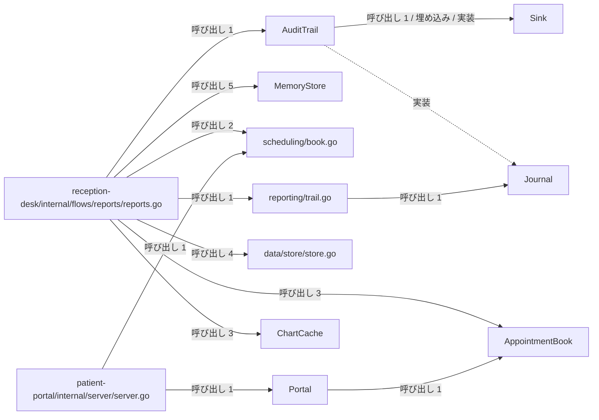
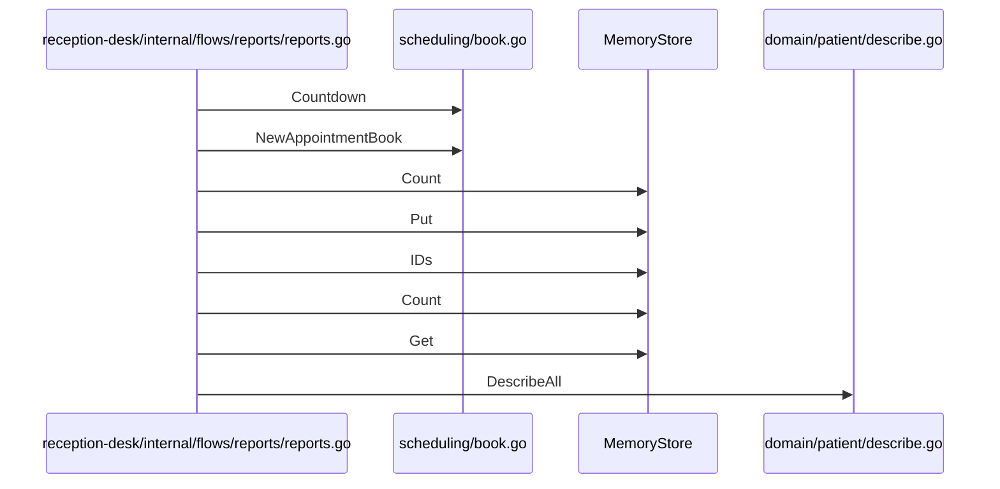

# 患者ポータルと帳票出力

## はじめに
本トピックは、医療システムにおける患者ポータルのWebサーバー機能、予約管理、および帳票出力フローの実行を担うコンポーネント群で構成されています。データストア、患者ドメイン、予約スケジュール、監査ログなどの多様なモジュールを統合し、帳票データの生成、出力、およびWebインターフェースを通じたサービス提供を行う役割を持っています。

本トピックはレベル 1 に位置づけられ、規模として型・疑似型 25 個、ファイル 11 個（attached-file 5、primary 20）を含んでいます。

## アーキテクチャと設計

### コンポーネント関係図

## データフロー

## 主要コンポーネント

本トピックを構成する主なメンバーの役割と定義は以下の通りです。

### 帳票出力・フロー制御
*   **`reception-desk/internal/flows/reports/reports.go`** (ファイルの関数)
    *   **主な関数・メソッド**: `Run`, `countAll`, `label`, `labelsOf`
    *   **役割**: 医療システムにおける帳票出力フローをデモンストレーションおよび実行するためのファイルです。データストア、患者ドメイン、予約スケジュール、監査ログなどの様々なモジュールを統合し、帳票データの生成と出力を処理します。
*   **`PatientList`** (struct)
    *   **役割**: 患者データをメモリ上に保持するストアとタイトルを組み合わせた、帳票用の患者リストを表す構造体です。
*   **`reporting/labels.go`** (ファイルの関数)
    *   **主な関数・メソッド**: `LabelAll`
    *   **役割**: `Label` メソッドを持つ任意の型のスライスから、それぞれのラベル文字列を抽出して新しいスライスとして返すジェネリックなヘルパー関数を提供します。

### 患者ポータル・Webサーバー
*   **`patient-portal/internal/server/server.go`** (ファイルの関数)
    *   **主な関数・メソッド**: `Demo`, `NewPortal`
    *   **役割**: 患者ポータル（Patient Portal）のWebサーバー機能を実装しています。予約管理や診療費計算などのドメインロジックをHTTPハンドラーとして公開し、ルーティングの設定やデモ実行用の関数を提供します。
*   **`Portal`** (struct)
    *   **主な関数・メソッド**: `Portal.Routes`, `Portal.handleAppointments`, `Portal.handleFees`, `Portal.handleHealth`
    *   **役割**: 予約管理（`AppointmentBook`）と診療費計算（`FeeCalculator`）の依存関係を保持する、患者ポータルサーバーのメイン構造体です。
*   **`patient-portal/cmd/patient-portal/main.go`** (ファイルの関数)
    *   **主な関数・メソッド**: `main`
    *   **役割**: 患者ポータルアプリケーションの実行可能なエントリーポイントです。標準出力を引数として内部パッケージのデモサーバー関数を呼び出し、アプリケーションのデモンストレーションを実行します。

### 予約管理
*   **`AppointmentBook`** (struct)
    *   **主な関数・メソッド**: `AppointmentBook.All`, `AppointmentBook.Each`, `AppointmentBook.Reserve`, `AppointmentBook.ReserveFor`
    *   **役割**: 予約枠のリストと、通知を行うためのNotifierを保持する予約帳の構造体です。
*   **`scheduling/book.go`** (ファイルの関数)
    *   **主な関数・メソッド**: `Countdown`, `NewAppointmentBook`
    *   **役割**: 医療予約システムにおける予約枠と予約帳を管理するための機能を提供します。予約の登録や患者ごとの予約、通知処理との連携、および登録された予約一覧をイテレータを介して取得する機能を実装しています。
*   **`Slot`** (struct)
    *   **主な関数・メソッド**: `Slot.Label`
    *   **役割**: 予約の時間帯と予約者名を保持する構造体です。

### データ管理・キャッシュ
*   **`MemoryStore`** (struct)
    *   **主な関数・メソッド**: `MemoryStore.Count`, `MemoryStore.Get`, `MemoryStore.IDs`, `MemoryStore.Put`
    *   **役割**: 任意の型をメモリ上のマップで保持する、ジェネリックなインメモリデータストア構造体です。
*   **`Store`** (alias)
    *   **役割**: `MemoryStore` の型エイリアスであり、将来的な拡張や抽象化のために定義されています。
*   **`data/store/store.go`** (ファイルの関数)
    *   **主な関数・メソッド**: `FirstOf`, `Map`, `NewMemoryStore`, `Sum`
    *   **役割**: ジェネリクスを活用したインメモリのデータストアの実装と、スライス操作のための汎用的なユーティリティ関数群を提供するファイルです。
*   **`Number`** (interface)
    *   **役割**: 数値計算（`int`, `int64`, `float64`）に適合する型を制限するためのジェネリックなインターフェースです。
*   **`ChartCache`** (struct)
    *   **主な関数・メソッド**: `ChartCache.Get`, `ChartCache.Len`, `ChartCache.Put`
    *   **役割**: ジェネリクスに対応し、キーと値のペアをマップで保持するキャッシュ構造体です。
*   **`data/cache/cache.go`** (ファイルの関数)
    *   **主な関数・メソッド**: `New`
    *   **役割**: ジェネリクスを利用した汎用的なインメモリキャッシュ機構を提供します。

### 監査ログ・メッセージ記録
*   **`AuditTrail`** (struct)
    *   **主な関数・メソッド**: `AuditTrail.Note`
    *   **役割**: 任意の `Sink` を内包し、名前付きでメッセージを記録する構造体です。
*   **`Sink`** (interface)
    *   **主な関数・メソッド**: `Sink.Write`
    *   **役割**: 文字列を書き込むための `Write` メソッドを定義するインターフェースです。
*   **`Journal`** (interface)
    *   **主な関数・メソッド**: `Journal.Write`
    *   **役割**: メッセージを書き込むための `Write` メソッドを持つインターフェースです。
*   **`MemorySink`** (struct)
    *   **主な関数・メソッド**: `MemorySink.Write`
    *   **役割**: 書き込まれた文字列をメモリ上のスライスに保持する構造体です。
*   **`reporting/trail.go`** (ファイルの関数)
    *   **主な関数・メソッド**: `Publish`
    *   **役割**: 監査ログやメッセージの記録（シンク）およびジャーナル処理を行うためのインターフェースと、その具体的な実装を提供します。

### ドメインモデル
*   **`domain/patient/describe.go`** (ファイルの関数)
    *   **主な関数・メソッド**: `DescribeAll`
    *   **役割**: 患者ドメインにおけるオブジェクトの文字列表現（説明）を取得するための共通インターフェースと、そのスライスを一括処理するユーティリティ関数を定義しています。
*   **`Ward`** (struct - `domain/wards/north/ward.go`)
    *   **主な関数・メソッド**: `Ward.Beds`
    *   **役割**: 北病棟を表す構造体であり、病棟の名前を保持します。
*   **`domain/wards/north/ward.go`** (ファイルの関数)
    *   **役割**: 北病棟に関するドメインモデルを定義するファイルです。
*   **`Ward`** (struct - `domain/wards/south/ward.go`)
    *   **主な関数・メソッド**: `Ward.Beds`
    *   **役割**: 南病棟を表す構造体で、病棟の名前を保持します。
*   **`domain/wards/south/ward.go`** (ファイルの関数)
    *   **役割**: 南病棟に関するドメインモデルを定義するファイルです。

## 依存関係

本トピックは、他のトピックと以下のような呼び出し関係を持っています。

### 依存先（本トピックが呼ぶ側）
*   **薬局窓口と日次バッチ処理** (重み: 5.0, 呼び出し数: 5)
    *   例: `Run` → `NewMonthlyReport`, `Run` → `MonthlyReport.Render`
*   **患者受付と来院通知** (重み: 3.0, 呼び出し数: 3)
    *   例: `DescribeAll` → `Describer.Describe`, `Portal.handleAppointments` → `Patient.Describe`

### 依存元（本トピックが呼ばれる側）
*   **患者受付と来院通知** (重み: 2.0, 呼び出し数: 2)
    *   例: `Run` → `NewAppointmentBook`, `Run` → `AppointmentBook.ReserveFor`
*   **薬局窓口と日次バッチ処理** (重み: 1.0, 呼び出し数: 1)
    *   例: `Run` → `Sink.Write`
*   **テキストレポートの整形出力** (重み: 1.0, 呼び出し数: 1)
    *   例: `Run` → `Run`
    *   ※ `reception-desk/internal/flows/reports/reports.go` は、テキストレポートの整形出力から唯一の入口として呼び出されます。

## 構造的根拠

本トピックの構成メンバーは、Goコードにおける呼び出し、埋め込み、および実装の構造的関係に基づいて決定されました。

トピック内の結合において、中心的なハブとして機能しているのは `reception-desk/internal/flows/reports/reports.go` です。このファイルは、トピック内の PageRank において最上位に位置し、他から 1 回呼ばれる一方で、トピック内の各コンポーネントを 27 回呼び出しています。

主なトピック内呼び出しの根拠は以下の通りです。
*   `reception-desk/internal/flows/reports/reports.go` から `MemoryStore` への呼び出し（メソッド対: 5）
    *   例: `countAll` → `MemoryStore.Count`, `Run` → `MemoryStore.Put`, `Run` → `MemoryStore.IDs`
*   `reception-desk/internal/flows/reports/reports.go` から `data/store/store.go` への呼び出し（メソッド対: 4）
    *   例: `Run` → `Sum`, `Run` → `FirstOf`, `Run` → `NewMemoryStore`
*   `reception-desk/internal/flows/reports/reports.go` から `AppointmentBook` への呼び出し（メソッド対: 3）
    *   例: `Run` → `AppointmentBook.Reserve`, `Run` → `AppointmentBook.All`, `Run` → `AppointmentBook.Each`
*   `reception-desk/internal/flows/reports/reports.go` から `ChartCache` への呼び出し（メソッド対: 3）
    *   例: `Run` → `ChartCache.Len`, `Run` → `ChartCache.Put`, `Run` → `ChartCache.Get`
*   `reception-desk/internal/flows/reports/reports.go` から `scheduling/book.go` への呼び出し（メソッド対: 2）
    *   例: `Run` → `Countdown`, `Run` → `NewAppointmentBook`
*   `reception-desk/internal/flows/reports/reports.go` から `AuditTrail` への呼び出し（メソッド対: 1）
    *   例: `Run` → `AuditTrail.Note`

また、本トピックは以下の3つの子トピックを内包しています。
1.  **帳票出力とデータ管理** (レベル 2): 帳票出力フローの実行や、インメモリデータストア、キャッシュ、予約スケジュール、病棟ドメインなどの多様なモジュールを統合し、帳票データの生成と出力を管理します。
2.  **患者ポータルと予約管理** (レベル 2): 患者ポータルのWebサーバー機能、予約管理、およびアプリケーションのエントリーポイントを提供します。
3.  **監査ログとメッセージ記録** (レベル 2): 監査ログやメッセージの記録、ジャーナル処理を担います。

これらの構造的関係（凝集度: 0.073333、コンダクタンス: 0.169053）により、患者ポータル機能と帳票出力フローに関連する一連のコンポーネントが同一トピックとして定義されています。

---

<!-- codedoc:grounding -->
## 識別子の確認
本文のコード識別子 133 個のうち 133 個がグラフに存在します。
