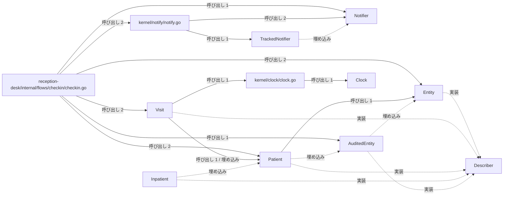
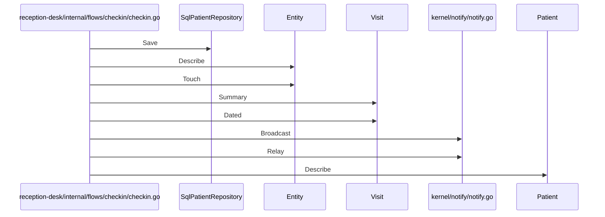

# 患者受付と来院通知

## はじめに
本トピックは、システム内においてレベル 1 に位置づけられる「患者受付と来院通知」に関する設計ドキュメントです。

このトピックは、型・疑似型 25 個、ファイル 11 個（うち primary 18 個、attached-file 3 個、attached-test 4 個）の規模で構成されており、凝集度は 0.133333、コンダクタンスは 0.145024 です。トピック内の中心的なハブとして `reception-desk/internal/flows/checkin/checkin.go` が機能しています。

主な役割は、医療受付（チェックイン）の業務フローの実行およびシミュレーションであり、患者情報の検索・保存、診察情報の作成、通知の送信、予約の作成など、ドメインモデルやリポジトリなどの各コンポーネントを組み合わせて一連の受付処理の流れを実演・検証することです。

## アーキテクチャと設計

### コンポーネント関係図

## データフロー

## 主要コンポーネント

本トピックを構成する主要なメンバーとその役割は以下の通りです。

### 業務フロー・制御
* **`reception-desk/internal/flows/checkin/checkin.go`** (ファイルの関数)
  * 医療受付（チェックイン）の業務フローをシミュレートまたは実行するためのファイルです。`Run`、`describeAny`、`find` などの関数を持ち、患者情報の検索・保存、診察情報の作成、通知の送信、予約の作成など、ドメインモデルやリポジトリなどの各コンポーネントを組み合わせて一連の受付処理の流れを実演・検証する役割を持ちます。

### ドメインモデル（患者・来院情報）
* **`Patient`** (struct)
  * `AuditedEntity` を埋め込み、患者の名前などの基本情報を保持する構造体です。`Patient.Describe` や `Patient.Save` などのメソッドを持ちます。
* **`Visit`** (struct)
  * 患者情報（`Patient`）を埋め込み、受診理由（Reason）を保持する来院情報を表す構造体です。`Visit.Dated` や `Visit.Summary` などのメソッドを持ちます。
* **`AuditedEntity`** (struct)
  * `Entity` を埋め込み、操作履歴などの監査ログを保持できるように拡張した構造体です。`AuditedEntity.Record` メソッドを持ちます。
* **`Entity`** (struct)
  * すべてのエンティティの基盤となる構造体で、一意のIDを保持します。`Entity.Describe`、`Entity.Save`、`Entity.Touch` などのメソッドを持ちます。
* **`Inpatient`** (struct)
  * `Patient` を埋め込み、病棟情報を追加した入院患者を表す構造体です。
* **`Describer`** (interface)
  * 自身を説明する文字列を返す `Describe` メソッドを定義したインターフェースです。
* **`domain/patient/entity.go`** (ファイルの関数)
  * 患者ドメインにおける基本エンティティ、監査ログ付きエンティティ、患者、および入院患者のデータ構造を定義するファイルです。構造体の埋め込み（コンポジション）を活用して、共通のID管理や監査機能、患者情報の定義と振る舞いを段階的に拡張しています。
* **`domain/visit/visit.go`** (ファイルの関数)
  * 患者の来院（受診）情報を表すドメインモデル `Visit` を定義しているファイルです。患者の基本情報に加えて受診理由を保持し、受付フローなどで利用するためのサマリー情報の生成や日時スタンプ付きの文字列表現を提供する役割を持ちます。

### 通知機能
* **`Notifier`** (interface)
  * メッセージを送信するための基本的な振る舞いを定義するインターフェースです。`Notifier.Send` メソッドを持ちます。
* **`TrackedNotifier`** (interface)
  * `Notifier` を拡張し、これまでに送信されたメッセージの件数を取得する機能を追加したインターフェースです。`TrackedNotifier.Sent` メソッドを持ちます。
* **`kernel/notify/notify.go`** (ファイルの関数)
  * システム内での通知送信機能を抽象化するためのインターフェースと、その具体的な実装およびユーティリティ関数を提供します。`Broadcast`、`Relay`、`itoa` などの関数を持ち、メール通知などの具体的な送信手段を定義し、複数の通知先への一括送信や送信件数の追跡が可能な通知処理をサポートします。
* **`SmsNotifier`** (struct)
  * SMS通知を送信するための構造体であり、宛先の電話番号と送信済みのメッセージ数を保持します。`SmsNotifier.Send`、`SmsNotifier.Sent` メソッドを持ちます。
* **`MailNotifier`** (struct)
  * メールによる通知送信を行うための構造体で、宛先情報を保持します。`MailNotifier.Send` メソッドを持ちます。
* **`scheduling/sms.go`** (ファイルの関数)
  * SMS（ショートメッセージサービス）を利用した通知送信機能をシミュレートする `SmsNotifier` 構造体とそのメソッドを定義しているファイルです。指定された電話番号へのメッセージ送信処理と、送信された通知の総数を追跡する機能を提供します。

### データアクセス（リポジトリ）
* **`SqlPatientRepository`** (struct)
  * 患者データをメモリ内のマップで保持し、ログ出力機能を備えた、患者リポジトリの具体的な実装構造体です。`SqlPatientRepository.Find` や `SqlPatientRepository.Save` メソッドを持ちます。
* **`Repository`** (interface)
  * 任意の型を対象としたデータの検索と保存の操作を定義する、ジェネリックなリポジトリインターフェースです。`Repository.Find`、`Repository.Save` メソッドを持ちます。
* **`data/repository/repository.go`** (ファイルの関数)
  * 汎用的なデータアクセスを行うためのリポジトリインターフェースと、メモリ内マップを用いた患者データ用リポジトリの具体的な実装を提供するファイルです。`NewSqlPatientRepository` 関数を持ち、ドメインモデルの永続化と取得に関する抽象化および具体的なデータ操作処理を担っています。

### 時刻管理
* **`Clock`** (interface)
  * 現在時刻を取得するための抽象的なインターフェースを定義します。`Clock.Now` メソッドを持ちます。
* **`OfficeClock`** (struct)
  * 特定の固定された日付を保持し、`Clock` インターフェースを実装する構造体です。`OfficeClock.Now` メソッドを持ちます。
* **`kernel/clock/clock.go`** (ファイルの関数)
  * システム内で時刻を扱うための抽象化（`Clock` インターフェース）と、その具体的な実装（`OfficeClock`）、および時刻に関連するユーティリティ関数を提供します。`Label`、`Stamp`、`normalize` などの関数を持ち、テスト時などの時刻のモック化を容易にし、一貫した日付フォーマットやラベル生成を支援する役割を持ちます。

### テスト用コンポーネント
* **`fakeClock`** (struct)
  * `Clock` インターフェースを満たすために定義された、テスト用の偽の時計構造体です。`fakeClock.Now` メソッドを持ちます。
* **`kernel/clock/clock_test.go`** (ファイルの関数)
  * `clock` パッケージの機能を検証するためのテストコードです。テスト用のモック（`fakeClock`）を定義し、日付スタンプの生成機能や文字列の正規化処理が正しく動作することを確認します。`TestNormalize`、`TestStamp` などの関数を持ちます。
* **`kernel/clock/clock_ext_test.go`** (ファイルの関数)
  * `clock` パッケージの外部テスト（`clock_test` パッケージ）を実装したものです。パッケージの公開APIである `Normalize`、`NormalizeHook`、および `Label` 関数の動作が期待通りに機能するかを検証します。`TestExported`、`TestLabel` などの関数を持ちます。
* **`kernel/clock/export_test.go`** (ファイルの関数)
  * `clock` パッケージの非公開（小文字開始）の関数や変数を、外部のテストパッケージからアクセスできるようにエクスポートするためのテスト用ファイルです。テストコードから内部ロジックを直接検証できるように仲介する役割を持ち、`Normalize` 関数などを提供します。

## 依存関係

本トピックは、他のトピックと以下のような依存関係（呼び出し・埋め込み・実装）を持っています。

### 依存先（本トピックが呼び出すトピック）
* **薬局窓口と日次バッチ処理** (重み: 3.0, 呼び出し数: 3)
  * 例: `SqlPatientRepository.Find` → `Logger.Log`
  * 例: `Run` → `New`
* **患者ポータルと帳票出力** (重み: 2.0, 呼び出し数: 2)
  * 例: `Run` → `NewAppointmentBook`
  * 例: `Run` → `AppointmentBook.ReserveFor`

### 依存元（本トピックを呼び出すトピック）
* **患者ポータルと帳票出力** (重み: 3.0, 呼び出し数: 3)
  * 例: `DescribeAll` → `Describer.Describe`
  * 例: `Portal.handleAppointments` → `Patient.Describe`
* **薬局窓口と日次バッチ処理** (重み: 2.0, 呼び出し数: 2)
  * 例: `first` → `Patient.Describe`
  * 例: `Run` → `Notifier.Send`
* **テキストレポートの整形出力** (重み: 1.0, 呼び出し数: 1)
  * 例: `Run` → `Run`

## 構造的根拠

本トピックのメンバー構成および境界は、Go コードにおける呼び出し、構造体の埋め込み、およびインターフェースの実装構造に基づいて決定されました。

### 主なハブと入口
* **`reception-desk/internal/flows/checkin/checkin.go`** は、トピック内 PageRank 上位のハブであり、他トピックから 1 回呼ばれる一方で、トピック内の各コンポーネントを 17 回呼び出しています。
* 外部トピックからの入口として、`reception-desk/internal/flows/checkin/checkin.go` は「テキストレポートの整形出力」から呼び出され、`Describer` インターフェースは「患者ポータルと帳票出力」から呼び出されています。

### トピック内の主な呼び出し関係
トピックの結束を示す主な内部呼び出しは以下の通りです。
* `reception-desk/internal/flows/checkin/checkin.go` から `Patient` への呼び出し（2回、例: `Run` → `Patient.Describe`, `Run` → `Patient.Save`）
* `reception-desk/internal/flows/checkin/checkin.go` から `Visit` への呼び出し（2回、例: `Run` → `Visit.Summary`, `Run` → `Visit.Dated`）
* `reception-desk/internal/flows/checkin/checkin.go` から `Entity` への呼び出し（2回、例: `Run` → `Entity.Describe`, `Run` → `Entity.Touch`）
* `reception-desk/internal/flows/checkin/checkin.go` から `kernel/notify/notify.go` への呼び出し（2回、例: `Run` → `Broadcast`, `Run` → `Relay`）
* `kernel/notify/notify.go` から `Notifier` への呼び出し（2回、例: `Broadcast` → `Notifier.Send`, `Relay` → `Notifier.Send`）
* `reception-desk/internal/flows/checkin/checkin.go` から `Notifier` への呼び出し（1回、例: `Run` → `Notifier.Send`）
* `reception-desk/internal/flows/checkin/checkin.go` から `AuditedEntity` への呼び出し（1回、例: `Run` → `AuditedEntity.Record`）
* `reception-desk/internal/flows/checkin/checkin.go` から `SqlPatientRepository` への呼び出し（1回、例: `Run` → `SqlPatientRepository.Save`）
* `Visit` から `Patient` への呼び出し（1回、例: `Visit.Summary` → `Patient.Describe`）
* `reception-desk/internal/flows/checkin/checkin.go` から `data/repository/repository.go` への呼び出し（1回、例: `Run` → `NewSqlPatientRepository`）

### 子トピック
本トピック（レベル 1）の下位には、以下のレベル 2 の子トピックが属しており、より細分化された機能構造を形成しています。
* **メールとSMS通知送信**: システム内における通知送信機能を抽象化し、メールやSMSによる具体的な通知処理をサポートします。
* **患者情報と来院記録**: 患者の基本情報や来院（受診）記録を管理します。
* **患者受付とデータ永続化**: 患者データの永続化と取得に関する抽象化および具体的なデータ操作処理を担います。
* **システム時刻と時計管理**: 時刻を扱うための抽象化や具体的な時計の実装、および時刻に関連するユーティリティ関数を提供します。

---

<!-- codedoc:grounding -->
## 識別子の確認
本文のコード識別子 152 個のうち 151 個がグラフに存在します。
グラフに見つからない識別子: `NormalizeHook`
