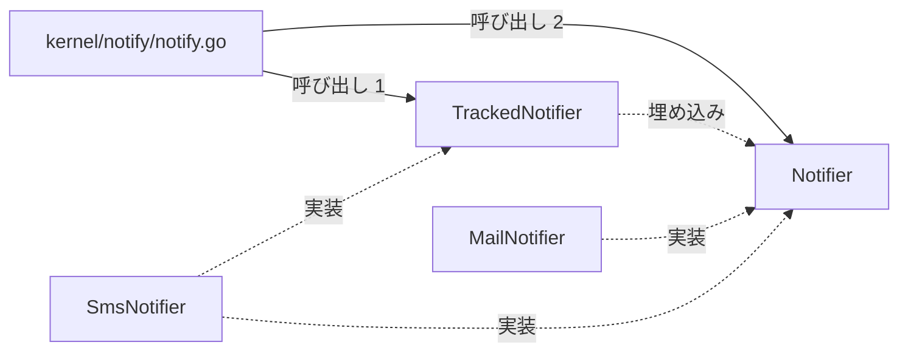
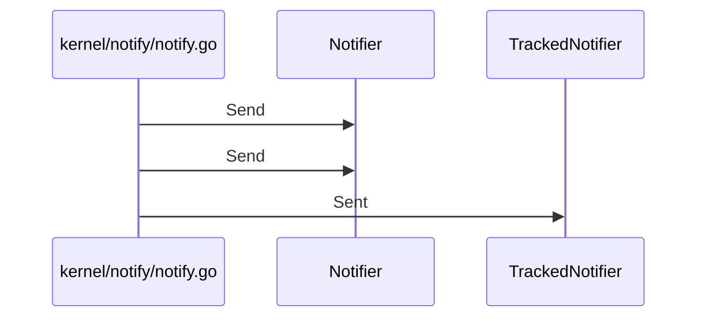

# メールとSMS通知送信

## はじめに
「メールとSMS通知送信」は、システム内における通知送信機能を抽象化し、メールやSMS（ショートメッセージサービス）といった具体的な手段による通知処理をサポートするレベル 2 のトピックです。上位トピックである「患者受付と来院通知」に属しています。

本トピックは、型・疑似型 6 個、ファイル 2 個（`attached-file` 1個、`primary` 5個）の規模で構成され、ハブとして `Notifier` を中心に設計されています。トピック内の凝集度は 0.4、コンダクタンスは 0.273649 です。

## アーキテクチャと設計

### コンポーネント関係図

## データフロー

## 主要コンポーネント

本トピックを構成する主なメンバーの役割と定義は以下の通りです。

*   **`Notifier` (interface)**
    *   ファイル: `kernel/notify/notify.go` (primary)
    *   役割: メッセージを送信するための基本的な振る舞いを定義するインターフェースです。主なメソッドとして `Notifier.Send` を持ちます。
*   **`kernel/notify/notify.go` (ファイルの関数)**
    *   ファイル: `kernel/notify/notify.go` (primary)
    *   役割: システム内での通知送信機能を抽象化するためのインターフェースと、その具体的な実装およびユーティリティ関数を提供します。メール通知などの具体的な送信手段を定義し、複数の通知先への一括送信や送信件数の追跡が可能な通知処理をサポートします。主な関数として `Broadcast`, `Relay`, `itoa` があります。
*   **`TrackedNotifier` (interface)**
    *   ファイル: `kernel/notify/notify.go` (primary)
    *   役割: `Notifier` を拡張し、これまでに送信されたメッセージの件数を取得する機能を追加したインターフェースです。主なメソッドとして `TrackedNotifier.Sent` を持ちます。
*   **`SmsNotifier` (struct)**
    *   ファイル: `scheduling/sms.go` (primary)
    *   役割: SMS通知を送信するための構造体であり、宛先の電話番号と送信済みのメッセージ数を保持します。主なメソッドとして `SmsNotifier.Send` および `SmsNotifier.Sent` を持ちます。
*   **`MailNotifier` (struct)**
    *   ファイル: `kernel/notify/notify.go` (primary)
    *   役割: メールによる通知送信を行うための構造体で、宛先情報を保持します。主なメソッドとして `MailNotifier.Send` を持ちます。
*   **`scheduling/sms.go` (ファイルの関数)**
    *   ファイル: `scheduling/sms.go` (attached-file)
    *   役割: SMSを利用した通知送信機能をシミュレートする `SmsNotifier` 構造体とそのメソッドを定義しています。指定された電話番号へのメッセージ送信処理と、送信された通知の総数を追跡する機能を提供し、システムの他の部分から通知インターフェースを介したSMS送信を可能にします。

## 依存関係

本トピックは、外部のトピックから以下の呼び出しを受けて依存されています。

*   **患者受付とデータ永続化** (依存元)
    *   呼び出し数: 3 (重み: 2.585)
    *   具体的な呼び出し例: `Run` → `Broadcast`, `Run` → `Relay`
    *   入口メンバー: `kernel/notify/notify.go` は、このトピックから 2 回呼び出されます。
*   **管理コンソールと月報作成** (依存元)
    *   呼び出し数: 1 (重み: 1.0)
    *   具体的な呼び出し例: `Run` → `Notifier.Send`
*   **帳票出力とデータ管理** (依存元)
    *   呼び出し数: 1 (重み: 1.0)
    *   具体的な呼び出し例: `AppointmentBook.ReserveFor` → `Notifier.Send`

## 構造的根拠

このトピックのメンバーは、Go コードにおける呼び出し、埋め込み、および実装の構造に基づいて決定されました。

トピック内における主な呼び出しおよび構造的関係の根拠は以下の通りです。

1.  **トピック内の関数呼び出し**
    *   `kernel/notify/notify.go` から `Notifier` への呼び出しが 2 回行われています（例: `Broadcast` → `Notifier.Send`, `Relay` → `Notifier.Send`）。
    *   `kernel/notify/notify.go` から `TrackedNotifier` への呼び出しが 1 回行われています（例: `Relay` → `TrackedNotifier.Sent`）。
2.  **インターフェースの埋め込みと実装関係**
    *   `TrackedNotifier` は `Notifier` を埋め込んでいます。
    *   `MailNotifier` は `Notifier` を実装しています。
    *   `SmsNotifier` は `Notifier` と `TrackedNotifier` の両方を実装しています。

---

<!-- codedoc:grounding -->
## 識別子の確認
本文のコード識別子 49 個のうち 49 個がグラフに存在します。
