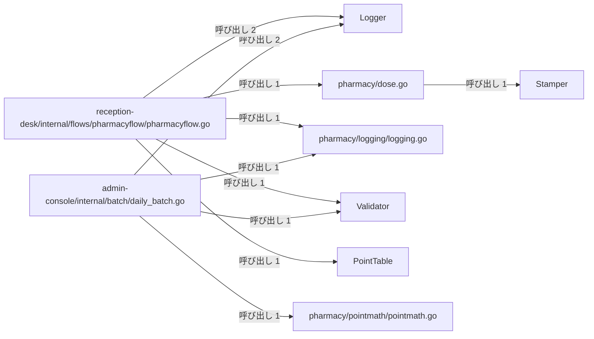
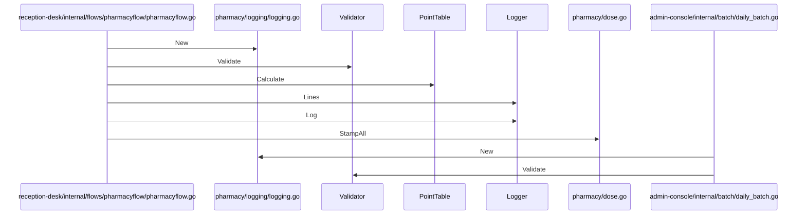

# 薬局調剤と処方監査

## はじめに
このトピックは「薬局調剤と処方監査」に関する処理を担っており、アプリケーション内では「薬局窓口と日次バッチ処理」の上位トピックに属するレベル 2 のトピックとして位置づけられています。

本トピックの規模は、型・疑似型 11 個、ファイル 7 個（attached-file 2、primary 9）で構成されています。トピック内のハブとして `reception-desk/internal/flows/pharmacyflow/pharmacyflow.go` が機能しており、凝集度は 0.181818、コンダクタンスは 0.289102 です。

## アーキテクチャと設計

### コンポーネント関係図

## データフロー

## 主要コンポーネント

本トピックを構成する主要なメンバー（型、およびファイルの関数をまとめた疑似型）の役割と定義は以下の通りです。

*   **`reception-desk/internal/flows/pharmacyflow/pharmacyflow.go`** (ファイルの関数)
    *   **役割**: primary
    *   **主な関数・メソッド**: `Run`
    *   **要約**: 薬局窓口における一連の業務フローをシミュレートするファイルです。処方箋や保険情報のバリデーション、調剤量や診療報酬の計算、スタンプの押印、およびログの記録と出力を順次実行します。
*   **`admin-console/internal/batch/daily_batch.go`** (ファイルの関数)
    *   **役割**: primary
    *   **主な関数・メソッド**: `Run`
    *   **要約**: 管理コンソールにおける日次バッチ処理を定義するプログラムです。外部の共通パッケージを利用して、日次点検のログ記録、データの検証、およびポイントから円への金額変換を行い、その結果を指定された出力先へ書き出します。
*   **`Logger`** (struct)
    *   **役割**: primary
    *   **主な関数・メソッド**: `Logger.Lines`, `Logger.Log`
    *   **要約**: ステーション名と記録されたログ行のリストを保持する構造体です。
*   **`pharmacy/logging/logging.go`** (ファイルの関数)
    *   **役割**: primary
    *   **主な関数・メソッド**: `New`
    *   **要約**: 調剤業務におけるログ記録を行うためのシンプルなロガーを提供するファイルです。特定のステーション（場所や担当）に関連付けられたログメッセージをメモリ内に蓄積し、管理する機能を持っています。
*   **`Validator`** (struct)
    *   **役割**: primary
    *   **主な関数・メソッド**: `Validator.Validate`
    *   **要約**: 処方箋のバリデーション機能をカプセル化するための構造体です。
*   **`pharmacy/dose.go`** (ファイルの関数)
    *   **役割**: primary
    *   **主な関数・メソッド**: `StampAll`
    *   **要約**: 調剤業務における用量計算や、薬袋などのラベルへのスタンプ押印処理を提供するファイルです。用量計算を行う構造体や、スタンプ処理を抽象化するインターフェースとその具体的な実装が定義されています。
*   **`Stamper`** (interface)
    *   **役割**: primary
    *   **主な関数・メソッド**: `Stamper.Stamp`
    *   **要約**: ラベルに対してスタンプを押す操作を定義するインターフェースです。
*   **`PointTable`** (struct)
    *   **役割**: primary
    *   **主な関数・メソッド**: `PointTable.Calculate`
    *   **要約**: 点数計算に関する処理をまとめるための構造体です。
*   **`pharmacy/pointmath/pointmath.go`** (ファイルの関数)
    *   **役割**: primary
    *   **主な関数・メソッド**: `ToYen`
    *   **要約**: 調剤報酬などの点数を日本円に変換するための計算処理を提供するファイルです。点数に対して特定の倍率（10.8倍）を掛けた金額を算出する機能を持ちます。
*   **`legacy-claims/pointtable.go`** (ファイルの関数)
    *   **役割**: attached-file
    *   **主な関数・メソッド**: なし
    *   **要約**: レセプト（診療報酬請求）における点数計算のロジックを定義するファイルです。点数と回数に基づき、特定の加算処理を伴う合計点数の算出機能を提供します。
*   **`pharmacy/validation/validator.go`** (ファイルの関数)
    *   **役割**: attached-file
    *   **主な関数・メソッド**: なし
    *   **要約**: 処方箋データのバリデーションを行うための `Validator` 構造体とそのメソッドを定義しているファイルです。入力された処方箋情報が正しいフォーマットを満たしているかを検証する機能を提供します。

## 依存関係

本トピックと他のトピックとの間には、以下の呼び出し・埋め込み・実装の依存関係が存在します。

### 依存先（本トピックが依存しているトピック）
*   **受付日次締めと請求検証** (呼び出し: 4, 重み: 3.585)
    *   呼び出し例: `Run` → `Validator.Validate`, `Run` → `New`
*   **管理コンソールと月報作成** (呼び出し: 2, 重み: 2.0)
    *   呼び出し例: `Run` → `DoseCalculator.Calculate`, `Run` → `FeeCalculator.Calculate`
*   **受付振り分けと医療費計算** (呼び出し: 1, 重み: 1.0)
    *   呼び出し例: `Run` → `NewFeeCalculator`

### 依存元（本トピックに依存しているトピック）
*   **管理コンソールと月報作成** (呼び出し: 1, 重み: 1.0)
    *   呼び出し例: `Run` → `Run`
*   **テキストレポートの整形出力** (呼び出し: 1, 重み: 1.0)
    *   呼び出し例: `Run` → `Run`
*   **受付振り分けと医療費計算** (呼び出し: 0, 重み: 0.5)

## 構造的根拠

このトピックのメンバー構成は、Go コードにおける呼び出し・埋め込み・実装の構造的関係性に基づいて決定されました。

### トピック内の主な呼び出し関係
トピック内における主要な結合および呼び出しの根拠は以下の通りです。

*   `reception-desk/internal/flows/pharmacyflow/pharmacyflow.go` から `Logger` への呼び出し（メソッド対: 2、例: `Run` → `Logger.Lines`, `Run` → `Logger.Log`）
*   `admin-console/internal/batch/daily_batch.go` から `Logger` への呼び出し（メソッド対: 2、例: `Run` → `Logger.Lines`, `Run` → `Logger.Log`）
*   `reception-desk/internal/flows/pharmacyflow/pharmacyflow.go` から `pharmacy/logging/logging.go` への呼び出し（メソッド対: 1、例: `Run` → `New`）
*   `reception-desk/internal/flows/pharmacyflow/pharmacyflow.go` から `Validator` への呼び出し（メソッド対: 1、例: `Run` → `Validator.Validate`）
*   `reception-desk/internal/flows/pharmacyflow/pharmacyflow.go` から `pharmacy/dose.go` への呼び出し（メソッド対: 1、例: `Run` → `StampAll`）
*   `reception-desk/internal/flows/pharmacyflow/pharmacyflow.go` から `PointTable` への呼び出し（メソッド対: 1、例: `Run` → `PointTable.Calculate`）
*   `admin-console/internal/batch/daily_batch.go` から `pharmacy/logging/logging.go` への呼び出し（メソッド対: 1、例: `Run` → `New`）
*   `admin-console/internal/batch/daily_batch.go` から `Validator` への呼び出し（メソッド対: 1、例: `Run` → `Validator.Validate`）
*   `admin-console/internal/batch/daily_batch.go` から `pharmacy/pointmath/pointmath.go` への呼び出し（メソッド対: 1、例: `Run` → `ToYen`）
*   `pharmacy/dose.go` から `Stamper` への呼び出し（メソッド対: 1、例: `StampAll` → `Stamper.Stamp`）

### ハブ（トピック内 PageRank 上位）
トピック内で中心的な役割を果たすメンバーの呼び出し関係は以下の通りです。

*   `reception-desk/internal/flows/pharmacyflow/pharmacyflow.go` (ファイルの関数): 呼ばれる 1 / 呼ぶ 13
*   `admin-console/internal/batch/daily_batch.go` (ファイルの関数): 呼ばれる 1 / 呼ぶ 5
*   `Logger` (struct): 呼ばれる 4 / 呼ぶ 0
*   `pharmacy/dose.go` (ファイルの関数): 呼ばれる 1 / 呼ぶ 1
*   `pharmacy/logging/logging.go` (ファイルの関数): 呼ばれる 2 / 呼ぶ 0

### 入口（他トピックからのみ呼ばれるメンバー）
外部のトピックから本トピックへアクセスする際の境界となるメンバーです。

*   `reception-desk/internal/flows/pharmacyflow/pharmacyflow.go`
    *   呼び出し元: テキストレポートの整形出力 (呼ばれる: 1)
*   `admin-console/internal/batch/daily_batch.go`
    *   呼び出し元: 管理コンソールと月報作成 (呼ばれる: 1)

---

<!-- codedoc:grounding -->
## 識別子の確認
本文のコード識別子 88 個のうち 88 個がグラフに存在します。
