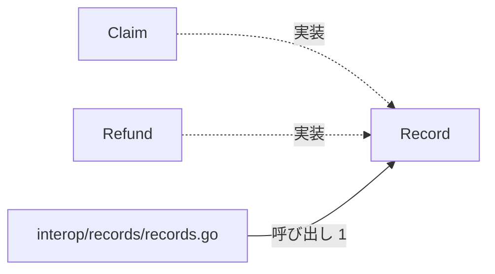
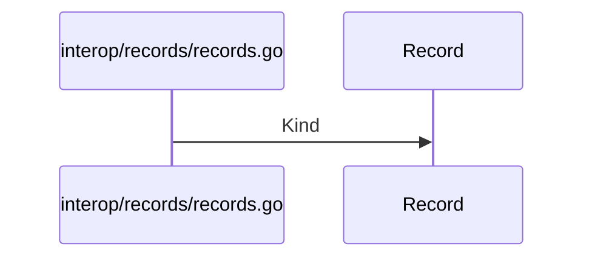

# 請求と返金の記録

## はじめに
「請求と返金の記録」は、システム保守とデータ出力を上位トピックとするレベル 2 のトピックです。このトピックは、医療ドメインにおける「請求」や「返金」などの記録データを統一的に扱うためのインターフェースと構造体を定義する役割を持っています。

## アーキテクチャと設計

### コンポーネント関係図

## データフロー

## 主要コンポーネント
このトピックは、1つのファイル（`interop/records/records.go`）に含まれる4つの型・疑似型（すべて primary 役割）で構成されています。

*   **`Record` (interface)**
    *   **定義ファイル**: `interop/records/records.go`
    *   **主なメソッド**: `Record.Kind`, `Record.sealed`
    *   **説明**: 請求や返金などの記録を表すインターフェースです。パッケージ外での独自実装を防ぐための非公開メソッドを用いたシールドメソッド（`Record.sealed`）を含んでいます。
*   **`interop/records/records.go` (ファイルの関数)**
    *   **主な関数**: `KindOf`
    *   **説明**: 医療ドメインにおける「請求」や「返金」などの記録データを統一的に扱うためのインターフェースと構造体を定義しています。非公開メソッドを用いたシールドインターフェース（sealed interface）パターンを採用し、パッケージ外での独自の `Record` 実装を制限しています。
*   **`Claim` (struct)**
    *   **定義ファイル**: `interop/records/records.go`
    *   **主なメソッド**: `Claim.Kind`, `Claim.sealed`
    *   **説明**: 請求情報を保持する構造体であり、`Record` インターフェースを実装しています。
*   **`Refund` (struct)**
    *   **定義ファイル**: `interop/records/records.go`
    *   **主なメソッド**: `Refund.Kind`, `Refund.sealed`
    *   **説明**: 返金情報を保持する構造体であり、`Record` インターフェースを実装しています。

## 依存関係
他トピックとの間には以下の依存関係が存在します。

*   **依存元トピックからの呼び出し**:
    *   **受付振り分けと医療費計算**: このトピックから `Record.Kind` が呼び出されています（例: `Run` → `Record.Kind`、呼び出し数: 1、重み: 1.0）。
    *   **システム保守とメトリクス収集**: このトピックから `KindOf` が呼び出されています（例: `Run` → `KindOf`、呼び出し数: 1、重み: 1.0）。また、このトピックは「システム保守とメトリクス収集」からのみ呼ばれる入口としての役割も持っています。

## 構造的根拠
このトピックのメンバーおよび範囲は、Go コードの呼び出し・埋め込み・実装の構造に基づいて決定されました。

*   **規模**: 型・疑似型 4 個、ファイル 1 個（すべて primary）
*   **ハブ**: `Record`（トピック内 PageRank 上位。呼ばれる数: 2、呼ぶ数: 0）
*   **指標**: 凝集度 0.5、コンダクタンス 0.333333
*   **トピック内の主な呼び出し**:
    *   `interop/records/records.go` から `Record` への呼び出し（メソッド対 1、例: `KindOf` → `Record.Kind`）
*   **実装関係**:
    *   `Claim` 構造体による `Record` インターフェースの実装
    *   `Refund` 構造体による `Record` インターフェースの実装

---

<!-- codedoc:grounding -->
## 識別子の確認
本文のコード識別子 34 個のうち 34 個がグラフに存在します。
