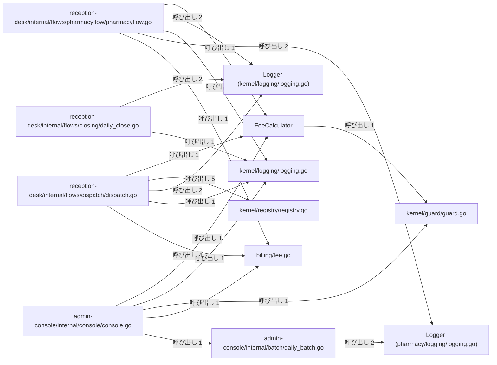
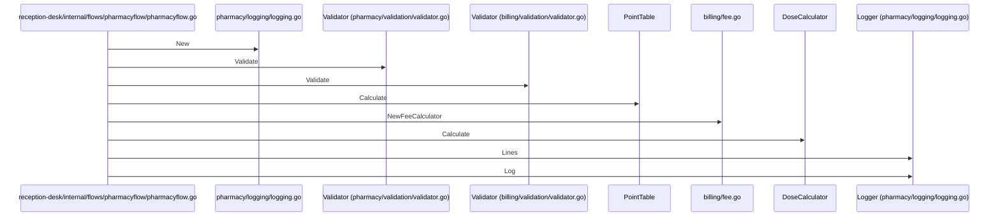

# 薬局窓口と日次バッチ処理

## はじめに
本トピックは、医療システムにおける薬局窓口業務のシミュレーション、受付の振り分け、日次締め処理、および管理コンソールにおける日次バッチ処理などの一連のフローを担うコンポーネント群で構成されています。

アプリケーション内ではレベル 1 に位置づけられており、型・疑似型 36 個、ファイル 22 個（うち `attached-file` が 7 個、`attached-test` が 1 個、`primary` が 28 個）の規模を持ちます。トピック内の中心的なハブとして `reception-desk/internal/flows/pharmacyflow/pharmacyflow.go` が機能しています。

## アーキテクチャと設計

### コンポーネント関係図
以下に、本トピック内における主要コンポーネント間の呼び出し関係を示します。

## データフロー
以下は、薬局窓口業務フロー（`reception-desk/internal/flows/pharmacyflow/pharmacyflow.go`）を実行する際の一連のデータフローとコンポーネント間の相互作用を示したシーケンス図です。

## 主要コンポーネント

本トピックを構成する主なメンバーとその役割は以下の通りです。

### 業務フロー・バッチ制御
*   **`reception-desk/internal/flows/pharmacyflow/pharmacyflow.go`**
    *   **役割**: 薬局窓口における一連の業務フローをシミュレートします。処方箋や保険情報のバリデーション、調剤量や診療報酬の計算、スタンプの押印、およびログの記録と出力を順次実行します。主な関数として `Run` を持ちます。
*   **`reception-desk/internal/flows/dispatch/dispatch.go`**
    *   **役割**: 医療受付システムにおける「振り分け（dispatch）」フローを実装します。会計、ロギング、レジストリ、調剤などの外部パッケージの機能を組み合わせ、関数の値としての取り扱いやクロージャ、ゴルーチン、パニックからの回復など、Go言語の様々な関数機能の動作デモンストレーションや検証を行います。主な関数として `Run`, `apply`, `looksInsured`, `makeAdder`, `recovered`, `tally` を持ちます。
*   **`admin-console/internal/console/console.go`**
    *   **役割**: 医療管理システムの管理コンソールにおけるメイン処理を制御します。バッチ処理の実行、診療報酬の計算、月次レポートの生成、通知の送信、監査ログの記録など、一連の管理タスクを順次実行して結果を出力します。主な関数として `Run` を持ちます。
*   **`admin-console/internal/batch/daily_batch.go`**
    *   **役割**: 管理コンソールにおける日次バッチ処理を定義します。外部の共通パッケージを利用して、日次点検のログ記録、データの検証、およびポイントから円への金額変換を行い、その結果を指定された出力先へ書き出します。主な関数として `Run` を持ちます。
*   **`reception-desk/internal/flows/closing/daily_close.go`**
    *   **役割**: 受付業務における日次締め（日次点検）の実行フローを定義します。ログの記録、バリデーションチェック、点数から日本円への換算を行い、その処理結果を指定された出力先（`io.Writer`）に書き出します。主な関数として `Run` を持ちます。
*   **`admin-console/cmd/admin-console/main.go`**
    *   **役割**: 管理コンソール（`admin-console`）アプリケーションのエントリポイントです。標準出力を引数として内部パッケージの `console.Run` を呼び出し、アプリケーションの実行を開始します。主な関数として `main` を持ちます。

### 料金計算・点数計算
*   **`billing/fee.go`**
    *   **役割**: 医療費などの料金計算を行うための構造体や関数を提供します。点数と回数、および設定されたレート（単価）を基に料金を計算する機能や、端数処理（丸め）、消費税加算などのユーティリティ関数が含まれます。システム内の様々なモジュールから料金計算の共通処理として利用されます。主な関数として `AddTax`, `NewFeeCalculator`, `Round` を持ちます。
*   **`FeeCalculator` (struct in `billing/fee.go`)**
    *   **役割**: 料金計算の基準となるレート（単価）を保持する構造体です。主なメソッドとして `FeeCalculator.Calculate`, `FeeCalculator.Scaled` を持ちます。
*   **`PointTable` (struct in `legacy-claims/pointtable.go`)**
    *   **役割**: 点数計算に関する処理をまとめるための構造体です。主なメソッドとして `PointTable.Calculate` を持ちます。
*   **`legacy-claims/pointtable.go`**
    *   **役割**: レセプト（診療報酬請求）における点数計算のロジックを定義します。点数と回数に基づき、特定の加算処理を伴う合計点数の算出機能を提供します。
*   **`billing/pointmath/pointmath.go`**
    *   **役割**: 医療費などの計算において、点数を日本円に変換するためのユーティリティ関数を提供します。1点あたり10円として計算するシンプルな変換処理（`ToYen`）を定義しています。
*   **`pharmacy/pointmath/pointmath.go`**
    *   **役割**: 調剤報酬などの点数を日本円に変換するための計算処理を提供します。点数に対して特定の倍率（10.8倍）を掛けた金額を算出する機能（`ToYen`）を持ちます。

### ログ記録・監査
*   **`Logger` (struct in `kernel/logging/logging.go`)**
    *   **役割**: ログのプレフィックスと、記録されたログメッセージの履歴を保持する構造体です。主なメソッドとして `Logger.Dump`, `Logger.Lines`, `Logger.Log` を持ちます。
*   **`kernel/logging/logging.go`**
    *   **役割**: アプリケーション内でのログ記録を管理するためのシンプルなロガー機能を提供します。プレフィックス付きのログメッセージをメモリ内にスライスとして保持し、後からログ一覧の取得や一括出力（ダンプ）を行う役割を担っています。主な関数として `New` を持ちます。
*   **`Logger` (struct in `pharmacy/logging/logging.go`)**
    *   **役割**: ステーション名と記録されたログ行のリストを保持する構造体です。主なメソッドとして `Logger.Lines`, `Logger.Log` を持ちます。
*   **`pharmacy/logging/logging.go`**
    *   **役割**: 調剤業務におけるログ記録を行うためのシンプルなロガーを提供します。特定のステーション（場所や担当）に関連付けられたログメッセージをメモリ内に蓄積し、管理します。主な関数として `New` を持ちます。
*   **`ConsoleLogger` (struct in `kernel/audit/audit.go`)**
    *   **役割**: `Logger` インターフェースを実装し、出力されたログ行をメモリ内のスライスに保持する構造体です。主なメソッドとして `ConsoleLogger.Printf` を持ちます。

### バリデーション・ガード条件
*   **`kernel/guard/guard.go`**
    *   **役割**: アプリケーション全体で共通して使用される値の検証（ガード条件）機能を提供します。必須チェックや数値の正負チェックなど、プログラムの前提条件を検証し、不正なデータによる予期せぬ動作を防ぎます。主な関数として `EnsurePositive`, `Require` を持ちます。
*   **`RequiredError` (struct in `kernel/guard/guard.go`)**
    *   **役割**: 必須項目が欠落していることを表すカスタムエラー構造体です。主なメソッドとして `RequiredError.Error` を持ちます。
*   **`Validator` (struct in `pharmacy/validation/validator.go`)**
    *   **役割**: 処方箋のバリデーション機能をカプセル化するための構造体です。主なメソッドとして `Validator.Validate` を持ちます。
*   **`pharmacy/validation/validator.go`**
    *   **役割**: 処方箋データのバリデーションを行うための `Validator` 構造体とそのメソッドを定義しているファイルです。入力された処方箋情報が正しいフォーマットを満たしているかを検証する機能を提供します。
*   **`Validator` (struct in `billing/validation/validator.go`)**
    *   **役割**: 請求データのバリデーションロジックをカプセル化するための構造体です。主なメソッドとして `Validator.Validate` を持ちます。
*   **`billing/validation/validator.go`**
    *   **役割**: 請求処理におけるIDの妥当性を検証するためのバリデータを提供します。`Validator` 構造体とその検証メソッドを定義し、システム全体で一貫したIDフォーマットのチェックを可能にします。

### 調剤・用量計算
*   **`DoseCalculator` (struct in `pharmacy/dose.go`)**
    *   **役割**: 用量の計算処理をカプセル化するための構造体です。主なメソッドとして `DoseCalculator.Calculate` を持ちます。
*   **`pharmacy/dose.go`**
    *   **役割**: 調剤業務における用量計算や、薬袋などのラベルへのスタンプ押印処理を提供します。用量計算を行う構造体や、スタンプ処理を抽象化するインターフェースとその具体的な実装が定義されています。主な関数として `StampAll` を持ちます。
*   **`Stamper` (interface in `pharmacy/dose.go`)**
    *   **役割**: ラベルに対してスタンプを押す操作を定義するインターフェースです。主なメソッドとして `Stamper.Stamp` を持ちます。
*   **`RubberStamp` (struct in `pharmacy/dose.go`)**
    *   **役割**: `Stamper` インターフェースを実装し、設定された名前を用いてスタンプを押す構造体です。主なメソッドとして `RubberStamp.Stamp` を持ちます。

### レポート・テキスト出力
*   **`reporting/monthly.go`**
    *   **役割**: 月ごとの患者の受診状況をまとめた月報（`MonthlyReport`）を生成するための機能を提供します。ロガーを利用して処理状況を記録しながら、受診リストから月報のテキスト表現をレンダリングします。主な関数として `NewMonthlyReport`, `first` を持ちます。
*   **`MonthlyReport` (struct in `reporting/monthly.go`)**
    *   **役割**: 月報のデータを保持する構造体であり、対象の月情報とログ出力用のロガーを格納します。主なメソッドとして `MonthlyReport.Render` を持ちます。
*   **`admin-console/internal/textreport/textreport.go`**
    *   **役割**: 管理コンソール向けのテキストレポートを生成するためのユーティリティ関数を提供しています。サードパーティのテキストフォーマットライブラリを利用して、見出しの装飾、テーブル表示、金額行のフォーマットなどのテキスト整形処理を行います。主な関数として `Heading`, `Line`, `Render` を持ちます。

### レジストリ・共通ユーティリティ
*   **`kernel/registry/registry.go`**
    *   **役割**: 文字列処理を行うハンドラ関数を登録・管理し、動的な呼び出しを可能にするレジストリ機能を提供するファイルです。デフォルトのバナー生成や文字列の正規化処理など、システム共通のユーティリティ機能も備えています。主な関数として `<init>`, `Banner`, `Call`, `Names`, `Normalize`, `Register` を持ちます。
*   **`kernel/registry/defaults.go`**
    *   **役割**: レジストリパッケージの初期化時にデフォルトの関数を登録するためのファイルです。パッケージのロード時に自動的に実行され、共通で利用する関数をレジストリに登録します。主な関数として `init#1` を持ちます。

### テスト・その他
*   **`billing/fee_test.go`**
    *   **役割**: 医療費計算に関連する機能のユニットテストを実装しています。料金計算器の初期化、料金計算処理、および端数処理（`Round`）が期待通りに動作することを確認するためのテストケース（`TestCalculate`）を提供します。
*   **`Step` (named type in `reception-desk/internal/flows/dispatch/dispatch.go`)**
    *   **役割**: 整数を受け取り整数を返す関数型を定義し、処理ステップを抽象化します。
*   **`Route` (struct in `reception-desk/internal/flows/dispatch/dispatch.go`)**
    *   **役割**: ルート名と、文字列を処理するハンドラ関数を保持する構造体です。
*   **`Checker` (struct in `reception-desk/internal/flows/dispatch/dispatch.go`)**
    *   **役割**: IDの妥当性を検証する関数を保持する構造体です。

### 子トピック
本トピックは、以下のレベル 2 の子トピックを内包しています。
*   **薬局調剤と処方監査**: 薬局調剤と処方監査に関する処理を担うトピック。
*   **管理コンソールと月報作成**: 管理コンソールのメイン処理の制御や、月次レポート（月報）の生成、料金計算、値の検証などを行うトピック。
*   **受付日次締めと請求検証**: 薬局窓口業務における日次締め（日次点検）の実行フローを担うトピック。
*   **受付振り分けと医療費計算**: 医療受付システムにおける「振り分け（dispatch）」フローの制御、医療費などの料金計算、および文字列処理ハンドラを管理するレジストリ機能を提供するトピック。

---

## 依存関係

本トピックと他のトピックとの間には、以下の呼び出し・埋め込み・実装による依存関係が存在します。

### 依存先（本トピックが依存しているトピック）
*   **患者受付と来院通知** (呼び出し: 2, 重み: 2.0)
    *   例: `first` → `Patient.Describe`, `Run` → `Notifier.Send`
*   **システム保守とデータ出力** (呼び出し: 1, 重み: 1.5)
    *   例: `Run` → `Record.Kind`
*   **患者ポータルと帳票出力** (呼び出し: 1, 重み: 1.0)
    *   例: `Run` → `Sink.Write`

### 依存元（本トピックに依存しているトピック）
*   **患者ポータルと帳票出力** (呼び出し: 5, 重み: 5.0)
    *   例: `Run` → `NewMonthlyReport`, `Run` → `MonthlyReport.Render`
*   **診療費会計と領収書発行** (呼び出し: 4, 重み: 3.1699)
    *   例: `Run` → `Round`, `Run` → `NewFeeCalculator`
*   **患者受付と来院通知** (呼び出し: 3, 重み: 3.0)
    *   例: `SqlPatientRepository.Find` → `Logger.Log`, `Run` → `New`
*   **テキストレポートの整形出力** (呼び出し: 3, 重み: 3.0)
    *   例: `Run` → `Run`

### 入口（他トピックから直接呼び出されるメンバー）
以下のメンバーは、「テキストレポートの整形出力」トピックから直接呼び出されます。
*   `reception-desk/internal/flows/pharmacyflow/pharmacyflow.go` (呼び出し: 1)
*   `reception-desk/internal/flows/dispatch/dispatch.go` (呼び出し: 1)
*   `reception-desk/internal/flows/closing/daily_close.go` (呼び出し: 1)

---

## 構造的根拠

本トピックの構成メンバーおよびその境界は、Goコードにおける呼び出し、構造体の埋め込み、およびインターフェースの実装構造の解析に基づいて決定されました。

トピックの凝集度は `0.070588`、コンダクタンスは `0.161878` です。トピック内における主要な呼び出し関係（メソッド対の数）は以下の通りであり、これらがトピックの構造的結合の強力な根拠となっています。

*   `reception-desk/internal/flows/dispatch/dispatch.go` から `kernel/registry/registry.go` への呼び出し (メソッド対: 5)
    *   例: `tally` → `Names`, `Run` → `Names`, `Run` → `Call`
*   `reception-desk/internal/flows/dispatch/dispatch.go` から `billing/fee.go` への呼び出し (メソッド対: 4)
    *   例: `recovered` → `NewFeeCalculator`, `worker` → `Round`, `Run` → `AddTax`
*   `admin-console/internal/console/console.go` から `admin-console/internal/textreport/textreport.go` への呼び出し (メソッド対: 3)
    *   例: `Run` → `Heading`, `Run` → `Render`, `Run` → `Line`
*   `reception-desk/internal/flows/pharmacyflow/pharmacyflow.go` から `Logger` への呼び出し (メソッド対: 2)
    *   例: `Run` → `Logger.Lines`, `Run` → `Logger.Log`
*   `reception-desk/internal/flows/dispatch/dispatch.go` から `Logger` への呼び出し (メソッド対: 2)
    *   例: `Run` → `Logger.Lines`, `Run` → `Logger.Log`
*   `reception-desk/internal/flows/closing/daily_close.go` から `Logger` への呼び出し (メソッド対: 2)
    *   例: `Run` → `Logger.Lines`, `Run` → `Logger.Log`
*   `admin-console/internal/batch/daily_batch.go` から `Logger` への呼び出し (メソッド対: 2)
    *   例: `Run` → `Logger.Lines`, `Run` → `Logger.Log`
*   `reception-desk/internal/flows/pharmacyflow/pharmacyflow.go` から `billing/fee.go` への呼び出し (メソッド対: 1)
    *   例: `Run` → `NewFeeCalculator`
*   `reception-desk/internal/flows/pharmacyflow/pharmacyflow.go` から `FeeCalculator` への呼び出し (メソッド対: 1)
    *   例: `Run` → `FeeCalculator.Calculate`

---

<!-- codedoc:grounding -->
## 識別子の確認
本文のコード識別子 192 個のうち 191 個がグラフに存在します。
グラフに見つからない識別子: `io.Writer`
