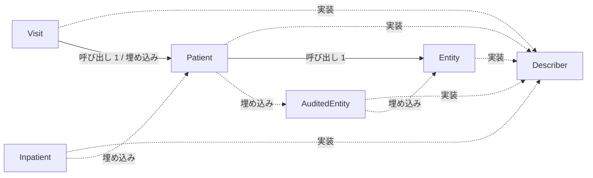
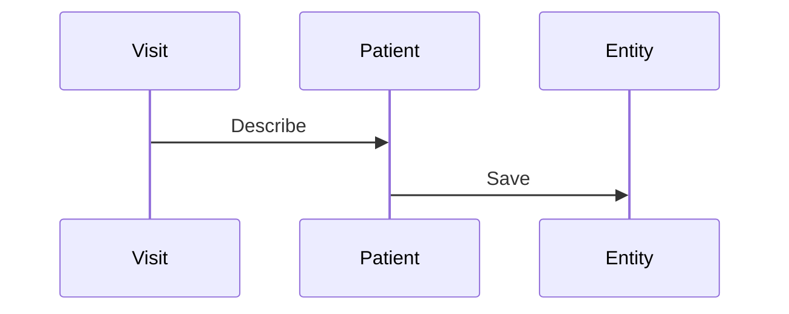

# 患者情報と来院記録

## はじめに
「患者情報と来院記録」は、アプリケーションにおいて患者の基本情報や来院（受診）記録を管理するためのトピックです。本トピックは、全体設計においてレベル 2 に位置づけられており、上位トピックである「患者受付と来院通知」の下位に属しています。

本トピックの規模は、型・疑似型が 8 個、ファイルが 3 個（うち `attached-file` が 2 個、`primary` が 6 個）で構成されています。トピック内の中心的な役割を果たすハブは `Patient` であり、凝集度は 0.357143、コンダクタンスは 0.280677 です。

## アーキテクチャと設計

### コンポーネント関係図

## データフロー

## 主要コンポーネント

本トピックを構成する主要なメンバー（型およびファイル）の役割と定義は以下の通りです。

### 構造体・インターフェース（primary）

- **`Patient`** (`domain/patient/entity.go`)
  `AuditedEntity` を埋め込み、患者の名前などの基本情報を保持する構造体です。主なメソッドとして `Patient.Describe` や `Patient.Save` を持ちます。
  
- **`Visit`** (`domain/visit/visit.go`)
  患者情報（`Patient`）を埋め込み、受診理由（`Reason`）を保持する来院情報を表す構造体です。主なメソッドとして `Visit.Dated` や `Visit.Summary` を持ちます。

- **`AuditedEntity`** (`domain/patient/entity.go`)
  `Entity` を埋め込み、操作履歴などの監査ログを保持できるように拡張した構造体です。主なメソッドとして `AuditedEntity.Record` を持ちます。

- **`Entity`** (`domain/patient/entity.go`)
  すべてのエンティティの基盤となる構造体で、一意のIDを保持します。主なメソッドとして `Entity.Describe`、`Entity.Save`、`Entity.Touch` を持ちます。

- **`Describer`** (`domain/patient/describe.go`)
  自身を説明する文字列を返す `Describe` メソッドを定義したインターフェースです。

- **`Inpatient`** (`domain/patient/entity.go`)
  `Patient` を埋め込み、病棟情報を追加した入院患者を表す構造体です。

### ファイル（attached-file）

- **`domain/patient/entity.go`**
  患者ドメインにおける基本エンティティ、監査ログ付きエンティティ、患者、および入院患者のデータ構造を定義するファイルです。構造体の埋め込み（コンポジション）を活用して、共通のID管理や監査機能、患者情報の定義と振る舞いを段階的に拡張しています。

- **`domain/visit/visit.go`**
  患者の来院（受診）情報を表すドメインモデル `Visit` を定義しているファイルです。患者の基本情報に加えて受診理由を保持し、受付フローなどで利用するためのサマリー情報の生成や日時スタンプ付きの文字列表現を提供する役割を持ちます。

## 依存関係

本トピックは、他のトピックと以下のような依存関係（呼び出し・埋め込み・実装）を持っています。

### 依存先（本トピックが依存しているトピック）
- **システム時刻と時計管理**（重み: 1.0、呼び出し数: 1）
  - 例: `Visit.Dated` → `Stamp`

### 依存元（本トピックに依存している他トピック）
- **患者受付とデータ永続化**（重み: 5.7549、呼び出し数: 7）
  - 例: `Run` → `Entity.Describe`
  - 例: `Run` → `Entity.Touch`
- **管理コンソールと月報作成**（重み: 1.0、呼び出し数: 1）
  - 例: `first` → `Patient.Describe`
- **帳票出力とデータ管理**（重み: 1.0、呼び出し数: 1）
  - 例: `DescribeAll` → `Describer.Describe`
- **患者ポータルと予約管理**（重み: 1.0、呼び出し数: 1）
  - 例: `Portal.handleAppointments` → `Patient.Describe`

### 他トピックから直接呼び出される入口メンバー
- **`Visit`**: 「患者受付とデータ永続化」から 2 回呼び出されます。
- **`AuditedEntity`**: 「患者受付とデータ永続化」から 1 回呼び出されます。
- **`Describer`**: 「帳票出力とデータ管理」から 1 回呼び出されます。

## 構造的根拠

本トピックのメンバーおよび範囲は、Go コードにおける呼び出し・埋め込み・実装の構造的な関係性に基づいて決定されました。

主な根拠となったトピック内の呼び出しおよび関係性は以下の通りです。
- **`Visit` から `Patient` への呼び出し**: `Visit.Summary` から `Patient.Describe` が呼び出されます（メソッド対の数: 1）。
- **`Patient` から `Entity` への呼び出し**: `Patient.Save` から `Entity.Save` が呼び出されます（メソッド対の数: 1）。
- **ハブとしての `Patient`**: `Patient` 構造体は、トピック内で最も多く参照されるハブであり、呼ばれる数が 5、呼ぶ数が 1 となっています。
- **その他の構造的関係**:
  - `AuditedEntity`（呼ばれる数: 1、呼ぶ数: 0）
  - `Entity`（呼ばれる数: 3、呼ぶ数: 0）
  - `Visit`（呼ばれる数: 2、呼ぶ数: 2）
  - `Describer`（呼ばれる数: 1、呼ぶ数: 0）

---

<!-- codedoc:grounding -->
## 識別子の確認
本文のコード識別子 59 個のうち 58 個がグラフに存在します。
グラフに見つからない識別子: `Reason`
