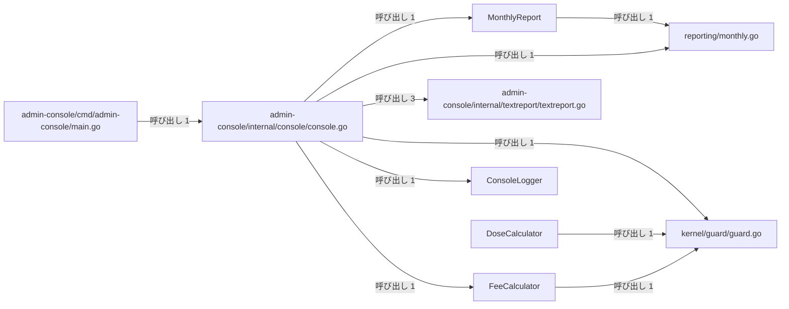
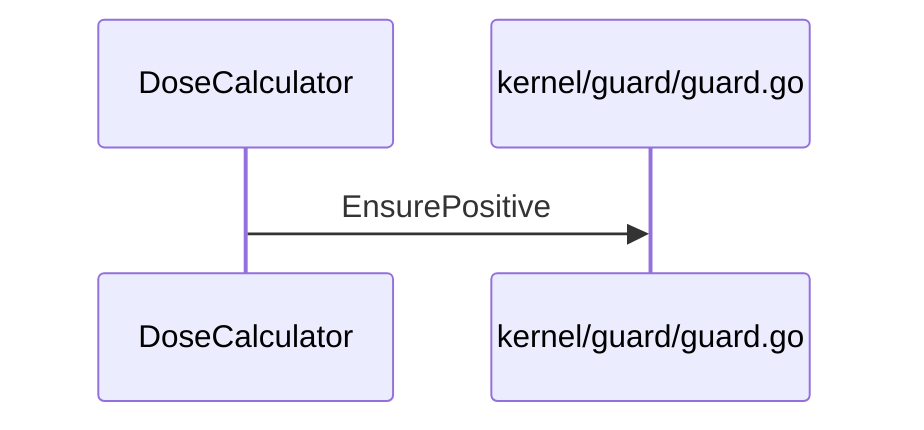

# 管理コンソールと月報作成

## はじめに
「管理コンソールと月報作成」は、医療管理システムにおける管理コンソールのメイン処理の制御や、月次レポート（月報）の生成、料金計算、値の検証などを行うトピックです。本トピックは「薬局窓口と日次バッチ処理」の上位トピックに属するレベル2のトピックであり、型・疑似型10個、ファイル8個（うち `attached-file` が1個、`primary` が9個）の規模で構成されています。

## アーキテクチャと設計

### コンポーネント関係図

## データフロー

## 主要コンポーネント

本トピックを構成する主なメンバーとその役割は以下の通りです。

- **`admin-console/internal/console/console.go`** (primary)
  医療管理システムの管理コンソールにおけるメイン処理を制御するパッケージです。バッチ処理の実行、診療報酬の計算、月次レポートの生成、通知の送信、監査ログの記録など、一連の管理タスクを順次実行して結果を出力する役割を持ちます。主な関数として `Run` が定義されています。
  
- **`FeeCalculator`** (primary)
  料金計算の基準となるレート（単価）を保持する構造体です。主なメソッドとして `FeeCalculator.Calculate` や `FeeCalculator.Scaled` を持ちます。

- **`reporting/monthly.go`** (primary)
  月ごとの患者の受診状況をまとめた月報（`MonthlyReport`）を生成するための機能を提供します。ロガーを利用して処理状況を記録しながら、受診リストから月報のテキスト表現をレンダリングする役割を持ちます。主な関数として `NewMonthlyReport` や `first` が定義されています。

- **`MonthlyReport`** (primary)
  月報のデータを保持する構造体であり、対象の月情報とログ出力用のロガーを格納します。主なメソッドとして `MonthlyReport.Render` を持ちます。

- **`kernel/guard/guard.go`** (primary)
  アプリケーション全体で共通して使用される値の検証（ガード条件）機能を提供します。必須チェックや数値の正負チェックなど、プログラムの前提条件を検証し、不正なデータによる予期せぬ動作を防ぐ役割を持ちます。主な関数として `EnsurePositive` や `Require` が定義されています。

- **`admin-console/internal/textreport/textreport.go`** (primary)
  管理コンソール向けのテキストレポートを生成するためのユーティリティ関数を提供しています。サードパーティのテキストフォーマットライブラリを利用して、見出しの装飾、テーブル表示、金額行のフォーマットなどのテキスト整形処理を行います。主な関数として `Heading`、`Line`、`Render` が定義されています。

- **`DoseCalculator`** (primary)
  用量の計算処理をカプセル化するための構造体です。主なメソッドとして `DoseCalculator.Calculate` を持ちます。

- **`ConsoleLogger`** (primary)
  `Logger` インターフェースを実装し、出力されたログ行をメモリ内のスライスに保持する構造体です。主なメソッドとして `ConsoleLogger.Printf` を持ちます。

- **`admin-console/cmd/admin-console/main.go`** (primary)
  管理コンソール（`admin-console`）アプリケーションのエントリポイントです。標準出力を引数として内部パッケージの `console.Run` を呼び出し、アプリケーションの実行を開始する役割を持ちます。主な関数として `main` が定義されています。

- **`RequiredError`** (attached-file)
  必須項目が欠落していることを表すカスタムエラー構造体です。主なメソッドとして `RequiredError.Error` を持ちます。

## 依存関係

### 依存先（本トピックが呼び出す他トピック）
- **受付日次締めと請求検証**（重み: 2.0, 呼び出し数: 2）
  - 例: `MonthlyReport.Render` → `Logger.Log`
  - 例: `Run` → `New`
- **メールとSMS通知送信**（重み: 1.0, 呼び出し数: 1）
  - 例: `Run` → `Notifier.Send`
- **薬局調剤と処方監査**（重み: 1.0, 呼び出し数: 1）
  - 例: `Run` → `Run`
- **患者情報と来院記録**（重み: 1.0, 呼び出し数: 1）
  - 例: `first` → `Patient.Describe`
- **受付振り分けと医療費計算**（重み: 1.0, 呼び出し数: 1）
  - 例: `Run` → `NewFeeCalculator`
- **システム保守とメトリクス収集**（重み: 0.5, 呼び出し数: 0）

### 依存元（本トピックを呼び出す他トピック）
- **薬局調剤と処方監査**（重み: 2.0, 呼び出し数: 2）
  - 例: `Run` → `DoseCalculator.Calculate`
  - 例: `Run` → `FeeCalculator.Calculate`
- **帳票出力とデータ管理**（重み: 2.0, 呼び出し数: 2）
  - 例: `Run` → `NewMonthlyReport`
  - 例: `Run` → `MonthlyReport.Render`
- **診療費会計と領収書発行**（重み: 1.585, 呼び出し数: 2）
  - 例: `Run` → `FeeCalculator.Calculate`
  - 例: `Run` → `FeeCalculator.Scaled`
- **患者ポータルと予約管理**（重み: 1.0, 呼び出し数: 1）
  - 例: `Portal.handleFees` → `FeeCalculator.Calculate`
- **受付振り分けと医療費計算**（重み: 1.0, 呼び出し数: 1）
  - 例: `recovered` → `FeeCalculator.Calculate`

### 入口（他トピックからのみ呼び出されるメンバー）
- **`DoseCalculator`**
  - 呼び出し元: 「薬局調剤と処方監査」から1回呼び出されます。

## 構造的根拠

このトピックのメンバーは、Goコードにおける呼び出し、埋め込み、および実装の構造に基づいて決定されました。トピック全体の凝集度は 0.222222、コンダクタンスは 0.390328 です。

トピック内のハブとして機能しているのは `admin-console/internal/console/console.go` であり、トピック内 PageRank で上位に位置しています。このファイルは他から1回呼ばれる一方で、トピック内で12回の呼び出しを行っています。

### トピック内の主な呼び出し関係
- `admin-console/internal/console/console.go` から `admin-console/internal/textreport/textreport.go` への呼び出し（メソッド対 3、例: `Run` → `Heading`, `Run` → `Render`, `Run` → `Line`）
- `admin-console/internal/console/console.go` から `FeeCalculator` への呼び出し（メソッド対 1、例: `Run` → `FeeCalculator.Calculate`）
- `admin-console/internal/console/console.go` から `reporting/monthly.go` への呼び出し（メソッド対 1、例: `Run` → `NewMonthlyReport`）
- `admin-console/internal/console/console.go` から `MonthlyReport` への呼び出し（メソッド対 1、例: `Run` → `MonthlyReport.Render`）
- `admin-console/internal/console/console.go` から `kernel/guard/guard.go` への呼び出し（メソッド対 1、例: `Run` → `Require`）
- `admin-console/internal/console/console.go` から `ConsoleLogger` への呼び出し（メソッド対 1、例: `Run` → `ConsoleLogger.Printf`）
- `admin-console/cmd/admin-console/main.go` から `admin-console/internal/console/console.go` への呼び出し（メソッド対 1、例: `main` → `Run`）
- `FeeCalculator` から `kernel/guard/guard.go` への呼び出し（メソッド対 1、例: `FeeCalculator.Calculate` → `EnsurePositive`）
- `MonthlyReport` から `reporting/monthly.go` への呼び出し（メソッド対 1、例: `MonthlyReport.Render` → `first`）
- `DoseCalculator` から `kernel/guard/guard.go` への呼び出し（メソッド対 1、例: `DoseCalculator.Calculate` → `EnsurePositive`）

---

<!-- codedoc:grounding -->
## 識別子の確認
本文のコード識別子 102 個のうち 102 個がグラフに存在します。
