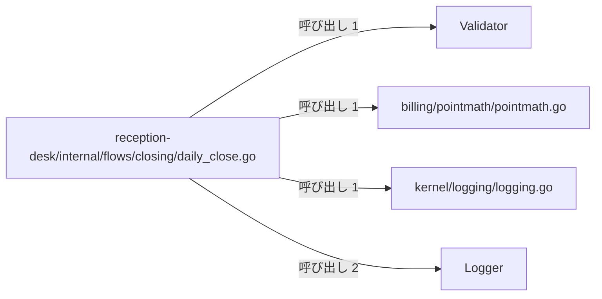
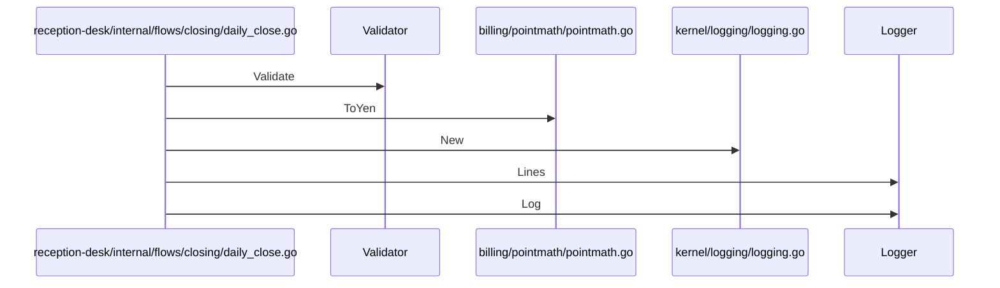

# 受付日次締めと請求検証

## はじめに
「受付日次締めと請求検証」は、薬局窓口業務における日次締め（日次点検）の実行フローを担うトピックです。このトピックは、上位トピックである「薬局窓口と日次バッチ処理」の下に位置づけられるレベル2のトピックです。

本トピックは、型・疑似型6個、ファイル4個（うち `attached-file` 1個、`primary` 5個）の規模で構成されており、ハブとして `reception-desk/internal/flows/closing/daily_close.go` を持ちます。凝集度は 0.266667、コンダクタンスは 0.589526 です。

主な役割は、受付業務における日次締めの実行フローを定義し、ログの記録、バリデーションチェック、点数から日本円への換算を行い、その処理結果を指定された出力先（`io.Writer`）に書き出すことです。

## アーキテクチャと設計

### コンポーネント関係図

## データフロー

## 主要コンポーネント

本トピックを構成する主要なメンバー（型および疑似型）の詳細は以下の通りです。

*   **`reception-desk/internal/flows/closing/daily_close.go`**（ファイルの関数）
    *   **役割**: `primary`
    *   **主な関数・メソッド**: `Run`
    *   **説明**: 受付業務における日次締め（日次点検）の実行フローを定義するファイルです。ログの記録、バリデーションチェック、点数から日本円への換算を行い、その処理結果を指定された出力先（`io.Writer`）に書き出す役割を持ちます。
*   **`Logger`**（struct）
    *   **役割**: `primary`
    *   **ファイル**: `kernel/logging/logging.go`
    *   **主な関数・メソッド**: `Logger.Dump`, `Logger.Lines`, `Logger.Log`
    *   **説明**: ログのプレフィックスと、記録されたログメッセージの履歴を保持する構造体です。
*   **`kernel/logging/logging.go`**（ファイルの関数）
    *   **役割**: `primary`
    *   **主な関数・メソッド**: `New`
    *   **説明**: アプリケーション内でのログ記録を管理するためのシンプルなロガー機能を提供します。プレフィックス付きのログメッセージをメモリ内にスライスとして保持し、後からログ一覧の取得や一括出力（ダンプ）を行う役割を担っています。
*   **`Validator`**（struct）
    *   **役割**: `primary`
    *   **ファイル**: `billing/validation/validator.go`
    *   **主な関数・メソッド**: `Validator.Validate`
    *   **説明**: 請求データのバリデーションロジックをカプセル化するための構造体です。
*   **`billing/pointmath/pointmath.go`**（ファイルの関数）
    *   **役割**: `primary`
    *   **主な関数・メソッド**: `ToYen`
    *   **説明**: 医療費などの計算において、点数を日本円に変換するためのユーティリティ関数を提供するファイルです。1点あたり10円として計算するシンプルな変換処理を定義しています。
*   **`billing/validation/validator.go`**（ファイルの関数）
    *   **役割**: `attached-file`
    *   **説明**: 請求処理におけるIDの妥当性を検証するためのバリデータを提供します。`Validator` 構造体とその検証メソッドを定義し、システム全体で一貫したIDフォーマットのチェックを可能にします。

## 依存関係

### 入口（他トピックから呼ばれるメンバー）
本トピックの `reception-desk/internal/flows/closing/daily_close.go` は、他トピック「テキストレポートの整形出力」から呼び出されます（呼ばれる数: 1）。

### 他トピックからの依存（依存元）
本トピックは、以下の他トピックから呼び出しによる依存を受けています。

| 依存元トピック | 呼び出し数 | 重み | 主な呼び出し例 |
|---|---|---|---|
| **薬局調剤と処方監査** | 4 | 3.585 | `Run` → `Validator.Validate`, `Run` → `New` |
| **患者受付とデータ永続化** | 3 | 3.0 | `SqlPatientRepository.Find` → `Logger.Log`, `Run` → `New` |
| **受付振り分けと医療費計算** | 3 | 2.585 | `Run` → `New`, `Run` → `Logger.Lines` |
| **管理コンソールと月報作成** | 2 | 2.0 | `MonthlyReport.Render` → `Logger.Log`, `Run` → `New` |
| **テキストレポートの整形出力** | 1 | 1.0 | `Run` → `Run` |
| **帳票出力とデータ管理** | 1 | 1.0 | `Run` → `New` |

## 構造的根拠

このトピックのメンバー構成および範囲は、Go コードにおける呼び出し・埋め込み・実装の静的構造に基づいて決定されました。

トピック内における主な構造的根拠となる呼び出し関係は以下の通りです。ハブである `reception-desk/internal/flows/closing/daily_close.go` から、トピック内の各コンポーネントに対して以下の呼び出しが行われています。

*   `reception-desk/internal/flows/closing/daily_close.go` から `Logger` への呼び出し（メソッド対: 2、例: `Run` → `Logger.Lines`, `Run` → `Logger.Log`）
*   `reception-desk/internal/flows/closing/daily_close.go` から `kernel/logging/logging.go` への呼び出し（メソッド対: 1、例: `Run` → `New`）
*   `reception-desk/internal/flows/closing/daily_close.go` から `Validator` への呼び出し（メソッド対: 1、例: `Run` → `Validator.Validate`）
*   `reception-desk/internal/flows/closing/daily_close.go` から `billing/pointmath/pointmath.go` への呼び出し（メソッド対: 1、例: `Run` → `ToYen`）

---

<!-- codedoc:grounding -->
## 識別子の確認
本文のコード識別子 59 個のうち 57 個がグラフに存在します。
グラフに見つからない識別子: `io.Writer`
