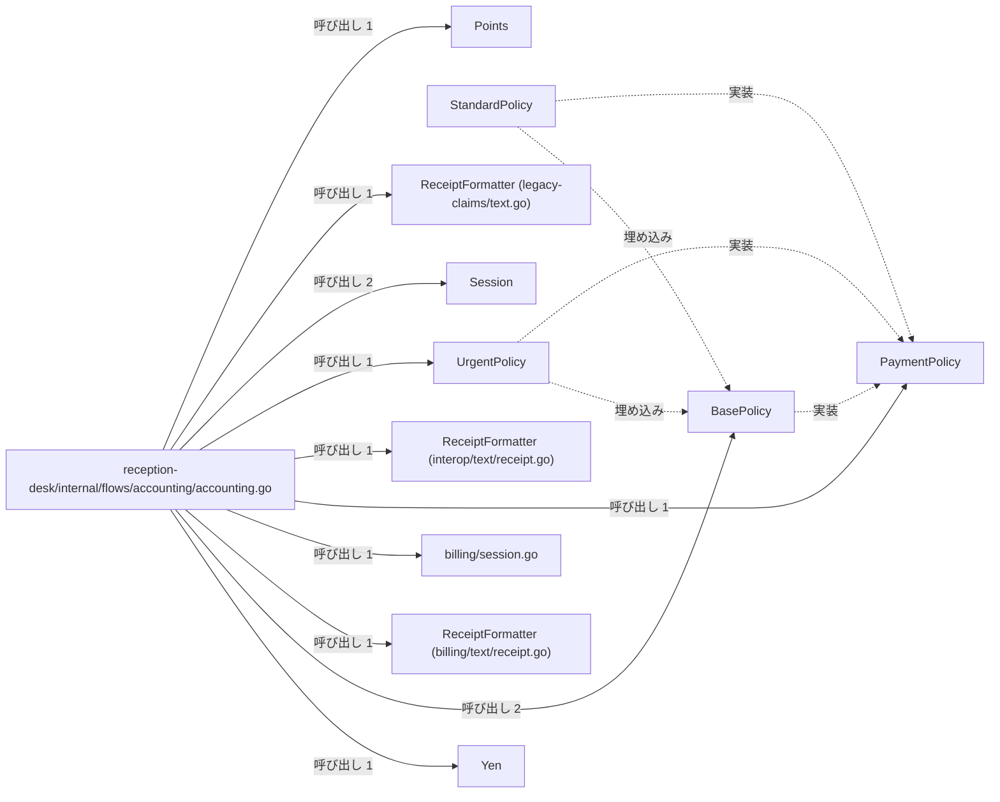
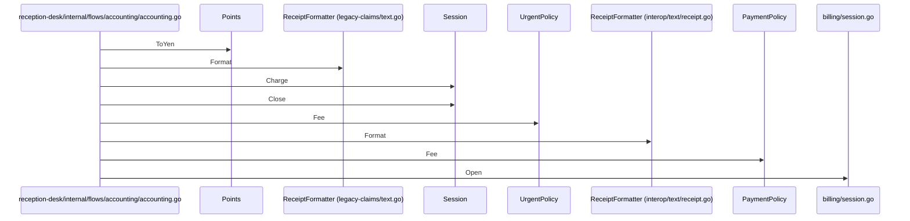

# 診療費会計と領収書発行

## はじめに
本トピックは、アプリケーション内における診療費の会計処理および領収書の発行フローを担うコンポーネント群で構成されています。
このトピックは、型・疑似型17個、ファイル7個（attached-file 5、primary 12）の規模を持ち、凝集度は0.110294、コンダクタンスは0.111169です。トピック内の中心的なハブとして `reception-desk/internal/flows/accounting/accounting.go` が機能しており、各種ポリシーに基づく料金計算や、セッション管理を用いた決済、領収書のテキストフォーマット出力などの一連の会計窓口業務を制御しています。

## アーキテクチャと設計

### コンポーネント関係図

## データフロー

## 主要コンポーネント

本トピックを構成する主要なメンバーの役割と定義は以下の通りです。

### 医療会計フロー
*   **`reception-desk/internal/flows/accounting/accounting.go` (primary)**
    *   **役割**: 医療会計フロー（会計窓口業務）のシミュレーションや実行を担うファイルです。
    *   **主な関数・メソッド**: `Run`, `charge`, `report`, `settle`
    *   **説明**: 各種ポリシーに基づく料金計算、診療費や薬代の合算、新旧フォーマッタによるレシート出力、およびセッション管理を用いた決済処理を順次実行します。

### 支払いポリシー（手数料計算ルール）
*   **`BasePolicy` (primary)**
    *   **役割**: 基本的な手数料計算とラベルを提供する構造体です。
    *   **主な関数・メソッド**: `BasePolicy.Fee`, `BasePolicy.Label`
    *   **説明**: 手数料率（Rate）を保持します。
*   **`UrgentPolicy` (primary)**
    *   **役割**: 緊急時の支払いポリシーを表す構造体です。
    *   **主な関数・メソッド**: `UrgentPolicy.Fee`
    *   **説明**: `BasePolicy` を埋め込んで定義されています。
*   **`StandardPolicy` (primary)**
    *   **役割**: 標準的な支払いポリシーを表す構造体です。
    *   **説明**: `BasePolicy` を埋め込んで定義されています。
*   **`PaymentPolicy` (primary)**
    *   **役割**: 支払い手数料を計算するための共通インターフェースです。
    *   **主な関数・メソッド**: `PaymentPolicy.Fee`
*   **`kernel/policy/policy.go` (attached-file)**
    *   **役割**: 会計処理における支払い手数料の計算ルール（ポリシー）を定義するパッケージです。基本となる `BasePolicy` と、それを拡張した `StandardPolicy` および `UrgentPolicy` を提供します。これらは共通のインターフェース `PaymentPolicy` を実装しています。

### 請求セッション管理
*   **`Session` (primary)**
    *   **役割**: 請求セッションを表す構造体です。
    *   **主な関数・メソッド**: `Session.Charge`, `Session.Close`
    *   **説明**: 担当窓口、合計金額、および課金明細の履歴を保持します。
*   **`billing/session.go` (primary)**
    *   **役割**: 医療会計などの請求処理における1回分のセッション（`Session`）を管理するための構造体とメソッドを定義しているファイルです。
    *   **主な関数・メソッド**: `Open`
    *   **説明**: 窓口ごとの請求金額の累積や課金明細の記録を行い、最終的な合計金額と明細件数の集計結果を提供します。

### 通貨・点数表現
*   **`Points` (primary)**
    *   **役割**: 医療費計算などで用いられる点数を表す整数ベースのカスタム型です。
    *   **主な関数・メソッド**: `Points.ToYen`
*   **`Yen` (primary)**
    *   **役割**: 日本円の金額を表す整数ベース of カスタム型です。
    *   **主な関数・メソッド**: `Yen.Add`, `Yen.String`
*   **`domain/money/money.go` (attached-file)**
    *   **役割**: ドメインモデルにおける日本円（`Yen`）と点数（`Points`）を表す型、およびそれらに関連する基本的な操作を定義しているファイルです。金額の加算や文字列フォーマット、点数から円への換算といった、会計処理に必要な計算ロジックを提供します。

### 領収書・レセプトフォーマッタ
*   **`ReceiptFormatter` (struct / `legacy-claims/text.go`) (primary)**
    *   **役割**: 旧レセプトのフォーマット処理を担当する構造体です。
    *   **主な関数・メソッド**: `ReceiptFormatter.Format`
*   **`ReceiptFormatter` (struct / `interop/text/receipt.go`) (primary)**
    *   **役割**: 領収書のテキストフォーマット処理をカプセル化するための構造体です。
    *   **主な関数・メソッド**: `ReceiptFormatter.Format`
*   **`ReceiptFormatter` (struct / `billing/text/receipt.go`) (primary)**
    *   **役割**: 領収書のテキストフォーマット処理をカプセル化するための構造体です。
    *   **主な関数・メソッド**: `ReceiptFormatter.Format`
*   **`interop/text/receipt.go` (attached-file)**
    *   **役割**: 他システムとの連携用として、金額（円）を指定されたテキスト形式にフォーマットする機能を提供するファイルです。領収書などのテキスト表現を生成するためのシンプルな構造体とメソッドが定義されています。
*   **`billing/text/receipt.go` (attached-file)**
    *   **役割**: 会計処理における領収書のテキスト表現を生成するためのフォーマッタを提供するファイルです。金額を指定されたテキスト形式に整形する役割を持ちます。
*   **`legacy-claims/text.go` (attached-file)**
    *   **役割**: 旧レセプト（診療報酬明細書）のフォーマット処理を行うための構造体とメソッドを定義しているファイルです。金額（円）を受け取り、特定のプレフィックスを付与した文字列に整形する機能を提供します。

## 依存関係

本トピックは、他トピックと以下のような依存関係（呼び出し関係）を持っています。

*   **依存先（本トピックが呼ぶトピック）**
    *   **薬局窓口と日次バッチ処理**: 呼び出し数は4、重みは3.1699です。
        *   呼び出し例: `Run` → `Round`, `Run` → `NewFeeCalculator`
*   **依存元（本トピックを呼ぶトピック）**
    *   **テキストレポートの整形出力**: 呼び出し数は1、重みは1.0です。
        *   呼び出し例: `Run` → `Run`（`reception-desk/internal/flows/accounting/accounting.go` の `Run` が呼び出されます）

## 構造的根拠

本トピックのメンバー構成および範囲は、Goコードにおける呼び出し、埋め込み、および実装の構造的関係に基づいて決定されています。

1.  **中心的なハブの存在**
    *   `reception-desk/internal/flows/accounting/accounting.go` は、トピック内 PageRank 上位のハブであり、他のメンバーから1回呼ばれる一方で、トピック内の各コンポーネントを16回呼び出しています。
2.  **ポリシーの実装と埋め込み構造**
    *   `StandardPolicy` および `UrgentPolicy` は、`BasePolicy` を埋め込んでおり、同時に `PaymentPolicy` インターフェースを実装しています。また、`BasePolicy` 自身も `PaymentPolicy` を実装しています。
3.  **トピック内の主な呼び出し関係**
    *   `reception-desk/internal/flows/accounting/accounting.go` から、以下のメンバーに対する具体的な呼び出しが確認されています。
        *   `BasePolicy` への呼び出し（2回）: `Run` → `BasePolicy.Fee`, `Run` → `BasePolicy.Label`
        *   `Session` への呼び出し（2回）: `settle` → `Session.Charge`, `report` → `Session.Close`
        *   `UrgentPolicy` への呼び出し（1回）: `Run` → `UrgentPolicy.Fee`
        *   `PaymentPolicy` への呼び出し（1回）: `charge` → `PaymentPolicy.Fee`
        *   `Points` への呼び出し（1回）: `Run` → `Points.ToYen`
        *   `ReceiptFormatter` への呼び出し（各1回）: `Run` → `ReceiptFormatter.Format`
        *   `billing/session.go` への呼び出し（1回）: `settle` → `Open`
        *   `Yen` への呼び出し（1回）: `Run` → `Yen.Add`

---

<!-- codedoc:grounding -->
## 識別子の確認
本文のコード識別子 91 個のうち 91 個がグラフに存在します。
