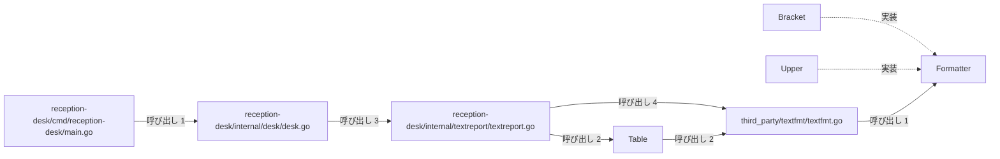
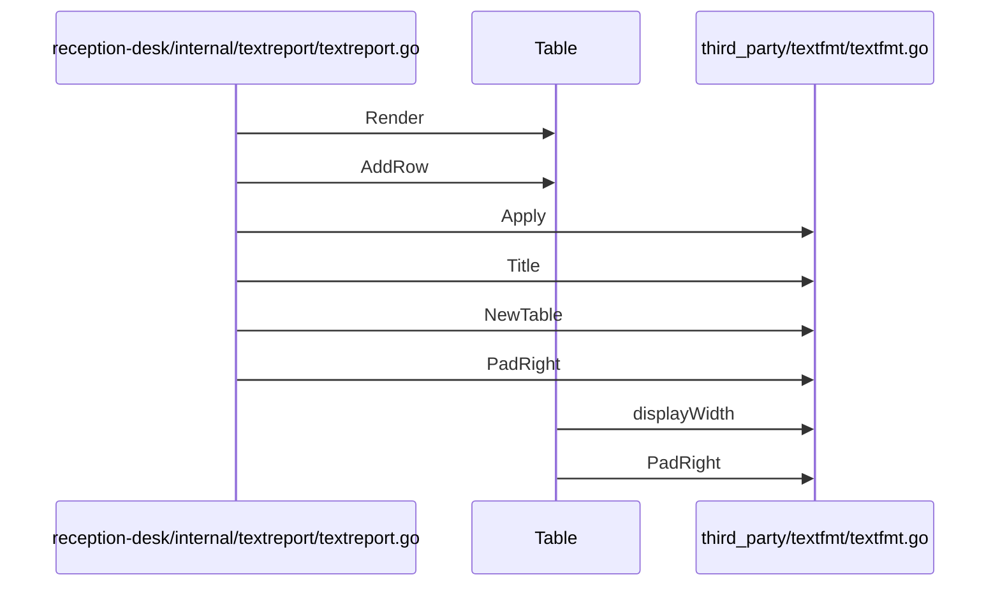

# テキストレポートの整形出力

## はじめに
このトピックは、アプリケーション内においてテキストレポートの整形および出力を行う役割を担っています。医療受付業務のデモ実行フローから呼び出され、サードパーティのテキストフォーマットライブラリを活用して、見出し、テーブル、金額行などの整形されたテキストレポートを生成・出力する位置づけとなっています。

## アーキテクチャと設計

### コンポーネント関係図

## データフロー

## 主要コンポーネント

このトピックを構成する主なメンバーは以下の通りです。

*   **`reception-desk/internal/desk/desk.go`** (ファイルの関数)
    *   **主な関数・メソッド**: `Run`
    *   **要約**: 医療受付業務のデモを実行するためのエントリーポイントとなるファイルです。チェックイン、会計、薬局、締め、派遣、レポート、メンテナンスなどの各業務フローを順次呼び出し、最終的な日次サマリーレポートを出力します。
    *   **役割**: primary
*   **`reception-desk/internal/textreport/textreport.go`** (ファイルの関数)
    *   **主な関数・メソッド**: `Heading`, `Line`, `Render`
    *   **要約**: サードパーティのテキストフォーマットライブラリを利用して、受付業務向けのテキストレポート（見出し、テーブル、金額行など）を整形・生成するためのユーティリティ関数を提供するファイルです。
    *   **役割**: primary
*   **`third_party/textfmt/textfmt.go`** (ファイルの関数)
    *   **主な関数・メソッド**: `Apply`, `NewTable`, `PadRight`, `Title`, `displayWidth`
    *   **要約**: テキストのフォーマット、装飾、全角・半角を考慮した表示幅の計算、およびテキストベースのテーブル生成機能を提供するユーティリティパッケージです。大文字変換や括弧囲みなどのフォーマッタや、等幅でのパディング処理などが実装されています。
    *   **役割**: primary
*   **`Table`** (struct)
    *   **主な関数・メソッド**: `Table.AddRow`, `Table.Len`, `Table.Render`
    *   **要約**: 複数行・複数列のテキストデータを保持し、グリッド状に整形して出力するための構造体です。
    *   **役割**: primary
*   **`Formatter`** (interface)
    *   **主な関数・メソッド**: `Formatter.Format`
    *   **要約**: 文字列をフォーマットするための共通のインターフェースを定義します。
    *   **役割**: primary
*   **`reception-desk/cmd/reception-desk/main.go`** (ファイルの関数)
    *   **主な関数・メソッド**: `main`
    *   **要約**: 受付デスク（reception-desk）アプリケーションのエントリーポイントです。標準出力を引数として内部パッケージの実行関数（`desk.Run`）を呼び出し、アプリケーションを起動する役割を担っています。
    *   **役割**: primary
*   **`Bracket`** (struct)
    *   **主な関数・メソッド**: `Bracket.Format`
    *   **要約**: 文字列を指定した開始・終了文字列で囲むフォーマッタを表す構造体です。
    *   **役割**: primary
*   **`Upper`** (struct)
    *   **主な関数・メソッド**: `Upper.Format`
    *   **要約**: 文字列を大文字に変換するフォーマッタを表す空の構造体です。
    *   **役割**: primary

## 依存関係

このトピックは、以下の外部トピックに対して依存関係（呼び出し）を持っています。

*   **薬局窓口と日次バッチ処理** (依存先)
    *   呼び出し数: 3 (重み: 3.0)
    *   呼び出し例: `Run` → `Run`, `Run` → `Run`
*   **患者ポータルと帳票出力** (依存先)
    *   呼び出し数: 1 (重み: 1.0)
    *   呼び出し例: `Run` → `Run`
*   **患者受付と来院通知** (依存先)
    *   呼び出し数: 1 (重み: 1.0)
    *   呼び出し例: `Run` → `Run`
*   **診療費会計と領収書発行** (依存先)
    *   呼び出し数: 1 (重み: 1.0)
    *   呼び出し例: `Run` → `Run`
*   **システム保守とデータ出力** (依存先)
    *   呼び出し数: 1 (重み: 1.0)
    *   呼び出し例: `Run` → `Run`

## 構造的根拠

このトピックのメンバーおよび範囲は、Go コードにおける呼び出し・埋め込み・実装の構造的関係から決定されました。トピックの規模は型・疑似型 8 個、ファイル 4 個（primary 8）で構成され、凝集度は 0.285714、コンダクタンスは 0.250146 です。

トピックのハブとして `reception-desk/internal/textreport/textreport.go` が位置づけられており、以下の主な呼び出し関係がトピック形成の根拠となっています。

*   `reception-desk/internal/textreport/textreport.go` から `third_party/textfmt/textfmt.go` への呼び出し（メソッド対 4、例: `Heading` → `Apply`, `Render` → `Title`, `Render` → `NewTable`）
*   `reception-desk/internal/desk/desk.go` から `reception-desk/internal/textreport/textreport.go` への呼び出し（メソッド対 3、例: `Run` → `Heading`, `Run` → `Render`, `Run` → `Line`）
*   `reception-desk/internal/textreport/textreport.go` から `Table` への呼び出し（メソッド対 2、例: `Render` → `Table.Render`, `Render` → `Table.AddRow`）
*   `Table` から `third_party/textfmt/textfmt.go` への呼び出し（メソッド対 2、例: `Table.Render` → `displayWidth`, `Table.Render` → `PadRight`）
*   `reception-desk/cmd/reception-desk/main.go` から `reception-desk/internal/desk/desk.go` への呼び出し（メソッド対 1、例: `main` → `Run`）
*   `third_party/textfmt/textfmt.go` から `Formatter` への呼び出し（メソッド対 1、例: `Apply` → `Formatter.Format`）
*   `Bracket` および `Upper` による `Formatter` インターフェースの実装関係

---

<!-- codedoc:grounding -->
## 識別子の確認
本文のコード識別子 77 個のうち 77 個がグラフに存在します。
