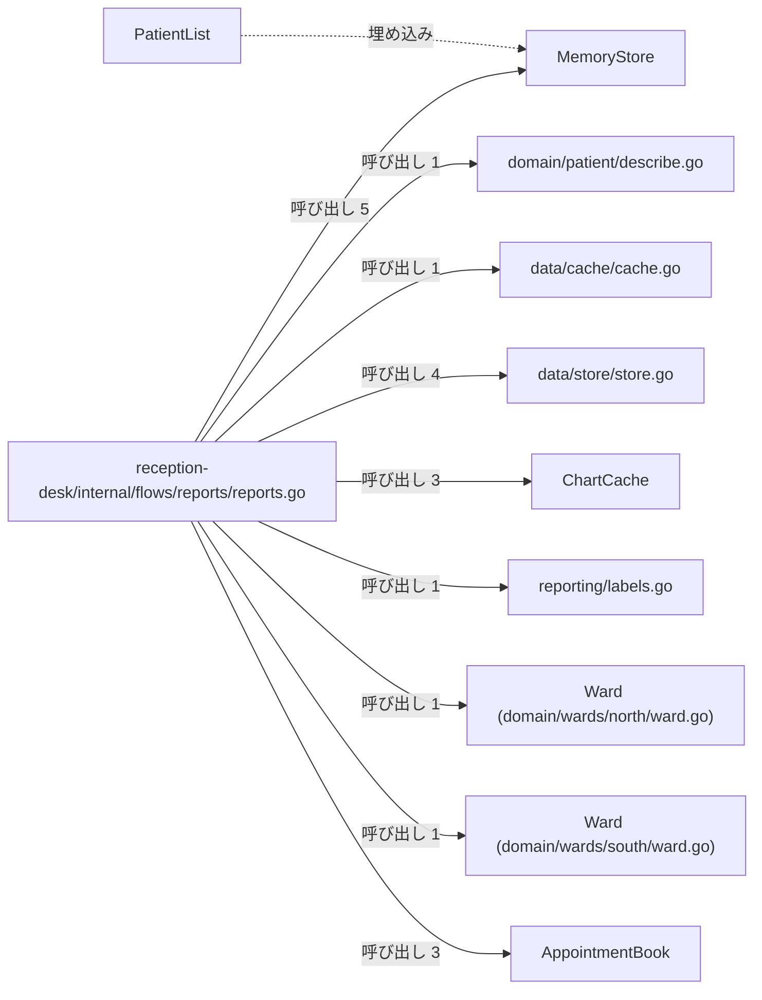
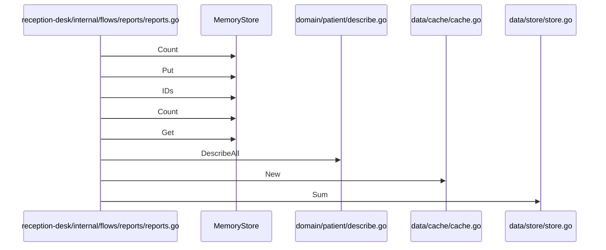

# 帳票出力とデータ管理

## はじめに
このトピックは、「患者ポータルと帳票出力」の上位トピックに属するレベル 2 のトピックです。医療システムにおける帳票出力フローの実行や、インメモリデータストア、キャッシュ、予約スケジュール、病棟ドメインなどの多様なモジュールを統合し、帳票データの生成と出力を管理する役割を担っています。

本トピックは、型・疑似型 16 個、ファイル 8 個（うち attached-file 5 個、primary 11 個）で構成されており、凝集度は 0.083333、コンダクタンスは 0.266942 です。トピック内の中心的なハブとして `reception-desk/internal/flows/reports/reports.go` が機能しています。

## アーキテクチャと設計

### コンポーネント関係図

## データフロー

## 主要コンポーネント

本トピックを構成する主なメンバーの役割と定義は以下の通りです。

### `reception-desk/internal/flows/reports/reports.go`（ファイルの関数 / primary）
医療システムにおける帳票出力フローをデモンストレーションおよび実行するためのファイルです。データストア、患者ドメイン、予約スケジュール、監査ログなどの様々なモジュールを統合し、帳票データの生成と出力を処理します。主な関数として `Run`、`countAll`、`label`、`labelsOf` が定義されています。

### `AppointmentBook`（struct / primary）
予約枠のリストと、通知を行うための `Notifier` を保持する予約帳の構造体です。`scheduling/book.go` に定義されており、主なメソッドとして `AppointmentBook.All`、`AppointmentBook.Each`、`AppointmentBook.Reserve`、`AppointmentBook.ReserveFor` を持ちます。

### `MemoryStore`（struct / primary）
任意の型をメモリ上のマップで保持する、ジェネリックなインメモリデータストア構造体です。`data/store/store.go` に定義されており、主なメソッドとして `MemoryStore.Count`、`MemoryStore.Get`、`MemoryStore.IDs`、`MemoryStore.Put` を持ちます。

### `data/store/store.go`（ファイルの関数 / primary）
ジェネリクスを活用したインメモリのデータストアの実装と、スライス操作のための汎用的なユーティリティ関数群を提供するファイルです。データの簡易的な保存・取得機能に加え、集計やマッピングなどの便利なヘルパー関数（`FirstOf`、`Map`、`NewMemoryStore`、`Sum`）を定義しています。

### `PatientList`（struct / primary）
患者データをメモリ上に保持するストア（`MemoryStore`）とタイトルを組み合わせた、帳票用の患者リストを表す構造体です。`reception-desk/internal/flows/reports/reports.go` に定義されています。

### `domain/patient/describe.go`（ファイルの関数 / primary）
患者ドメインにおけるオブジェクトの文字列表現（説明）を取得するための共通インターフェースと、そのスライスを一括処理するユーティリティ関数 `DescribeAll` を定義しているファイルです。これにより、`Patient` や `Inpatient` などの異なるエンティティに対して、統一された方法で説明テキストを生成・収集できます。

### `ChartCache`（struct / primary）
ジェネリクスに対応し、キーと値のペアをマップで保持するキャッシュ構造体です。`data/cache/cache.go` に定義されており、主なメソッドとして `ChartCache.Get`、`ChartCache.Len`、`ChartCache.Put` を持ちます。

### `data/cache/cache.go`（ファイルの関数 / primary）
ジェネリクスを利用した汎用的なインメモリキャッシュ機構を提供するファイルです。マップをラップしたシンプルな構造体により、任意の型に対応したデータの追加、取得、および件数確認の機能を実現します。キャッシュを生成する `New` 関数が定義されています。

### `reporting/labels.go`（ファイルの関数 / primary）
`Label` メソッドを持つ任意の型のスライスから、それぞれのラベル文字列を抽出して新しいスライスとして返すジェネリックなヘルパー関数 `LabelAll` を提供するファイルです。主にレポート作成や一覧表示の処理において、オブジェクト群からラベル一覧を効率的に生成するために使用されます。

### `Ward`（struct / primary）
病棟を表す構造体であり、病棟の名前を保持します。以下の2つのファイルにそれぞれ定義されています。
- `domain/wards/north/ward.go`：北病棟を表し、病棟が持つベッド数を取得する `Ward.Beds` メソッドを提供します。
- `domain/wards/south/ward.go`：南病棟を表し、病棟の名前やベッド数といった基本的な情報を保持・提供する `Ward.Beds` メソッドを提供します。

### その他のメンバー（attached-file）
- `domain/wards/south/ward.go`（ファイルの関数）：南病棟に関するドメインモデルを定義するファイルです。
- `Slot`（struct）：予約の時間帯と予約者名を保持する構造体です（`scheduling/book.go` に定義、`Slot.Label` メソッドを持つ）。
- `Store`（alias）：`MemoryStore` の型エイリアスであり、将来的な拡張や抽象化のために定義されています。
- `domain/wards/north/ward.go`（ファイルの関数）：北病棟に関するドメインモデルを定義するファイルです。
- `Number`（interface）：数値計算（`int`, `int64`, `float64`）に適合する型を制限するためのジェネリックなインターフェースです。

---

## 依存関係

本トピックは、他のトピックと以下のような依存関係（呼び出し・埋め込み・実装）を持っています。

### 依存先（本トピックが依存しているトピック）
- **管理コンソールと月報作成**（重み: 2.0, 呼び出し数: 2）
  - 例：`Run` → `NewMonthlyReport`
  - 例：`Run` → `MonthlyReport.Render`
- **監査ログとメッセージ記録**（重み: 2.0, 呼び出し数: 2）
  - 例：`Run` → `AuditTrail.Note`
  - 例：`Run` → `Publish`
- **患者ポータルと予約管理**（重み: 1.585, 呼び出し数: 2）
  - 例：`Run` → `Countdown`
  - 例：`Run` → `NewAppointmentBook`
- **メールとSMS通知送信**（重み: 1.0, 呼び出し数: 1）
  - 例：`AppointmentBook.ReserveFor` → `Notifier.Send`
- **患者情報と来院記録**（重み: 1.0, 呼び出し数: 1）
  - 例：`DescribeAll` → `Describer.Describe`
- **受付日次締めと請求検証**（重み: 1.0, 呼び出し数: 1）
  - 例：`Run` → `New`

### 依存元（本トピックに依存しているトピック）
- **テキストレポートの整形出力**（重み: 1.0, 呼び出し数: 1）
  - 例：`Run` → `Run`
- **患者受付とデータ永続化**（重み: 1.0, 呼び出し数: 1）
  - 例：`Run` → `AppointmentBook.ReserveFor`
- **患者ポータルと予約管理**（重み: 1.0, 呼び出し数: 1）
  - 例：`Portal.handleAppointments` → `AppointmentBook.Reserve`

---

## 構造的根拠

このトピックのメンバー構成は、Go コードにおける呼び出し、埋め込み、および実装の静的構造に基づいて決定されました。

### 主な根拠となった構造的関係
1. **中心的なハブの存在**
   `reception-desk/internal/flows/reports/reports.go` は、トピック内から 27 回呼び出され、他トピックから 1 回呼び出される最大のハブです。このファイルが起点となり、トピック内の各コンポーネントを呼び出しています。
2. **トピック内の主要な呼び出し関係**
   - `reception-desk/internal/flows/reports/reports.go` から `MemoryStore` への 5 回の呼び出し（例：`countAll` → `MemoryStore.Count`、`Run` → `MemoryStore.Put`、`Run` → `MemoryStore.IDs`）
   - `reception-desk/internal/flows/reports/reports.go` から `data/store/store.go` への 4 回の呼び出し（例：`Run` → `Sum`、`Run` → `FirstOf`、`Run` → `NewMemoryStore`）
   - `reception-desk/internal/flows/reports/reports.go` から `AppointmentBook` への 3 回の呼び出し（例：`Run` → `AppointmentBook.Reserve`、`Run` → `AppointmentBook.All`、`Run` → `AppointmentBook.Each`）
   - `reception-desk/internal/flows/reports/reports.go` から `ChartCache` への 3 回の呼び出し（例：`Run` → `ChartCache.Len`、`Run` → `ChartCache.Put`、`Run` → `ChartCache.Get`）
3. **構造体の埋め込み関係**
   - `PatientList` 構造体は、内部に `MemoryStore` を埋め込む構造となっています。
4. **外部からの単一の進入点（入口）**
   - 「テキストレポートの整形出力」トピックから `reception-desk/internal/flows/reports/reports.go` の `Run` 関数が 1 回呼び出されることで、外部から本トピックの処理フローが開始されます。

---

<!-- codedoc:grounding -->
## 識別子の確認
本文のコード識別子 115 個のうち 115 個がグラフに存在します。
