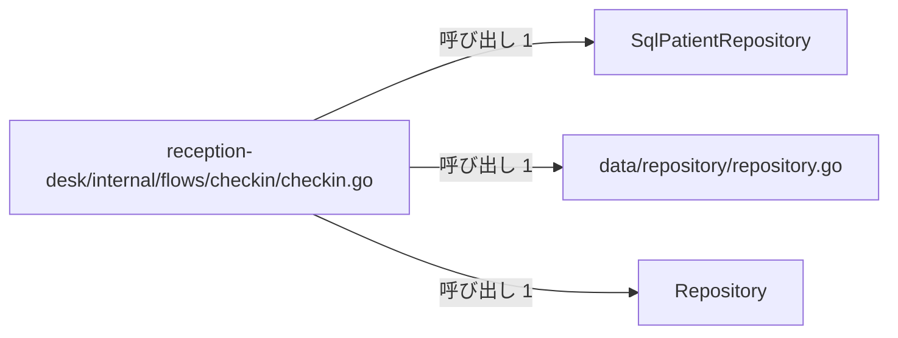
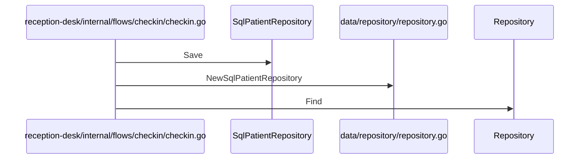

# 患者受付とデータ永続化

## はじめに
このトピックは、アプリケーション内においてレベル 2に位置し、上位トピックである「患者受付と来院通知」に属しています。規模は型・疑似型 4 個、ファイル 2 個（primary 4）で構成されています。
主な役割は、医療受付（チェックイン）の業務フローの実行・検証と、患者データの永続化および取得に関する抽象化と具体的なデータ操作処理を提供することです。

## アーキテクチャと設計
### コンポーネント関係図

## データフロー

## 主要コンポーネント
このトピックを構成する主要なメンバーは以下の通りです。

*   **`reception-desk/internal/flows/checkin/checkin.go`** (ファイルの関数)
    *   **ファイル**: `reception-desk/internal/flows/checkin/checkin.go`
    *   **主な関数・メソッド**: `Run`, `describeAny`, `find`
    *   **要約・役割**: 医療受付（チェックイン）の業務フローをシミュレートまたは実行するためのファイルです。患者情報の検索・保存、診察情報の作成、通知の送信、予約の作成など、ドメインモデルやリポジトリなどの各コンポーネントを組み合わせて一連の受付処理の流れを実演・検証する役割（primary）を持ちます。
*   **`SqlPatientRepository`** (struct)
    *   **ファイル**: `data/repository/repository.go`
    *   **主な関数・メソッド**: `SqlPatientRepository.Find`, `SqlPatientRepository.Save`
    *   **要約・役割**: 患者データをメモリ内のマップで保持し、ログ出力機能を備えた、患者リポジトリの具体的な実装構造体（primary）です。
*   **`data/repository/repository.go`** (ファイルの関数)
    *   **ファイル**: `data/repository/repository.go`
    *   **主な関数・メソッド**: `NewSqlPatientRepository`
    *   **要約・役割**: 汎用的なデータアクセスを行うためのリポジトリインターフェースと、メモリ内マップを用いた患者データ用リポジトリの具体的な実装を提供するファイル（primary）です。ドメインモデルの永続化と取得に関する抽象化および具体的なデータ操作処理を担っています。
*   **`Repository`** (interface)
    *   **ファイル**: `data/repository/repository.go`
    *   **主な関数・メソッド**: `Repository.Find`, `Repository.Save`
    *   **要約・役割**: 任意の型を対象としたデータの検索と保存の操作を定義する、ジェネリックなリポジトリインターフェース（primary）です。

## 依存関係
本トピックは、他のトピックと以下の依存関係（呼び出し・埋め込み・実装）を持っています。

### 依存先（本トピックから呼び出すトピック）
*   **患者情報と来院記録** (呼び出し数: 7, 重み: 5.7549)
    *   例: `Run` → `Entity.Describe`, `Run` → `Entity.Touch`
*   **受付日次締めと請求検証** (呼び出し数: 3, 重み: 3.0)
    *   例: `SqlPatientRepository.Find` → `Logger.Log`, `Run` → `New`
*   **メールとSMS通知送信** (呼び出し数: 3, 重み: 2.585)
    *   例: `Run` → `Broadcast`, `Run` → `Relay`
*   **帳票出力とデータ管理** (呼び出し数: 1, 重み: 1.0)
    *   例: `Run` → `AppointmentBook.ReserveFor`
*   **患者ポータルと予約管理** (呼び出し数: 1, 重み: 1.0)
    *   例: `Run` → `NewAppointmentBook`

### 依存元（他トピックから呼び出される関係）
*   **テキストレポートの整形出力** (呼び出し数: 1, 重み: 1.0)
    *   例: `Run` → `Run`
    *   ※ `reception-desk/internal/flows/checkin/checkin.go` は、このトピックからのみ呼び出される「入口」のメンバーとなっています。

## 構造的根拠
このトピックのメンバーは、Go コードの呼び出し・埋め込み・実装の構造から決定されました。トピックの凝集度は 0.5、コンダクタンスは 0.705013 です。

主な根拠となったトピック内の呼び出し関係は以下の通りです。
*   `reception-desk/internal/flows/checkin/checkin.go` から `SqlPatientRepository` への呼び出し（例: `Run` → `SqlPatientRepository.Save`）
*   `reception-desk/internal/flows/checkin/checkin.go` から `data/repository/repository.go` への呼び出し（例: `Run` → `NewSqlPatientRepository`）
*   `reception-desk/internal/flows/checkin/checkin.go` から `Repository` への呼び出し（例: `find` → `Repository.Find`）

トピック内のハブである `reception-desk/internal/flows/checkin/checkin.go` は、トピック内で最も多く他のメンバーを呼び出しており（呼ぶ数: 17）、このトピックの中心的な役割を担っています。

---

<!-- codedoc:grounding -->
## 識別子の確認
本文のコード識別子 48 個のうち 48 個がグラフに存在します。
