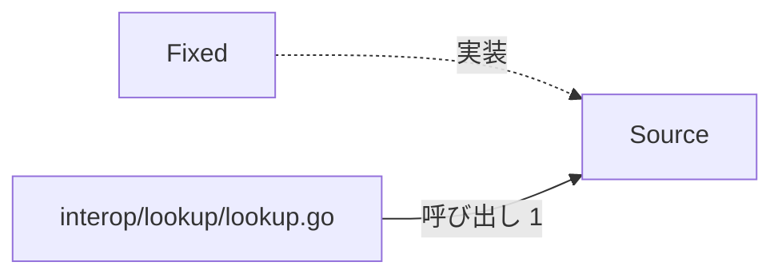
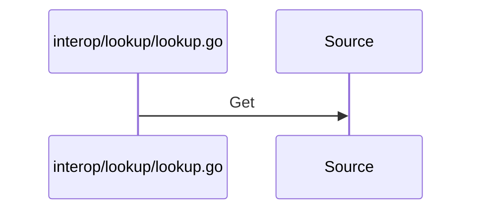

# コード情報のルックアップ

## はじめに
「コード情報のルックアップ」は、上位トピック「システム保守とデータ出力」に属するレベル 2 のトピックです。
このトピックは、外部ソースからコード情報を取得・解決するためのインターフェースと、その固定値による簡易実装を提供するパッケージであり、主に医療システムなどの相互運用において、コード情報のルックアップ処理を抽象化する役割を持ちます。

## アーキテクチャと設計
### コンポーネント関係図

## データフロー

## 主要コンポーネント
このトピックは、1つのファイル（`interop/lookup/lookup.go`）に含まれる以下の4つのメンバー（型・疑似型）で構成されています。

*   **`interop/lookup/lookup.go`** (ファイルの関数 / 役割: primary)
    外部ソースからコード情報を取得・解決するためのインターフェースと、その固定値による簡易実装を提供するパッケージです。主な関数として `Resolve` を持ちます。
*   **`Source`** (interface / 役割: primary)
    コード情報を取得するための `Get` メソッドを定義したインターフェースです。
*   **`Fixed`** (struct / 役割: primary)
    固定のコード値を保持し、`Source` インターフェースを実装する構造体です。主なメソッドとして `Fixed.Get` を持ちます。
*   **`Code`** (named / 役割: attached-file)
    コード情報を表す文字列のカスタム型です。

## 依存関係
このトピックは、他のトピックと以下の依存関係を持っています。

*   **依存元**: 「システム保守とメトリクス収集」トピックから呼び出されます（重み 1.0）。
    *   呼び出し例: `Run` → `Resolve`
*   **入口**: `interop/lookup/lookup.go` は、「システム保守とメトリクス収集」トピックからのみ呼び出されます（呼ばれる回数: 1）。

## 構造的根拠
このトピックのメンバーは、Go コードの呼び出し・埋め込み・実装の構造から決定されました。

*   **規模**: 型・疑似型 4 個、ファイル 1 個（attached-file 1、primary 3）
*   **ハブ**: `Source`（トピック内 PageRank 上位）
*   **凝集度**: 0.333333
*   **コンダクタンス**: 0.25
*   **トピック内の主な呼び出し**:
    *   `interop/lookup/lookup.go` から `Source` への呼び出し（メソッド対 1、例: `Resolve` → `Source.Get`）

---

<!-- codedoc:grounding -->
## 識別子の確認
本文のコード識別子 17 個のうち 17 個がグラフに存在します。
