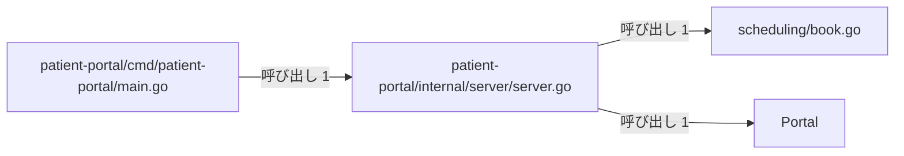
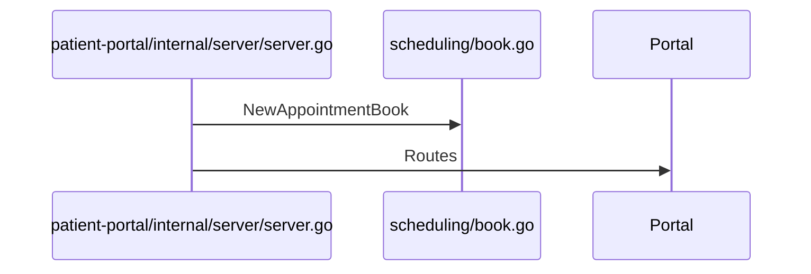

# 患者ポータルと予約管理

## はじめに
本トピックは、患者ポータルのWebサーバー機能、予約管理、およびアプリケーションのエントリーポイントを提供するコンポーネント群で構成されています。

このトピックは「レベル 2」に位置づけられており、上位トピックは「患者ポータルと帳票出力」です。トピックの規模は型・疑似型 4 個、ファイル 3 個（すべて primary メンバー）であり、ハブとして `patient-portal/internal/server/server.go` が機能しています。また、トピックの凝集度は 0.5、コンダクタンスは 0.523241 です。

## アーキテクチャと設計
### コンポーネント関係図

## データフロー

## 主要コンポーネント
本トピックを構成する主要なメンバーの詳細は以下の通りです。

* **`patient-portal/internal/server/server.go`** (ファイルの関数)
  * **主な関数・メソッド**: `Demo`, `NewPortal`
  * **役割**: 患者ポータル（Patient Portal）のWebサーバー機能を実装します。予約管理や診療費計算などのドメインロジックをHTTPハンドラーとして公開し、ルーティングの設定やデモ実行用の関数を提供します。
* **`Portal`** (struct)
  * **主な関数・メソッド**: `Portal.Routes`, `Portal.handleAppointments`, `Portal.handleFees`, `Portal.handleHealth`
  * **役割**: 予約管理（`AppointmentBook`）と診療費計算（`FeeCalculator`）の依存関係を保持する、患者ポータルサーバーのメイン構造体です。
* **`scheduling/book.go`** (ファイルの関数)
  * **主な関数・メソッド**: `Countdown`, `NewAppointmentBook`
  * **役割**: 医療予約システムにおける予約枠と予約帳を管理するための機能を提供します。予約の登録や患者ごとの予約、通知処理との連携、および登録された予約一覧をイテレータを介して取得する機能を実装しています。
* **`patient-portal/cmd/patient-portal/main.go`** (ファイルの関数)
  * **主な関数・メソッド**: `main`
  * **役割**: 患者ポータル（patient-portal）アプリケーションの実行可能なエントリーポイントです。標準出力を引数として内部パッケージのデモサーバー関数を呼び出し、アプリケーションのデモンストレーションを実行します。

## 依存関係
本トピックは、他のトピックと以下のような呼び出し関係を持っています。

### 依存先トピック（本トピックが呼び出す対象）
* **患者情報と来院記録** (重み: 1.0)
  * 例: `Portal.handleAppointments` → `Patient.Describe` (呼び出し数: 1)
* **管理コンソールと月報作成** (重み: 1.0)
  * 例: `Portal.handleFees` → `FeeCalculator.Calculate` (呼び出し数: 1)
* **帳票出力とデータ管理** (重み: 1.0)
  * 例: `Portal.handleAppointments` → `AppointmentBook.Reserve` (呼び出し数: 1)
* **受付振り分けと医療費計算** (重み: 1.0)
  * 例: `NewPortal` → `NewFeeCalculator` (呼び出し数: 1)

### 依存元トピック（本トピックを呼び出す対象）
* **帳票出力とデータ管理** (重み: 1.585)
  * 例: `Run` → `Countdown`, `Run` → `NewAppointmentBook` (呼び出し数: 2)
* **患者受付とデータ永続化** (重み: 1.0)
  * 例: `Run` → `NewAppointmentBook` (呼び出し数: 1)

## 構造的根拠
本トピックのメンバーおよびその境界は、Go コードにおける呼び出し・埋め込み・実装の構造的関係に基づいて決定されました。

トピック内における主な呼び出し関係は以下の通りです。
* `patient-portal/internal/server/server.go` は `Portal` を呼び出します（メソッド対 1、例: `Demo` → `Portal.Routes`）。
* `patient-portal/internal/server/server.go` は `scheduling/book.go` を呼び出します（メソッド対 1、例: `NewPortal` → `NewAppointmentBook`）。
* `patient-portal/cmd/patient-portal/main.go` は `patient-portal/internal/server/server.go` を呼び出します（メソッド対 1、例: `main` → `Demo`）。

これらの関係性において、`patient-portal/internal/server/server.go` は呼ばれる数が 1、呼ぶ数が 3 であり、トピック内の中心的なハブとして機能しています。また、`Portal` は呼ばれる数が 1、呼ぶ数が 3 であり、`scheduling/book.go` は呼ばれる数が 4、呼ぶ数が 0 となっています。

---

<!-- codedoc:grounding -->
## 識別子の確認
本文のコード識別子 45 個のうち 45 個がグラフに存在します。
