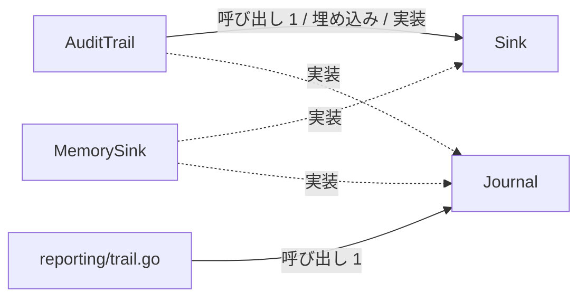
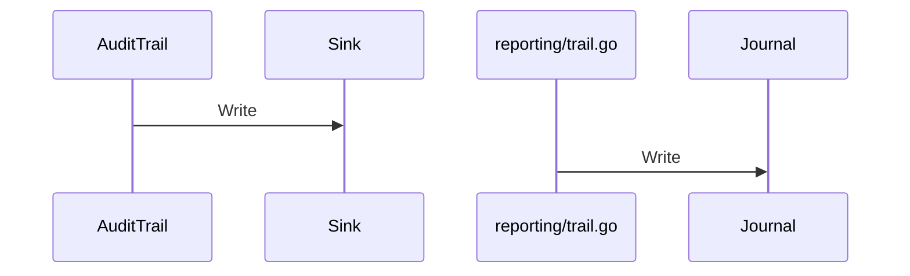

# 監査ログとメッセージ記録

## はじめに
「監査ログとメッセージ記録」は、上位トピックである「患者ポータルと帳票出力」に属するレベル 2 のトピックです。

本トピックは、監査ログやメッセージの記録（シンク）およびジャーナル処理を行うためのインターフェースと、その具体的な実装を提供します。メモリ上にログを保持する構造体や、名前付きでメッセージを記録する構造体が定義されており、アプリケーション内での柔軟なログ出力や公開処理の抽象化を可能にします。

本トピックの規模は、型・疑似型が 5 個、ファイルが 1 個（`reporting/trail.go`）で構成されています。トピック内のハブとして `Sink` が機能しており、凝集度は 0.5、コンダクタンスは 0.2 です。

## アーキテクチャと設計

### コンポーネント関係図

## データフロー

## 主要コンポーネント

本トピックを構成する主なメンバー（型およびファイルの関数）の詳細は以下の通りです。すべてのメンバーは `reporting/trail.go` ファイルに定義されています。

- **`Sink` (interface)**
  文字列を書き込むための `Sink.Write` メソッドを定義するインターフェースです。トピック内のハブとして機能します。
- **`AuditTrail` (struct)**
  任意の `Sink` を内包し、名前付きでメッセージを記録する構造体です。主なメソッドとして `AuditTrail.Note` を持ちます。
- **`Journal` (interface)**
  メッセージを書き込むための `Journal.Write` メソッドを持つインターフェースです。
- **`MemorySink` (struct)**
  書き込まれた文字列をメモリ上のスライスに保持する構造体です。主なメソッドとして `MemorySink.Write` を持ちます。
- **`reporting/trail.go` (ファイルの関数)**
  `Publish` などの関数を含みます。監査ログやメッセージの記録（シンク）およびジャーナル処理を行うためのインターフェースと、その具体的な実装を提供します。

## 依存関係

### 他トピックからの依存（依存元）
本トピックは、以下の他トピックから呼び出されます。

- **帳票出力とデータ管理**
  - 呼び出し回数（重み）: 2 (2.0)
  - 呼び出し例: `Run` → `AuditTrail.Note`, `Run` → `Publish`
  - このトピックからのみ呼び出される入口メンバーとして、`AuditTrail`（呼ばれる数: 1）および `reporting/trail.go`（呼ばれる数: 1）が存在します。
- **受付振り分けと医療費計算**
  - 呼び出し回数（重み）: 1 (1.0)
  - 呼び出し例: `Run` → `Sink.Write`

## 構造的根拠

このトピックのメンバーは、Go コードの呼び出し・埋め込み・実装の構造から決定されました。

主な根拠となったトピック内の呼び出し関係は以下の通りです。
- `AuditTrail` から `Sink` への呼び出し（メソッド対 1、例: `AuditTrail.Note` → `Sink.Write`）
- `reporting/trail.go` から `Journal` への呼び出し（メソッド対 1、例: `Publish` → `Journal.Write`）

また、`Sink` はトピック内で最も多く呼ばれるハブ（呼ばれる数 2、呼ぶ数 0）として位置づけられています。

---

<!-- codedoc:grounding -->
## 識別子の確認
本文のコード識別子 31 個のうち 31 個がグラフに存在します。
