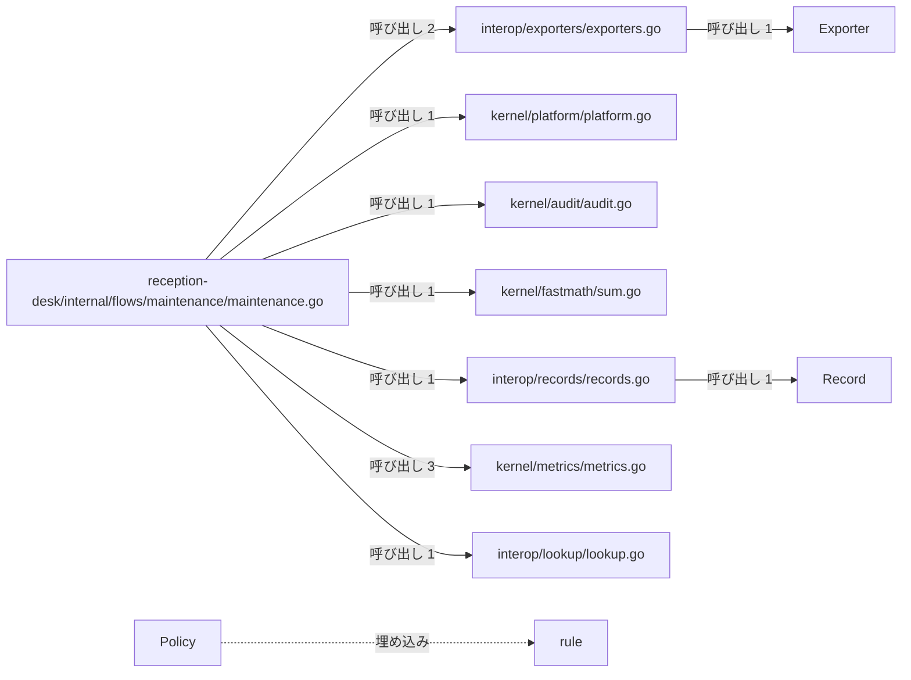
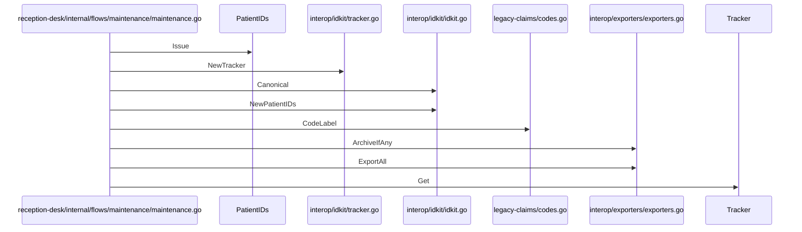

# システム保守とデータ出力

## はじめに
本トピックは、医療受付システムにおける保守フローの実行と、それに伴うデータの出力（エクスポート）やアーカイブ、プラットフォーム情報の取得、メトリクス収集、監査ログ記録、ID管理、高速な数値計算などのシステム保守に関連する機能を担っています。

アプリケーション内では、システム保守とデータ出力を行うレベル 1 のトピックとして位置づけられており、型・疑似型 36 個、ファイル 19 個（attached-file 4、attached-generated 1、attached-test 1、primary 30）の規模で構成されています。

## アーキテクチャと設計

### コンポーネント関係図

## データフロー

## 主要コンポーネント

本トピックを構成する主なメンバーとその役割は以下の通りです。

*   **`reception-desk/internal/flows/maintenance/maintenance.go`**
    医療受付システムにおける保守フローを実行するためのパッケージです。システムの各種機能（ID管理、料金表、データエクスポート、監査ログなど）を統合的に呼び出し、動作確認や保守情報の出力を行います。主な関数として `Run` を持ちます。
*   **`interop/exporters/exporters.go`**
    データを異なるフォーマットで出力（エクスポート）するためのインターフェースと、その具体的な実装（CSVおよびXML）を提供します。また、データのアーカイブ処理を抽象化するインターフェースと、それを安全に実行するためのユーティリティ関数も定義しています。主な関数は `ArchiveIfAny` および `ExportAll` です。
*   **`kernel/platform/platform.go`**
    プラットフォームに関する情報を取得し、記述するための機能を提供するファイルです。システムのプラットフォーム名、ホームディレクトリ、およびアクセラレータ情報を統合して表現する役割を持ち、主な関数として `Describe` を提供します。
*   **`Record`**
    請求や返金などの記録を表すインターフェースであり、パッケージ外での独自実装を防ぐシールドメソッド（`Record.sealed`）を含んでいます。
*   **`kernel/metrics/metrics.go`**
    システムのメトリクス収集や時間計測のためのユーティリティ関数（`Count`, `Elapsed`, `Started`, `bump`, `nanotime`）を提供しています。`go:linkname` ディレクティブを使用することで、内部パッケージやGoランタイムの未公開関数とリンクし、カウンタの更新や高精度な時間取得を実現しています。
*   **`kernel/audit/audit.go`**
    システム内の監査ログを記録するための共通インターフェースと、その具体的なコンソール出力用の実装、およびログ記録を実行するためのヘルパー関数を提供します。主な関数は `Record` です。
*   **`kernel/fastmath/sum.go`**
    高速な数値計算を行うためのユーティリティ関数を提供しています。与えられたポイントのスライスを順次加算し、その総和を効率的に計算する `Total` 関数を定義しています。
*   **`Exporter`**
    データを特定のフォーマットに変換して出力するための共通インターフェース（`Exporter.Export`）です。
*   **`Policy`**
    基本ルール（`rule`）を埋め込み、特定の病棟（`Ward`）情報を保持する公開用のポリシー構造体です。
*   **`rule`**
    エスカレーションの基本ルールを定義するためのパッケージ内限定の構造体です。
*   **`interop/records/records.go`**
    医療ドメインにおける「請求」や「返金」などの記録データを統一的に扱うためのインターフェースと構造体を定義しています。非公開メソッドを用いたシールドインターフェースパターンを採用し、パッケージ外での独自の `Record` 実装を制限しています。主な関数は `KindOf` です。
*   **`interop/lookup/lookup.go`**
    外部ソースからコード情報を取得・解決するためのインターフェースと、その固定値による簡易実装を提供するパッケージです。主な関数は `Resolve` です。
*   **`interop/idkit/idkit.go`**
    医療システム等における患者IDの生成や正規化を行うためのユーティリティを提供しています。サードパーティの `uuidlite` パッケージを利用して、シード値に基づいた一意のIDシーケンスを管理し、特定のフォーマット（"P-" 接頭辞付き）の患者IDを発行する機能や、生のID文字列を正規化された形式に変換する機能を提供します。主な関数は `Canonical` および `NewPatientIDs` です。
*   **`Table`**
    解析された診療報酬点数表のデータを保持し、各コードの点数情報を管理する構造体です。
*   **`kernel/platform/platform_linux.go`**
    Linuxプラットフォーム向けに依存する情報を定義するためのファイルです。プラットフォーム名やデフォルトのホームディレクトリのパスなど、Linux環境固有の設定を提供します。主な関数は `Name` および `homeDir` です。
*   **`Source`**
    コード情報を取得するための `Get` メソッドを定義したインターフェースです。
*   **`CsvExporter`**
    データをCSV形式で出力するための構造体です。
*   **`Logger`**
    監査ログを出力するための抽象的なインターフェース（`Logger.Printf`）を定義します。
*   **`kernel/internal/tally/tally.go`**
    アプリケーション内の各種カウンターの合計値をメモリ上で管理するための内部パッケージです。主な関数は `bump` です。
*   **`PatientIDs`**
    `uuidlite` のシーケンスを保持し、一連の患者IDを生成・管理するための構造体です。
*   **`interop/idkit/tracker.go`**
    負荷情報を追跡するための `Tracker` 構造体とその関連機能を提供します。主な関数は `NewTracker` です。
*   **`Archiver`**
    指定された年のデータをアーカイブするためのインターフェース（`Archiver.ArchiveAll`）です。
*   **`legacy-claims/codes.go`**
    レセプト（診療報酬明細書）に関するコードの正規化や、コードに対応するラベル文字列の生成を行うユーティリティ関数（`CodeLabel`, `normalizeCode`）を提供するファイルです。
*   **`kernel/fastmath/add_amd64.go`**
    AMD64アーキテクチャ向けに最適化された高速な数値加算処理を提供するGoのソースコードで、`AddPoints` 関数を定義しています。
*   **`Tracker`**
    `uuidlite.Sequence` を埋め込み、負荷（load）を表す浮動小数点数データを保持する構造体です。
*   **`kernel/escalation/escalation.go`**
    システム内におけるエスカレーションのルールやポリシーを定義し、それらを評価するための機能を提供します。主な関数は `Evaluate` です。
*   **`billing/tariff/tariff.go`**
    医療費請求における診療報酬点数表（タリフ）を管理するためのパッケージで、主な関数は `Load` です。
*   **`kernel/platform/accel_nocgo.go`**
    CGOが有効でない環境（`!cgo`）において、プラットフォーム固有のアクセラレーション設定を提供するファイルです。主な関数は `Accel` です。
*   **`XmlExporter`**
    データをXML形式で出力するための構造体です。
*   **`Claim`**
    請求情報を保持する構造体であり、`Record` インターフェースを実装しています。
*   **`Refund`**
    返金情報を保持する構造体であり、`Record` インターフェースを実装しています。
*   **`Fixed`**
    固定のコード値を保持し、`Source` インターフェースを実装する構造体です。
*   **`legacy-claims/codes_gen.go`**
    生成コード（rezeptgen）であり、主な関数は `KnownCodes` および `LookupCode` です。
*   **`Code`**
    コード情報を表す文字列のカスタム型です。
*   **`wardLock`**
    病棟のベッド数を安全に操作するために、排他制御用のミューテックスとベッド数を保持する構造体です。
*   **`kernel/escalation/escalation_test.go`**
    `escalation` パッケージにおけるポリシー評価機能の動作を検証するためのテストコードです。主な関数は `TestEvaluate` です。

## 依存関係

本トピックは、他トピックと以下の依存関係を持っています。

*   **依存元トピック：「薬局窓口と日次バッチ処理」**
    *   呼び出し数: 1、重み: 1.5
    *   呼び出し例: `Run` → `Record.Kind`
*   **依存元トピック：「テキストレポートの整形出力」**
    *   呼び出し数: 1、重み: 1.0
    *   呼び出し例: `Run` → `Run`

## 構造的根拠

本トピックのメンバーおよびその境界は、Go コードにおける呼び出し、埋め込み、および実装の構造から決定されました。
トピックの凝集度は 0.055258、コンダクタンスは 0.036668 です。

トピック内の主要な呼び出し構造として、ハブである `reception-desk/internal/flows/maintenance/maintenance.go` から以下のコンポーネントへの呼び出しが中心的な根拠となっています。

*   `kernel/metrics/metrics.go` への呼び出し（3回、例: `Run` → `Elapsed`, `Run` → `Started`, `Run` → `Count`）
*   `interop/exporters/exporters.go` への呼び出し（2回、例: `Run` → `ArchiveIfAny`, `Run` → `ExportAll`）
*   `interop/idkit/idkit.go` への呼び出し（2回、例: `Run` → `Canonical`, `Run` → `NewPatientIDs`）
*   `Table` への呼び出し（2回、例: `Run` → `Table.Points`, `Run` → `Table.Codes`）
*   `kernel/platform/platform.go` への呼び出し（1回、例: `Run` → `Describe`）
*   `kernel/audit/audit.go` への呼び出し（1回、例: `Run` → `Record`）
*   `kernel/fastmath/sum.go` への呼び出し（1回、例: `Run` → `Total`）
*   `interop/records/records.go` への呼び出し（1回、例: `Run` → `KindOf`）
*   `interop/lookup/lookup.go` への呼び出し（1回、例: `Run` → `Resolve`）

また、`kernel/platform/platform.go` から `kernel/platform/platform_linux.go` への呼び出し（2回、例: `Describe` → `Name`, `Describe` → `homeDir`）なども、本トピック内の構造を強固に結びつける要素となっています。

---

<!-- codedoc:grounding -->
## 識別子の確認
本文のコード識別子 128 個のうち 125 個がグラフに存在します。
グラフに見つからない識別子: `uuidlite`, `uuidlite.Sequence`
