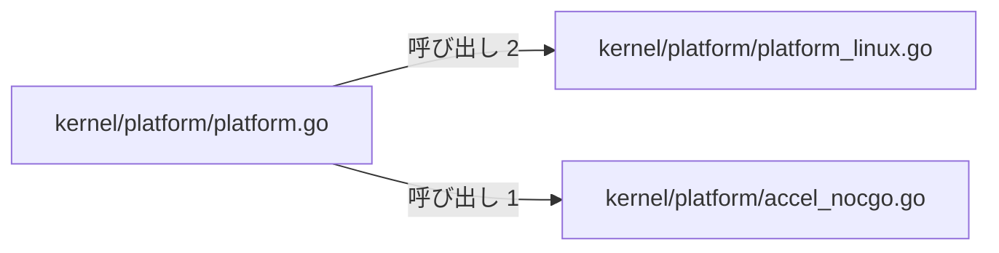
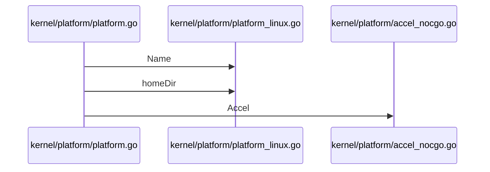

# 実行プラットフォーム情報

## はじめに
「実行プラットフォーム情報」は、システムのプラットフォーム名、ホームディレクトリ、およびアクセラレータ情報を取得・統合して記述するための機能を提供するトピックです。

本トピックは、システム全体において以下の位置づけを持ちます。
- **レベル**: 2
- **上位トピック**: システム保守とデータ出力
- **規模**: 型・疑似型 3 個、ファイル 3 個（すべて primary）
- **ハブ**: `kernel/platform/platform.go`
- **凝集度**: 0.666667
- **コンダクタンス**: 0.162077

## アーキテクチャと設計

### コンポーネント関係図

## データフロー

## 主要コンポーネント

本トピックを構成する主要なメンバー（ファイル・疑似型）は以下の通りです。

*   **`kernel/platform/platform.go`**（ファイルの関数 / primary）
    *   **主な関数・メソッド**: `Describe`
    *   **役割**: プラットフォームに関する情報を取得し、記述するための機能を提供します。システムのプラットフォーム名、ホームディレクトリ、およびアクセラレータ情報を統合して表現する役割を持ちます。
*   **`kernel/platform/platform_linux.go`**（ファイルの関数 / primary）
    *   **主な関数・メソッド**: `Name`, `homeDir`
    *   **役割**: Linuxプラットフォーム向けに依存する情報を定義します。プラットフォーム名やデフォルトのホームディレクトリのパスなど、Linux環境固有の設定を提供します。
*   **`kernel/platform/accel_nocgo.go`**（ファイルの関数 / primary）
    *   **主な関数・メソッド**: `Accel`
    *   **役割**: CGOが有効でない環境（`!cgo`）において、プラットフォーム固有のアクセラレーション設定を提供します。ハードウェアアクセラレーションを使用しない純粋なGo（pure Go）実装が選択されていることを示します。

## 依存関係

本トピックは、外部のトピックと以下の依存関係を持っています。

### 依存元からの呼び出し
*   **依存元トピック**: システム保守とメトリクス収集
*   **呼び出しの方向**: `システム保守とメトリクス収集` → `実行プラットフォーム情報`
*   **重み**: 1.0（呼び出し数: 1）
*   **具体的な呼び出し例**: `Run` → `Describe`
*   **入口メンバー**: `kernel/platform/platform.go`（「システム保守とメトリクス収集」からのみ呼び出されます）

## 構造的根拠

本トピックのメンバーおよび範囲は、Go コードにおける呼び出し・埋め込み・実装の構造に基づいて決定されました。

主な根拠となったトピック内の呼び出し関係は以下の通りです。
*   `kernel/platform/platform.go` から `kernel/platform/platform_linux.go` への呼び出し（メソッド対の数: 2）
    *   例: `Describe` → `Name`
    *   例: `Describe` → `homeDir`
*   `kernel/platform/platform.go` から `kernel/platform/accel_nocgo.go` への呼び出し（メソッド対の数: 1）
    *   例: `Describe` → `Accel`

これらの呼び出し構造により、`kernel/platform/platform.go` をハブ（トピック内 PageRank 上位、呼ばれる数: 1、呼ぶ数: 3）として、プラットフォーム情報の統合と環境固有の実装が密に結合していることが示されています。

---

<!-- codedoc:grounding -->
## 識別子の確認
本文のコード識別子 22 個のうち 22 個がグラフに存在します。
