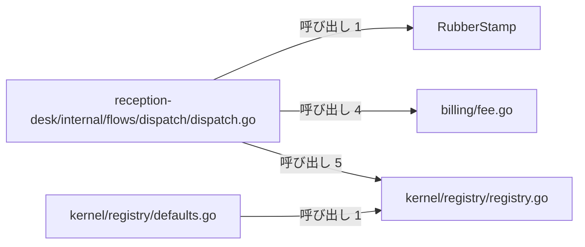
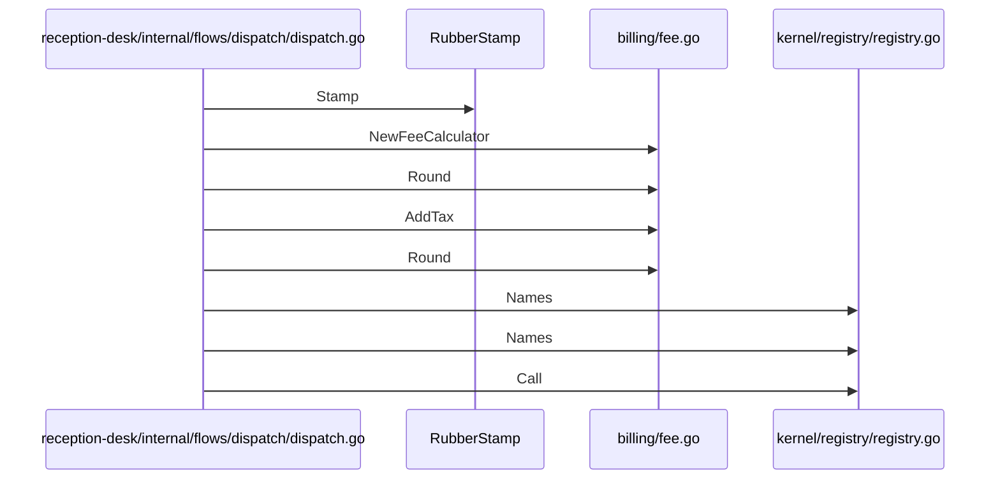

# 受付振り分けと医療費計算

## はじめに
「受付振り分けと医療費計算」は、医療受付システムにおける「振り分け（dispatch）」フローの制御や、医療費などの料金計算、および文字列処理ハンドラを管理するレジストリ機能を提供するトピックです。

本トピックは、上位トピックである「薬局窓口と日次バッチ処理」の下位に位置するレベル 2 のトピックです。その規模は、型・疑似型 9 個、ファイル 6 個（attached-file 3、attached-test 1、primary 5）で構成されており、トピック内のハブとして `reception-desk/internal/flows/dispatch/dispatch.go` が機能しています。

## アーキテクチャと設計

### コンポーネント関係図

## データフロー

## 主要コンポーネント

本トピックを構成する主なメンバーの役割と概要は以下の通りです。

### `reception-desk/internal/flows/dispatch/dispatch.go`（ファイルの関数 / primary）
医療受付システムにおける「振り分け（dispatch）」フローを実装しています。会計、ロギング、レジストリ、調剤などの外部パッケージの機能を組み合わせ、関数の値としての取り扱いやクロージャ、ゴルーチン、パニックからの回復など、Go言語の様々な関数機能の動作デモンストレーションや検証を行う役割を持っています。主な関数・メソッドとして `Run`、`apply`、`looksInsured`、`makeAdder`、`recovered`、`tally` が含まれます。

### `billing/fee.go`（ファイルの関数 / primary）
医療費などの料金計算を行うための構造体や関数を提供するファイルです。点数と回数、および設定されたレート（単価）を基に料金を計算する機能や、端数処理（丸め）、消費税加算などのユーティリティ関数が含まれています。システム内の様々なモジュール（受付、管理者コンソール、患者ポータルなど）から料金計算の共通処理として利用されます。主な関数・メソッドとして `AddTax`、`NewFeeCalculator`、`Round` があります。

### `kernel/registry/registry.go`（ファイルの関数 / primary）
文字列処理を行うハンドラ関数を登録・管理し、動的な呼び出しを可能にするレジストリ機能を提供するファイルです。デフォルトのバナー生成や文字列の正規化処理など、システム共通のユーティリティ機能も備えています。主な関数・メソッドとして `<init>`、`Banner`、`Call`、`Names`、`Normalize`、`Register` があります。

### `RubberStamp`（struct / primary）
ファイル `pharmacy/dose.go` に定義されています。Stamper インターフェースを実装し、設定された名前を用いてスタンプを押す構造体です。主なメソッドとして `RubberStamp.Stamp` があります。

### `kernel/registry/defaults.go`（ファイルの関数 / primary）
レジストリパッケージの初期化時にデフォルトの関数を登録するためのファイルです。パッケージのロード時に自動的に実行され、共通で利用する関数をレジストリに登録します。主な関数・メソッドとして `init#1` があります。

### `billing/fee_test.go`（ファイルの関数 / attached-test）
医療費計算に関連する機能のユニットテストを実装しています。料金計算器の初期化、料金計算処理、および端数処理（`Round`）が期待通りに動作することを確認するためのテストケースを提供します。主な関数・メソッドとして `TestCalculate` があります。

### `Step`（named / attached-file）
ファイル `reception-desk/internal/flows/dispatch/dispatch.go` に定義されています。整数を受け取り整数を返す関数型を定義し、処理ステップを抽象化します。

### `Route`（struct / attached-file）
ファイル `reception-desk/internal/flows/dispatch/dispatch.go` に定義されています。ルート名と、文字列を処理するハンドラ関数を保持する構造体です。

### `Checker`（struct / attached-file）
ファイル `reception-desk/internal/flows/dispatch/dispatch.go` に定義されています。IDの妥当性を検証する関数を保持する構造体です。

## 依存関係

本トピックは、他のトピックと以下のような呼び出し関係（依存関係）を持っています。

### 依存先（本トピックが依存しているトピック）
* **受付日次締めと請求検証**（呼び出し: 3、重み: 2.585）
  * 例: `Run` → `New`, `Run` → `Logger.Lines`
* **請求と返金の記録**（呼び出し: 1、重み: 1.0）
  * 例: `Run` → `Record.Kind`
* **管理コンソールと月報作成**（呼び出し: 1、重み: 1.0）
  * 例: `recovered` → `FeeCalculator.Calculate`
* **監査ログとメッセージ記録**（呼び出し: 1、重み: 1.0）
  * 例: `Run` → `Sink.Write`
* **薬局調剤と処方監査**（呼び出し: 0、重み: 0.5）

### 依存元（本トピックに依存しているトピック）
* **診療費会計と領収書発行**（呼び出し: 2、重み: 1.585）
  * 例: `Run` → `Round`, `Run` → `NewFeeCalculator`
* **薬局調剤と処方監査**（呼び出し: 1、重み: 1.0）
  * 例: `Run` → `NewFeeCalculator`
* **管理コンソールと月報作成**（呼び出し: 1、重み: 1.0）
  * 例: `Run` → `NewFeeCalculator`
* **テキストレポートの整形出力**（呼び出し: 1、重み: 1.0）
  * 例: `Run` → `Run`
* **患者ポータルと予約管理**（呼び出し: 1、重み: 1.0）
  * 例: `NewPortal` → `NewFeeCalculator`

## 構造的根拠

本トピックのメンバー構成および範囲は、Go コードにおける呼び出し・埋め込み・実装の静的構造に基づいて決定されました。

* **ハブコンポーネント**: `reception-desk/internal/flows/dispatch/dispatch.go` は、トピック内 PageRank において最上位のハブであり、トピック内から 1 回呼ばれ、トピック内の他コンポーネントを 16 回呼び出しています。
* **トピックの接続指標**: 本トピックの凝集度は 0.142857、コンダクタンスは 0.457937 です。
* **外部からの入口**: 他のトピックからのみ呼び出される入口として、`reception-desk/internal/flows/dispatch/dispatch.go` が「テキストレポートの整形出力」トピックから 1 回呼び出されています。
* **トピック内の主な呼び出し関係**:
  * `reception-desk/internal/flows/dispatch/dispatch.go` から `kernel/registry/registry.go` への呼び出し（メソッド対 5、例: `tally` → `Names`, `Run` → `Names`, `Run` → `Call`）
  * `reception-desk/internal/flows/dispatch/dispatch.go` から `billing/fee.go` への呼び出し（メソッド対 4、例: `recovered` → `NewFeeCalculator`, `worker` → `Round`, `Run` → `AddTax`）
  * `reception-desk/internal/flows/dispatch/dispatch.go` から `RubberStamp` への呼び出し（メソッド対 1、例: `Run` → `RubberStamp.Stamp`）
  * `kernel/registry/defaults.go` から `kernel/registry/registry.go` への呼び出し（メソッド対 1、例: `init#1` → `Register`）

---

<!-- codedoc:grounding -->
## 識別子の確認
本文のコード識別子 81 個のうち 81 個がグラフに存在します。
