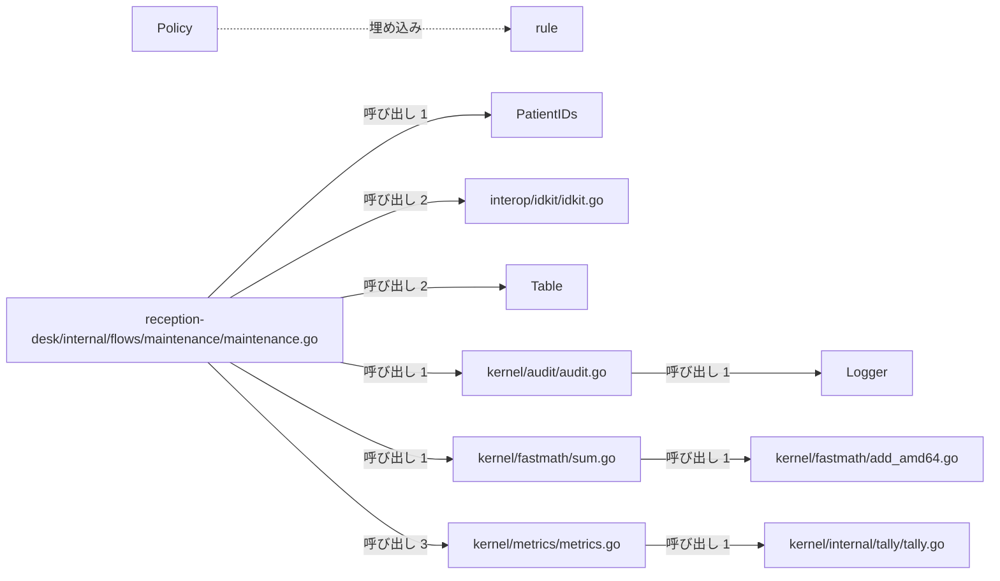
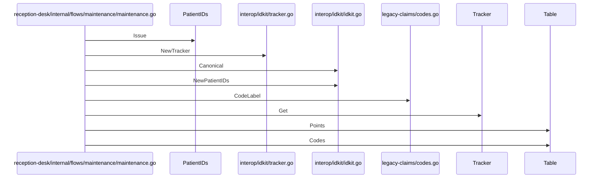

# システム保守とメトリクス収集

## はじめに
本トピックは、医療受付システムにおける保守フローの実行と、それに伴うメトリクス収集、監査ログ記録、ID管理、高速な数値計算などのシステム保守に関連する機能を担っています。このトピックは、Goコードの呼び出し・埋め込み・実装の構造から決定されており、システム保守とデータ出力という上位トピックに属するレベル2のトピックとして位置づけられています。

## アーキテクチャと設計

### コンポーネント関係図

## データフロー

## 主要コンポーネント

本トピックを構成する主要なコンポーネントとその役割は以下の通りです。

*   **`reception-desk/internal/flows/maintenance/maintenance.go`** (ファイルの関数)
    医療受付システムにおける保守フローを実行するためのパッケージです。システムの各種機能（ID管理、料金表、データエクスポート、監査ログなど）を統合的に呼び出し、動作確認や保守情報の出力を行います。主な関数として `Run` を持ちます。
*   **`kernel/metrics/metrics.go`** (ファイルの関数)
    システムのメトリクス収集や時間計測のためのユーティリティ関数を提供します。`go:linkname` ディレクティブを使用することで、内部パッケージやGoランタイムの未公開関数とリンクし、カウンタの更新や高精度な時間取得を実現します。主な関数・メソッドは `Count`, `Elapsed`, `Started`, `bump`, `nanotime` です。
*   **`kernel/audit/audit.go`** (ファイルの関数)
    システム内の監査ログを記録するための共通インターフェース、その具体的なコンソール出力用の実装、およびログ記録を実行するためのヘルパー関数を提供します。これにより、ログの出力先を抽象化し、統一されたフォーマットで監査イベントを記録します。主な関数は `Record` です。
*   **`kernel/fastmath/sum.go`** (ファイルの関数)
    高速な数値計算を行うためのユーティリティ関数を提供します。与えられたポイントのスライスを順次加算し、その総和を効率的に計算します。主な関数は `Total` です。
*   **`Policy`** (struct)
    基本ルール（`rule`）を埋め込み、特定の病棟（Ward）情報を保持する公開用のポリシー構造体です。主なメソッドは `Policy.Level` です。
*   **`rule`** (struct)
    エスカレーションの基本ルールを定義するためのパッケージ内限定の構造体です。主なメソッドは `rule.Level` です。
*   **`interop/idkit/idkit.go`** (ファイルの関数)
    医療システム等における患者IDの生成や正規化を行うためのユーティリティを提供します。サードパーティの `uuidlite` パッケージを利用して、シード値に基づいた一意のIDシーケンスを管理し、特定のフォーマット（"P-" 接頭辞付き）の患者IDを発行する機能や、生のID文字列を正規化された形式に変換する機能を提供します。主な関数は `Canonical`, `NewPatientIDs` です。
*   **`Table`** (struct)
    解析された診療報酬点数表のデータを保持し、各コードの点数情報を管理する構造体です。主なメソッドは `Table.Codes`, `Table.Points` です。
*   **`Logger`** (interface)
    監査ログを出力するための抽象的なインターフェースを定義します。主なメソッドは `Logger.Printf` です。
*   **`kernel/internal/tally/tally.go`** (ファイルの関数)
    アプリケーション内の各種カウンターの合計値をメモリ上で管理するための内部パッケージです。マップを使用してカウンター名ごとの数値を保持し、値をインクリメントする機能を提供します。主にメトリクス収集などの用途で、カウント値の更新と現在の合計値の取得を行うために使用されます。主な関数は `bump` です。
*   **`PatientIDs`** (struct)
    `uuidlite` のシーケンスを保持し、一連の患者IDを生成・管理するための構造体です。主なメソッドは `PatientIDs.Issue` です。
*   **`interop/idkit/tracker.go`** (ファイルの関数)
    負荷情報を追跡するための `Tracker` 構造体とその関連機能を提供します。サードパーティの `uuidlite.Sequence` を埋め込むことで、識別やシーケンス管理の機能を持たせつつ、負荷データの保持と取得を可能にしています。主な関数は `NewTracker` です。
*   **`legacy-claims/codes.go`** (ファイルの関数)
    レセプト（診療報酬明細書）に関するコードの正規化や、コードに対応するラベル文字列の生成を行うユーティリティ関数を提供するファイルです。レガシーな請求処理において、コード情報の整形や表示用のラベル作成を支援します。主な関数は `CodeLabel`, `normalizeCode` です。
*   **`kernel/fastmath/add_amd64.go`** (ファイルの関数)
    AMD64アーキテクチャ向けに最適化された高速な数値加算処理を提供するGoのソースコードです。アセンブリ言語などで実装された実体に対するGo言語側の関数宣言を定義しています。主な関数は `AddPoints` です。
*   **`Tracker`** (struct)
    `uuidlite.Sequence` を埋め込み、負荷（load）を表す浮動小数点数データを保持する構造体です。主なメソッドは `Tracker.Get` です。
*   **`kernel/escalation/escalation.go`** (ファイルの関数)
    システム内におけるエスカレーションのルールやポリシーを定義し、それらを評価するための機能を提供します。病棟情報とエスカレーションレベルを組み合わせて、評価結果を文字列として出力する役割を持ちます。主な関数は `Evaluate` です。
*   **`billing/tariff/tariff.go`** (ファイルの関数)
    医療費請求における診療報酬点数表（タリフ）を管理するためのパッケージです。埋め込まれたYAML形式のテキストデータから点数表をロードし、各診療コードに対応する点数の検索やコード一覧の取得機能を提供します。主な関数は `Load` です。
*   **`legacy-claims/codes_gen.go`** (ファイルの関数)
    生成コード（rezeptgen）を提供するファイルです。主な関数は `KnownCodes`, `LookupCode` です。
*   **`wardLock`** (struct)
    病棟のベッド数を安全に操作するために、排他制御用のミューテックスとベッド数を保持する構造体です。
*   **`kernel/escalation/escalation_test.go`** (ファイルの関数)
    `escalation` パッケージにおけるポリシー評価機能の動作を検証するためのテストコードです。テスト用の `Policy` 構造体に `Level` メソッドを定義し、 `Evaluate` 関数の挙動が期待通りであるかを検証します。主な関数は `TestEvaluate` です。

## 依存関係

本トピックは、他トピックと以下のような依存関係（呼び出し・埋め込み・実装）を持っています。

### 依存先トピック
*   **データ出力とアーカイブ** (呼び出し数: 3, 重み: 2.585)
    *   例: `Run` → `ArchiveIfAny`, `Run` → `ExportAll`
*   **請求と返金の記録** (呼び出し数: 1, 重み: 1.0)
    *   例: `Run` → `KindOf`
*   **コード情報のルックアップ** (呼び出し数: 1, 重み: 1.0)
    *   例: `Run` → `Resolve`
*   **実行プラットフォーム情報** (呼び出し数: 1, 重み: 1.0)
    *   例: `Run` → `Describe`

### 依存元トピック
*   **テキストレポートの整形出力** (呼び出し数: 1, 重み: 1.0)
    *   例: `Run` → `Run`
*   **管理コンソールと月報作成** (呼び出し数: 0, 重み: 0.5)

## 構造的根拠

本トピックの構成メンバーは、Goコードにおける呼び出し、構造体の埋め込み、およびインターフェースの実装構造に基づいて決定されました。

### 規模と指標
*   **規模**: 型・疑似型 20個、ファイル 13個（うち `attached-file` 3個、`attached-generated` 1個、`attached-test` 1個、`primary` 15個）
*   **凝集度**: 0.098039
*   **コンダクタンス**: 0.163155

### ハブと入口
*   **ハブ**: `reception-desk/internal/flows/maintenance/maintenance.go` がトピック内の中心（ハブ）として機能しており、他から1回呼ばれる一方で、トピック内外のコンポーネントを21回呼び出しています。
*   **入口**: 他トピック（「テキストレポートの整形出力」）から唯一呼び出されるメンバーとして、`reception-desk/internal/flows/maintenance/maintenance.go` が定義されています。

### トピック内の主な呼び出し関係
トピック内における主要な呼び出しの構成は以下の通りです。

*   `reception-desk/internal/flows/maintenance/maintenance.go` から `kernel/metrics/metrics.go` への呼び出し（メソッド対 3、例: `Run` → `Elapsed`, `Run` → `Started`, `Run` → `Count`）
*   `reception-desk/internal/flows/maintenance/maintenance.go` から `interop/idkit/idkit.go` への呼び出し（メソッド対 2、例: `Run` → `Canonical`, `Run` → `NewPatientIDs`）
*   `reception-desk/internal/flows/maintenance/maintenance.go` から `Table` への呼び出し（メソッド対 2、例: `Run` → `Table.Points`, `Run` → `Table.Codes`）
*   `reception-desk/internal/flows/maintenance/maintenance.go` から `kernel/audit/audit.go` への呼び出し（メソッド対 1、例: `Run` → `Record`）
*   `reception-desk/internal/flows/maintenance/maintenance.go` から `kernel/fastmath/sum.go` への呼び出し（メソッド対 1、例: `Run` → `Total`）
*   `reception-desk/internal/flows/maintenance/maintenance.go` から `PatientIDs` への呼び出し（メソッド対 1、例: `Run` → `PatientIDs.Issue`）
*   `reception-desk/internal/flows/maintenance/maintenance.go` から `interop/idkit/tracker.go` への呼び出し（メソッド対 1、例: `Run` → `NewTracker`）
*   `reception-desk/internal/flows/maintenance/maintenance.go` から `legacy-claims/codes.go` への呼び出し（メソッド対 1、例: `Run` → `CodeLabel`）
*   `reception-desk/internal/flows/maintenance/maintenance.go` から `Tracker` への呼び出し（メソッド対 1、例: `Run` → `Tracker.Get`）
*   `reception-desk/internal/flows/maintenance/maintenance.go` から `kernel/escalation/escalation.go` への呼び出し（メソッド対 1、例: `Run` → `Evaluate`）

---

<!-- codedoc:grounding -->
## 識別子の確認
本文のコード識別子 119 個のうち 115 個がグラフに存在します。
グラフに見つからない識別子: `uuidlite`, `uuidlite.Sequence`
