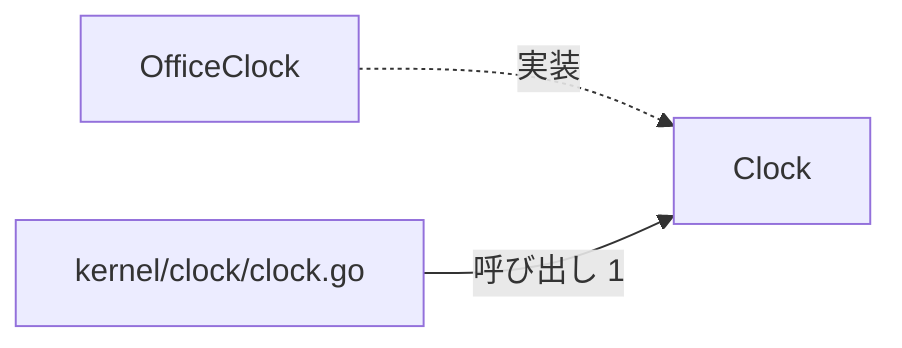
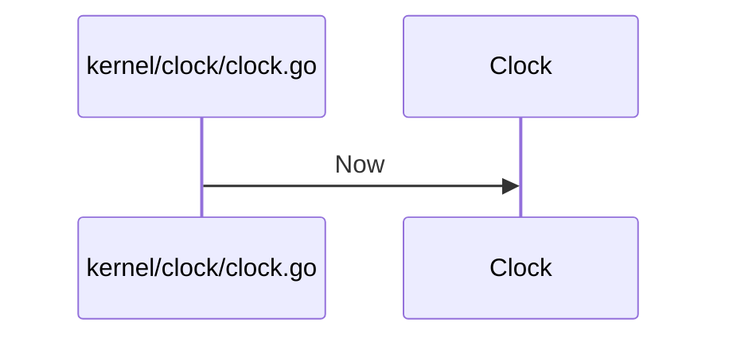

# システム時刻と時計管理

## はじめに
このトピックは、システム内で時刻を扱うための抽象化や具体的な時計の実装、および時刻に関連するユーティリティ関数を提供する役割を担っています。上位トピックである「患者受付と来院通知」の下に位置づけられるレベル 2 のトピックであり、テスト時における時刻のモック化を容易にし、一貫した日付フォーマットやラベル生成を支援します。

## アーキテクチャと設計
### コンポーネント関係図

## データフロー

## 主要コンポーネント
このトピックは、3個のプライマリ（primary）メンバーと4個のテスト用（attached-test）メンバーの、計7個の型・疑似型（4個のファイル）で構成されています。

### プライマリメンバー
- **`kernel/clock/clock.go`** (ファイルの関数)
  - **主な関数・メソッド**: `Label`, `Stamp`, `normalize`
  - **役割**: システム内で時刻を扱うための抽象化（`Clock`インターフェース）と、その具体的な実装（`OfficeClock`）、および時刻に関連するユーティリティ関数を提供します。
- **`Clock`** (interface)
  - **主な関数・メソッド**: `Clock.Now`
  - **役割**: 現在時刻を取得するための抽象的なインターフェースを定義します。本トピックのハブとして機能します。
- **`OfficeClock`** (struct)
  - **主な関数・メソッド**: `OfficeClock.Now`
  - **役割**: 特定の固定された日付を保持し、`Clock` インターフェースを実装する構造体です。

### テスト用メンバー (attached-test)
- **`fakeClock`** (struct)
  - **主な関数・メソッド**: `fakeClock.Now`
  - **役割**: `Clock`インターフェースを満たすために定義された、テスト用の偽の時計構造体です。
- **`kernel/clock/clock_test.go`** (ファイルの関数)
  - **主な関数・メソッド**: `TestNormalize`, `TestStamp`
  - **役割**: clockパッケージの機能を検証するためのテストコードです。テスト用のモック（`fakeClock`）を定義し、日付スタンプの生成機能や文字列の正規化処理が正しく動作することを確認します。
- **`kernel/clock/clock_ext_test.go`** (ファイルの関数)
  - **主な関数・メソッド**: `TestExported`, `TestLabel`
  - **役割**: clock パッケージの外部テスト（clock_test パッケージ）の実装です。パッケージの公開APIである Normalize、NormalizeHook、および Label 関数の動作が期待通りに機能するかを検証します。
- **`kernel/clock/export_test.go`** (ファイルの関数)
  - **主な関数・メソッド**: `Normalize`
  - **役割**: clockパッケージの非公開（小文字開始）の関数や変数を、外部のテストパッケージからアクセスできるようにエクスポートするためのテスト用ファイルです。テストコードから内部ロジックを直接検証できるように仲介します。

## 依存関係
このトピックは、外部のトピックから以下の依存関係を持っています。

- **依存元トピック**: 「患者情報と来院記録」
  - 「患者情報と来院記録」トピックから、本トピックの入口である `kernel/clock/clock.go` が呼び出されます（呼び出し数: 1、重み: 1.0）。
  - 呼び出しの具体例として、`Visit.Dated` から `Stamp` への呼び出しがあります。

## 構造的根拠
このトピックのメンバーは、Go コードの呼び出し・埋め込み・実装の構造から決定されました。主な根拠は以下の通りです。

- **規模**: 型・疑似型 7 個、ファイル 4 個（attached-test 4、primary 3）
- **ハブ**: `Clock`（トピック内 PageRank 上位、呼ばれる数: 1、呼ぶ数: 0）
- **指標**: 凝集度 0.666667、コンダクタンス 0.25
- **トピック内の主な呼び出し**: `kernel/clock/clock.go` から `Clock` への呼び出し（メソッド対 1、例: `Stamp` → `Clock.Now`）
- **実装関係**: `OfficeClock` 構造体が `Clock` インターフェースを実装しています。

---

<!-- codedoc:grounding -->
## 識別子の確認
本文のコード識別子 33 個のうち 33 個がグラフに存在します。
