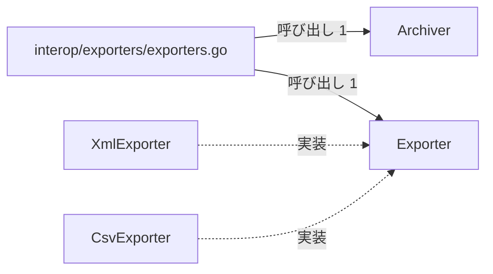
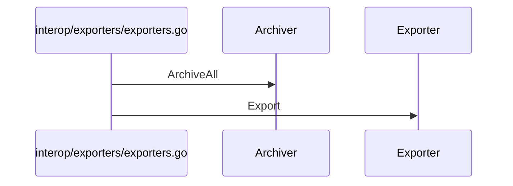

# データ出力とアーカイブ

## はじめに
本トピックは、システムにおけるデータの出力（エクスポート）およびアーカイブ処理を担当します。アプリケーション内では「システム保守とデータ出力」という上位トピックに属するレベル 2 のトピックとして位置づけられています。

このトピックは、データを異なるフォーマットで出力するためのインターフェースと具体的な実装（CSVおよびXML）、およびデータのアーカイブ処理を抽象化するインターフェースとそれを安全に実行するためのユーティリティ関数を提供します。規模は型・疑似型 5 個、ファイル 1 個（すべて primary）で構成され、ハブとして `Exporter` が機能しています。凝集度は 0.4、コンダクタンスは 0.301104 です。

## アーキテクチャと設計

### コンポーネント関係図

## データフロー

## 主要コンポーネント

本トピックを構成する主要なメンバー（型およびファイルの関数）は以下の通りです。

*   **`interop/exporters/exporters.go`** (ファイルの関数)
    *   **主な関数・メソッド**: `ArchiveIfAny`, `ExportAll`
    *   **役割**: データを異なるフォーマットで出力するためのインターフェースと、その具体的な実装（CSVおよびXML）を提供します。また、データのアーカイブ処理を抽象化するインターフェースと、それを安全に実行するためのユーティリティ関数も定義しています。
*   **`Exporter`** (interface)
    *   **主な関数・メソッド**: `Exporter.Export`
    *   **役割**: データを特定のフォーマットに変換して出力するための共通インターフェースです。
*   **`CsvExporter`** (struct)
    *   **主な関数・メソッド**: `CsvExporter.Export`
    *   **役割**: データをCSV形式で出力するための構造体です。
*   **`Archiver`** (interface)
    *   **主な関数・メソッド**: `Archiver.ArchiveAll`
    *   **役割**: 指定された年のデータをアーカイブするためのインターフェースです。
*   **`XmlExporter`** (struct)
    *   **主な関数・メソッド**: `XmlExporter.Export`
    *   **役割**: データをXML形式で出力するための構造体で、ルート要素名を保持します。

## 依存関係

本トピックは、外部のトピックである「システム保守とメトリクス収集」から依存されています。

*   **依存元**: `システム保守とメトリクス収集`（呼び出し数: 3、重み: 2.585）
    *   呼び出し例: `Run` → `ArchiveIfAny`、`Run` → `ExportAll`
*   **入口メンバー**（他トピックから呼び出されるメンバー）:
    *   `interop/exporters/exporters.go`（「システム保守とメトリクス収集」から 2 回呼び出し）
    *   `CsvExporter`（「システム保守とメトリクス収集」から 1 回呼び出し）

## 構造的根拠

本トピックのメンバーおよび範囲は、Go コードにおける呼び出し、埋め込み、および実装の構造解析に基づいて決定されました。

主な構造的根拠は以下の通りです。

*   **ハブの存在**: `Exporter` がトピック内のハブ（PageRank 上位）として機能しています。
*   **トピック内の主な呼び出し関係**:
    *   `interop/exporters/exporters.go` から `Exporter` への呼び出し（メソッド対 1、例: `ExportAll` → `Exporter.Export`）
    *   `interop/exporters/exporters.go` から `Archiver` への呼び出し（メソッド対 1、例: `ArchiveIfAny` → `Archiver.ArchiveAll`）
*   **実装関係**:
    *   `XmlExporter` は `Exporter` インターフェースを実装しています。
    *   `CsvExporter` は `Exporter` インターフェースを実装しています。

---

<!-- codedoc:grounding -->
## 識別子の確認
本文のコード識別子 31 個のうち 31 個がグラフに存在します。
