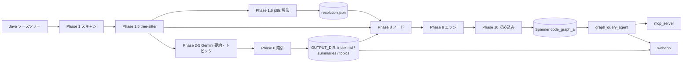

# アーキテクチャ

CodeDoc が何からできていて、ソースコードが日本語 Wiki と Spanner のコードグラフになるまでにどう流れるかを説明します。
導入・設定・CLI・運用は [../README.md](../README.md)、Phase 1.6 の解決アルゴリズムは [LSP_RESOLUTION.md](LSP_RESOLUTION.md)、Spanner のテーブルと ID 規則は [GRAPH_SCHEMA.md](GRAPH_SCHEMA.md)、複数アーティファクトの識別は [CROSS_PROJECT.md](CROSS_PROJECT.md) に譲ります。

## 解決したい問題

大きな Java リポジトリを初めて読む人が欲しいのは 2 種類の情報です。「このモジュールは何をしているか」という説明と、「このメソッドを呼んでいるのは誰か」「このクラスは何を継承しているか」という構造の事実です。

LLM に書かせた Wiki だけでは後者に答えられません。要約は実行のたびに揺れ、同名のメソッドやオーバーロードを区別できず、根拠を遡れません。grep だけでも足りません。`calculate` という名前は複数のクラスに複数のオーバーロードとして存在し、`import` 文脈を知らなければ `new Logger()` がどの `Logger` かは決まりません。

そこで出力を 2 つに分けます。

| 出力 | 作り方 | 性質 |
|---|---|---|
| 日本語 Wiki (ファイル要約・ディレクトリ要約・モジュール文書・索引) | Gemini | 読みやすい。非決定的 |
| コードグラフ (Files / Classes / Methods / Modules / Directories とエッジ) | tree-sitter + jdtls + 決定的 ID。Modules と FileBelongsToModule だけは Gemini のトピック | 正確。Modules を除き再実行しても同じ |

グラフのノードには要約も列として載るので、エージェントは 1 回の GQL で構造と説明の両方を引けます。

## 二本立ての設計

パイプラインは「ドキュメント系」と「グラフ系」に分かれています。

- ドキュメント系 (Phase 1〜6) は Gemini を呼び、`OUTPUT_DIR` に Markdown と JSON を書きます。
- グラフ系 (Phase 1.6, 8〜10) は LLM を呼びません。tree-sitter と jdtls の結果に Phase 2〜5 の要約とトピックを添えて Spanner に行を書き、最後に埋め込みを付けます。

分けている理由は 3 つです。構造を表すノード ID とエッジを LLM の出力に依存させない (決定性。Modules と FileBelongsToModule だけは例外)。LLM の失敗やレート制限がグラフの正しさに影響しない (独立性)。Wiki だけ、グラフだけを個別に再実行できる (コストとレジューム)。両系をつなぐのは `PipelineData` 1 つで、CLI をまたぐときは pickle で受け渡します。

本パイプラインは 2026 年 8 月に C# 版から Java 版へ移植されました。旧言語向けの経路はコードに残っていません。

## 構成要素

| モジュール | 役割 | 入力 | 出力 |
|---|---|---|---|
| `graph_generator/__main__.py` | CLI。サブコマンドを実行モードに振り分ける | 引数 | 標準出力、`timing_report.json`、`pipeline_data.pkl` |
| `graph_generator/config.py` | ルート `.env` を読み、既定値を与える | `.env` | 定数 |
| `graph_generator/pipeline.py` | `PipelineData`、全フェーズ関数、3 つの実行モード、スロットル、チェックポイント | 対象ディレクトリ | `OUTPUT_DIR` と Spanner |
| `graph_generator/treesitter_parser.py` | Phase 1.5。tree-sitter-java で型・メソッド・import・継承句を抽出。大きなファイルの構造チャンク分割 | `.java` | エンティティ辞書 |
| `graph_generator/java_decls.py` | Phase 1.6 の下請け。宣言インデックス (SYMBOL_GRAMMAR)、呼び出しサイト抽出、UTF-16 桁変換 | `.java`、逆コンパイルされたソース | `DeclIndex`、`CallSite` |
| `graph_generator/lsp_client.py` | Phase 1.6 の下請け。stdio 上の JSON-RPC 2.0 クライアント | 起動コマンド | LSP 要求・通知 |
| `graph_generator/resolution.py` | Phase 1.6 本体。Maven プロジェクト発見、jdtls セッション、サイト解決、DI とインターフェース実装の付け替え | `.java`、`pom.xml`、jdtls | `resolution.json` |
| `graph_generator/prompts.py` | Phase 2〜5 のプロンプト (日本語) | なし | 文字列 |
| `graph_generator/spanner_setup.py` | テーブルとプロパティグラフの DDL、作成・削除・確認 | 設定 | Spanner のスキーマ |
| `graph_generator/scorer.py` | `score` コマンド。`resolution.json` と正解マニフェストの照合 | JSON 2 つ | 判定と終了コード |
| `graph_query_agent/` | ADK エージェント。`root_agent` が `graph_agent` に委譲し、`run_gql_query` で Spanner を読む | 自然言語 | 日本語の回答 |
| `mcp_server/` | FastMCP サーバー。`ask_codebase` などのツールで `graph_query_agent` を公開 | MCP 要求 | ツール応答 |
| `webapp/` | FastAPI + React。Wiki の閲覧と `graph_query_agent` へのチャット | HTTP | HTML / JSON / SSE |



## フェーズ

| Phase | 関数 (`pipeline.py`) | 主な入力 | 主な出力 | 外部依存 |
|---|---|---|---|---|
| 1 | `phase1_scan` | 対象ディレクトリ | `file_list` / `dir_tree` / `dir_queue`。続けて `_load_checkpoint` | なし |
| 1.5 | `phase1b_treesitter_entities` | `.java` | `extracted_entities` → `entities.json` | なし |
| 1.6 | `phase1c_semantic_resolution` → `resolution.run_resolution` | `.java`、`pom.xml`、ローカル Maven リポジトリの jar | `resolution` → `resolution.json` | jdtls |
| 2 | `phase2_file_summaries` | ソース全文 | `file_summaries` → `summaries/files/*.md` | Gemini |
| 3 | `phase3_dir_summaries` | 子ファイル・子ディレクトリの要約 (各 1,500 字) | `dir_summaries` → `summaries/dirs/*.md` | Gemini |
| 4 | `phase4_topics` | ファイル要約 (各 300 字) | `topics` → `topics/topic_tree.json` | Gemini |
| 5 | `phase5_topic_summaries` | 関連ファイルのソース (各 15,000 字) と要約 (各 500 字) | `topic_summaries` → `topics/*.md` | Gemini |
| 6 | `phase6_index` | Phase 2〜5 の結果 | `index.md` / `reasoning_index.json` / `metadata.json` | なし |
| 8 | `phase8_write_nodes` | エンティティ、宣言、要約 | 5 ノードテーブル、ID マップ | Spanner |
| 9 | `phase9_write_edges` | 解決済みサイト、エンティティ、ID マップ | 7 エッジテーブル | Spanner |
| 10 | `phase10_generate_embeddings` | 要約、宣言 | Files / Classes / Modules の `embedding` | Vertex AI (`text-embedding-005`)、Spanner |

Phase 7 は欠番です。かつて LLM でエンティティを抽出していた番号で、Phase 1.5 の tree-sitter に置き換わりました。

**Phase 1〜1.5 (ローカル)。** `os.walk` で `SOURCE_EXTENSIONS` のファイルを集め、`SKIP_DIRS` と `.` 始まりのディレクトリを枝刈りします。tree-sitter は `.java` だけを解析し、型 (class / interface / enum / record / annotation。入れ子型も独立に)、メソッドとコンストラクタ (修飾子・戻り型・仮引数文字列・本体内の呼び出し名)、`import`、`package`、`extends` / `implements` を構文どおりに取り出します。行番号や引数型は持ちません。ここで取るのは表示用メタデータ、フォールバック時のノード素材、FileDependsOn と ClassInherits の入力です。

**Phase 1.6 (jdtls)。** グラフ系の先頭で毎回実行され、`.java` の呼び出しサイトをコンパイラ意味論で宣言に束縛します。結果はクラス・メソッドの識別子 (`artifact` + `fq_symbol`) と MethodCalls の唯一の情報源であり、ClassInherits は tree-sitter の基底名をこの型宣言に照合して作ります。詳細は [LSP_RESOLUTION.md](LSP_RESOLUTION.md)。

**Phase 2〜6 (Gemini)。** ファイル要約は 1 ファイル 1 呼び出しで、入力上限超過 (400 INVALID_ARGUMENT) のときだけ tree-sitter の構造境界でチャンク分割し map-reduce します。ディレクトリ要約は深い階層から順に、同じ深さを並行して生成します。トピック抽出はトップレベルディレクトリごとに fan-out し、合計 15 件以下なら名前で重複排除、16 件以上なら統合プロンプトで 3〜15 件にまとめます。Phase 6 は LLM を呼ばず、索引と `metadata.json` を書き、要約を再保存します。

**Phase 8〜10 (Spanner)。** ノードは `insert_or_update` で書きます。Phase 1.6 で解決されたファイルのクラス・メソッドは宣言一覧から、それ以外は tree-sitter のエンティティから行を作ります。エッジ 7 種は並行に書きます。埋め込みは Files (ファイル要約)、Classes (シンボル + メンバー一覧 + ファイル要約の冒頭)、Modules (トピック要約) にだけ付きます。行の意味と ID は [GRAPH_SCHEMA.md](GRAPH_SCHEMA.md)。

## 実行モードと PipelineData

`pipeline.py` には 3 つの入口があります。

| 関数 | フェーズ | 呼ぶ CLI |
|---|---|---|
| `run_docs_pipeline(target_dir)` | 1, 1.5, 2〜6 | `generate wiki`、`analyze` の前半 |
| `run_graph_pipeline(data)` | 1.6, 8〜10 (チェックポイント付き) | `generate graph` / `upload graph`、`analyze` の後半 |
| `run_pipeline(target_dir)` | 上の 2 つを続けて実行 | (CLI からは未使用) |

全フェーズは 1 つの `PipelineData` を直接書き換えます。

```python
@dataclass
class PipelineData:
    target_dir: str
    file_list: list[str]; dir_tree: dict; dir_queue: list[str]    # Phase 1
    extracted_entities: dict[str, Any]                             # Phase 1.5
    resolution: dict | None                                        # Phase 1.6 (resolution.json と同内容)
    file_summaries: dict; dir_summaries: dict                      # Phase 2, 3
    topics: list[dict]; topic_summaries: dict                      # Phase 4, 5
    file_id_map, class_id_map, method_id_map, module_id_map, dir_id_map   # Phase 8
    timings: dict[str, float]
```

`generate wiki` は終了時に `PipelineData` 全体を `pipeline_data.pkl` に保存します。`generate graph` はそれを読みますが、保存されている `target_dir` が今回の対象と違えば捨てて Phase 1 + 1.5 からやり直し、`OUTPUT_DIR` にある要約とトピックを読み込みます。`analyze` は `run_docs_pipeline` の後に pkl を読み戻して `run_graph_pipeline` を呼びます。

Phase 1.6 の `run_resolution` は自前の `asyncio.run` を持ちます。CLI の各経路ではイベントループが止まった後に呼ばれるのでそのまま実行され、`run_pipeline` のようにループが動いている経路だけ `_call_blocking` がワーカースレッドに逃がします。

## チェックポイントとレジュームの設計

原則は「生成できた単位はすぐディスクに書き、次回は Phase 1 で読み戻す」です。

| 対象 | 保存タイミング | 保存先 | 読み戻し |
|---|---|---|---|
| ファイル要約 | 1 件生成するごと | `summaries/files/*.md` | Phase 1 末尾の `_load_checkpoint`。空ファイルは無視 (再生成対象) |
| ディレクトリ要約 | 1 件ごと | `summaries/dirs/*.md` | 同上 |
| トピック一覧 | Phase 4 終了時 | `topics/topic_tree.json` | 同上。リストでなければ捨てる |
| トピック要約 | 1 件ごと | `topics/*.md` | 同上 |
| エンティティ | Phase 1.5 終了時 | `entities.json` | 同上 |
| 解決結果 | Phase 1.6 終了時 | `resolution.json` | 読み戻さない。Phase 1.6 は毎回実行し、前回との比較にだけ使う |
| グラフの進み | Phase 8 / 9 / 10 それぞれの終了時 | `graph_checkpoint.json` (`completed_phase` + 5 つの ID マップ) | `run_graph_pipeline` 冒頭。完了済みフェーズを飛ばす |

無効化の規則:

- Phase 1.6 は前回の `resolution.json` と `declarations` / `sites` を比較し、違っていれば (前回が無い場合も) `graph_checkpoint.json` を削除します。古い ID マップで不整合なエッジを書かないためです。
- `graph_checkpoint.json` は書き込み先 DB を記録しません。DB を切り替えたら手で消す必要があります (手順は README)。
- 失敗した要約はディスクに書かれないので、次回も自動的に再試行されます。

## 並行処理・レート制限・再試行

- Gemini 呼び出しは `asyncio.Semaphore(GEMINI_CONCURRENCY)` で制限し、Phase 2 は 500 件ずつのバッチで `gather` します。
- 1 回の呼び出し `_generate` は最大 5 試行。`429` / `rate` / `quota` / `resource` を含むエラーだけ再試行し、待ち時間は `min(1 + 0.5n, 3)` 秒 + ジッターです。空応答も失敗として再試行し、最後まで空なら `RuntimeError` (`consider raising MAX_OUTPUT_TOKENS`) を投げます。
- 全ワーカーが 1 つの `_AdaptiveThrottle` を共有します。レート制限で遅延 +0.5 秒、成功で −0.1 秒 (上限 5 秒)。直近 50 回の失敗率が 80% 以上ならサーキットブレーカーが開き、60 秒止めてから 1 回試します。Phase 2〜5 の開始時にリセットします。
- Phase 2 / 3 / 5 は失敗した項目を最大 3 ラウンド再試行し、ラウンド前に 30 / 90 / 180 秒待ちます。失敗は `error_log.txt` に追記します。
- Phase 4 の JSON は「フェンス除去 → 括弧対応で抽出 → LLM に修復させる」の 3 段で読みます。
- Phase 1.6 は jdtls セッションを `JAVA_LSP_CONCURRENCY` 本まで並行させます。起動順、`LspTimeout` の再試行、要求単位の縮退の規則は [LSP_RESOLUTION.md](LSP_RESOLUTION.md)。
- Spanner の `_batch_insert` は 5,000 行ずつ書きます。`Aborted` / `ServiceUnavailable` / `DeadlineExceeded` に対しては最大 5 試行で、待ち時間は `2^n` 秒 + ジッターです。Phase 9 は 7 エッジ種を `ThreadPoolExecutor(7)` で同時に書きます。
- Phase 10 は 20 件ずつのバッチを `ThreadPoolExecutor(EMBED_CONCURRENCY)` で回します。429 に対しては最大 5 試行で、待ち時間は `2^n × 2` 秒 + ジッターです。他のエラーは即座に失敗とし、失敗 ID は `error_log.txt` に残ります。

## クエリスタック

```
質問 (日本語)
  → root_agent   (graph_query_agent/agent.py。オーケストレーター)
    → graph_agent   (サブエージェント。GQL を書く)
      → run_gql_query(gql)   (Spanner の snapshot で読み取り専用に実行)
        → Cloud Spanner   (GRAPH code_graph_a MATCH ...)
```

`run_gql_query` は結果を最大 50 行、各値 500 字に切って返します。グラフ名はエージェント側の `GRAPH_NAME` で決まります。ノードの `summary` 列に要約が入っているので、説明系の質問も同じ経路で答えます。

その上に 2 つの入口があります。

- **webapp** (`webapp/main.py`)。FastAPI が ADK の `Runner` と `InMemorySessionService` を持ちます。`POST /api/chat` は最終応答だけを、`POST /api/chat/stream` は SSE で `session` / `delta` / `text` / `done` イベントを返します。`GET /api/docs/*` は `OUTPUT_DIR` の Markdown を HTML にして返します。`frontend/dist` があれば SPA を `/` で配信します。
- **mcp_server** (`mcp_server/server.py`)。FastMCP の streamable-http サーバーで、同じ `Runner` を包みます。ツールは `ask_codebase(question, session_id?)` と `list_sessions` / `get_session_history` / `delete_session` / `rename_session` です。セッションはプロセス内メモリにだけあります。

`adk run graph_query_agent` で端末から直接も使えます。3 者とも同じルート `.env` を読みます。

## 主な設計判断

- **誤エッジゼロを網羅率より優先する。** 解決できなかった呼び出しはエッジにしない。jdtls が使えない範囲はノードだけを作る。呼び出し先を名前で推測する経路は存在しない。
- **識別子は決定的。** クラス・メソッドの ID は `artifact` + 引数型付き完全修飾シンボルの SHA-256 で、パスや実行順に依存しない。再実行は上書きになる。
- **LLM の仕事は要約とモジュール分類だけ。** 構造 (どこに何があるか、誰が誰を呼ぶか) は tree-sitter と jdtls が決める。
- **Phase 1.6 は毎回走る。** チェックポイントで飛ばさず、結果が変われば下流を作り直す。古い解決結果でグラフを書かない。
- **出力は日本語。** プロンプト、エージェントの指示、パイプラインのガイダンスはすべて日本語。
- **設定は 1 つの `.env`、出力は 1 つの `OUTPUT_DIR`。** パイプライン・エージェント・webapp・MCP が同じ値を読む。
- **対象は Java のみ。** `.jsp` / `.kt` / `.groovy` / `.scala` / `.gradle` は要約と Files ノードにはなるが、Classes / Methods にはならない。
