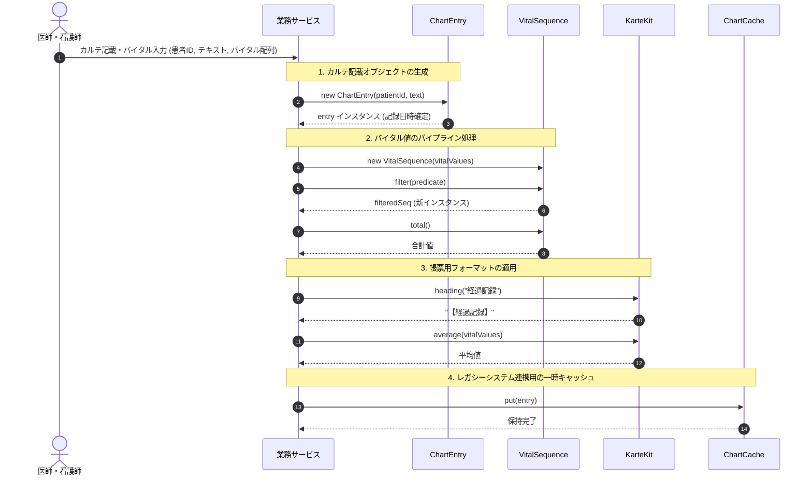

# カルテ・バイタルデータ管理

## はじめに
「カルテ・バイタルデータ管理」モジュールは、医療情報システムにおけるカルテの診療記録データ、バイタルサイン情報の処理・帳票整形、長期保管、およびレガシーレセコン（レセプトコンピュータ）連携用の一時キャッシュを担う基盤コンポーネント群です。

本モジュールは、以下の3つの主要領域をカバーしています。
- **診療記録ドメイン（`iryo.domain`）**: カルテの記載データ（`ChartEntry`）の不変表現およびカルテ保管庫（`ChartArchive`）の保守管理。
- **帳票・レポート処理（`iryo.reporting`）**: カルテ帳票のタイトル整形・統計ユーティリティ（`KarteKit`）、および時系列バイタルデータのフィルタリング・変換・集計パイプライン（`VitalSequence`）。
- **レガシー連携（`iryo.legacy.claims`）**: 旧請求処理系との値受け渡しを目的とした単一値ホルダー（`ChartCache`）。

---

## アーキテクチャと設計
本モジュールでは、医療データの完全性・信頼性の維持と、保守性の向上を目的として、以下の設計パターンおよび原則を採用しています。

1. **不変オブジェクト（Immutable Object）パターン**
   - `ChartEntry` はすべてのフィールドが `final` で宣言され、生成後に状態が変化しない設計となっており、並行アクセス時におけるスレッドセーフ性とデータの改ざん防止を担保しています。
   - `VitalSequence` は `filter` や `map` による操作を行うたびに新しいインスタンスを生成して返却することで、元のバイタルデータコレクションを破壊しないイミュータブルなパイプライン処理を実現しています。

2. **ユーティリティクラス（Utility Class）パターン**
   - `KarteKit` は `final` クラスかつプライベートコンストラクタを持ち、インスタンス化を抑止した純粋関数（副作用のない静的メソッド）のみを提供します。

3. **Value Holder パターン**
   - `ChartCache<T>` は、旧式システム間で任意型の単一データを一時的に保持・共有するためのコンテナとして動作します。

4. **ネストクラスによる凝集度の向上**
   - `ChartArchive` は、保管庫のライフサイクルに関連する処理を `Compactor`（静的ネストクラス：システム全体の独立バッチ）と `Janitor`（インナークラス：特定保管庫インスタンスに紐付くクリーンアップ）に分割してカプセル化しています。

### コンポーネント関係図
```mermaid
classDiagram
    namespace iryo_domain {
        class ChartEntry {
            -int patientId
            -String text
            -LocalDateTime writtenAt
            +ChartEntry()
            +ChartEntry(int patientId, String text)
            +int patientId()
            +String text()
            +LocalDateTime writtenAt()
        }

        class ChartArchive {
        }

        class Compactor {
            +void start()
        }

        class Janitor {
            +void clean()
        }
    }

    namespace iryo_reporting {
        class KarteKit {
            -KarteKit()
            +String heading(String title)$
            +int average(int... values)$
        }

        class VitalSequence {
            -List~Integer~ values
            +VitalSequence(int... values)
            -VitalSequence(List~Integer~ values)
            +VitalSequence filter(Predicate~Integer~ predicate)
            +VitalSequence map(Function~Integer, Integer~ mapper)
            +int total()
        }
    }

    namespace iryo_legacy_claims {
        class ChartCache~T~ {
            -T value
            +T get()
            +void put(T value)
        }
    }

    ChartArchive *-- Janitor : インナークラス
    ChartArchive +-- Compactor : 静的ネストクラス
```

### モジュールコンポーネント
| コンポーネント | パッケージ | 責務 |
|-----------|----------------|----------------|
| **`ChartEntry`** | `iryo.domain` | 患者ごとのカルテ記載1件（患者ID、記載内容、記録日時）を保持する不変エンティティ。 |
| **`ChartArchive`** | `iryo.domain` | カルテの長期保管庫を表現し、保守用ネストコンポーネント（`Compactor`, `Janitor`）を内包する。 |
| **`ChartArchive.Compactor`** | `iryo.domain` | 長期保管庫のアーカイブデータを圧縮する独立ジョブ。 |
| **`ChartArchive.Janitor`** | `iryo.domain` | 特定の保管庫インスタンスに紐付き、保管索引の清掃処理を実行する。 |
| **`KarteKit`** | `iryo.reporting` | 帳票出力用の見出し装飾や数値の平均値算出を提供する静的ユーティリティ。 |
| **`VitalSequence`** | `iryo.reporting` | 一連のバイタル値（血圧、脈拍等）に対するフィルタリング・値変換・合計算出などの連続操作を提供するシーケンス。 |
| **`ChartCache<T>`** | `iryo.legacy.claims` | 旧レセコン請求システムとの連携時に、単一オブジェクトを型安全に一時保管する簡易キャッシュ。 |

---

## データフロー

以下は、患者のカルテ記載およびバイタルサインデータを登録・集計・帳票化する際の標準的なデータフローです。



---

## 主要コンポーネント

### 1. `ChartEntry` (`iryo.domain`)
カルテ記載の最小単位を表すモデルクラスです。
- **特徴**:
  - レコード風アクセサメソッド（`patientId()`, `text()`, `writtenAt()`）を採用。
  - 引数なしコンストラクタ `ChartEntry()` を呼び出した場合、デフォルト値（ID: `0`、テキスト: `"新規記載"`）で初期化されます。
  - インスタンス生成時に `LocalDateTime.now()` により自動で記録日時が確定し、以降変更されません。

### 2. `ChartArchive` (`iryo.domain`)
カルテの長期保存領域を表現するクラスです。
- **`Compactor`**: 静的ネストクラスとして実装されており、外部のインスタンス状態に依存せず `new ChartArchive.Compactor().start()` でアーカイブ圧縮処理を実行できます。
- **`Janitor`**: 非静的インナークラスであり、特定の保管庫インスタンスに結び付いた状態で `archive.new Janitor().clean()` により保管索引をクリーンアップします。

### 3. `VitalSequence` (`iryo.reporting`)
整数値リスト（時系列バイタルデータ等）を関数型スタイルで処理するためのファーストクラスコレクションです。
- **`filter(Predicate<Integer> predicate)`**: 指定条件を満たす値のみを抽出した新しい `VitalSequence` を返します。
- **`map(Function<Integer, Integer> mapper)`**: 各要素に変換処理を適用した新しい `VitalSequence` を返します。
- **`total()`**: コレクション内の全数値を合算した合計値を返却する終端操作です。

### 4. `KarteKit` (`iryo.reporting`)
帳票整形用の静的ヘルパークラスです。
- **`heading(String title)`**: タイトル文字列の前後に墨付き括弧を付与した形式（例: `"【タイトル】"`）を返します。
- **`average(int... values)`**: 可変長引数で渡された整数列の相加平均を四捨五入した整数として算出します。引数が渡されなかった場合は安全に `0` を返却します。

### 5. `ChartCache<T>` (`iryo.legacy.claims`)
ジェネリクスを採用した単一値ホルダーです。
- **`put(T value)` / `get()`**: 単一の値の格納および取得を提供します。旧請求システムなど、ステートフルな値の引き渡しが必要なレガシー境界において使用されます。

---

## 依存関係
本モジュールは、外部フレームワークやサードパーティライブラリへの依存を持たないポータブルな構成となっています。

- **モジュール外部依存**: なし（Java標準APIのみ）
  - `java.time.LocalDateTime`
  - `java.util.List`, `java.util.ArrayList`, `java.util.Arrays`
  - `java.util.function.Predicate`, `java.util.function.Function`
- **パッケージ間依存**:
  - `iryo.domain`、`iryo.reporting`、`iryo.legacy.claims` は相互に独立しており、疎結合な設計となっています。上位のアプリケーションサービス層がこれらのコンポーネントを組み合わせて業務シナリオを実現します。